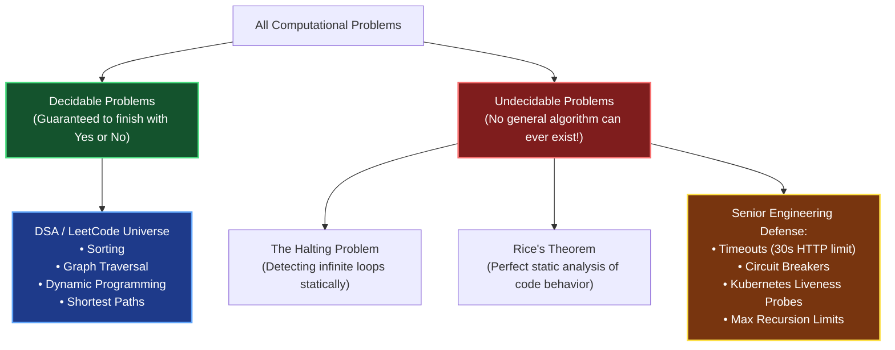

# Chapter 00: Computation & Computability — The Limits of Code

> *"Before asking how fast an algorithm can run, you must answer a more practical question: Can an algorithm solve this at all, and is your code guaranteed to terminate?"*

---

## 💡 1. The Napkin Analogy: The Program-Checking Machine That Broke

Imagine you are a Staff Engineer tasked with building the **Ultimate Automated Code Reviewer**:
- You want to write a program `will_it_halt(code, input_data)` that analyzes any given function and returns `True` if it finishes, or `False` if it enters an infinite loop.
- Can you build this tool? **Mathematically, NO.**

Alan Turing proved in 1936 that no computer program can ever decide whether an arbitrary program will halt or loop forever.

```
Suppose `will_it_halt(func)` exists.
Now write an evil function `paradox()`:

def paradox():
    if will_it_halt(paradox) == True:
        while True: pass  # Loop forever!
    else:
        return            # Halt immediately!

💥 If paradox() halts, will_it_halt() predicted it loops forever (WRONG!)
💥 If paradox() loops forever, will_it_halt() predicted it halts (WRONG!)
```

This is the famous **Halting Problem**. It proves that there are fundamental, mathematical limits to what software can predict about software.

---

## 📊 2. The Visual Whiteboard: Solvable vs. Unsolvable



### Why Rice's Theorem Matters to a Lead Engineer
Rice's Theorem states: **Any non-trivial semantic property of program code is undecidable.**
- "Does this function ever dereference a null pointer?" $\implies$ Undecidable.
- "Does this service have a memory leak?" $\implies$ Undecidable.
- "Is this endpoint vulnerable to SQL injection?" $\implies$ Undecidable.

**The Production Takeaway**: This is why linters (ESLint, SonarQube, Pylint) and security scanners can **never be 100% perfect**. They must choose between **false positives** (warning you about safe code) or **false negatives** (missing real bugs).

---

## 🗣️ 3. The 30-Second Interview Talk Track

### How to Prove Termination in a Live Coding Round
When writing recursive algorithms or complex `while` loops, interviewers look for candidates who proactively prove their code cannot loop forever:

> *"To guarantee termination and prevent infinite loops, our recursive function maintains two strict invariants:*  
> *1. **A definitive base case**: If the array is empty or the node is null, we return immediately.*  
> *2. **Monotonic progress**: At every recursive call, the search space $high - low$ strictly decreases by at least 1. Since the search space is finite and bounded below by 0, the recursion is mathematically guaranteed to terminate."*

### How to Explain Timeouts in Systems Design
> *"Because software cannot statically determine whether a hanging database query or third-party API call will ever terminate, our architecture must assume unreliability. We enforce strict client timeouts, circuit breakers, and dead-letter queues to prevent thread exhaustion."*

---

## 🧠 4. Senior Systems Reality: Accidental Turing Completeness

A system is **Turing-complete** if it can simulate any arbitrary computer program. When systems accidentally become Turing-complete, developers can unintentionally create infinite loops that take down production:

```
┌──────────────────────────────────────┬─────────────────────────────────────────────────────────┐
│ System                               │ How It Accidentally Becomes An Infinite Loop            │
├──────────────────────────────────────┼─────────────────────────────────────────────────────────┤
│ SQL Databases (PostgreSQL / MySQL)   │ `WITH RECURSIVE` CTEs can loop infinitely, pegging CPU. │
│ Regex Engines                        │ Catastrophic Backtracking on expressions like (a+)+$   │
│ TypeScript Type Systems              │ Recursive type definitions can hang the compiler.       │
│ CSS (CSS3 Selectors & Checkboxes)    │ Cellular automata can be simulated entirely in CSS.     │
└──────────────────────────────────────┴─────────────────────────────────────────────────────────┘
```

### The Production Defenses
- **Database CPU Guard**: Always set `statement_timeout = '5000ms'` in Postgres so non-terminating queries are automatically terminated.
- **Regex Timeout**: Avoid nested quantifiers (`(a+)+`), or use linear-time regex engines like Google's `re2`.

---

## 🎯 5. Constraint Triage & FAANG Traps

### Trap 1: The Missing Base-Case Progress
```python
# ❌ TRAP: Infinite loop / Stack Overflow!
def binary_search(nums, low, high, target):
    if low > high:
        return -1
    mid = (low + high) // 2
    if nums[mid] == target:
        return mid
    elif nums[mid] < target:
        # 💥 BUG: Forgot to add +1! If low == mid, range never shrinks!
        return binary_search(nums, mid, high, target)
    else:
        return binary_search(nums, low, mid - 1, target)

# ✅ SENIOR FIX: Always strictly advance bounds
return binary_search(nums, mid + 1, high, target)
```

### Trap 2: Loop Pointer Stagnation
```python
# ❌ TRAP: If nums[left] and nums[right] do not match any branch,
# pointers never move, causing a live-lock infinite loop!
while left < right:
    if nums[left] + nums[right] == target:
        return [left, right]
    elif nums[left] + nums[right] < target:
        left += 1
    # 💥 BUG: Missing `else: right -= 1` branch!
```

---

## 🧭 Navigation
- **Hub**: [🏛️ Back to Foundations README](./README.md)
- **Next**: [Ch 01: The Complexity Zoo](./01_complexity_classes_zoo.md)
