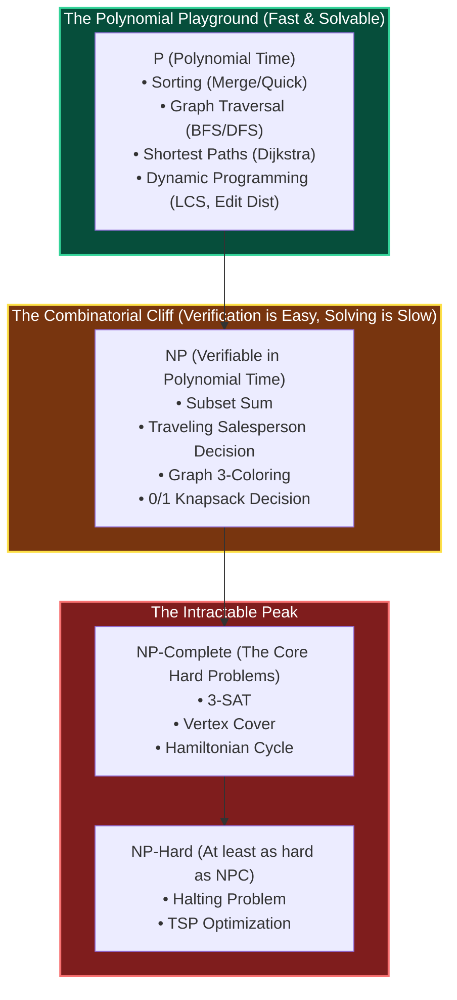

# Chapter 01: The Complexity Zoo — The Hardness Radar (P vs. NP)

> *"In an interview, the worst thing you can do is spend 30 minutes trying to design an $O(N)$ greedy algorithm for a problem that is mathematically NP-hard. Recognize the cliff, and pivot immediately."*

---

## 💡 1. The Napkin Analogy: The Sudoku Puzzle

Imagine sitting at a coffee table with a blank 9x9 Sudoku puzzle:
- **Solving the puzzle from scratch**: Painful trial-and-error, backtracking, checking possibilities. If the grid was $N \times N$, it would take exponential time.
- **Checking a friend's completed solution**: Trivial! You simply scan every row, column, and 3x3 box to confirm numbers 1 through 9 appear without duplicates. It takes **seconds** (polynomial time).

```
┌─────────────────────────────────────────────────────────────────────────────┐
│ 🟢 P (Polynomial Time)    = Easy to SOLVE (Sorting, BFS, Binary Search)      │
│ 🟡 NP (Nondet. Poly Time) = Hard to solve, but Easy to VERIFY (Sudoku)      │
│ 🔴 NP-Complete            = The hardest problems in NP (If one is solved,   │
│                             ALL are solved: P = NP!)                        │
│ 🟣 NP-Hard                = At least as hard as NP-Complete (e.g., Halting)  │
└─────────────────────────────────────────────────────────────────────────────┘
```

---

## 📊 2. The Visual Whiteboard: The Hierarchy of Hardness



### The $P \text{ vs } NP$ Question in One Sentence
Does being able to quickly verify a proof mean we can always quickly discover that proof?  
*(Almost every computer scientist believes $P \ne NP$, meaning hard combinatorial problems truly require exponential search in the worst case).*

---

## 🗣️ 3. The 30-Second Interview Talk Track

When an interviewer asks you to solve a problem that looks suspiciously combinatorial (e.g., finding the optimal subset of tasks or shortest tour):

### The Lead Engineer's Hardness Recognition Script
> *"This problem is structurally isomorphic to the classic **0/1 Knapsack / Subset Sum / Traveling Salesperson** problem, which is known to be **NP-hard**. An exact polynomial-time algorithm does not exist.*  
> 
> *Looking at our constraints, our strategy is clear:*  
> *1. **If $N \le 20$**: We solve it exactly using **Bitmask Dynamic Programming** or **Backtracking with branch-and-bound pruning** in $O(N \cdot 2^N)$ time.*  
> *2. **If the capacity $W \le 10^5$**: We solve it via **Pseudo-Polynomial DP** in $O(N \cdot W)$ time and space.*  
> *3. **If $N \ge 10^5$ and values are unbounded**: An exact solution will timeout; we should discuss a **greedy approximation** or heuristic."*

This response immediately signals to the interviewer that you operate at a Staff/Lead caliber.

---

## 🧠 4. Senior Systems Reality: The "Pseudo-Polynomial" Trap

Many engineers see the classic 0/1 Knapsack DP runtime:

$$O(N \cdot W)$$

Where $N$ is the number of items and $W$ is the knapsack capacity. They say: *"Look! It's $N$ times $W$, that's polynomial time!"*

### Why That is a Dangerous Illusion
In computer science, input size is measured by the **number of bits** required to write the input.
- To represent a number $W = 1,000,000,000$, you only need **30 bits** of input!
- If the runtime is proportional to $W$, the runtime is actually proportional to $2^{\text{bits}}$—which is **exponential**!
- That is why $O(N \cdot W)$ is classified as **Pseudo-Polynomial Time**.

```
Constraint Reality Check:
• If W = 1,000 and N = 100:     N · W = 100,000 operations ➔ Runs in 2 milliseconds (PASS!)
• If W = 10^9 and N = 100:       N · W = 10^11 operations  ➔ Takes 20 minutes (💥 TLE & Out of Memory!)
```

Always check whether your DP table depends on array length ($N$) or numeric magnitude ($W$).

---

## 🎯 5. Constraint Triage & FAANG Traps

### The Top 5 Disguises of NP-Hard Problems on LeetCode

| Disguised LeetCode Problem | Underlying NP-Complete Problem | Constraint Giveaway | Optimal Interview Strategy |
|---|---|---|---|
| **Partition Equal Subset Sum** (LC 416) | Subset Sum | Array sum $\le 20,000$ | 1D Boolean DP array |
| **Shortest Path Visiting All Nodes** (LC 847) | Traveling Salesperson (TSP) | $N \le 12$ | BFS with Bitmask State: `(node, mask)` |
| **Matchsticks to Square** (LC 473) | 4-Partition | $N \le 16$ | Backtracking + Descending Sort Pruning |
| **Word Break II** (LC 140) | Combinatorial Subsets | Sentence len $\le 20$ | DFS + Memoization |
| **Minimum Number of Work Sessions** (LC 1986) | Bin Packing | $N \le 14$ | Bitmask DP: $O(2^N \cdot N)$ |

---

## 🧭 Navigation
- **Previous**: [Ch 00: Computation & Computability](./00_computation_and_computability.md)
- **Next**: [Ch 02: Asymptotic Analysis](./02_asymptotic_analysis_deep.md)
