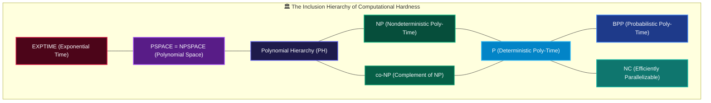
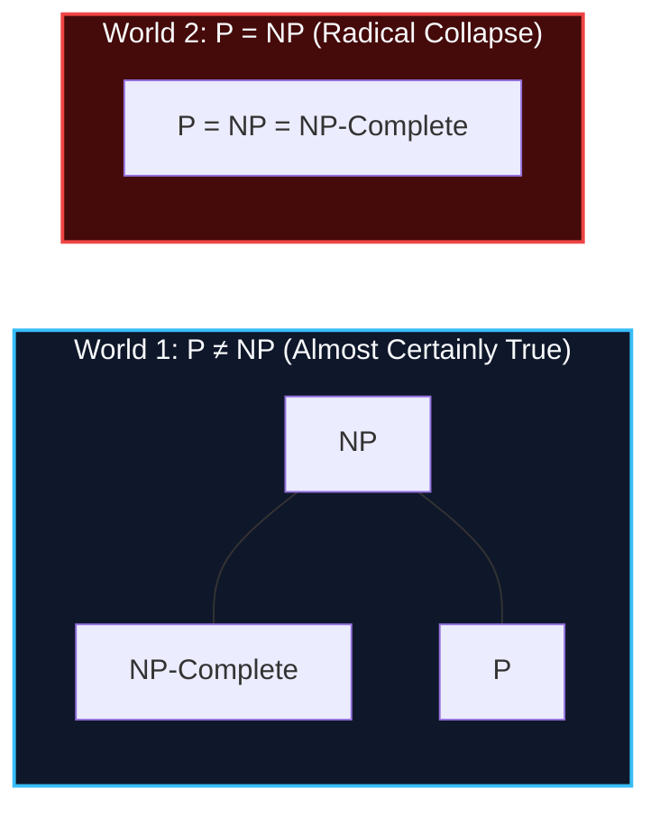
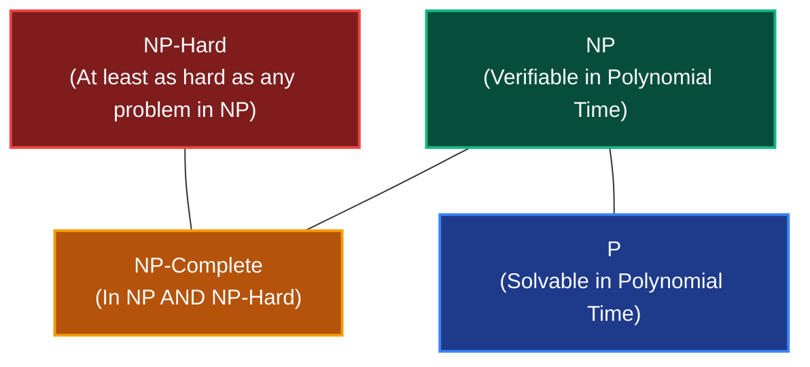

# Chapter 01: The Complexity Zoo — The Periodic Table of Hardness

> *"Complexity theory is the study of what is possible when resources are finite."* — Christos Papadimitriou

---

## 🧒 Explain Like I'm 5: The Kitchen Recipes

Imagine you are a chef in a restaurant kitchen:
- **Class $P$ (The 5-Minute Salad)**: You get an order. You slice the lettuce and toss it. Even if the table orders 100 salads, you just chop 100 times. It scales linearly or quadratically. Easy, predictable, done.
- **Class $NP$ (The Soufflé with a Mystery Flavor)**: Baking the soufflé from scratch to match a secret flavor profile might take weeks of trial and error ($2^N$ ingredient combinations). But if someone brings you a soufflé and claims *"This is the secret recipe!"*, you can take **one single bite** and know immediately whether they are telling the truth.  
  👉 **$P$ is finding the answer easily. $NP$ is checking someone else's answer easily.**
- **Class $PSPACE$ (The Infinite Countertop)**: You have a small kitchen counter. You can spend 40 years cooking, wiping the counter clean, and reusing it for the next step. As long as you never run out of countertop space, time is irrelevant.
- **Class $EXPTIME$ (Baking for Aliens)**: Recipes so complicated they take longer than the remaining lifespan of the sun to execute.

---

## 🟢 Undergraduate Foundation: The Core Landscape



### 1. Formal Definitions of $P$ and $NP$
Let $\text{TIME}(t(n))$ be the set of languages decidable by a deterministic Turing machine in $O(t(n))$ time.

#### Class $P$ (Deterministic Polynomial Time)
$$P = \bigcup_{k \ge 1} \text{TIME}(n^k)$$

**The Cobham-Edmonds Thesis**: $P$ is the mathematical definition of "tractable" or "computationally efficient." Any algorithm with runtime $O(n)$, $O(n \log n)$, $O(n^2)$, or $O(n^3)$ is in $P$.

#### Class $NP$ (Nondeterministic Polynomial Time)
$NP$ is **NOT** "Non-Polynomial"! It stands for **Nondeterministic Polynomial Time**:

$$NP = \bigcup_{k \ge 1} \text{NTIME}(n^k)$$

Equivalently (and more usefully for software engineers), $NP$ is the class of decision problems where a proposed "YES" solution can be **verified in deterministic polynomial time**.

> **The Certificate Definition**: A language $L \in NP$ if and only if there exists a polynomial-time deterministic verifier $V(x, c)$ and a polynomial $p(n)$ such that:
> $$x \in L \iff \exists c \text{ with } |c| \le p(|x|) \text{ such that } V(x, c) = \text{ACCEPT}$$
> Here, $c$ is the **certificate** (or proof witness).

| Problem | Is Finding Solution in $P$? | Is Checking Certificate in $P$? | Complexity Class |
|---|---|---|---|
| **Shortest Path** | ✅ Yes (Dijkstra $O(E + V \log V)$) | ✅ Yes (Sum edge weights) | $P$ (and in $NP$) |
| **Longest Simple Path** | ❌ No known poly algorithm | ✅ Yes (Check vertices simple, length $\ge K$) | $NP$ |
| **Sudoku ($N \times N$)** | ❌ Exponential search | ✅ Yes (Check rows, cols, boxes in $O(N^2)$) | $NP$-Complete |
| **Circuit Satisfiability (SAT)** | ❌ Exponential search | ✅ Yes (Evaluate circuit on boolean inputs) | $NP$-Complete |

---

### 2. The $P$ vs $NP$ Millennium Question
**Does $P = NP$?**
- If $P = NP$, then whenever a solution to a problem can be easily verified, it can also be easily discovered.
- **Philosophical Consequence**: If $P = NP$, reading a mathematical proof is no harder than creating it; appreciating a Mozart symphony is computational equivalent to composing it; breaking RSA/ECC cryptography is as easy as encrypting with it.
- **Consensus**: Virtually all computer scientists believe **$P \ne NP$**, but after 50+ years of intense effort, it remains unproven.



---

### 3. $NP$-Complete vs $NP$-Hard: The Crucial Distinction
Never confuse these two terms:



1. **$NP$-Hard**: A problem $H$ is $NP$-hard if *every* problem in $NP$ can be polynomial-time reduced to $H$ ($L \le_P H$ for all $L \in NP$).  
   **Crucial Rule**: An $NP$-hard problem **does NOT need to be in $NP$**! In fact, the Halting Problem is $NP$-hard, but it is completely undecidable!
2. **$NP$-Complete**: A problem $C$ is $NP$-complete if:
   - $C \in NP$ (it can be verified in polynomial time), **AND**
   - $C$ is $NP$-hard (every problem in $NP$ reduces to it).

---

## 🟡 Master's Deep-Dive: The Extended Zoo

### 1. $co\text{-}NP$: The Complement Universe
If $L \in NP$ asks *"Is there a certificate that says YES?"*, then $co\text{-}NP$ asks *"Can you verify a NO in polynomial time?"*

- **Example Problem**: $\text{TAUTOLOGY}$ (Given a boolean formula, is it true for *every* possible assignment?)
  - To prove it is NOT a tautology, give one assignment that makes it False (a poly-size certificate $\implies \text{TAUTOLOGY} \in co\text{-}NP$).
  - Proving it IS a tautology requires checking all $2^N$ assignments.
- **Open Question**: Does $NP = co\text{-}NP$? If $P = NP$, then $NP = co\text{-}NP$. However, if $NP \ne co\text{-}NP$, then $P \ne NP$.

### 2. $\text{PSPACE}$ & Savitch's Theorem
$\text{PSPACE}$ is the class of problems solvable using a polynomial amount of memory (space), with no limit on time:

$$\text{PSPACE} = \bigcup_{k \ge 1} \text{SPACE}(n^k)$$

**Savitch's Theorem (1970)**:
$$\text{NSPACE}(f(n)) \subseteq \text{DSPACE}(f(n)^2)$$
**Direct Consequence**: $\text{PSPACE} = \text{NPSPACE}$! Unlike time (where nondeterminism seemingly grants exponential power: $P$ vs $NP$), for space, nondeterminism can be simulated deterministically with at most a quadratic overhead!
- Canonical $\text{PSPACE}$-complete problem: **TQBF** (True Quantified Boolean Formulas, with alternating $\forall x \, \exists y \, \forall z$).
- Real-world games: Generalized Chess, Go, and Checkers on an $N \times N$ board are $\text{PSPACE}$-complete or $\text{EXPTIME}$-complete.

### 3. Probabilistic Classes: $BPP$, $RP$, $ZPP$
What happens when Turing machines can flip fair coins?

| Class | Name | Error Profile | Analogy |
|---|---|---|---|
| **$BPP$** | Bounded-error Probabilistic Poly-Time | Two-sided error $\le 1/3$ (can be amplified to $2^{-100}$) | Modern real-world efficient computing |
| **$RP$** | Randomized Poly-Time | One-sided error: If answer is NO, never lies. If YES, at least $50\%$ accurate. | Fast primality tests (Miller-Rabin) |
| **$ZPP$** | Zero-error Probabilistic Poly-Time | Never lies. Average runtime is polynomial. ($ZPP = RP \cap co\text{-}RP$) | Randomized Quicksort |

**Major Conjecture**: $P = BPP$. Most modern complexity theorists conjecture that pseudorandom generators allow all probabilistic algorithms to be derandomized without super-polynomial slowdown!

### 4. Counting Complexity: $\#P$ ("Sharp-P")
Introduced by Leslie Valiant: While $NP$ asks *"Does at least ONE valid configuration exist?"*, $\#P$ asks *"HOW MANY valid configurations exist?"*
- **Shocking Fact (Valiant's Theorem, 1979)**: Computing the **Determinant** of an $N \times N$ matrix is in $P$ ($O(N^3)$ via Gaussian elimination).  
  Computing the **Permanent** of an $N \times N$ matrix (which differs from Determinant by just omitting minus signs) is **$\#P$-Complete**!

### 5. Parameterized Complexity: The $FPT$ Escape Hatch
When a problem is $NP$-hard, we don't give up. We look for a parameter $k$ (e.g., solution size, tree-width, recursion depth):
- **$FPT$ (Fixed-Parameter Tractable)**: Solvable in $O(f(k) \cdot n^c)$ time.
  - **Vertex Cover**: Given graph $G$ and parameter $k$, can we cover all edges with $k$ vertices?  
    Vertex Cover is $NP$-Complete. But parameterized by $k$, it runs in $O(1.273^k + kn) \in FPT$! If $k \le 30$ and $N = 10^7$, it runs in seconds!
- **$W[1]$ / $W[2]$ Hardness**: The parameterized equivalent of $NP$-hard. **Independent Set** and **Clique** parameterized by size $k$ are $W[1]$-complete (running in $O(n^k)$, not $O(f(k) \cdot n^c)$).

---

## 🔴 PhD Horizon: The Three Barriers of $P$ vs $NP$

<details>
<summary><strong>Expand PhD Deep-Dive: Why P vs NP is So Impossibly Hard to Prove</strong></summary>

Why have thousands of brilliant mathematicians failed to prove $P \ne NP$? Because any successful proof must evade **Three Formal Barriers**:

### 1. The Relativization Barrier (Baker, Gill, Solovay 1975)
A proof technique "relativizes" if it remains valid when all machines have access to an arbitrary oracle $A$.
- BGS proved there exists an oracle $A$ where $P^A = NP^A$, and an oracle $B$ where $P^B \ne NP^B$.
- **Implication**: Any proof technique that treats machines as black boxes (such as Cantor's diagonalization or standard simulation) relativizes, and therefore **cannot resolve $P$ vs $NP$**.

### 2. The Natural Proofs Barrier (Razborov & Rudich 1997)
Can we prove lower bounds on Boolean circuit size?
- Razborov and Rudich proved that any "natural" circuit lower-bound proof (one that identifies a widespread, easily testable combinatorial property) would contradict the existence of strong pseudorandom function generators (and thus break all modern cryptography).

### 3. The Algebrization Barrier (Aaronson & Wigderson 2008)
Even algebraic techniques (like interactive proofs: $IP = \text{PSPACE}$) "algebrize" and fail to separate $P$ from $NP$.

Any resolution to $P$ vs $NP$ must employ radically new non-relativizing, non-natural, non-algebrizing mathematical machinery.

</details>

---

## 💻 Python 3.14 Verification: Verifier ($O(V+E)$) vs Solver ($O(3^V)$)

To make the certificate definition of $NP$ unmistakable, here is Python code showing the monumental difference between **Verifying** a solution in $NP$ versus **Finding** it:

```python
import itertools
from typing import Mapping

type Node = int
type Graph = dict[Node, list[Node]]
type Coloring = Mapping[Node, int]


def is_valid_3_coloring(graph: Graph, coloring: Coloring) -> bool:
    """THE NP VERIFIER: Checks a certificate in polynomial time O(V + E).

    Given a proposed assignment of 3 colors (0, 1, 2), does any edge connect
    two nodes of the same color?
    """
    for u in graph:
        if u not in coloring or coloring[u] not in (0, 1, 2):
            return False
        for v in graph[u]:
            if coloring[u] == coloring[v]:
                return False  # Violation found!
    return True


def solve_3_coloring_brute_force(graph: Graph) -> Coloring | None:
    """THE NP SOLVER: Explores 3^V assignments in exponential time.

    Graph 3-Coloring is NP-Complete. No polynomial-time solver is known.
    """
    nodes = list(graph.keys())
    num_nodes = len(nodes)

    # Test all 3^N possible color assignments
    for assignment in itertools.product((0, 1, 2), repeat=num_nodes):
        candidate: Coloring = dict(zip(nodes, assignment))
        if is_valid_3_coloring(graph, candidate):
            return candidate  # Found certificate!

    return None  # No valid coloring exists


# ─────────────────────────────────────────────────────────────
# Verification Example
# ─────────────────────────────────────────────────────────────
if __name__ == "__main__":
    # A 4-node cycle: 0 - 1 - 2 - 3 - 0 (Easily 3-colorable)
    bipartite_cycle: Graph = {
        0: [1, 3],
        1: [0, 2],
        2: [1, 3],
        3: [2, 0],
    }

    # Certificate provided by an external untrusted source
    claimed_certificate: Coloring = {0: 0, 1: 1, 2: 0, 3: 1}

    # 1. Verification is blazing fast: O(V + E)
    is_valid = is_valid_3_coloring(bipartite_cycle, claimed_certificate)
    assert is_valid is True
    print("✅ Certificate successfully verified in O(V + E) deterministic time!")

    # 2. Complete K4 graph (4 mutually connected nodes) -> CANNOT be 3-colored!
    k4_graph: Graph = {
        0: [1, 2, 3],
        1: [0, 2, 3],
        2: [0, 1, 3],
        3: [0, 1, 2],
    }
    k4_solution = solve_3_coloring_brute_force(k4_graph)
    assert k4_solution is None
    print("✅ K4 graph correctly proven uncolorable with 3 colors (verified exhaustion).")
```

---

## 🔗 Connections to Coding Patterns

- **Pattern 16: Subsets & Pattern 25: Backtracking**: When your problem is in $NP$ but not in $P$, Backtracking and Branch-and-Bound are your primary exact search engines.
- **Pattern 22: 0/1 Knapsack (DP)**: Knapsack is $NP$-Complete. Why does Dynamic Programming solve it in $O(NW)$? Because it is **pseudo-polynomial** (polynomial in the value of $W$, but exponential in the bit-length of $W$).
- **Pattern 27: Topological Sort & Pattern 13: Graphs**: 2-SAT is solvable in linear time $O(V+E)$ via strongly connected components (in $P$), whereas 3-SAT is $NP$-Complete. A single extra literal crosses the barrier of computational feasibility!

---

## 🧪 Self-Test Questions

1. **Explain why saying "This problem is NP, so it requires exponential time" is a rookie technical mistake.**
2. **If an algorithm runs in $O(N^{100})$, is it in $P$? Is it practical in engineering?**
3. **What is the difference between $NP$-Hard and $NP$-Complete? Give an example of an $NP$-hard problem that is NOT $NP$-complete.**
4. **Why is finding a Hamiltonian Cycle in $NP$, while finding the length of the longest path without cycles is also in $NP$?**
5. **How does Parameterized Complexity ($FPT$) rescue engineers who face $NP$-hard problems in real production systems?**

<details>
<summary><strong>Click to view answers</strong></summary>

1. Because $P \subseteq NP$. Every problem in $P$ (like sorting, binary search, shortest paths) is also in $NP$! Furthermore, we have not proven $P \ne NP$, so we cannot mathematically claim any $NP$ problem strictly requires exponential time. The proper statement is: *"This problem is NP-complete, so no polynomial-time algorithm is currently known."*
2. Yes, $O(N^{100})$ is strictly in $P$ by definition (polynomial exponent is constant). However, it is utterly impractical in engineering ($N=2 \implies 2^{100}$ operations). The Cobham-Edmonds thesis is an asymptotic model, not a guarantee that high-degree polynomials are fast.
3. An $NP$-Complete problem must be in $NP$ (verifiable in polynomial time). An $NP$-Hard problem is at least as hard as everything in $NP$, but does not need to be in $NP$. Example: The **Halting Problem** is $NP$-hard (any $NP$ problem can be reduced to it), but it is undecidable, so it is not in $NP$.
4. Both have polynomial-time certificates. For Hamiltonian Cycle, a certificate is the ordered sequence of vertices: checking that each pair is connected by an edge and visits every vertex once takes $O(V)$ time.
5. In real systems, the parameter that causes exponential blowup ($k$) is often very small (e.g., $k \le 15$ concurrent users, tree-depth $k \le 8$, budget $k \le 20$), while $N$ is massive ($10^7$). An $FPT$ algorithm with runtime $O(2^k \cdot N)$ runs in milliseconds on massive $N$, whereas an $O(N^k)$ algorithm would stall completely.

</details>

---

## 🧭 Navigation

| ← Previous | ↑ Master Index | Next → |
|:---|:---:|---:|
| [← Ch 00: Computation & Computability](00_computation_and_computability.md) | [🏛️ Theoretical Foundations Index](README.md) | [Ch 02: Asymptotic Analysis Deep Cuts →](02_asymptotic_analysis_deep.md) |

