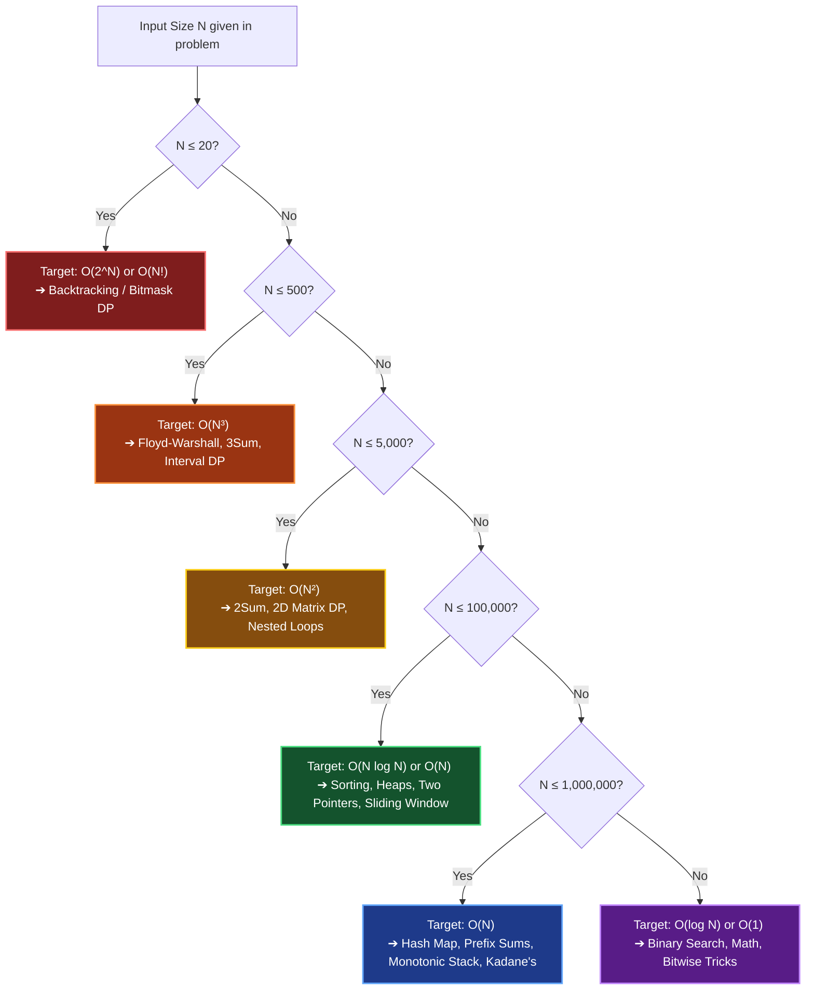
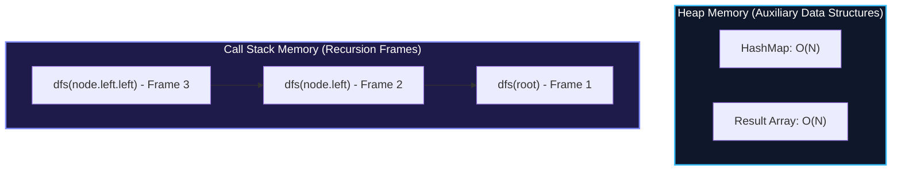

# Chapter 02: Asymptotic Analysis — The 1-Second Rule & Systems Reality

> *"Big-O is not a math test. It is a communication tool between engineers to predict whether a service survives peak traffic or melts the database."*

---

## 💡 1. The Napkin Analogy: The Speedometer, the Speed Limit, and Cruise Control

Imagine driving on a highway:

```
┌─────────────────────────────────────────────────────────────────────────────┐
│ 🚗 Big-O (Upper Bound)    = The Speed Limit: "You won't exceed 70 mph"      │
│ 🛑 Big-Ω (Lower Bound)    = The Minimum Speed: "Traffic forces at least 15" │
│ 🎯 Big-Θ (Tight Bound)    = Cruise Control: "Locked exactly at 55 mph"      │
└─────────────────────────────────────────────────────────────────────────────┘
```

- **Big-O ($O$) is the ceiling**: It tells you the *worst-case guarantee*. If an algorithm is $O(N)$, it will never scale worse than linear. Technically, an $O(N)$ algorithm is also $O(N^2)$ because 55 mph is under an 80 mph ceiling—which is why in casual speech engineers say "Big-O", but top candidates strive for tight bounds.
- **Big-$\Omega$ ($\Omega$) is the floor**: It guarantees the minimum work required. For example, any algorithm that searches an unsorted array of size $N$ requires $\Omega(N)$ operations because in the worst case, it must inspect every element at least once.
- **Big-$\Theta$ ($\Theta$) is the tight truth**: It means the upper bound and lower bound match. MergeSort is $\Theta(N \log N)$ because whether the input is already sorted, reversed, or random, it always takes $N \log N$ operations.

---

## 📊 2. The Visual Whiteboard: The 1-Second CPU Budget

In technical interviews and online assessments (LeetCode, HackerRank, Codeforces), your code runs with a **1.0 to 2.0-second time limit**.

### The Universal Rule of Thumb: $10^8$ Operations Per Second
A modern CPU core runs at roughly 2–4 GHz. Accounting for memory access, pipeline stalls, and language runtimes:
- **C++ / Go / Rust**: $\approx 10^8$ to $5 \times 10^8$ basic operations per second.
- **Java**: $\approx 10^8$ operations per second (after JIT warmup).
- **Python**: $\approx 10^7$ to $2 \times 10^7$ bytecode operations per second (due to dynamic typing overhead).

Use this benchmark to instantly deduce the required algorithm from the problem's constraints:



### The Complexity Hierarchy Visualized

```
Fastest                                                                 Slowest
O(1) ─── O(log N) ─── O(√N) ─── O(N) ─── O(N log N) ─── O(N²) ─── O(2^N) ─── O(N!)
 Instant   Binary      Prime    Linear   MergeSort    Nested   Subsets   Permutations
 Lookup    Search      Check     Scan                 Loops
```

| Complexity | $N = 10$ | $N = 100$ | $N = 10^5$ | Typical Operations |
|---|---|---|---|---|
| **$O(1)$** | 1 | 1 | 1 | Hash map lookup, array index |
| **$O(\log N)$** | 3 ops | 7 ops | 17 ops | Binary search, balanced BST query |
| **$O(N)$** | 10 ops | 100 ops | $10^5$ ops | Single loop, array scan |
| **$O(N \log N)$** | 33 ops | 664 ops | $1.7 \times 10^6$ ops | Sorting (Merge/Quick/Heap), Heapify $N$ items |
| **$O(N^2)$** | 100 ops | $10^4$ ops | $10^{10}$ ops (💥 **TLE!**) | Nested loops, all pairs check |
| **$O(2^N)$** | 1,024 ops | $1.2 \times 10^{30}$ (💥) | Universe melts | Generating all subsets |
| **$O(N!)$** | $3.6 \times 10^6$ | Impossible | Impossible | Generating all permutations |

---

## 🗣️ 3. The 30-Second Interview Talk Track

When your interviewer asks: *"What is the time and space complexity of your solution?"*, deliver a structured, two-part response.

### The Time Complexity Script
> *"The time complexity is **tight $\Theta(N)$** in the average case. We make a single pass through the array of length $N$. Inside the loop, each hash table lookup and insertion runs in amortized $O(1)$ time. In the pathological worst case where all elements collide into the same bucket, it degrades to $O(N^2)$, but with a modern randomized hash function, this is practically zero."*

### The Space Complexity Script (Auxiliary Space vs. Total Space)
> *"For space complexity, our **auxiliary space is $O(N)$** because we maintain a hash set containing at most $N$ distinct values to track seen elements. If we include the input and output buffer, the total space is $O(N)$."*

### The Recursion Stack Space Script
> *"For recursive solutions, auxiliary space is determined by the **maximum depth of the call stack**, not the total number of calls. Because each stack frame stores local variables and return pointers, a balanced tree of $N$ nodes incurs $O(\log N)$ stack frames. On a completely skewed tree, it degrades to $O(N)$ space, which could trigger a stack overflow for $N \ge 10^4$."*



---

## 🧠 4. Senior Systems Reality: Why $O(N)$ Array Crushes $O(N)$ Linked List

On a theoretical whiteboard, scanning an array of $1,000,000$ integers is $O(N)$, and traversing a linked list of $1,000,000$ integers is also $O(N)$.  
**In real hardware, the array can run 20x to 50x faster! Why?**

```
Array in RAM (Contiguous):
[ 42 ][ 17 ][ 99 ][ 04 ][ 88 ][ 12 ][ 31 ][ 64 ]
 └───────────── 64-Byte CPU Cache Line ─────────────┘
  ➜ 1 Memory Access fetches 16 integers at once! Cache Hit ≈ 1 nanosecond.

Linked List in RAM (Scattered Pointers):
[ Node A ] ──(Pointer)──> [ Node B (Address +4MB) ] ──(Pointer)──> [ Node C (Address -2MB) ]
 ➜ Every pointer jump triggers a CPU Cache Miss! RAM roundtrip ≈ 50-100 nanoseconds.
```

### The Engineering Takeaways
1. **CPU Cache Lines (64 Bytes)**: Modern CPUs read memory in 64-byte chunks into L1/L2 caches. Contiguous structures (arrays, vectors) maximize **spatial locality**; the hardware prefetcher predicts the next item before your code even asks for it.
2. **Pointer Chasing Penalty**: Linked lists, pointer-heavy binary trees, and object graphs store pointers that scatter nodes across disparate memory pages. Each node access is an unpredictable memory jump causing cache misses.
3. **In-Place QuickSort vs MergeSort**: While MergeSort guarantees $O(N \log N)$ worst-case comparisons, QuickSort is favored in production standard libraries (like C++ `std::sort`) because its partition step operates **in-place over contiguous memory**, keeping hot elements inside L1 cache.

---

## 🎯 5. Constraint Triage & FAANG Traps

### Trap 1: The String Concatenation Cascade
```python
# ❌ TRAP: O(N^2) Time Complexity!
# In Python, Java, and C#, strings are immutable.
# Each `+` allocates a NEW string and copies all previous characters!
s = ""
for ch in char_list:  # Runs N times
    s += ch  # Copies 1 + 2 + 3 + ... + N = O(N^2) total chars

# ✅ SENIOR FIX: O(N) Time Complexity
s = "".join(char_list)  # Pre-sizes the buffer once; runs in O(N)
```

### Trap 2: Slicing Inside a Loop
```python
# ❌ TRAP: O(N^2) Time Complexity!
# In Python, arr[1:] copies the entire remaining list of length K!
def process(arr):
    while arr:
        val = arr[0]
        arr = arr[1:]  # Copies N-1, N-2, N-3... elements = O(N^2)

# ✅ SENIOR FIX: O(N) using an Index Pointer
def process(arr):
    for i in range(len(arr)):
        val = arr[i]  # O(1) index access
```

### Trap 3: Python's `in` Operator on Lists vs Sets
- `item in list`: Linear search $\implies O(N)$.
- `item in set` or `item in dict`: Hash lookup $\implies O(1)$ average.
- Putting `if x in my_list:` inside a loop of size $N$ silently converts an intended $O(N)$ algorithm into an $O(N^2)$ failure.

---

## 🧭 Navigation
- **Previous**: [Ch 01: The Complexity Zoo](./01_complexity_classes_zoo.md)
- **Next**: [Ch 03: Recurrences & Master Theorem](./03_recurrences_and_master_theorem.md)
