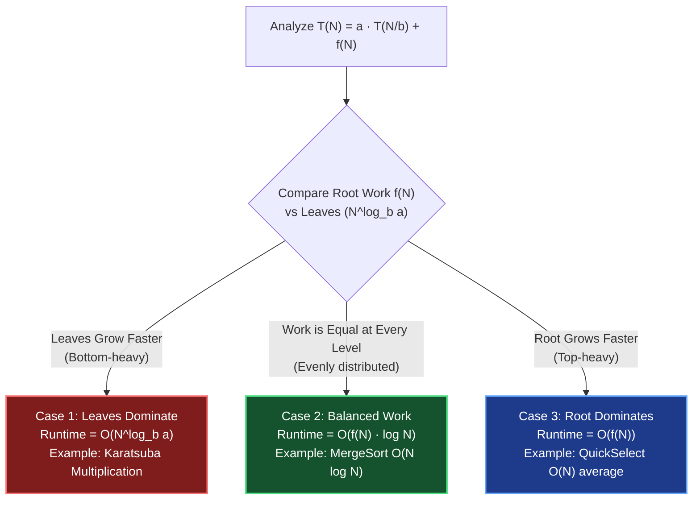

# Chapter 03: Recurrences & Divide-and-Conquer — The Recursion Tree Model

> *"You do not need integrals or Greek letters to solve recurrences. You only need to see who does the work: the root, the leaves, or everyone equally."*

---

## 💡 1. The Napkin Analogy: The Corporate Hierarchy

Think of a recursive algorithm like a corporate delegation hierarchy:

```
                  [ 👔 CEO (Root) ]  ────────── Work done at top: f(N)
                     /         \
          [ 🏢 VP 1 ]           [ 🏢 VP 2 ]  ── Sub-problems delegated
            /     \               /     \
         [Mgr]   [Mgr]         [Mgr]   [Mgr]
         /   \   /   \         /   \   /   \
       [👷] [👷] [👷] [👷]   [👷] [👷] [👷] [👷]  ── Ground workers (Leaves, N=1)
```

Whenever you see a recurrence relation $T(N) = a \cdot T(N/b) + f(N)$:
- $a$ = Number of subordinates created at each step.
- $b$ = How much smaller each subordinate's task is (e.g., cut in half $\implies b = 2$).
- $f(N)$ = The work the current manager does personally (splitting, combining, merging).

The entire Master Theorem boils down to **one simple question: Who does the most work?**

```
┌─────────────────────────────────────────────────────────────────────────────┐
│ 1. CEO does all the work?        ➜ O(f(N))     (Root Dominates)             │
│ 2. Everyone does equal work?     ➜ O(f(N) · log N) (Balanced Tree)          │
│ 3. Ground workers do all work?   ➜ O(Leaves)   (Leaves Dominate)            │
└─────────────────────────────────────────────────────────────────────────────┘
```

---

## 📊 2. The Visual Whiteboard: The Master Theorem in 3 Plain Sentences

No calculus, no integrals. Just compare the **work at the root ($f(N)$)** against the **number of leaves ($N^{\log_b a}$)**:



### The 5 Recurrences That Appear in 99% of Interviews

| Pattern / Algorithm | Recurrence Form | Tree Depth | Work per Level | Overall Time |
|---|---|---|---|---|
| **Binary Search** | $T(N) = T(N/2) + O(1)$ | $\log_2 N$ | $O(1)$ | **$O(\log N)$** |
| **Full Tree Traversal** | $T(N) = 2T(N/2) + O(1)$ | $\log_2 N$ | Doubles each level | **$O(N)$** |
| **MergeSort** | $T(N) = 2T(N/2) + O(N)$ | $\log_2 N$ | $O(N)$ at every level | **$O(N \log N)$** |
| **QuickSelect (Average)** | $T(N) = T(N/2) + O(N)$ | $\log_2 N$ | Halves: $N + \frac{N}{2} + \frac{N}{4} \dots$ | **$O(N)$** |
| **Naive Fibonacci / Subsets** | $T(N) = 2T(N-1) + O(1)$ | $N$ | Doubles each step | **$O(2^N)$** |

---

## 🗣️ 3. The 30-Second Interview Talk Track

When explaining recursive time complexity on a whiteboard:

### The MergeSort Script ($O(N \log N)$)
> *"At each recursion level, we split the array in half and do $O(N)$ work merging the results. Since we divide by 2 each time, the recursion tree has a depth of $\log_2 N$. Because every single level performs $O(N)$ combined merge work across all its nodes, the total time is simply $O(N) \times \log_2 N = O(N \log N)$."*

```
Level 0:                 [ N ]                     = N work
                         /   \
Level 1:           [ N/2 ]   [ N/2 ]               = N/2 + N/2 = N work
                    /   \     /   \
Level 2:        [N/4]  [N/4] [N/4]  [N/4]          = 4 * (N/4) = N work
... (log N levels total)
────────────────────────────────────────────────────────────────────────
Total Work = N * log₂ N
```

### The QuickSelect Script ($O(N)$ Average)
> *"In QuickSelect, after partitioning in $O(N)$ time, we only recurse into **one** half where our target $k$-th element lies. The work shrinks as a geometric series: $N + N/2 + N/4 + N/8 + \dots \le 2N$. Therefore, the average time complexity is bounded by $O(N)$."*

### The Binary Search Script ($O(\log N)$)
> *"At each step, we perform an $O(1)$ comparison and discard half the remaining elements. The search space shrinks as $N, N/2, N/4, \dots, 1$. Halving $N$ down to 1 takes exactly $\log_2 N$ steps, yielding $O(\log N)$ time."*

---

## 🧠 4. Senior Systems Reality: The Call Stack Memory Tax

On a whiteboard, recursion looks clean. In production systems, **every recursion level consumes real physical stack memory**:

```
High Memory
┌────────────────────────────────────────────────────────┐
│ Stack Frame 3: dfs(node.left.left)                     │
│  - Return Address: 0x7fff4820                          │
│  - Local variables, parameter pointers (64-128 bytes)  │
├────────────────────────────────────────────────────────┤
│ Stack Frame 2: dfs(node.left)                          │
├────────────────────────────────────────────────────────┤
│ Stack Frame 1: dfs(root)                               │
└────────────────────────────────────────────────────────┘
Low Memory (Stack grows downward towards Heap)
```

### The Production Hazards
1. **The Stack Overflow Threshold**:
   - The default call stack limit in OS threads is typically **1 MB to 8 MB**.
   - In Python, `sys.getrecursionlimit()` defaults to **1,000 frames**! If an unbalanced tree or recursive DFS exceeds 1,000 calls, Python raises `RecursionError`.
   - In Java / C++, a recursion depth of $\approx 10^5$ will instantly crash with `StackOverflowError` / segmentation fault.
2. **Converting to Explicit Stack (Heap-Backed)**:
   - When constraints say $N = 10^5$, recursive DFS is dangerous if the graph/tree can be degenerate (a straight line).
   - Senior engineers convert deep recursion to an **iterative loop with an explicit array stack** stored on the heap, which has gigabytes of space rather than megabytes.

---

## 🎯 5. Constraint Triage & FAANG Traps

### Trap 1: Passing Slices into Recursive Calls
```python
# ❌ TRAP: O(N log N) Extra Space and O(N^2) Time!
# `nums[:mid]` copies the elements into a new list at every call!
def merge_sort(nums):
    if len(nums) <= 1:
        return nums
    mid = len(nums) // 2
    left = merge_sort(nums[:mid])   # 💥 Creates a copy!
    right = merge_sort(nums[mid:])  # 💥 Creates a copy!
    return merge(left, right)

# ✅ SENIOR FIX: Pass Index Pointers (O(log N) Space)
def merge_sort(nums, left, right):
    if left >= right:
        return
    mid = (left + right) // 2
    merge_sort(nums, left, mid)
    merge_sort(nums, mid + 1, right)
```

### Trap 2: Unbalanced QuickSort Degradation
- If you always pick the first element as pivot on an **already sorted array**, the recursion tree does not divide by 2!
- Recurrence becomes: $T(N) = T(N-1) + O(N) \implies O(N^2)$ time and $O(N)$ stack depth.
- **The Defense**: Always use **Randomized Pivot Selection** or median-of-three to guarantee $O(N \log N)$ expected time.

---

## 🧭 Navigation
- **Previous**: [Ch 02: Asymptotic Analysis](./02_asymptotic_analysis_deep.md)
- **Next**: [Ch 04: Amortized Analysis](./04_amortized_analysis.md)
