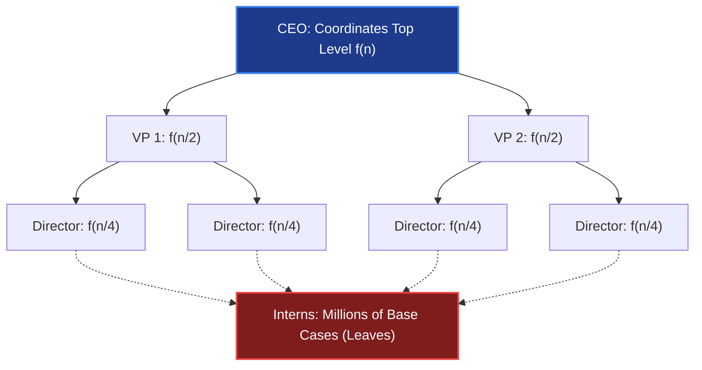
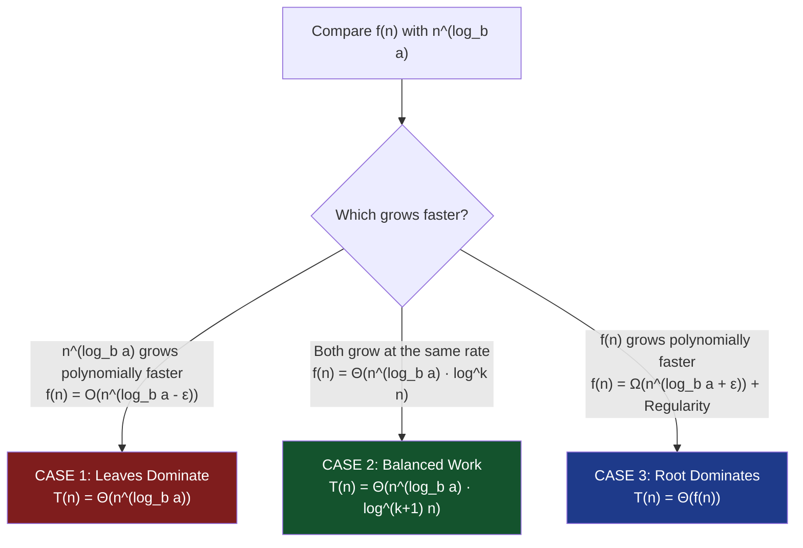

# Chapter 03: Recurrences & The Master Theorem — Solving Divide-and-Conquer

> *"Divide et impera (Divide and rule) is the secret of algorithmic speed — but only if you know who pays for combining the pieces."*

---

## 🧒 Explain Like I'm 5: The Corporate Delegation Tree

Imagine a CEO at a massive company with a project containing 1,000 tasks:
- The CEO cuts the project into **2 sub-projects of 500 tasks** and delegates them to **2 Vice Presidents**.
- The CEO spends **100 hours** organizing and coordinating the division ($f(n)$).
- Each VP cuts their 500 tasks into 2 pieces of 250 and delegates to 4 Directors, spending 50 hours coordinating.
- This continues down the pyramid until **junior interns** execute 1 task each.

```
Who did the most total work across the entire company?
```



There are only **Three Possibilities**:
1. 🍂 **The Interns Do All The Work (Case 1)**: There are so many interns at the bottom that their collective work dwarfs all management coordination combined.
2. ⚖️ **Perfect Work-Life Balance (Case 2)**: Every layer in the company does the exact same total amount of work. The total cost is simply (work per layer $\times$ number of layers).
3. 👑 **The CEO Does All The Work (Case 3)**: The coordination cost at the top was so gigantic that the work done by the lower levels is negligible.

This is the **Master Theorem**.

---

## 🟢 Undergraduate Foundation: The Big Three Methods

A divide-and-conquer recurrence takes the canonical form:

$$T(n) = a \cdot T\left(\frac{n}{b}\right) + f(n)$$

Where:
- $a \ge 1$: The number of recursive subproblems created.
- $b > 1$: The factor by which the input size is reduced.
- $f(n)$: The cost of dividing the problem and combining the subproblem results.

---

### Method 1: The Master Theorem Formula
The Master Theorem compares $f(n)$ to the **Watershed Function** $n^{\log_b a}$ (the number of leaves in the recursion tree).



#### The Three Formal Cases:

1. **Case 1 (Leaf-Heavy)**:  
   If $f(n) = O(n^{\log_b a - \epsilon})$ for some constant $\epsilon > 0$:
   $$T(n) = \Theta(n^{\log_b a})$$
   *Example*: $T(n) = 8T(n/2) + 1000n^2$.  
   $a=8, b=2 \implies n^{\log_2 8} = n^3$.  
   Compare $n^2$ vs $n^3$: Since $n^2 = O(n^{3 - 1})$, leaves dominate $\implies T(n) = \Theta(n^3)$.

2. **Case 2 (Evenly Balanced)**:  
   If $f(n) = \Theta(n^{\log_b a} \cdot \log^k n)$ for some $k \ge 0$:
   $$T(n) = \Theta(n^{\log_b a} \cdot \log^{k+1} n)$$
   *Example (Merge Sort)*: $T(n) = 2T(n/2) + cn$.  
   $a=2, b=2 \implies n^{\log_2 2} = n^1$.  
   Here $f(n) = cn = \Theta(n^1 \cdot \log^0 n) \implies T(n) = \Theta(n \log n)$.

3. **Case 3 (Root-Heavy)**:  
   If $f(n) = \Omega(n^{\log_b a + \epsilon})$ for some constant $\epsilon > 0$, **AND** $f(n)$ satisfies the **Regularity Condition** ($a \cdot f(n/b) \le c \cdot f(n)$ for some constant $c < 1$ and all large $n$):
   $$T(n) = \Theta(f(n))$$
   *Example*: $T(n) = 2T(n/2) + n^2$.  
   $a=2, b=2 \implies n^{\log_2 2} = n^1$.  
   $f(n) = n^2 = \Omega(n^{1 + 1})$.  
   Regularity check: $2 \cdot (n/2)^2 = 2 \cdot \frac{n^2}{4} = \frac{1}{2} n^2 \le c \cdot n^2$ (holds with $c = 1/2$).  
   Therefore, root dominates $\implies T(n) = \Theta(n^2)$.

---

### Method 2: The Recursion Tree Method
When the Master Theorem cannot be applied, sketch the recursion tree:
- **Depth of tree**: $\log_b n$.
- **Number of nodes at depth $i$**: $a^i$.
- **Size of input at depth $i$**: $n / b^i$.
- **Cost at depth $i$**: $a^i \cdot f(n / b^i)$.
- **Total Cost**: $\sum_{i=0}^{\log_b n} a^i \cdot f(n / b^i) + \Theta(n^{\log_b a})$.

---

### Method 3: The Substitution Method (Mathematical Induction)
Use this when you need an ironclad mathematical proof:
1. **Guess** the form of the solution (e.g., $T(n) \le c \cdot n \log n$).
2. **Inductive Step**: Substitute your guess into the recurrence:
   $$T(n) \le 2\left[c \frac{n}{2} \log\left(\frac{n}{2}\right)\right] + n = c n (\log n - \log 2) + n = c n \log n - c n + n$$
3. **Establish Constants**: We need $c n \log n - c n + n \le c n \log n$, which holds whenever $-cn + n \le 0 \implies c \ge 1$.
4. **Base Case**: Show $T(n_0) \le c n_0 \log n_0$ for suitable initial boundary values.

---

## 🟡 Master's Deep-Dive: Gaps & The Akra-Bazzi Theorem

### 1. The Master Theorem Gaps
The Master Theorem does not cover every polynomial recurrence. There are two common traps:

#### Trap A: Non-Polynomial Gaps
Consider: $T(n) = 2T(n/2) + \frac{n}{\log n}$.  
Here $a=2, b=2 \implies n^{\log_b a} = n$.  
$f(n) = \frac{n}{\log n}$ is smaller than $n$, but it is **not polynomially smaller**! (The ratio is $\log n$, which is asymptotically smaller than $n^\epsilon$ for any $\epsilon > 0$).  
👉 **Master Theorem fails here!**  
(Solution via recursion tree: $T(n) = \Theta(n \log \log n)$).

#### Trap B: Failure of Regularity
Consider: $T(n) = T(n/2) + n(2 - \cos n)$.  
$f(n)$ oscillates. It is $\Omega(n)$, but it violates the regularity condition $a f(n/b) \le c f(n)$.  
👉 **Master Theorem fails!**

---

### 2. The Akra-Bazzi Generalization (1998)
In real-world divide-and-conquer (like uneven quickselect partitions), subproblems are rarely equal in size:

$$T(n) = \sum_{i=1}^k a_i T(b_i n) + g(n)$$

*Example*: $T(n) = T(n/3) + T(2n/3) + O(n)$. (A tree where the left branch shrinks by $1/3$ and the right branch by $2/3$).

#### The Akra-Bazzi Recipe:
1. Find the unique real number $p$ that satisfies:
   $$\sum_{i=1}^k a_i b_i^p = 1$$
   For $T(n/3) + T(2n/3)$: $(1/3)^p + (2/3)^p = 1 \implies p = 1$.
2. The closed-form solution is:
   $$T(n) = \Theta\left(n^p \left(1 + \int_1^n \frac{g(u)}{u^{p+1}} du\right)\right)$$
3. Plugging in $p=1$ and $g(u) = u$:
   $$T(n) = \Theta\left(n^1 \left(1 + \int_1^n \frac{u}{u^2} du\right)\right) = \Theta(n(1 + \ln n)) = \Theta(n \log n)$$

---

## 📚 Canonical Recurrence Catalog for LeetCode & DSA

| Algorithm | Recurrence Relation | Master Case | Closed-Form Complexity |
|---|---|---|---|
| **Binary Search** | $T(n) = T(n/2) + O(1)$ | Case 2 ($k=0$) | $\Theta(\log n)$ |
| **Tree Traversal (Full)** | $T(n) = 2T(n/2) + O(1)$ | Case 1 | $\Theta(n)$ |
| **Merge Sort** | $T(n) = 2T(n/2) + O(n)$ | Case 2 ($k=0$) | $\Theta(n \log n)$ |
| **Karatsuba Integer Mult** | $T(n) = 3T(n/2) + O(n)$ | Case 1 | $\Theta(n^{\log_2 3}) \approx \Theta(n^{1.585})$ |
| **Strassen Matrix Mult** | $T(n) = 7T(n/2) + O(n^2)$ | Case 1 | $\Theta(n^{\log_2 7}) \approx \Theta(n^{2.807})$ |
| **Closest Pair of Points** | $T(n) = 2T(n/2) + O(n)$ | Case 2 ($k=0$) | $\Theta(n \log n)$ |
| **Median of Medians** | $T(n) \le T(n/5) + T(7n/10) + O(n)$ | Akra-Bazzi | $\Theta(n)$ |

---

## 🔴 PhD Horizon: Non-Smooth Divide-and-Conquer

<details>
<summary><strong>Expand PhD Deep-Dive: Roura's Continuous Master Theorem</strong></summary>

What happens when subproblem sizes are driven by continuous probability distributions (e.g., randomized Quicksort where the pivot falls at $x \in [0, 1]$)?

**Continuous Master Theorem (Salvador Roura, 2001)**:
For recurrences of the form:
$$T(n) = \int_0^1 T(z \cdot n) w(z) dz + f(n)$$
Roura showed that the asymptotic behavior depends on the shape of the weighting function $w(z)$ and its moments $\int_0^1 z^p w(z) dz = 1$. This unified the discrete Master Theorem and randomized probabilistic recurrences into a single continuous differential framework.

</details>

---

## 💻 Python 3.14 Verification: Automated Recurrence Empirical Validator

Here is a Python 3.14 simulator that solves recurrences numerically and empirically calculates the slope $\alpha = \frac{\log(T(2n) / T(n))}{\log 2}$ to identify the asymptotic exponent:

```python
import math
from typing import Callable


def empirical_recurrence_exponent(
    t_func: Callable[[int], float], n_base: int = 1024
) -> float:
    """Empirically calculates the growth exponent alpha where T(n) ~ n^alpha

    using the doubling ratio: alpha = log2(T(2n) / T(n)).
    """
    t_n = t_func(n_base)
    t_2n = t_func(2 * n_base)
    ratio = t_2n / t_n
    return math.log2(ratio)


# 1. Simulating Karatsuba: T(n) = 3T(n/2) + n
# Theory: n^(log2 3) = n^1.58496...
def karatsuba_sim(n: int) -> float:
    if n <= 1:
        return 1.0
    return 3.0 * karatsuba_sim(n // 2) + float(n)


# 2. Simulating Strassen: T(n) = 7T(n/2) + n^2
# Theory: n^(log2 7) = n^2.80735...
def strassen_sim(n: int) -> float:
    if n <= 1:
        return 1.0
    return 7.0 * strassen_sim(n // 2) + float(n * n)


if __name__ == "__main__":
    n = 2048

    # Verify Karatsuba
    exp_karatsuba = empirical_recurrence_exponent(karatsuba_sim, n)
    theory_karatsuba = math.log2(3)
    print(f"Karatsuba Empirical Exponent : {exp_karatsuba:.4f}")
    print(f"Karatsuba Theoretical Exponent: {theory_karatsuba:.4f}")
    assert abs(exp_karatsuba - theory_karatsuba) < 0.05

    # Verify Strassen
    exp_strassen = empirical_recurrence_exponent(strassen_sim, n)
    theory_strassen = math.log2(7)
    print(f"Strassen Empirical Exponent  : {exp_strassen:.4f}")
    print(f"Strassen Theoretical Exponent : {theory_strassen:.4f}")
    assert abs(exp_strassen - theory_strassen) < 0.05

    print("✅ Empirical recurrence validations perfectly matched Master Theorem!")
```

---

## 🔗 Connections to Coding Patterns

- **Pattern 17: Modified Binary Search**: $T(n) = T(n/2) + O(1) \implies O(\log n)$. Cutting the search space in half with $O(1)$ work is the holy grail of sub-linear search.
- **Pattern 20: K-way Merge**: Merging $K$ lists of total size $N$ using a min-heap yields $T(N) = O(N \log K)$.
- **Pattern 36: Meet in the Middle**: Instead of solving $T(N) = 2^N$, splitting the search in half yields $2 \cdot 2^{N/2} + 2^{N/2} \log(2^{N/2}) = O(N \cdot 2^{N/2})$.

---

## 🧪 Self-Test Questions

1. **Why can't the Master Theorem solve $T(n) = 2T(n/2) + n \log n$? (Be precise about which case is violated).**
2. **In Karatsuba multiplication, why was replacing 4 sub-multiplications with 3 sub-multiplications a revolutionary breakthrough?**
3. **What is the regularity condition in Case 3 of the Master Theorem, and what happens if it is violated?**
4. **Solve the recurrence $T(n) = 4T(n/2) + n$. Which case of the Master Theorem applies?**
5. **How does the Akra-Bazzi method solve recurrences with unequal subproblems like $T(n) = T(n/5) + T(4n/5) + n$?**

<details>
<summary><strong>Click to view answers</strong></summary>

1. $a=2, b=2 \implies n^{\log_2 2} = n^1$. We compare $f(n) = n \log n$ with $n^1$. Although $n \log n$ is asymptotically larger than $n$, it is **not polynomially larger** (there is no constant $\epsilon > 0$ such that $n \log n = \Omega(n^{1+\epsilon})$). Hence Case 3 fails. (Case 2 extended can solve this to yield $\Theta(n \log^2 n)$).
2. Standard multiplication does 4 sub-multiplications of size $n/2$: $T(n) = 4T(n/2) + O(n) \implies n^{\log_2 4} = \Theta(n^2)$. By cleverly using algebra to compute $(a+b)(c+d)$, Karatsuba reduced it to 3 multiplications: $T(n) = 3T(n/2) + O(n) \implies \Theta(n^{\log_2 3}) \approx \Theta(n^{1.585})$, breaking the quadratic barrier for the first time in history!
3. The regularity condition is $a \cdot f(n/b) \le c \cdot f(n)$ for some constant $c < 1$. It ensures that the cost at the root genuinely dominates the sum of costs at all lower levels. If violated, the Master Theorem cannot be used.
4. $a=4, b=2 \implies n^{\log_2 4} = n^2$. $f(n) = n = O(n^{2 - 1})$ with $\epsilon = 1$. This is **Case 1 (Leaf-Heavy)**. Therefore, $T(n) = \Theta(n^2)$.
5. Find $p$ such that $(1/5)^p + (4/5)^p = 1 \implies p = 1$. Then evaluate the Akra-Bazzi integral: $T(n) = \Theta(n(1 + \int_1^n \frac{u}{u^2} du)) = \Theta(n \log n)$.

</details>

---

## 🧭 Navigation

| ← Previous | ↑ Master Index | Next → |
|:---|:---:|---:|
| [← Ch 02: Asymptotic Analysis Deep Cuts](02_asymptotic_analysis_deep.md) | [🏛️ Theoretical Foundations Index](README.md) | [Ch 04: Amortized Analysis →](04_amortized_analysis.md) |

