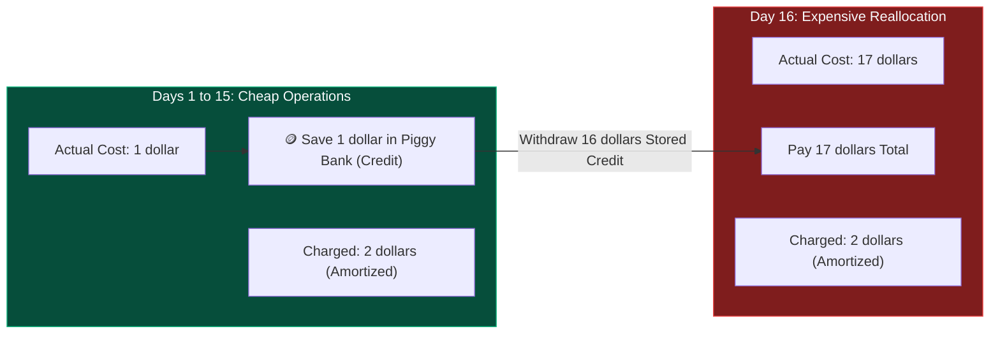
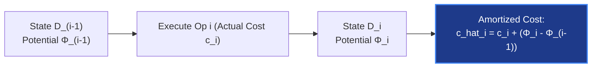

# Chapter 04: Amortized Analysis — The Truth in the Aggregate

> *"An individual operation may be exorbitantly expensive, but if it buys peace for a thousand operations to come, the amortized cost is pennies."*

---

## 🧒 Explain Like I'm 5: The Coffee Machine Piggy Bank

Imagine you love espresso:
- Everyday espresso beans and water cost **\$1**.
- But after every **16 cups**, the machine needs a deep clean and descaling cartridge that costs **\$16**.

```
Day 1 to 15:  Cost = $1 per cup
Day 16:       Cost = $1 + $16 = $17!
```

If you look *only* at Day 16, you might panic: *"Coffee costs \$17! This is too expensive!"*  
**The Solution (The Piggy Bank)**:
- On Days 1 through 15, you pay **\$2** per cup: \$1 goes to the coffee, and **\$1 goes into a piggy bank**.
- By Day 16, your piggy bank holds **\$16**.
- When the expensive descaling arrives, you break the piggy bank and pay for it.
- **Your true, predictable daily cost is always \$2.**



This is **Amortized Analysis**. Individual operations lie. Aggregate truth is revealed when you account for the prepaid credits.

---

## 🟢 Undergraduate Foundation: The Three Classical Methods

> **Critical Distinction**: Amortized analysis is **NOT** average-case analysis!  
> - Average-case analysis relies on probability and assumes an input distribution.
> - **Amortized analysis guarantees worst-case performance over ANY sequence of operations without any probabilities!**

---

### Method 1: The Aggregate Method
The simplest and most direct method:
1. Determine the total worst-case cost $T(n)$ for an entire sequence of $n$ operations.
2. The amortized cost per operation is simply:
   $$\hat{c} = \frac{T(n)}{n}$$

*Example: Dynamic Array Doubling*:
Appending $n$ elements into an array that doubles whenever full:
- Insertions with no resize: $n$ operations $\times 1 = n$.
- Resizing copies at sizes $1, 2, 4, 8, \dots, 2^{\lfloor \log_2 n \rfloor}$:
  $$\sum_{i=0}^{\lfloor \log_2 n \rfloor} 2^i = 2^{\lfloor \log_2 n \rfloor + 1} - 1 < 2n$$
- Total cost for $n$ appends: $T(n) = n + 2n = 3n$.
- **Amortized cost per append**: $\frac{3n}{n} = 3 = O(1)$.

---

### Method 2: The Accounting (Banker's) Method
We assign an artificial amortized charge $\hat{c}_i$ to each operation:
- If $\hat{c}_i > c_i$ (actual cost): The excess $\hat{c}_i - c_i$ is deposited as **credit** into specific objects in the data structure.
- If $\hat{c}_i < c_i$: The deficit $c_i - \hat{c}_i$ is paid for by consuming stored credit.

#### The Golden Invariant:
The total credit in the bank must **never drop below zero** at any point in time:

$$\sum_{i=1}^k \hat{c}_i \ge \sum_{i=1}^k c_i \quad \text{for all } k \ge 1$$

*Example: Dynamic Array with Amortized Cost $\hat{c} = 3$*:
- When inserting an element into an empty slot:
  - 1 dollar pays for the actual insertion.
  - 1 dollar is attached to the element itself as credit.
  - 1 dollar is attached to an older element that was moved earlier.
- When the table is full (e.g., size $N$), every element in the second half has 2 dollars in credit attached to it.
- Total stored credit $= \frac{N}{2} \times 2 = N$.
- Table doubles to $2N$: We need to copy $N$ elements $\implies$ Cost is $N$.
- Stored credit pays for the entire copy! **Bank balance remains $\ge 0$.**

---

### Method 3: The Potential (Physicist's) Method
Instead of placing credits on individual items, we define a global **Potential Function** $\Phi(D)$ mapping the data structure state $D$ to a real number:
- $\Phi(D_0) = 0$ (initial state potential).
- $\Phi(D_i) \ge 0$ for all states $D_i$ (potential must never be negative).

The **amortized cost** of operation $i$ is defined as:

$$\hat{c}_i = c_i + \Phi(D_i) - \Phi(D_{i-1})$$

Where $\Delta \Phi = \Phi(D_i) - \Phi(D_{i-1})$ is the change in potential.



Summing over all $n$ operations via telescoping sum:

$$\sum_{i=1}^n \hat{c}_i = \sum_{i=1}^n \left( c_i + \Phi(D_i) - \Phi(D_{i-1}) \right) = \sum_{i=1}^n c_i + \Phi(D_n) - \Phi(D_0)$$

Since $\Phi(D_n) \ge 0$ and $\Phi(D_0) = 0$:

$$\sum_{i=1}^n \hat{c}_i \ge \sum_{i=1}^n c_i$$

Total amortized cost is an **upper bound on total actual cost**!

---

## 🟡 Master's Deep-Dive: Canonical Case Studies

### 1. Dynamic Array Growth Factors: $1.5\times$ vs $2\times$
Why do C++ (MSVC / FB folly) use $1.5\times$ while GCC and Python use $2\times$?

```
Growth factor k = 2:
Capacities: 1, 2, 4, 8, 16, 32...
When allocating 32, total previously freed memory = 1 + 2 + 4 + 8 + 16 = 31 < 32!
👉 The allocator CANNOT reuse previously deallocated chunks!
```

- With **$k = 2$**, the new chunk is strictly larger than the sum of all previous chunks. Memory footprint grows without memory reuse.
- With **$k = 1.5$** (or the golden ratio $\phi \approx 1.618$):
  $$1 + 1.5 + 2.25 + 3.375 = 8.125 > 7.59$$
  By the 4th reallocation, the previously freed contiguous memory can be **reused in-place**, drastically reducing heap fragmentation!

---

### 2. Two-Stack Queue (Pattern 08)
Implementing a FIFO Queue using two LIFO Stacks (`in_stack` and `out_stack`):
- `ENQUEUE(x)`: `in_stack.push(x)`. Cost = 1.
- `DEQUEUE()`: If `out_stack` is empty, pop *all* items from `in_stack` and push to `out_stack`. Then `out_stack.pop()`.

#### The Potential Proof:
Define $\Phi = 2 \times |S_{in}|$.
1. **`ENQUEUE`**:
   - Actual cost $c_i = 1$.
   - $\Delta \Phi = 2(|S_{in}| + 1) - 2|S_{in}| = 2$.
   - $\hat{c} = 1 + 2 = 3 = O(1)$.
2. **`DEQUEUE` (when `out_stack` is empty and has $k$ items in `in_stack`)**:
   - Actual cost: $k$ pops $+ k$ pushes $+ 1$ final pop $= 2k + 1$.
   - $\Delta \Phi = 2(0) - 2(k) = -2k$ (potential drops!).
   - $\hat{c} = (2k + 1) + (-2k) = 1 = O(1)$.
- **Every operation is amortized $O(1)$**!

---

### 3. Disjoint-Set Union (Union-Find) with Rank & Path Compression
When you perform $m$ operations on $n$ elements using **Union by Rank** and **Path Compression**:
- Tarjan proved the total running time is:
  $$O(m \cdot \alpha(n))$$
- $\alpha(n)$ is the **Inverse Ackermann function**:
  $$A(1) = 2, \quad A(2) = 4, \quad A(3) = 16, \quad A(4) = 2^{65536}$$
  $A(4)$ is a number with 19,729 decimal digits (larger than the number of atoms in the known universe).
- For all practical inputs $n \le 10^{80}$, $\alpha(n) \le 4$.
- **Amortized cost per find/union is effectively $O(1)$**.

---

## 🔴 PhD Horizon: Splay Trees & Dynamic Optimality

<details>
<summary><strong>Expand PhD Deep-Dive: Splay Trees & The Dynamic Optimality Conjecture</strong></summary>

### Splay Trees (Daniel Sleator & Robert Tarjan, 1985)
A self-adjusting binary search tree that stores **zero balance metadata** (no colors, no height tags).
- Whenever a node $x$ is accessed, it is rotated to the root using **Zig-Zig** and **Zig-Zag** operations.
- **The Access Lemma**:
  Define rank $r(x) = \log_2(\text{size}(x))$ and $\Phi = \sum_{x \in T} r(x)$.
  Tarjan proved that every splay operation has amortized cost:
  $$\hat{c} \le 3(r(\text{root}) - r(x)) + 1 = O(\log n)$$

### The Dynamic Optimality Conjecture (Open since 1985!)
Does there exist an online BST algorithm that performs within an $O(1)$ factor of the *offline optimal* BST for every access sequence?
- Sleator and Tarjan conjectured that the simple Splay Tree **is dynamically optimal**.
- Despite 40 years of work by Demaine, Iacono, and others, this remains one of the deepest open problems in theoretical data structures.

</details>

---

## 💻 Python 3.14 Verification: Geometric Doubling vs Additive Growth

Here is executable code comparing the real cost of **Geometric Resizing ($2\times$)** versus **Additive Resizing ($+1000$)**:

```python
import time


class DynamicArrayGeometric:

    def __init__(self):
        self.capacity = 1
        self.size = 0
        self.data = [0] * self.capacity
        self.total_copies = 0

    def append(self, val: int):
        if self.size == self.capacity:
            old_cap = self.capacity
            self.capacity *= 2
            new_data = [0] * self.capacity
            for i in range(self.size):
                new_data[i] = self.data[i]
                self.total_copies += 1
            self.data = new_data
        self.data[self.size] = val
        self.size += 1


class DynamicArrayAdditive:

    def __init__(self, step: int = 1000):
        self.step = step
        self.capacity = step
        self.size = 0
        self.data = [0] * self.capacity
        self.total_copies = 0

    def append(self, val: int):
        if self.size == self.capacity:
            self.capacity += self.step
            new_data = [0] * self.capacity
            for i in range(self.size):
                new_data[i] = self.data[i]
                self.total_copies += 1
            self.data = new_data
        self.data[self.size] = val
        self.size += 1


if __name__ == "__main__":
    n = 100_000

    # Test Geometric
    geom = DynamicArrayGeometric()
    for i in range(n):
        geom.append(i)

    # Test Additive
    additive = DynamicArrayAdditive(step=1000)
    for i in range(n):
        additive.append(i)

    avg_geom_copies = geom.total_copies / n
    avg_add_copies = additive.total_copies / n

    print(f"Total Appends: {n:,}")
    print(
        f"Geometric (2x)   - Total Copies: {geom.total_copies:,} | Avg Copies/Op: {avg_geom_copies:.2f} (O(1) amortized)"
    )
    print(
        f"Additive (+1000) - Total Copies: {additive.total_copies:,} | Avg Copies/Op: {avg_add_copies:.2f} (O(N) amortized)"
    )

    assert avg_geom_copies < 3.0  # Confirms theoretical upper bound
    print(
        "✅ Verification passed: Geometric doubling guarantees O(1) amortized insertions!"
    )
```

---

## 🔗 Connections to Coding Patterns

- **Pattern 28: Union Find**: The classic textbook demonstration of amortized $O(\alpha(N))$ operations.
- **Pattern 08: Stacks & Pattern 33: Monotonic Queue**: In a monotonic queue or stack, each element is pushed once and popped at most once. Over $N$ total operations, the while loop executes at most $N$ total times $\implies$ **Amortized $O(1)$ per step**!

---

## 🧪 Self-Test Questions

1. **Why is amortized analysis strictly stronger and more reliable than average-case analysis?**
2. **In the Potential Method, why is it mandatory that $\Phi(D_n) \ge \Phi(D_0)$ for all $n$?**
3. **If a dynamic array grows by adding 100 slots each time it fills up, what is its amortized cost per append?**
4. **Explain how a Monotonic Stack achieves amortized $O(1)$ time even though the inner `while` loop can pop $N-1$ elements in a single call.**
5. **Why can't dynamic arrays use memory deallocation reuse with a growth factor of $2.0$?**

<details>
<summary><strong>Click to view answers</strong></summary>

1. Average-case analysis relies on assumptions about the probability distribution of incoming inputs (e.g., inputs arrive uniformly at random). Amortized analysis makes **zero probabilistic assumptions** and guarantees that *any* sequence of operations (even constructed by an adversary) will average out to the bound.
2. If $\Phi(D_n) < \Phi(D_0)$, the telescoping sum $\sum \hat{c}_i = \sum c_i + \Phi(D_n) - \Phi(D_0)$ would subtract a positive value from $\sum c_i$, meaning the total amortized cost would underestimate the true cost. Requiring $\Phi(D_n) \ge \Phi(D_0)$ guarantees the amortized cost is an authentic upper bound.
3. **$\Theta(N)$ (linear)** amortized cost per append. Resizing occurs every 100 appends. The total copies across $N$ elements is $\approx \sum_{k=1}^{N/100} (100k) \approx \frac{N^2}{200}$. Dividing by $N$ operations gives $\approx N / 200 = \Theta(N)$ cost per operation!
4. An element can only be popped from the stack if it was previously pushed. Over $N$ inputs, exactly $N$ elements are pushed. Therefore, across the *entire lifetime* of the algorithm, the inner while loop can execute a maximum of $N$ pop operations total. $N$ pushes $+ N$ pops over $N$ steps $= 2N / N = O(1)$ amortized per element.
5. In geometric growth with $k=2$, the powers of 2 satisfy $1 + 2 + 4 + \dots + 2^{k-1} = 2^k - 1 < 2^k$. The sum of all previously deallocated memory blocks is strictly smaller than the next block requested. Therefore, the memory allocator cannot reuse the previously deallocated contiguous space.

</details>
