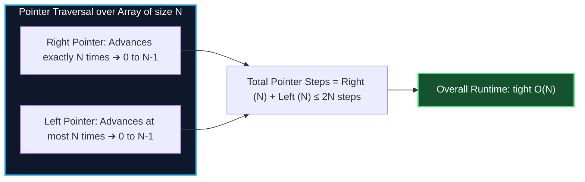

# Chapter 04: Amortized Analysis — The Piggy Bank Model & Loop Illusions

> *"Amortized analysis is not advanced mathematics. It is financial accounting: you pay a little extra during the cheap moments so the rare expensive moments are already prepaid."*

---

## 💡 1. The Napkin Analogy: The Coffee Punch Card

Imagine a coffee shop punch card:
- Cups 1 through 9 cost **$3.00 each**.
- Cup 10 is **Free**!
- What is your average cost per cup? $\frac{9 \times \$3}{10} = \$2.70$.

Now invert the scenario for a **Dynamic Array (`vector` / `ArrayList` / Python `list`)**:

```
Append 1: [ A ]               Cost = 1 op
Append 2: [ A | B ]           Cost = 1 op
Append 3: [ A | B | C | _ ]   Array full! Resize to 4: Copy A, B, insert C ➜ Cost = 3 ops
Append 4: [ A | B | C | D ]   Cost = 1 op
Append 5: [ A | B | C | D | E | _ | _ | _ ] Resize to 8: Copy 4, insert E ➜ Cost = 5 ops
```

Most appends take **$O(1)$** work. Very rarely, an append hits a capacity wall and takes **$O(N)$** work to allocate double the memory and copy elements over.

### The Piggy Bank Rule
Every time you insert an element on an easy day, you deposit **$2 into a piggy bank**:
- $1 pays to insert the element right now.
- $1 is saved to pay for copying this element when the array doubles later.

Because every element pays for its own future copy upfront, **the piggy bank never runs out of money**. The amortized cost per append is **constant time $O(1)$**.

---

## 📊 2. The Visual Whiteboard: Two Big Multi-Loop Illusions

In technical interviews, interviewers frequently test whether you can recognize when **nested loops are secretly $O(N)$**.

### Illusion 1: The Two-Pointer & Sliding Window ($O(N)$, not $O(N^2)$)

Candidates see a `while` loop inside a `for` loop and panic, guessing $O(N^2)$:

```python
left = 0
for right in range(len(nums)):  # Outer loop runs N times
    window_sum += nums[right]
    while window_sum > target:  # Inner while loop! Is this O(N^2)??
        window_sum -= nums[left]
        left += 1  # ⚠️ Notice: `left` NEVER resets backward!
```



**The Proof**: The `right` pointer moves from index $0$ to $N-1$ (at most $N$ steps). The `left` pointer also only moves forward from $0$ to $N-1$ (at most $N$ steps). It **never resets back to zero**. The combined operations of both pointers cannot exceed $2N \implies O(N)$.

---

### Illusion 2: The Monotonic Stack ($O(N)$, not $O(N^2)$)

```python
stack = []
for x in nums:  # Runs N times
    while stack and stack[-1] < x:  # Inner loop popping elements!
        stack.pop()
    stack.append(x)
```

```
Push element 1 ──┐
Push element 2 ──┼──> Exactly N total pushes across entire program
Push element 3 ──┘

Pop element 1 ──┐
Pop element 2 ──┼──> At most N total pops across entire program
Pop element 3 ──┘
─────────────────────────────────────────────────────────────
Total operations across all iterations ≤ 2N = O(N)
```

Every number enters the stack **exactly once** and leaves the stack **at most once**. An element that has been popped can never be popped again. Total operations across the entire algorithm $\le 2N \implies O(N)$.

---

### Illusion 3: Disjoint Set Union (DSU / Union-Find) with Path Compression

With both **path compression** and **union by rank/size**, finding or uniting sets runs in **$O(\alpha(N))$** time.
- $\alpha(N)$ is the **Inverse Ackermann Function**.
- For any input $N$ up to the number of atoms in the observable universe ($10^{80}$), $\alpha(N) \le 4$.
- On a whiteboard, state: *"DSU operations run in effectively constant amortized time $O(\alpha(N)) \approx O(1)$."*

---

## 🗣️ 3. The 30-Second Interview Talk Track

### The Two-Pointer / Sliding Window Script
> *"Although there is a while loop nested inside the for loop, this is **strictly $O(N)$ time**. Notice that the left pointer only moves forward and never resets. Each of the $N$ elements is examined at most twice: once when entering the window via the right pointer, and once when leaving via the left pointer. Across the entire function, there are at most $2N$ pointer movements, giving an amortized linear runtime of $O(N)$."*

### The Monotonic Stack Script
> *"While the inner while loop can pop multiple elements in a single iteration, each element is pushed onto the stack exactly once and popped at most once. Across all $N$ elements, the total number of push and pop operations combined is bounded by $2N$. Therefore, the amortized time complexity is $O(N)$."*

### The Dynamic Array Resize Script
> *"While a single append that triggers a capacity resize takes $O(N)$ time, capacity doubles geometrically ($1, 2, 4, 8, \dots$). The total number of element copies across $N$ insertions is bounded by $2N$. Amortized across all $N$ operations, each append costs an average of $O(1)$ time."*

---

## 🧠 4. Senior Systems Reality: The P99 Latency Spike Hazard

In theory, amortized $O(1)$ is wonderful. In high-scale low-latency systems (e.g., trading engines, payment gateways, video games), **amortized $O(1)$ can cause production incidents**:

```
Latency Timeline:
Append 1..1023:  [0.01 ms] [0.01 ms] [0.01 ms] ... (Fast)
Append 1024:     [ 15.0 ms ] 💥 Resizing array from 1024 to 2048! (P99 Spike / Audio Glitch)
Append 1025..:   [0.01 ms] [0.01 ms] ...
```

### How Senior Engineers Prevent This in Production:
1. **Pre-Allocation**: If you know your query will return $\approx 100,000$ records, never use default dynamic sizing:
   - In Java: `new ArrayList<>(100_000)`
   - In C++: `std::vector::reserve(100000)`
   - This eliminates all re-allocations and memory copy overhead entirely.
2. **Predictable Latency Containers**: When P99 latency guarantees are strict (SLA $\le 5$ ms), real-time systems use fixed-size ring buffers (`circular buffer`) or chunked deques rather than doubling arrays.

---

## 🎯 5. Constraint Triage & FAANG Traps

### Trap 1: The `pop(0)` Disaster on Python Lists
```python
# ❌ TRAP: O(N^2) Time Complexity!
# A Python list is a dynamic contiguous array.
# Calling `pop(0)` removes the first element and SHIFTS all remaining N-1 elements left!
queue = [1, 2, 3, 4, 5]
while queue:
    item = queue.pop(0)  # O(N) shift per iteration! O(N^2) total!

# ✅ SENIOR FIX: O(N) using collections.deque (Doubly Linked Blocks)
from collections import deque
queue = deque([1, 2, 3, 4, 5])
while queue:
    item = queue.popleft()  # True O(1) pointer unlink! O(N) total!
```

### Trap 2: Accidentally Resetting Pointers
If in a sliding window or two-pointer problem you write:
```python
# ❌ TRAP: Re-setting left = 0 destroys the amortized bound!
if invalid_condition:
    left = 0  # 💥 Can cause up to N pointer resets ➔ Degrades to O(N^2)!
```
Ensure your pointer monotonically advances forward.

---

## 🧭 Navigation
- **Previous**: [Ch 03: Recurrences & Master Theorem](./03_recurrences_and_master_theorem.md)
- **Next**: [Ch 05: Lower Bounds & Impossibility](./05_lower_bounds_and_impossibility.md)
