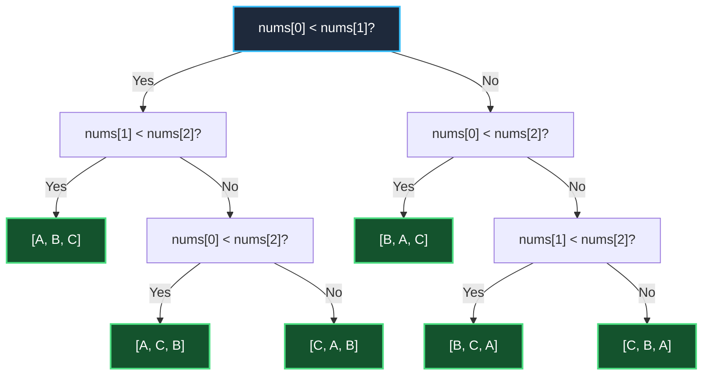
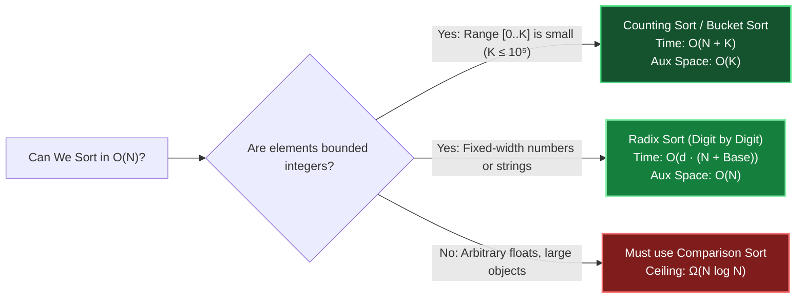

# Chapter 05: Theoretical Ceilings — The 20-Questions Rule & Sorting Limits

> *"Knowing what is impossible saves you from wasting an entire interview trying to optimize past a mathematical wall."*

---

## 💡 1. The Napkin Analogy: The 20-Questions Game

Imagine playing the game of **20 Questions**:
- I think of a secret object. You can only ask **Yes/No** questions.
- Each question cuts the space of possibilities in half at best.
- If there are $M$ possible objects, you need at least $\log_2 M$ questions to uniquely identify the answer.

Now apply this to **Sorting an Array of $N$ Elements**:
- How many different ways can $N$ distinct items be ordered?  
  Exactly **$N!$ (factorial)** possible permutations!
- Every time your algorithm compares two items (`nums[i] < nums[j]`), it asks a **Yes/No** question.
- To isolate the **single correct sorted order** out of $N!$ possibilities, your algorithm must ask:

$$\text{Minimum Comparisons} \ge \log_2(N!) \approx N \log_2 N$$

```
┌─────────────────────────────────────────────────────────────────────────────┐
│ 🛑 THE COMPARISON LOWER BOUND:                                              │
│ No comparison-based sorting algorithm (MergeSort, QuickSort, HeapSort)      │
│ can EVER run faster than Ω(N log N) in the worst case!                      │
└─────────────────────────────────────────────────────────────────────────────┘
```

---

## 📊 2. The Visual Whiteboard: The Decision Tree & The Escape Hatches

### The Decision Tree for $N = 3$ (6 Possible Permutations)



Tree depth must be at least $\lceil \log_2(6) \rceil = 3$ questions to reach all leaves. For $N = 10^5$, $\log_2(10^5!) \approx 1.7 \times 10^6$ comparisons.

---

### How to Escape the $\Omega(N \log N)$ Ceiling: Non-Comparison Sorts

Can we ever sort in $O(N)$ linear time? **YES, if we stop comparing elements against each other!**



---

## 🗣️ 3. The 30-Second Interview Talk Track

### Defending the Optimality of Your Solution
When an interviewer asks: *"Can we solve this faster than $O(N \log N)$?"*

> *"If we rely on pairwise element comparisons, $\Omega(N \log N)$ is an information-theoretic lower bound because any decision tree must discriminate among $N!$ possible permutations.  
> 
> However, if the problem constraints restrict elements to small integers (e.g., ages between 0 and 120, or characters in lowercase English), we can bypass the comparison ceiling by using **Counting Sort** in $O(N)$ time and $O(K)$ space."*

### Graph Search Lower Bound
When asked why BFS/DFS is optimal for graph traversal:
> *"In an arbitrary graph, any traversal must visit every vertex and inspect every edge at least once in the worst case to determine connectivity. Therefore, $\Omega(V + E)$ is a strict lower bound; our BFS/DFS matches this bound tight."*

---

## 🧠 4. Senior Systems Reality: Why Production Runtimes Hybridize

Standard libraries in Python, Java, and C++ do not use purely textbook algorithms:

```
┌───────────────────┬──────────────────────┬─────────────────────────────────────────────────────────┐
│ Language          │ Algorithm            │ Why This Hybrid Architecture?                           │
├───────────────────┼──────────────────────┼─────────────────────────────────────────────────────────┤
│ Python & Java     │ Timsort              │ MergeSort + InsertionSort hybrid. Detects naturally     │
│ (Objects)         │                      │ ordered runs. Stable (preserves object identity order). │
├───────────────────┼──────────────────────┼─────────────────────────────────────────────────────────┤
│ C++ (`std::sort`) │ Introsort            │ QuickSort + HeapSort + InsertionSort. Starts fast with  │
│                   │                      │ QuickSort; switches to HeapSort if depth > 2 log N      │
│                   │                      │ to avoid O(N²) worst-case degradation.                  │
└───────────────────┴──────────────────────┴─────────────────────────────────────────────────────────┘
```

### The Small-$N$ Insertion Sort Switch
Both Timsort and Introsort switch to **Insertion Sort when subarrays shrink to $N \le 32$**.  
*Why?* While Insertion Sort is $O(N^2)$ asymptotically, for $N < 32$:
- It requires zero recursion or buffer allocations.
- It stays entirely inside the CPU L1 cache.
- The constant factor is tiny, outperforming QuickSort and MergeSort on small slices!

---

## 🎯 5. Constraint Triage & FAANG Traps

### Trap 1: The Massive Range Counting Sort Memory Bomb
```python
# ❌ TRAP: Out Of Memory!
# nums = [1, 10^9]. Range K = 10^9!
# Allocating a count array of size 1,000,000,000 crashes with MemoryError!
def bad_counting_sort(nums):
    max_val = max(nums)
    counts = [0] * (max_val + 1)  # 💥 Allocates gigabytes of RAM!

# ✅ SENIOR FIX: Only use Counting Sort when max(nums) - min(nums) ≤ 10^5.
# Otherwise, fall back to O(N log N) Timsort.
```

### Trap 2: Floating Point Precision Loss in Buckets
When implementing Bucket Sort on floating-point numbers, never rely on exact equality checks (`== 0.0`). Always normalize into buckets with `int(num * num_buckets)`.

---

## 🧭 Navigation
- **Previous**: [Ch 04: Amortized Analysis](./04_amortized_analysis.md)
- **Next**: [Ch 06: NP-Completeness & Reductions](./06_np_completeness_and_reductions.md)
