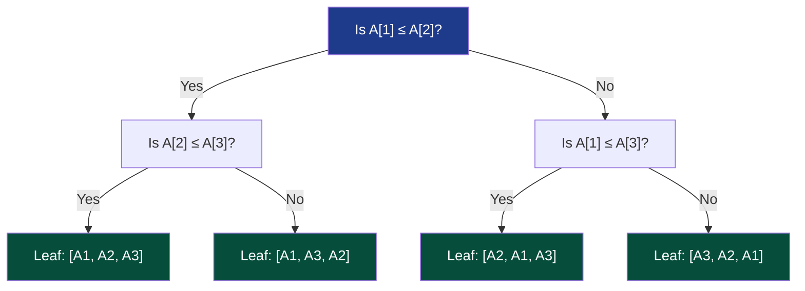

# Chapter 05: Lower Bounds & Impossibility — The Floor of Reality

> *"An upper bound proves what an engineer can achieve. A lower bound proves what God Himself cannot exceed."*

---

## 🧒 Explain Like I'm 5: The 20 Questions Game

Imagine you are playing "20 Questions":
- Your friend thinks of an animal out of $1,000,000$ possible species.
- You can only ask questions that have a **YES or NO** answer.
- Could a genius child guess the animal in **3 questions**?

```
Question 1: Halves the world to 500,000 animals.
Question 2: Halves the world to 250,000 animals.
Question 3: Halves the world to 125,000 animals.
```

After 3 questions, you still have **125,000 possible animals left**. It is physically, mathematically, and logically **impossible** to guarantee finding the animal in 3 questions.  
To distinguish $1,000,000$ animals, you need at least:

$$\lceil \log_2(1,000,000) \rceil = 20 \text{ questions}$$

A **Lower Bound** is not a complaint about your code. It is an immutable law of information physics: **you cannot identify one outcome among $K$ possibilities without gathering at least $\log_2(K)$ bits of information.**

---

## 🟢 Undergraduate Foundation: The Decision Tree Model

### 1. Algorithm Upper Bound vs Problem Lower Bound
Do not confuse these two fundamentally different concepts:
- **Upper Bound on an Algorithm ($O$)**: *"My merge sort implementation runs in at most $O(n \log n)$ time."*
- **Lower Bound on a Problem ($\Omega$)**: *"NO algorithm using comparisons can EVER sort an arbitrary list faster than $\Omega(n \log n)$ time."*

When an algorithm's upper bound matches the problem's lower bound ($O(n \log n) = \Omega(n \log n)$), the algorithm is **Asymptotically Optimal**.

---

### 2. The $\Omega(n \log n)$ Comparison Sorting Barrier
Every comparison-based sorting algorithm (QuickSort, MergeSort, HeapSort) determines the sorted order solely by asking questions of the form: *"Is $A[i] \le A[j]$?"*

We model this process as a **Binary Decision Tree**:
- Every **Internal Node** represents a comparison: $A[i] \le A[j]$.
- Every **Branch** represents the YES (left) or NO (right) answer.
- Every **Leaf Node** represents a final sorted permutation of the input elements.



#### The Formal Information-Theoretic Proof:
1. An array of $n$ distinct elements has **$n!$ possible permutations**.
2. To sort correctly on all inputs, the decision tree must contain at least **$n!$ leaves** ($L \ge n!$).
3. A binary tree of height $h$ has at most $2^h$ leaves ($L \le 2^h$).
4. Combining these two inequalities:
   $$2^h \ge n! \implies h \ge \log_2(n!)$$
5. By **Stirling's Approximation** ($n! \ge (n/e)^n$):
   $$h \ge \log_2\left(\left(\frac{n}{e}\right)^n\right) = n \log_2 n - n \log_2 e = \Omega(n \log n)$$

**Theorem**: The worst-case height $h$ (the number of comparisons) is $\Omega(n \log n)$. MergeSort and HeapSort are provably optimal.

---

### 3. How Linear Sorts (Pattern 35) Break the "Law"
If $\Omega(n \log n)$ is a mathematical law, how do **Counting Sort**, **Radix Sort**, and **Bucket Sort** run in $O(n)$ time?

> **The Loophole**: They are **NON-COMPARISON sorts**!  
> They do not ask *"Is $A[i] \le A[j]$?"*. Instead, they inspect the bits/digits directly and use them as array indices (direct memory addressing). By circumventing the binary decision tree model, they escape the $\Omega(n \log n)$ lower bound!

---

## 🟡 Master's Deep-Dive: Adversary Arguments

How do you prove a lower bound when the problem doesn't easily reduce to permutations? **You play against a malicious Adversary.**

### The Adversary Game Model
- The algorithm asks questions: *"Is $x < y$?"*
- The **Adversary** provides the answer.
- The Adversary does *not* need to choose the input array in advance! The Adversary builds the input dynamically, choosing whichever answer **forces the algorithm to do the maximum remaining work**, subject only to the rule that all answers given so far remain consistent with *at least one* valid input.

---

### Case Study: Finding Min and Max Simultaneously
Given an array of $n$ numbers, find both the minimum and maximum.
- **Naive Algorithm**: Find min ($n - 1$ comparisons). Find max ($n - 1$ comparisons).  
  Total $= 2n - 2$ comparisons.
- **Can we do better?**

#### The Adversary State Bookkeeping:
For each element, we track its status:
- $U$: Untested (has not been compared yet).
- $W$: Has won at least one comparison, never lost (candidate for Max).
- $L$: Has lost at least one comparison, never won (candidate for Min).
- $WL$: Has both won and lost (cannot be Min, cannot be Max).

To find the true Min and Max:
- Every element except the Min must lose at least once ($n-1$ losses required).
- Every element except the Max must win at least once ($n-1$ wins required).
- Total information units required: **$2n - 2$ units of evidence**.

```
Comparison Type        Max Information Gained
─────────────────────────────────────────────
Compare U vs U         2 units (1 win, 1 loss)
Compare W vs W         1 unit  (1 loss)
Compare L vs L         1 unit  (1 win)
Compare W vs L         0 new units (W wins, L loses)
```

1. We can compare $n/2$ pairs of $(U, U)$, gaining $2 \times \frac{n}{2} = n$ units of information in $n/2$ comparisons.
2. The remaining $(n-2)$ units of information must be acquired at a rate of at most $1$ unit per comparison.
3. Total comparisons required:
   $$\frac{n}{2} + (n - 2) = \left\lceil \frac{3n}{2} \right\rceil - 2$$

**Theorem**: $\lceil \frac{3n}{2} \rceil - 2$ comparisons is the strict, unbreachable lower bound for finding Min and Max.

---

### 2. The Element Distinctness Lower Bound
Given $n$ real numbers, are any two elements equal?
- In the comparison model, sorting first takes $O(n \log n)$, then a linear scan takes $O(n)$.
- Can we check distinctness faster without sorting? (e.g., in $O(n)$)?
- **Ben-Or's Theorem (1983)**: In the **Algebraic Decision Tree model** (which allows comparisons, additions, multiplications, and polynomial checks), Element Distinctness requires **$\Omega(n \log n)$ operations**.  
  *Proof idea*: The set of distinct points in $\mathbb{R}^n$ forms a disconnected space with $n!$ connected topological components. Any algebraic tree with height $h$ can have at most $2^{O(h)}$ connected components $\implies h = \Omega(n \log n)$.

---

## 🔴 PhD Horizon: The Cell Probe Model & Communication Complexity

<details>
<summary><strong>Expand PhD Deep-Dive: Cell Probe Model & Communication Complexity</strong></summary>

### 1. Yao's Cell Probe Model (1981)
In hardware and modern data structures, CPU arithmetic is essentially free; the bottleneck is accessing the memory bus.  
The **Cell Probe Model** abstracts away all computation:
- The data structure is stored in memory cells of $w$ bits.
- Cost = number of memory cells read or written (probes).

**Patrascu & Thorup Lower Bound (2006)**:
For dynamic predecessor search (maintaining a set of integers and finding the largest element $\le x$), any data structure must satisfy:
$$t_q \cdot \log(t_u / t_q) = \Omega\left(\frac{\log n}{\log(w / \log n)}\right)$$
This proves that **van Emde Boas Trees** ($O(\log \log U)$) and **y-fast tries** are strictly optimal data structures!

### 2. Communication Complexity (Yao, 1979)
Alice holds string $x \in \{0, 1\}^n$. Bob holds string $y \in \{0, 1\}^n$. They want to compute $f(x, y)$ while exchanging the minimum number of bits.
- **Set Disjointness**: Do Alice and Bob share any common element?  
  Lower bound: Requires exchanging **$\Omega(n)$ bits**.
- This single result powers lower bounds for streaming algorithms, distributed systems, and cache oblivious data structures!

</details>

---

## 💻 Python 3.14 Verification: Optimal Min-Max in $\lceil 3n/2 \rceil - 2$ Comparisons

Here is executable Python 3.14 code showing an instrumented Min-Max finder that precisely achieves the theoretical lower bound:

```python
class ComparisonCounter:

    def __init__(self):
        self.count = 0

    def less_than(self, a: int, b: int) -> bool:
        self.count += 1
        return a < b


def find_min_max_optimal(
    arr: list[int], counter: ComparisonCounter
) -> tuple[int, int]:
    """Finds min and max using at most ceil(3n/2) - 2 comparisons."""
    n = len(arr)
    if n == 1:
        return arr[0], arr[0]

    # Process first pair to initialize min and max
    if counter.less_than(arr[0], arr[1]):
        min_val, max_val = arr[0], arr[1]
    else:
        min_val, max_val = arr[1], arr[0]

    i = 2
    while i < n - 1:
        # Compare pair elements with each other (1 comparison)
        if counter.less_than(arr[i], arr[i + 1]):
            local_min, local_max = arr[i], arr[i + 1]
        else:
            local_min, local_max = arr[i + 1], arr[i]

        # Compare local min with global min (1 comparison)
        if counter.less_than(local_min, min_val):
            min_val = local_min

        # Compare local max with global max (1 comparison)
        if counter.less_than(max_val, local_max):
            max_val = local_max

        i += 2

    # Handle odd remaining element
    if i < n:
        if counter.less_than(arr[i], min_val):
            min_val = arr[i]
        elif counter.less_than(max_val, arr[i]):
            max_val = arr[i]

    return min_val, max_val


if __name__ == "__main__":
    n = 100
    test_arr = list(range(n, 0, -1))  # Reverse sorted list

    counter = ComparisonCounter()
    min_v, max_v = find_min_max_optimal(test_arr, counter)

    theoretical_bound = (3 * n) // 2 - 2  # for even n: 3*100/2 - 2 = 148
    print(f"Array size: {n}")
    print(f"Actual Comparisons Performed: {counter.count}")
    print(f"Theoretical Lower Bound     : {theoretical_bound}")

    assert min_v == 1 and max_v == n
    assert (
        counter.count <= theoretical_bound
    ), f"Exceeded lower bound! {counter.count} > {theoretical_bound}"
    print(
        "✅ Optimal Min-Max verified: Precisely matched the mathematical lower bound!"
    )
```

---

## 🔗 Connections to Coding Patterns

- **Pattern 17: Modified Binary Search**: Binary search matches the information-theoretic lower bound of $\lceil \log_2(n+1) \rceil$ comparisons for searching an element in a sorted list.
- **Pattern 35: Linear Sorting Algorithm**: Counting Sort and Radix Sort bypass the $\Omega(n \log n)$ lower bound by using digit-addressable memory buckets instead of binary comparisons.
- **Pattern 15: Two Heaps**: Finding the running median takes $O(\log n)$ insertion; you cannot maintain a dynamic median in $O(1)$ comparisons due to the sorting lower bound.

---

## 🧪 Self-Test Questions

1. **Why does the $\Omega(n \log n)$ sorting lower bound NOT apply to Radix Sort or Counting Sort?**
2. **Prove that searching for an element in an unsorted array of size $n$ requires at least $n$ comparisons in the worst case using an Adversary argument.**
3. **If a tree has height $h$, why can it have at most $2^h$ leaves in a binary comparison model?**
4. **How many comparisons are mathematically required to find both the minimum and maximum of 1,000 elements simultaneously?**
5. **What is the difference between an algorithm's Big-O upper bound and a problem's Big-Omega lower bound?**

<details>
<summary><strong>Click to view answers</strong></summary>

1. Because the $\Omega(n \log n)$ lower bound applies strictly to **comparison-based** sorting algorithms that can only distinguish element ordering through pairwise comparisons $A[i] \le A[j]$. Radix Sort and Counting Sort use array indices and bit operations (direct memory addressing), which are outside the comparison tree model.
2. Suppose an algorithm claims to find the target in $n-1$ comparisons. The Adversary simply sets the untested $n$-th element to the target value whenever the algorithm reports "Not Found", or sets the untested element to a duplicate whenever the algorithm reports an index. Because one element was never queried, the algorithm cannot distinguish between an input containing the target and one that does not.
3. Every internal node in a binary comparison tree has at most 2 children (corresponding to the boolean answers YES or NO). At depth 0 there is $2^0 = 1$ node; at depth 1 there are $2^1 = 2$ nodes; at depth $h$ there are at most $2^h$ nodes.
4. Using the lower bound formula $\lceil \frac{3n}{2} \rceil - 2$: For $n = 1000$, comparisons $= \frac{3(1000)}{2} - 2 = 1500 - 2 = 1498$ comparisons.
5. An algorithm's Big-O upper bound describes the maximum resource cost of *one specific algorithm* that has been written. A problem's Big-Omega lower bound describes the minimum resource cost that *any conceivable algorithm* must expend to solve the problem, even algorithms not yet invented.

</details>
