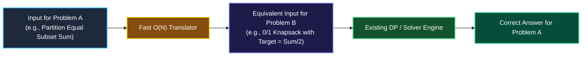

# Chapter 06: Reductions & Disguises — Spotting Hard Problems in Disguise

> *"A polynomial reduction is simply putting a disguise on an existing problem. If you recognize the face beneath the mask, you already know the solution."*

---

## 💡 1. The Napkin Analogy: The Costume Party & The Translator

Imagine you are hired as a translator at the United Nations:
- A diplomat speaks only Japanese.
- You do not speak Japanese, but you have a fast, automated translator that turns Japanese text into French in **1 second**.
- You already know how to solve problems in French!
- Can you solve the diplomat's request? **Yes!** Japanese $\to$ French $\to$ Solve.

```
┌─────────────────────────────────────────────────────────────────────────────┐
│ 🎭 POLYNOMIAL REDUCTION (A ≤ₚ B):                                           │
│ "Problem A reduces to Problem B" means:                                     │
│ If we have a solver for B, we can solve A with only a tiny polynomial       │
│ amount of translation work upfront.                                         │
└─────────────────────────────────────────────────────────────────────────────┘
```

In technical assessments, interviewers rarely name classic theoretical problems directly. Instead, they put a **story disguise** over a famous NP-Complete problem:
- *"Distribute cargo boxes across delivery vans"* $\implies$ **Bin Packing**.
- *"Place security guards at hallway intersections"* $\implies$ **Vertex Cover**.
- *"Split team bonus points into two equal pools"* $\implies$ **Subset Sum**.

---

## 📊 2. The Visual Whiteboard: The Reduction Pipeline



### The Big-5 Disguises Tested in FAANG Rounds

| Interview Story Disguise | Underlying NP-Complete Problem | Dead Giveaway Constraint | Expected Algorithmic Strategy |
|---|---|---|---|
| **Divide array into equal sums** (LC 416) | **Subset Sum** | Sum $\le 20,000$ | 1D Dynamic Programming (0/1 Knapsack) |
| **Visit every city / node once** (LC 847) | **Traveling Salesperson (TSP)** | $N \le 12$ | BFS with Bitmask State: `(node, mask)` |
| **Min cameras to monitor all tree edges** (LC 968) | **Vertex Cover** (on Tree) | Tree structure (No cycles!) | Greedy Post-Order DFS in $O(N)$! |
| **Schedule jobs into fixed time windows** (LC 1986) | **Bin Packing** | $N \le 14$ | Bitmask DP: $O(2^N \cdot N)$ |
| **Select largest independent team of friends** | **Maximum Independent Set** | $N \le 40$ | Meet-in-the-Middle / Backtracking |

---

## 🗣️ 3. The 30-Second Interview Talk Track

### Unmasking the Problem Script
> *"This problem is structurally isomorphic to the classic **Subset Sum problem**, which is known to be **NP-complete**. An exact polynomial-time solution for arbitrary values does not exist.*  
> 
> *However, notice the problem constraint: the maximum sum is bounded by $20,000$. This allows us to reduce it to a **0/1 Knapsack formulation** and solve it using **pseudo-polynomial Dynamic Programming** with a boolean 1D array in $O(N \cdot \text{target})$ time and $O(\text{target})$ auxiliary space. For $N = 200$ and target $= 10,000$, this performs roughly $2 \times 10^6$ operations, which finishes in under 20 milliseconds."*

---

## 🧠 4. Senior Systems Reality: Intractability in Everyday Infrastructure

NP-Hard problems appear constantly in production distributed systems:

```
┌──────────────────────────────────────┬─────────────────────────────────────────────────────────┐
│ Infrastructure Component             │ Underlying Intractable Problem                          │
├──────────────────────────────────────┼─────────────────────────────────────────────────────────┤
│ Kubernetes Pod Scheduler             │ Bin Packing: Fitting variable CPU/RAM pods into VMs     │
│ SQL Query Planner (10+ Table Joins)  │ Traveling Salesperson: Finding optimal join order       │
│ Package Managers (npm, pip, cargo)   │ Boolean SAT: Resolving version dependency trees         │
│ CDN Edge Cache Placement             │ Facility Location Problem: Minimizing latency to users  │
└──────────────────────────────────────┴─────────────────────────────────────────────────────────┘
```

### Why Systems Use Heuristics
When Kubernetes schedules pods across 5,000 worker nodes, it cannot run an exponential branch-and-bound solver. It uses **Greedy Heuristics** (e.g., Best-Fit or Least-Allocated) because finding an answer in **5 milliseconds that is 98% optimal** is vastly superior to waiting 40 minutes for a 100% perfect allocation.

---

## 🎯 5. Constraint Triage & FAANG Traps

### The $N \le 20$ Giveaway
Whenever an interview question gives $N \le 16$ or $N \le 20$:
- **Do NOT look for an $O(N \log N)$ sorting or two-pointer trick.**
- It is a flashing neon sign that the problem is NP-hard or combinatorial!
- The expected answer is **Bitmask DP** ($O(N \cdot 2^N)$) or **Backtracking with branch-and-bound pruning**.

### The "Tree Escape" Hatch
Notice row 3 in the table above: Vertex Cover is NP-Complete on general graphs. **On Trees, it is solvable in $O(N)$ linear time!**  
If an interviewer gives you a graph problem that seems NP-hard, immediately ask: *"Is the graph guaranteed to be acyclic (a tree or DAG)?"* If yes, the problem drops from exponential to linear DP!

---

## 🧭 Navigation
- **Previous**: [Ch 05: Lower Bounds & Impossibility](./05_lower_bounds_and_impossibility.md)
- **Next**: [Ch 07: Approximation Algorithms](./07_approximation_algorithms.md)
