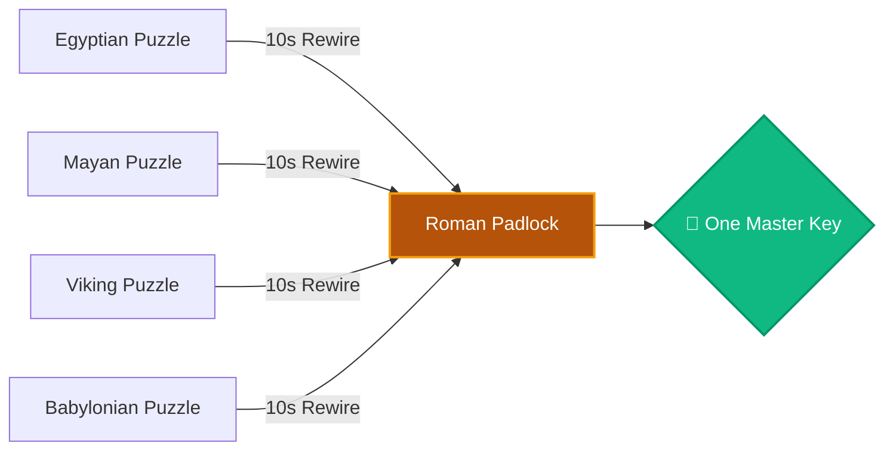
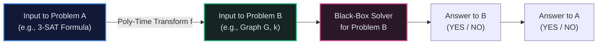
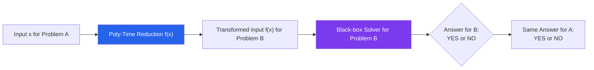
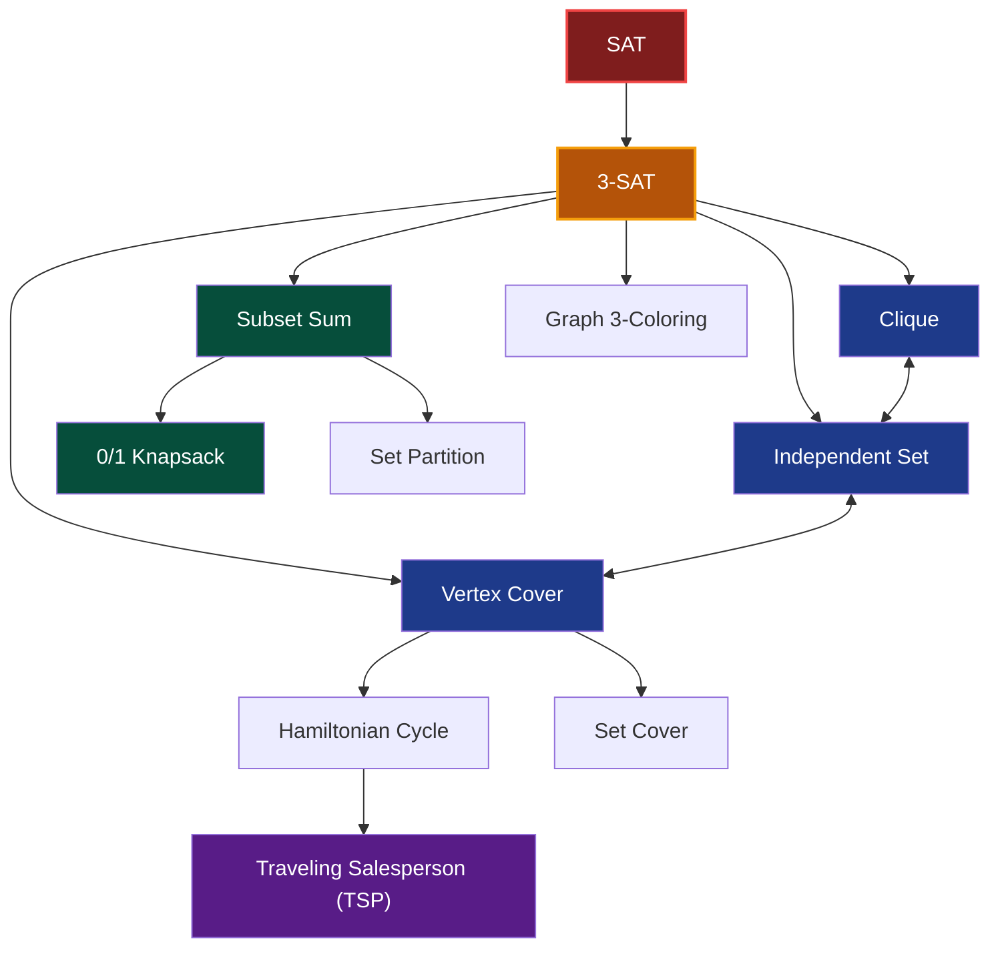
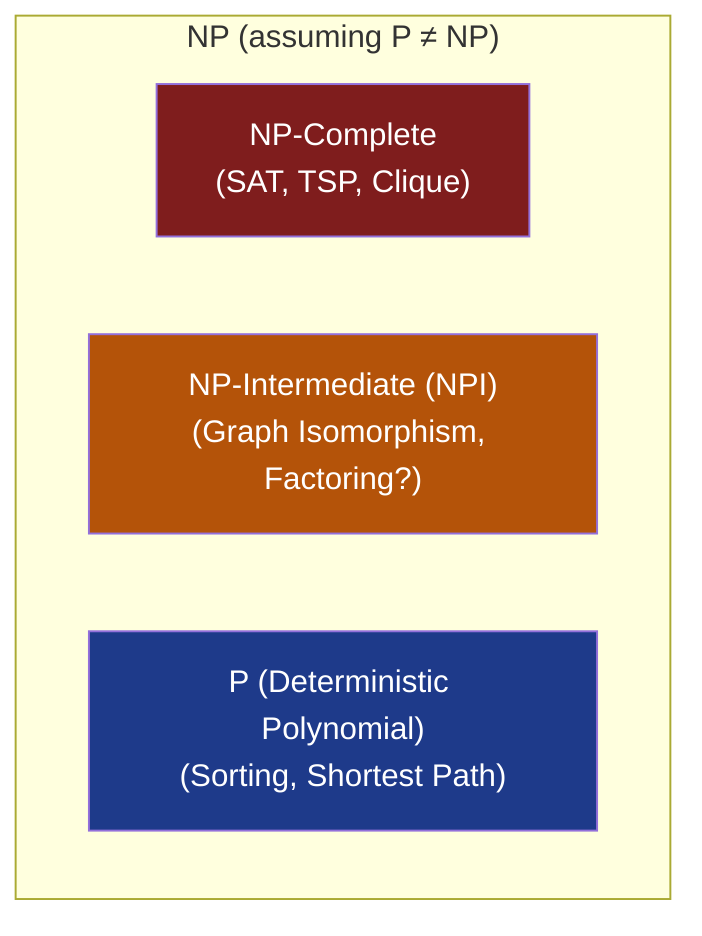

# Chapter 06: NP-Completeness & Reductions — The Grand Translation Web

> *"If you can solve any one NP-complete problem in polynomial time, you have solved them all."*

---

## 📍 Level 100 — The Napkin Sketch: The Universal Language

Imagine you run a library containing 1,000 ancient locked puzzle boxes from 1,000 different civilizations:
- An Egyptian lock, a Mayan lock, a Viking lock, a Babylonian lock...
- Trying to master 1,000 different lockpicking tools seems impossible.
- But then an archaeologist proves something unbelievable:
  > *"Every single lock can be mechanically rewired in 10 seconds into a standard Roman Padlock."*



Now you don't need 1,000 lockpicks. **You only need to crack the Roman Padlock.** If you find a key for the Roman Padlock, every puzzle box in the world opens instantly. If the Roman Padlock is unbreakable, all 1,000 puzzle boxes remain sealed.

This is **$NP$-Completeness**. The "Roman Padlock" is Boolean Satisfiability (SAT), and the "rewiring" is a **Polynomial-Time Reduction**.

---

## 🎯 Level 200 — Street Fundamentals: The Converter Box & Reduction Recipe

> 🧠 **Mental Model Card**
> - **The Reduction Principle ($A \le_P B$):** "Problem $A$ reduces to Problem $B$ in polynomial time."
>   - Meaning: Problem $B$ is *at least as hard* as Problem $A$. If you have a magic solver for $B$, you can solve $A$ by transforming inputs.
> - **The Direction Rule (Never Get Backwards!):**
>   - To prove $B$ is Hard: Reduce a **KNOWN HARD problem** to your problem ($3\text{-SAT} \le_P B$).
>   - To solve $A$ with existing code: Reduce your problem to a **KNOWN EASY problem** ($A \le_P \text{Max-Flow}$).
> - **The 4 Canonical Interview NP-Complete Families:**
>   1. Satisfiability (3-SAT)
>   2. Graph Cover/Pack (Vertex Cover, Independent Set, Clique)
>   3. Sequencing/Tour (Hamiltonian Path, Traveling Salesperson)
>   4. Partition/Knapsack (Subset Sum, Partition, 0/1 Knapsack)

### Street Reduction Recipe



---

## ⚙️ Level 300 — Working Professional: Reductions & Cook-Levin

### 1. Polynomial-Time Reductions ($A \le_P B$)
Let $A$ and $B$ be two decision problems (languages).

> **Definition (Karp / Many-One Reduction)**:  
> $A$ is polynomial-time reducible to $B$ (written $A \le_P B$) if there exists a function $f : \Sigma^* \to \Sigma^*$ computable in polynomial time such that for all $x$:
> $$x \in A \iff f(x) \in B$$



#### The Cardinal Rule of Reduction Direction
The notation $A \le_P B$ means **"$B$ is at least as hard as $A$"** (or "$A$ is no harder than $B$"):
1. **To solve $A$**: If $B$ is easy ($B \in P$), and $A \le_P B$, then $A$ is easy ($A \in P$).
2. **To prove $B$ is hard**: If $A$ is known to be hard ($A$ is $NP$-hard), and $A \le_P B$, then $B$ is hard ($B$ is $NP$-hard).

> ⚠️ **The Fatal Student Mistake**: Reducing in the wrong direction!  
> If you reduce your new problem $X$ to a known $NP$-complete problem $Y$ ($X \le_P Y$), you have only proven that $X$ is no harder than $Y$. You have **not** proven $X$ is $NP$-hard!  
> To prove $X$ is $NP$-hard, you must reduce **from a known hard problem to $X$**: $\text{3-SAT} \le_P X$.

---

### 2. The Cook-Levin Theorem (1971): The Spark of Creation
How did we prove the *first* problem was $NP$-complete when there were no prior $NP$-complete problems to reduce from?

Stephen Cook and Leonid Levin independently proved:
> **Theorem**: $\text{SAT}$ (Boolean Satisfiability) is $NP$-Complete.

#### The Intuition Behind the Proof
Let $L$ be *any* arbitrary language in $NP$. By definition, there is a non-deterministic Turing Machine $M$ that decides $L$ in time $p(n) = n^k$.  
The execution of $M$ on input $w$ can be visualized as an $n^k \times n^k$ grid (a **computation tableau**), where each row is the tape contents, head position, and state at time step $t$.

Cook showed you can write a Boolean formula $\Phi = \phi_{cell} \land \phi_{start} \land \phi_{move} \land \phi_{accept}$ that encodes the rules of physics of the Turing Machine:
- $\phi_{cell}$: Each cell has exactly one symbol.
- $\phi_{start}$: Row 0 matches initial input $w$.
- $\phi_{move}$: Transition from row $t$ to row $t+1$ obeys the TM transition function $\delta$.
- $\phi_{accept}$: Some cell eventually enters $q_{accept}$.

Formula $\Phi$ has size $O(n^{2k})$ (polynomial size) and is satisfiable **if and only if** $M$ accepts $w$!  
Because this works for *every* language in $NP$, **every problem in $NP$ reduces to SAT**.

---

### 3. The 4-Step Recipe to Prove Any Problem $X$ is $NP$-Complete

When an interviewer or professor asks you to prove a new problem $X$ is $NP$-complete, follow this exact 4-step template:

```
┌─────────────────────────────────────────────────────────────────────────────┐
│ THE 4-STEP NP-COMPLETENESS PROOF RECIPE                                     │
│                                                                             │
│ Step 1: Prove X ∈ NP                                                        │
│   • Define the polynomial-size certificate c.                               │
│   • Show a deterministic verifier checks c in polynomial time.              │
│                                                                             │
│ Step 2: Select a Known NP-Complete Problem Y                                │
│   • Choose Y from the canonical list (3-SAT, Vertex Cover, Subset Sum...).  │
│                                                                             │
│ Step 3: Construct the Reduction Function f                                  │
│   • Describe how an arbitrary instance of Y is transformed into an          │
│     instance of X: f(y) = x.                                                │
│   • Prove f runs in polynomial time.                                        │
│                                                                             │
│ Step 4: Prove Bi-directional Correctness (The "If and Only If")             │
│   • Forward (⇒): If y is a YES instance of Y, then f(y) is a YES for X.     │
│   • Backward (⇐): If f(y) is a YES instance of X, then y was a YES for Y.   │
└─────────────────────────────────────────────────────────────────────────────┘
```

---

## 🔬 Level 400 — Staff & Senior Engineer: Karp's 21 NP-Complete Web

In 1972, Richard Karp published his landmark paper showing that 21 fundamental problems across graph theory, logic, routing, and set packing were all $NP$-complete via chain reductions.



---

### The Graph Trinity: Independent Set, Vertex Cover, and Clique
These three classic problems are mathematically equivalent on a graph $G = (V, E)$ with $|V| = n$:

1. **Independent Set**: A subset $S \subseteq V$ where no two vertices in $S$ share an edge.
2. **Vertex Cover**: A subset $C \subseteq V$ where every edge in $E$ touches at least one vertex in $C$.
3. **Clique**: A subset $K \subseteq V$ where every pair of vertices in $K$ is connected by an edge.

#### The Beautiful Duality Theorem:
$$\text{For any graph } G = (V, E) \text{ and subset } S \subseteq V:$$
$$S \text{ is an Independent Set of } G \iff V \setminus S \text{ is a Vertex Cover of } G$$
$$S \text{ is an Independent Set of } G \iff S \text{ is a Clique in the complement graph } \overline{G}$$

```
Graph G (4 vertices):              Complement Graph G_bar:
  (0) ─── (1)                        (0)     (1)
   │       │                          │ ╲   ╱ │
   │       │                          │   ╳   │
   │       │                          │ ╱   ╲ │
  (3) ─── (2)                        (3)     (2)

Independent Set: {0, 2}             Clique: {0, 2}
Vertex Cover:    {1, 3} = V \ {0, 2}
```

---

### Reduction Walkthrough: 3-SAT to Independent Set
To prove Independent Set is $NP$-complete, we reduce from **3-SAT**.

Given a 3-SAT formula with $m$ clauses, e.g.:
$$\phi = (x_1 \lor \overline{x_2} \lor x_3) \land (\overline{x_1} \lor x_2 \lor x_4)$$

1. **Construct Graph $G$**:
   - For each clause, create a **triangle** of 3 vertices, labeled with the literals in the clause.
   - For $m$ clauses, there are $3m$ vertices and $m$ disjoint triangles.
2. **Add Conflict Edges**:
   - Add an edge between any two vertices that are contradictory literals (e.g., between every vertex labeled $x_1$ and every vertex labeled $\overline{x_1}$).
3. **Set Target Goal $K = m$**:
   - Can we find an independent set of size $K = m$?

#### Why This Works:
- From each clause triangle, an independent set can pick **at most 1 vertex** (since all 3 are mutually connected).
- To get $m$ vertices total, we must pick **exactly 1 vertex per triangle** (satisfying every clause!).
- The conflict edges guarantee we never pick both $x_i$ and $\overline{x_i}$ simultaneously (no contradictory truth assignments!).

---

### Weak vs Strong NP-Hardness: The Pseudo-Polynomial Trap
Why can we solve 0/1 Knapsack in $O(N \cdot W)$ using Dynamic Programming (Pattern 22), yet Knapsack is $NP$-complete?

| Classification | Meaning | Classic Examples |
|---|---|---|
| **Weakly $NP$-Hard** | $NP$-hard in general, but solvable in polynomial time if all numbers in the input are small (**pseudo-polynomial time**). | 0/1 Knapsack ($O(NW)$), Subset Sum, Partition |
| **Strongly $NP$-Hard** | Remains $NP$-hard even if all numbers in the input are bounded by a polynomial in $N$ ($V \le N^c$). Cannot be solved by pseudo-polynomial DP unless $P=NP$! | Traveling Salesperson (TSP), 3-SAT, Clique, Vertex Cover |

> **Why $O(NW)$ is NOT Polynomial Time**:  
> In complexity theory, input size $L$ is measured in **bits**. A weight capacity $W = 10^{15}$ takes only $\lceil \log_2(10^{15}) \rceil \approx 50$ bits to write down!  
> An algorithm taking $W$ steps is doing $2^{50}$ operations — which is **exponential** in the length of the input!

---

## 🎓 Level 500 — Researcher's Corner: Ladner's Theorem & The Intermediate Realm

<details>
<summary><strong>Expand PhD Deep-Dive: Ladner's Theorem & NP-Intermediate Problems</strong></summary>

### Ladner's Theorem (1975)
If $P \ne NP$, does every problem in $NP$ fall neatly into either $P$ or $NP$-Complete?

**Theorem (Richard Ladner)**:
> If $P \ne NP$, then there exist problems in $NP$ that are **neither in $P$ nor $NP$-Complete**.  
> This infinite gap is known as **$NP$-Intermediate** ($\text{NPI}$).



### The Prime Candidates for $NP$-Intermediate:
1. **Integer Factorization**: Given $N$, find prime factors. No polynomial algorithm is known for classical computers (basis of RSA), but it is unlikely to be $NP$-complete because it lies in $NP \cap co\text{-}NP$. (Peter Shor showed in 1994 that quantum computers solve it in polynomial time!).
2. **Graph Isomorphism**: Are two graphs structurally identical? László Babai (2016) showed Graph Isomorphism can be solved in **quasi-polynomial time** ($2^{O(\log^c n)}$), proving it is almost certainly not $NP$-complete.

</details>

---

## 💻 Python 3.14 Verification: Reduction from 3-SAT to Independent Set

Here is a working Python 3.14 reduction engine that converts any 3-SAT problem into a Graph instance, solves Independent Set, and reconstructs the boolean truth assignment:

```python
from collections import defaultdict
from dataclasses import dataclass
import itertools

type Literal = str  # e.g., "x1" or "~x1"
type Clause = tuple[Literal, Literal, Literal]
type Formula = list[Clause]


@dataclass
class Graph:
    vertices: list[int]
    labels: dict[int, Literal]
    edges: set[tuple[int, int]]


def reduce_3sat_to_independent_set(formula: Formula) -> tuple[Graph, int]:
    """THE POLYNOMIAL REDUCTION: Converts a 3-SAT formula with m clauses into a

    Graph G and target integer K = m.
    """
    m = len(formula)
    vertices: list[int] = []
    labels: dict[int, Literal] = {}
    edges: set[tuple[int, int]] = set()

    # 1. Create a triangle for each clause
    v_id = 0
    for clause in formula:
        clause_vertices = []
        for lit in clause:
            vertices.append(v_id)
            labels[v_id] = lit
            clause_vertices.append(v_id)
            v_id += 1

        # Triangle edges within clause
        edges.add((clause_vertices[0], clause_vertices[1]))
        edges.add((clause_vertices[1], clause_vertices[2]))
        edges.add((clause_vertices[0], clause_vertices[2]))

    # 2. Add conflict edges between contradictory literals (x_i and ~x_i)
    for i in range(len(vertices)):
        for j in range(i + 1, len(vertices)):
            lit_i = labels[i]
            lit_j = labels[j]
            # Conflict if one is negation of the other
            if (lit_i.startswith("~") and lit_i[1:] == lit_j) or (
                lit_j.startswith("~") and lit_j[1:] == lit_i
            ):
                edges.add((i, j))

    return Graph(vertices, labels, edges), m


def find_independent_set(graph: Graph, k: int) -> list[int] | None:
    """Verifies that an independent set of size k exists."""
    for combo in itertools.combinations(graph.vertices, k):
        is_independent = True
        for u, v in itertools.combinations(combo, 2):
            if (u, v) in graph.edges or (v, u) in graph.edges:
                is_independent = False
                break
        if is_independent:
            return list(combo)
    return None


# ─────────────────────────────────────────────────────────────
# Verification Example
# Formula: (x1 or x2 or x3) and (~x1 or ~x2 or x3)
# ─────────────────────────────────────────────────────────────
if __name__ == "__main__":
    test_formula: Formula = [
        ("x1", "x2", "x3"),
        ("~x1", "~x2", "x3"),
    ]

    graph, k = reduce_3sat_to_independent_set(test_formula)
    assert k == 2  # Must pick 1 literal per clause
    assert len(graph.vertices) == 6  # 2 clauses * 3 literals

    independent_set = find_independent_set(graph, k)
    assert independent_set is not None

    chosen_literals = [graph.labels[v] for v in independent_set]
    print(f"✅ Reduction successful! Found Independent Set of size {k}:")
    print(f"   Vertices: {independent_set}")
    print(f"   Corresponding Satisfying Literals: {chosen_literals}")
```

---

## 🔗 Connections to Coding Patterns

- **Pattern 22: 0/1 Knapsack**: The grand prototype of weakly $NP$-hard problems. When constraints $W \le 10^5$, run Dynamic Programming. When $W \ge 10^{15}$, DP dies; switch to **Meet-in-the-Middle** (Pattern 36) or Branch-and-Bound.
- **Pattern 36: Meet in the Middle**: Cuts exhaustive search of Subset Sum from $O(2^N)$ to $O(2^{N/2} \cdot N)$ — the practical weapon for solving $NP$-hard subset problems up to $N \approx 40$.
- **Pattern 21: Greedy Algorithms**: Greedy fails on general 0/1 Knapsack, but provides a 2-approximation for Fractional Knapsack. Recognizing $NP$-completeness tells you whether Greedy yields the exact answer or merely an approximation.

---

## 🧪 Self-Test Questions

1. **If you reduce 3-SAT to problem X in polynomial time, have you proven that X is in NP?**
2. **Explain why $S$ being an Independent Set in $G$ implies that $V \setminus S$ is a Vertex Cover in $G$.**
3. **What is the difference between a Karp (many-one) reduction and a Cook (Turing) reduction?**
4. **Why is 0/1 Knapsack called "weakly" NP-hard, while 3-SAT is "strongly" NP-hard?**
5. **A colleague says: "I proved my problem is NP-complete by reducing it to 3-SAT." What did they do wrong?**

<details>
<summary><strong>Click to view answers</strong></summary>

1. **No**. You have only proven that $X$ is **$NP$-Hard**. To prove $X$ is $NP$-Complete, you must also separately show that $X \in NP$ by demonstrating a polynomial-time verifier for certificates of $X$.
2. Suppose $V \setminus S$ were *not* a vertex cover. That would mean some edge $(u, v) \in E$ has neither endpoint in $V \setminus S$. Therefore, both $u \in S$ and $v \in S$. But then an edge exists between two vertices in $S$, contradicting the fact that $S$ is an independent set!
3. In a Karp reduction ($A \le_P B$), you transform instance $x$ of $A$ into a single instance $f(x)$ of $B$, where the answers match directly ($x \in A \iff f(x) \in B$). In a Cook reduction ($A \le_T^P B$), you can call an oracle for $B$ multiple times as a subroutine, invert answers, and perform intermediate polynomial computations.
4. Knapsack is weakly $NP$-hard because it can be solved in pseudo-polynomial time $O(NW)$ via Dynamic Programming when numbers are small. 3-SAT is strongly $NP$-hard because its hardness does not depend on large numerical values; there is no pseudo-polynomial algorithm for 3-SAT unless $P = NP$.
5. They reduced in the **wrong direction**! Reducing problem $X$ to 3-SAT ($X \le_P \text{3-SAT}$) only proves that $X$ is no harder than 3-SAT (it shows $X \in NP$). To prove $X$ is $NP$-hard, they must reduce **from** 3-SAT **to** $X$ ($\text{3-SAT} \le_P X$).

</details>

---

## 🧭 Navigation

| ← Previous | ↑ Master Index | Next → |
|:---|:---:|---:|
| [← Ch 05: Lower Bounds & Impossibility](05_lower_bounds_and_impossibility.md) | [🏛️ Theoretical Foundations Index](README.md) | [Ch 07: Approximation Algorithms →](07_approximation_algorithms.md) |

