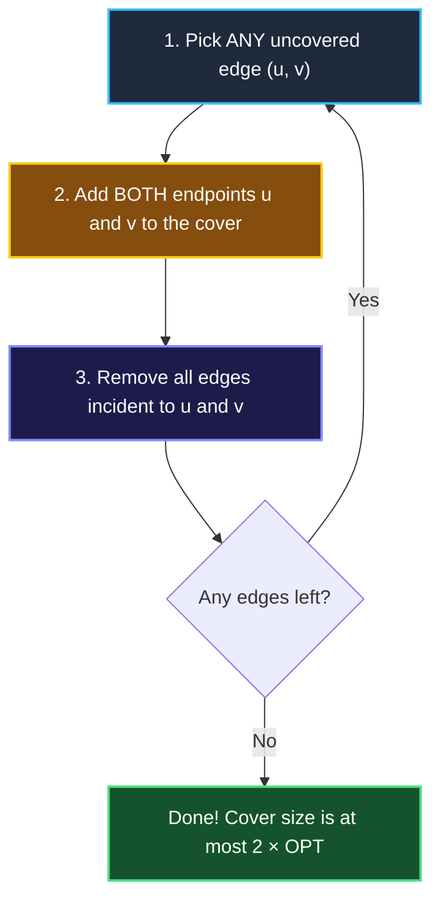

# Chapter 07: Approximation Algorithms — Fast Solutions When Exact Is Impossible

> *"In real-world engineering and senior interviews, a 98% optimal answer delivered in 5 milliseconds is infinitely better than a 100% perfect answer that arrives after the server crashes."*

---

## 💡 1. The Napkin Analogy: The Moving Truck

Imagine packing a moving truck with boxes of different sizes:
- Finding the 100% mathematically optimal arrangement that wastes zero cubic centimeters is **Bin Packing (NP-hard)**. Computing it would take days of CPU time.
- Alternatively, you can use a simple rule: **"Pack largest boxes first, smallest boxes last."**
- You finish packing in 20 minutes, and the truck is 90% full.

```
┌─────────────────────────────────────────────────────────────────────────────┐
│ 📐 APPROXIMATION ALGORITHM:                                                 │
│ An algorithm that runs in fast polynomial time (e.g., O(N) or O(N log N))    │
│ and provides a MATHEMATICAL GUARANTEE that its result is within a bounded   │
│ factor (e.g., at most 2×) of the theoretical optimum.                       │
└─────────────────────────────────────────────────────────────────────────────┘
```

---

## 📊 2. The Visual Whiteboard: The 2-Approximation for Vertex Cover

**The Challenge**: Given a graph, select the smallest number of vertices such that every edge touches at least one selected vertex (NP-Hard).



### Why It Is Guaranteed to Be $\le 2 \times \text{Optimal}$ (The 30-Second Proof)
- Every edge we picked was completely disjoint (no shared endpoints).
- The theoretical optimal solution **must pick at least ONE vertex** from every one of those disjoint edges.
- We picked **both** vertices (2 vertices per edge).
- Therefore, our cover size is at most **$2 \times \text{OPT}$**!
- **Runtime**: $O(V + E)$ linear time instead of $O(2^V)$ exponential search!

---

## 🗣️ 3. The 30-Second Interview Talk Track

### When an Interviewer Asks for an Optimization on Large $N$
> *"Because minimizing Vertex Cover / Metric TSP is NP-hard, an exact solver on $N = 100,000$ will exceed our 1-second timeout.  
> 
> Instead, we can implement a **2-Approximation algorithm** in $O(V + E)$ time. By greedily selecting both endpoints of maximal independent edges, we guarantee that our result will never exceed twice the optimal cost, while ensuring sub-second execution in production."*

---

## 🧠 4. Senior Systems Reality: The "Power of Two Choices"

Approximation principles govern modern cloud architecture:

```
┌──────────────────────────────────────┬─────────────────────────────────────────────────────────┐
│ System Problem                       │ Approximation Strategy                                  │
├──────────────────────────────────────┼─────────────────────────────────────────────────────────┤
│ Microservice Load Balancing          │ "The Power of Two Choices": Pick 2 random backend       │
│                                      │ servers and send traffic to the less loaded one.        │
│                                      │ (Achieves near-perfect balance with zero central lock!) │
├──────────────────────────────────────┼─────────────────────────────────────────────────────────┤
│ Database Unique Visitor Counting     │ HyperLogLog: Approximates unique counts (CARDINALITY)   │
│                                      │ within 1% error using only 1.5 KB of RAM!               │
└──────────────────────────────────────┴─────────────────────────────────────────────────────────┘
```

---

## 🎯 5. Constraint Triage & FAANG Traps

### The Bipartite Escape Trap
If an interviewer presents a Vertex Cover or Maximum Matching problem, always check:
- Is the graph **Bipartite** (e.g., matching job applicants to jobs, or students to dorm rooms)?
- **If YES**: Kőnig's theorem proves that on bipartite graphs, Vertex Cover can be solved **EXACTLY in polynomial time** using Max-Flow / Hopcroft-Karp ($O(E \sqrt{V})$)!

---

## 🧭 Navigation
- **Previous**: [Ch 06: NP-Completeness & Reductions](./06_np_completeness_and_reductions.md)
- **Next**: [Ch 08: Randomized Algorithms](./08_randomized_algorithms.md)
