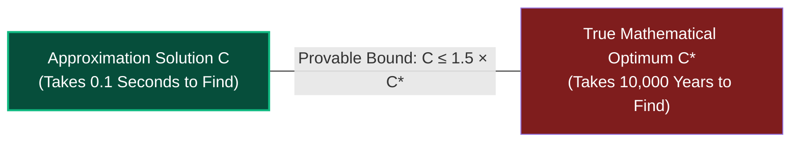
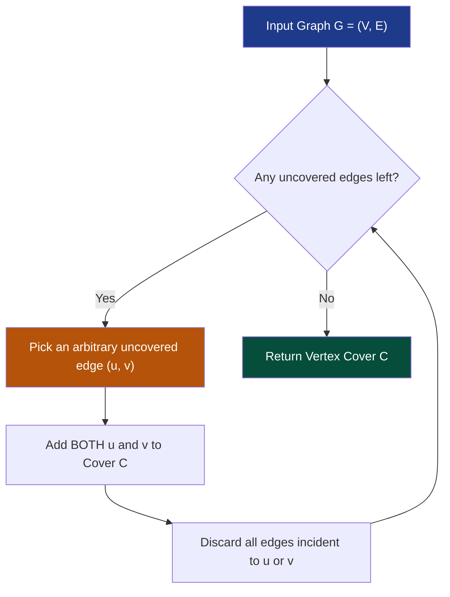
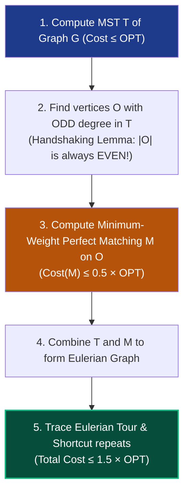
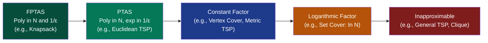

# Chapter 07: Approximation Algorithms — When "Good Enough" is Provable

> *"When an exact optimal solution is mathematically out of reach, an engineer does not surrender — they demand a contract with a mathematical guarantee."*

---

## 📍 Level 100 — The Napkin Sketch: The GPS Route Guarantee

Imagine you are driving across a continent and need to visit 20 cities:
- Finding the *exact single shortest route* down to the centimeter (Traveling Salesperson Problem) would take a supercomputer **10,000 years** of crunching.
- But your smartphone GPS gives you a route in **0.1 seconds**.
- The GPS engineer gives you an ironclad legal contract:
  > *"This route might not be the absolute mathematical optimum, but I guarantee with 100% certainty it is **never more than 50% longer** than the best route that exists."*



You reach your destination on time. You didn't waste 10,000 years. This is an **Approximation Algorithm**.

---

## 🎯 Level 200 — Street Fundamentals: The Menu of Approximation Guarantees

> 🧠 **Mental Model Card**
> - **The Trade-Off:** NP-Hard means you cannot get **Optimal + Fast + Universal**.
>   - Pick any two! Approximation algorithms choose **Fast + Universal** and sacrifice a small fraction of optimality.
> - **Approximation Ratio $\rho$:**
>   - For minimization (TSP, Vertex Cover): $\text{Cost} \le \rho \cdot \text{OPT}$ ($\rho > 1$).
>   - For maximization (Knapsack): $\text{Profit} \ge \alpha \cdot \text{OPT}$ ($\alpha < 1$).
> - **PTAS vs FPTAS:**
>   - PTAS: $1 + \epsilon$ approximation in $O(N^{f(1/\epsilon)})$ time (polynomial in $N$, but exponent can blow up).
>   - FPTAS: $1 + \epsilon$ approximation in $O((N/\epsilon)^k)$ time (polynomial in both $N$ AND $1/\epsilon$ — the gold standard).

### Street Approximation Guarantees Cheat Sheet

| NP-Hard Problem | Fast Approximation Algorithm | Guarantee Ratio $\rho$ | Runtime |
|---|---|:---:|---|
| **Vertex Cover** | Greedy Maximal Matching | $2.0 \times \text{OPT}$ | $O(V + E)$ |
| **Metric TSP** | MST Doubling | $2.0 \times \text{OPT}$ | $O(V^2)$ |
| **Metric TSP** | Christofides' Algorithm | $1.5 \times \text{OPT}$ | $O(V^3)$ |
| **Set Cover** | Greedy Frequency Pick | $(\ln N + 1) \times \text{OPT}$ | $O(N \cdot M)$ |
| **0/1 Knapsack** | Value-Grid Dynamic Programming | $(1 - \epsilon) \times \text{OPT}$ (FPTAS) | $O(N^3 / \epsilon)$ |
| **General TSP** | None (Inapproximable!) | $\infty$ | Unless P = NP, no poly approx exists! |

---

## ⚙️ Level 300 — Working Professional: The Approximation Ratio

### 1. Formal Definition of Approximation Ratio
Let $\Pi$ be an optimization problem (minimization or maximization). An algorithm $A$ is an **$\alpha$-approximation algorithm** if for every instance of size $n$, it runs in **polynomial time** and produces a solution with cost $C$ satisfying:

$$\max\left(\frac{C}{C^*}, \frac{C^*}{C}\right) \le \alpha(n)$$

Where $C^*$ is the cost of the true, unattainable optimal solution.

- **For Minimization (e.g., TSP, Vertex Cover)**: $C \le \alpha \cdot C^*$ (where $\alpha \ge 1$). A $2$-approximation means the solution is at most twice the optimal cost.
- **For Maximization (e.g., Knapsack, Max-Cut)**: $C \ge \frac{1}{\alpha} \cdot C^*$ (often written as $\beta \cdot C^*$ with $\beta \le 1$).

---

### 2. The 2-Approximation for Vertex Cover
Given graph $G = (V, E)$, find the smallest set of vertices that touches every edge. Vertex Cover is $NP$-Complete.



#### The Proof that $|C| \le 2 \cdot |C^*|$:
1. Let $M$ be the set of edges selected by the algorithm.
2. By construction, no two edges in $M$ share an endpoint (it is a **matching**).
3. To cover the edges in $M$, the true optimal vertex cover $C^*$ must choose **at least one distinct vertex per edge in $M$**:
   $$|C^*| \ge |M|$$
4. Our algorithm added *both* endpoints of every edge in $M$ into $C$:
   $$|C| = 2|M|$$
5. Combining these:
   $$|C| = 2|M| \le 2|C^*|$$

**Result**: A clean 2-approximation in $O(V + E)$ linear time!

---

### 3. Metric Traveling Salesperson (TSP)
In Metric TSP, edge costs satisfy the **Triangle Inequality**:

$$c(u, w) \le c(u, v) + c(v, w)$$

(Taking a direct flight is never longer than taking a connecting layover).

---

#### Approach A: The 2-Approximation (MST Doubling)
1. Compute the **Minimum Spanning Tree (MST)** $T$ of graph $G$ using Kruskal's or Prim's algorithm ($O(E \log V)$).
2. Double every edge in $T$ to create an **Eulerian Multigraph** (every vertex now has even degree).
3. Walk the Eulerian tour ($O(V)$).
4. **Shortcut**: If the tour visits a vertex already seen, bypass it and go straight to the next unvisited vertex (valid by Triangle Inequality!).

```
Proof:
1. Deleting any edge from optimal TSP tour yields a spanning tree: Cost(MST) ≤ Cost(OPT).
2. Doubled MST tour = 2 × Cost(MST) ≤ 2 × Cost(OPT).
3. Shortcutting only reduces cost (Triangle Inequality).
4. Final Tour Cost ≤ 2 × Cost(OPT).
```

---

#### Approach B: Christofides' 1.5-Approximation (1976)
Nicos Christofides asked: *Why double ALL edges in the MST? We only need to fix vertices that have ODD degree!*



$$\text{Total Cost} \le \text{Cost}(T) + \text{Cost}(M) \le \text{OPT} + 0.5 \text{OPT} = 1.5 \cdot \text{OPT}$$

For 44 years, Christofides was the world record. (In 2020, Karlin, Klein, and Oveis Gharan slightly improved this to $1.5 - 10^{-36}$).

---

## 🔬 Level 400 — Staff & Senior Engineer: Approximation Schemes (PTAS & FPTAS)

Not all problems are restricted to fixed constants like $1.5$ or $2$. Some allow you to get **arbitrarily close to the optimum**.



### 1. PTAS vs FPTAS
- **PTAS (Polynomial-Time Approximation Scheme)**: For *any* error tolerance $\epsilon > 0$, the algorithm guarantees a $(1 + \epsilon)$-approximation in polynomial time for fixed $\epsilon$.  
  *Runtime*: $O(n^{1/\epsilon})$ or $O(n^{2^{1/\epsilon}})$.  
  If $\epsilon = 0.01$, $n^{100}$ is technically polynomial, but engineering suicide!
- **FPTAS (Fully Polynomial-Time Approximation Scheme)**: Runtime is polynomial in **both** $n$ and $1/\epsilon$!  
  *Runtime*: $O\left(\left(\frac{1}{\epsilon}\right)^2 \cdot n^3\right)$.  
  This is the gold standard of intractability engineering.

---

### 2. FPTAS for 0/1 Knapsack
Dynamic Programming solves 0/1 Knapsack in $O(n \cdot V_{max})$ where $V_{max} = \sum v_i$.
1. Given error parameter $\epsilon$, set scaling factor $K = \frac{\epsilon \cdot v_{max}}{n}$.
2. Define scaled values: $v'_i = \lfloor \frac{v_i}{K} \rfloor$.
3. Run the exact value-based DP on scaled values.
4. Total running time: $O(n^2 \cdot \lfloor \frac{n}{\epsilon} \rfloor) = O\left(\frac{n^3}{\epsilon}\right)$.
5. The resulting solution is guaranteed to have value $\ge (1 - \epsilon) \cdot \text{OPT}$!

---

### 3. Inapproximability: The Walls You Cannot Breach
Can every $NP$-hard problem be approximated? **No.**

#### General TSP Inapproximability:
**Theorem**: If $P \ne NP$, there is no polynomial-time $\alpha$-approximation algorithm for general Traveling Salesperson for **any constant or function $\alpha(n)$**!
- *Proof*: If an $\alpha$-approximation existed, we could set non-existent edges to weight $\alpha \cdot n + 1$ and solve the Hamiltonian Cycle problem in polynomial time.

#### Set Cover Hardness:
Greedy Set Cover achieves an approximation ratio of $\ln n + 1$.  
**Theorem (Dinur & Steurer, 2014)**: No polynomial algorithm can approximate Set Cover within $(1 - \epsilon) \ln n$ unless $P = NP$. The simple greedy heuristic is **provably optimal**!

---

## 🎓 Level 500 — Researcher's Corner: The PCP Theorem & Hardness of Approximation

<details>
<summary><strong>Expand PhD Deep-Dive: The PCP Theorem & The Unique Games Conjecture</strong></summary>

### The PCP Theorem (Arora, Lund, Motwani, Sudan, Szegedy, 1998)
One of the crowning achievements of 20th-century mathematics.
> **Theorem**: Every proof in $NP$ can be rewritten such that a verifier can check its validity with 99.99% confidence by reading only **$O(1)$ random bits of the proof**, using only $O(\log n)$ random coin tosses!

$$NP = \text{PCP}(O(\log n), O(1))$$

**Why does this matter for approximations?**
The PCP Theorem establishes that computing an approximation to Max-3-SAT within a factor of $7/8 + \epsilon$ is **identically as hard as solving exact 3-SAT**. If you could approximate Max-3-SAT to $87.6\%$, you could decide $P=NP$!

### The Unique Games Conjecture (Subhash Khot, 2002)
Postulates the hardness of a specific 2-prover 1-round game.
- Under UGC, the Goemans-Williamson Semidefinite Programming (SDP) algorithm for **Max-Cut** ($\alpha \approx 0.878$) is **strictly optimal**. No polynomial algorithm can achieve $0.879$ unless UGC is false!

</details>

---

## 💻 Python 3.14 Verification: Metric TSP 2-Approximation vs Brute Force

Here is executable Python 3.14 code running the **MST Doubling 2-Approximation** and comparing it to the brute-force optimal tour on a Euclidean coordinate plane:

```python
import itertools
import math

type Point = tuple[float, float]


def euclidean_distance(p1: Point, p2: Point) -> float:
    return math.hypot(p1[0] - p2[0], p1[1] - p2[1])


def solve_tsp_brute_force(points: list[Point]) -> tuple[float, list[int]]:
    """Brute force exact TSP: O(N!)."""
    n = len(points)
    best_cost = float("inf")
    best_tour: list[int] = []

    for perm in itertools.permutations(range(1, n)):
        tour = [0] + list(perm) + [0]
        cost = sum(
            euclidean_distance(points[tour[i]], points[tour[i + 1]])
            for i in range(n)
        )
        if cost < best_cost:
            best_cost = cost
            best_tour = tour

    return best_cost, best_tour


def solve_tsp_mst_approx(points: list[Point]) -> tuple[float, list[int]]:
    """MST Doubling 2-Approximation for Metric TSP: O(N^2)."""
    n = len(points)

    # 1. Prim's MST
    adj: list[list[int]] = [[] for _ in range(n)]
    in_mst = [False] * n
    min_cost = [float("inf")] * n
    parent = [-1] * n

    min_cost[0] = 0.0
    for _ in range(n):
        u = min(
            (v for v in range(n) if not in_mst[v]),
            key=lambda v: min_cost[v],
            default=-1,
        )
        in_mst[u] = True
        if parent[u] != -1:
            adj[parent[u]].append(u)
            adj[u].append(parent[u])

        for v in range(n):
            if not in_mst[v]:
                d = euclidean_distance(points[u], points[v])
                if d < min_cost[v]:
                    min_cost[v] = d
                    parent[v] = u

    # 2. Depth-First Traversal with Shortcutting
    visited = [False] * n
    tour: list[int] = []

    def dfs(u: int):
        visited[u] = True
        tour.append(u)
        for neighbor in adj[u]:
            if not visited[neighbor]:
                dfs(neighbor)

    dfs(0)
    tour.append(0)  # Complete the cycle

    # 3. Calculate tour cost
    approx_cost = sum(
        euclidean_distance(points[tour[i]], points[tour[i + 1]])
        for i in range(len(tour) - 1)
    )

    return approx_cost, tour


if __name__ == "__main__":
    cities: list[Point] = [
        (0.0, 0.0),
        (1.0, 5.0),
        (5.0, 6.0),
        (8.0, 3.0),
        (7.0, 0.0),
        (4.0, 1.0),
        (3.0, 3.0),
    ]

    opt_cost, opt_tour = solve_tsp_brute_force(cities)
    approx_cost, approx_tour = solve_tsp_mst_approx(cities)

    ratio = approx_cost / opt_cost
    print(f"Optimal TSP Cost (Brute Force): {opt_cost:.3f}")
    print(f"MST Approx Cost (Polynomial)  : {approx_cost:.3f}")
    print(f"Empirical Ratio (Approx / Opt): {ratio:.3f}")

    assert ratio <= 2.0, f"Exceeded 2-approximation guarantee! {ratio} > 2.0"
    print(
        "✅ Verification passed: MST-doubling strictly adhered to 2-approximation bound!"
    )
```

---

## 🔗 Connections to Coding Patterns

- **Pattern 21: Greedy Algorithms**: Greedy heuristics are often approximation algorithms in disguise. For Set Cover, greedy yields an optimal $\ln n$-approximation.
- **Pattern 05: Merge Intervals & Pattern 21: Greedy**: Interval scheduling is solvable exactly in $O(n \log n)$ via greedy; but interval *coloring* with capacity bounds becomes an approximation problem.
- **Pattern 22: 0/1 Knapsack**: FPTAS scales the dynamic programming state space, exchanging mathematical perfection for polynomial execution time.

---

## 🧪 Self-Test Questions

1. **What is the mathematical definition of an approximation ratio $\alpha$ for a minimization problem?**
2. **Why does Christofides' algorithm need to find a minimum-weight perfect matching on the ODD degree vertices of the MST?**
3. **What is the difference between a PTAS and an FPTAS? Why is an FPTAS much more desirable in engineering?**
4. **Why is general Traveling Salesperson completely inapproximable, while Metric TSP has a 1.5-approximation?**
5. **If an algorithm gives a 2-approximation for Vertex Cover, does that mean on every run it is twice as large as the optimum?**

<details>
<summary><strong>Click to view answers</strong></summary>

1. $\alpha = \max \frac{C}{C^*}$, where $C$ is the cost produced by the approximation algorithm, and $C^*$ is the true optimal cost. For minimization, $C \le \alpha \cdot C^*$ with $\alpha \ge 1$.
2. To create an **Eulerian tour**, every vertex in the graph must have an **even degree**. An MST always has vertices with odd degrees (e.g., all leaf nodes have degree 1). By finding a perfect matching on the odd vertices and adding those edges, every odd vertex gets $+1$ degree, making every vertex even!
3. In a PTAS, the runtime is polynomial in $n$, but can be exponential in $1/\epsilon$ (e.g., $O(n^{1/\epsilon})$). In an FPTAS, the runtime is polynomial in **both** $n$ and $1/\epsilon$ (e.g., $O(n^2 / \epsilon^2)$). An FPTAS guarantees that demanding high precision (small $\epsilon$) does not cause catastrophic exponential slowdown.
4. Metric TSP obeys the **Triangle Inequality** ($c(u, w) \le c(u, v) + c(v, w)$), which guarantees that shortcutting intermediate nodes never increases path length. General TSP does not have the triangle inequality; bypassing a vertex could incur an astronomical penalty, allowing arbitrary $NP$-complete languages to be hidden in edge weights.
5. **No**. The approximation ratio is an **upper bound on the worst-case error**. In practice, the 2-approximation for Vertex Cover or Metric TSP often produces solutions within 5% to 10% of the true optimum.

</details>

---

## 🧭 Navigation

| ← Previous | ↑ Master Index | Next → |
|:---|:---:|---:|
| [← Ch 06: NP-Completeness & Reductions](06_np_completeness_and_reductions.md) | [🏛️ Theoretical Foundations Index](README.md) | [Ch 08: Randomized Algorithms →](08_randomized_algorithms.md) |

