# Chapter 08: Randomized Algorithms — Beating Worst Cases with a Coin Flip

> *"Randomness in computer science is not chaos. It is a mathematical shield against worst-case inputs and adversarial test cases."*

---

## 💡 1. The Napkin Analogy: Las Vegas vs. Monte Carlo

Think of the difference between two famous gambling capitals:

```
┌─────────────────────────────────────────────────────────────────────────────┐
│ 🎰 LAS VEGAS ALGORITHM:                                                     │
│ Always gives the 100% CORRECT answer, but RUNTIME depends on luck.          │
│ • Example: QuickSort with a random pivot.                                   │
│ • It will NEVER return a corrupted or mis-sorted array. Worst case is slow, │
│   but expected runtime is always O(N log N).                                │
├─────────────────────────────────────────────────────────────────────────────┤
│ 🎲 MONTE CARLO ALGORITHM:                                                   │
│ Always finishes in FIXED FAST TIME, but has a tiny chance of error.         │
│ • Example: Bloom Filter, Miller-Rabin Primality Test.                       │
│ • "It might say Yes when it means No (false positive), but it never misses  │
│   a real match, and runs in 1 microsecond."                                 │
└─────────────────────────────────────────────────────────────────────────────┘
```

---

## 📊 2. The Visual Whiteboard: Defeating the Adversary in QuickSort

If you always choose the first element `nums[0]` as your pivot:
- An adversarial LeetCode test suite hands you an **already sorted array** $[1, 2, 3, 4, 5 \dots N]$.
- Pivot $1$ leaves all $N-1$ elements on the right.
- The recursion tree does not divide: $T(N) = T(N-1) + O(N) \implies \mathbf{O(N^2)}$ (💥 **Time Limit Exceeded**).

```mermaid
flowchart TD
    subgraph Bad["Deterministic Pivot (Pick nums[0])"]
        B1["Input: [1, 2, 3, 4, 5]"] --> B2["Pivot = 1 | Remaining: [2, 3, 4, 5] (N-1 work)"]
        B2 --> B3["Pivot = 2 | Remaining: [3, 4, 5] (N-2 work)"]
        B3 --> B4["Degrades to O(N²) time & O(N) stack depth!"]
    end

    subgraph Good["Randomized Pivot (Pick random index)"]
        G1["Input: [1, 2, 3, 4, 5]"] --> G2["Pick random index: Pivot = 3"]
        G2 --> G3["Left: [1, 2] | Right: [4, 5] (Balanced!)"]
        G3 --> G4["Expected O(N log N) on ALL inputs!"]
    end

    style Bad fill:#7f1d1d,stroke:#f87171,stroke-width:2px,color:#fff
    style Good fill:#14532d,stroke:#4ade80,stroke-width:2px,color:#fff
```



### The Skip List: Probabilistic Search in $O(\log N)$
Instead of complex Red-Black tree rotations, a **Skip List** builds multi-level linked lists by flipping a coin for each node:
- 50% chance a node is promoted to Level 1.
- 25% chance promoted to Level 2.
- 12.5% chance promoted to Level 3.
- Fast express lanes allow searching $N$ items in expected **$O(\log N)$ time** with trivial pointer code.  
*(This is why Redis uses Skip Lists to power Sorted Sets (`ZSET`)).*

---

## 🗣️ 3. The 30-Second Interview Talk Track

### Explaining Randomized QuickSelect / QuickSort
> *"To ensure our algorithm is immune to sorted or reverse-sorted adversarial inputs, we choose our pivot uniformly at random from the current subarray. This guarantees that no static test case can force an $O(N^2)$ worst case. Across all random choices, the expected recursion depth is bounded by $2 \ln N$, yielding an expected runtime of $O(N \log N)$ [or $O(N)$ for QuickSelect] with high probability."*

### Explaining Bloom Filters in System Design
> *"To protect our database from millions of redundant read queries for non-existent user handles, we front the service with a **Monte Carlo Bloom Filter** in Redis. If the Bloom filter returns False, the record is guaranteed not to exist (zero false negatives), saving a disk read. If it returns True, we perform the database lookup. With 10 bits per key and 3 hash functions, we achieve a false positive rate under 1%."*

---

## 🧠 4. Senior Systems Reality: The Duplicate-Element Trap

Randomizing the pivot alone is **NOT enough** if the input contains thousands of identical numbers:
- Example: $[5, 5, 5, 5, 5, 5, 5, \dots]$
- A standard 2-way partition still puts all equal elements on one side $\implies O(N^2)$ disaster!

### The Senior Defense: Dutch National Flag 3-Way Partitioning
```python
def partition3(nums, low, high, pivot):
    lt = low       # nums[low..lt-1] < pivot
    gt = high      # nums[gt+1..high] > pivot
    i = low        # nums[lt..i-1] == pivot
    while i <= gt:
        if nums[i] < pivot:
            nums[lt], nums[i] = nums[i], nums[lt]
            lt += 1
            i += 1
        elif nums[i] > pivot:
            nums[gt], nums[i] = nums[i], nums[gt]
            gt -= 1
        else:
            i += 1
    return lt, gt  # All elements between lt and gt are EQUAL to pivot!
```
Now all duplicate elements are grouped together and **never recursed into again**, running in pure $O(N)$ time on duplicate arrays!

---

## 🎯 5. Constraint Triage & FAANG Traps

### Pseudo-Random Number Generation Overhead
- In Python, `random.randint(low, high)` has python function call overhead.
- In competitive programming or tight loops, using `random.randrange(low, high)` or caching seeds is significantly faster.
- Never use PRNG (`math/rand`) when generating cryptographic API tokens; use `crypto/rand` or `secrets`.

---

## 🧭 Navigation
- **Previous**: [Ch 07: Approximation Algorithms](./07_approximation_algorithms.md)
- **Next**: [Ch 09: Heuristics & Metaheuristics](./09_heuristics_and_metaheuristics.md)
