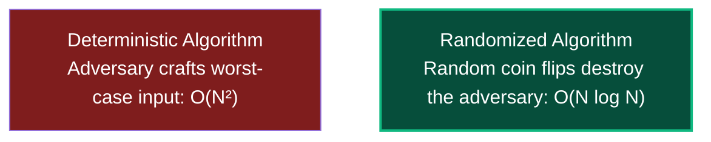
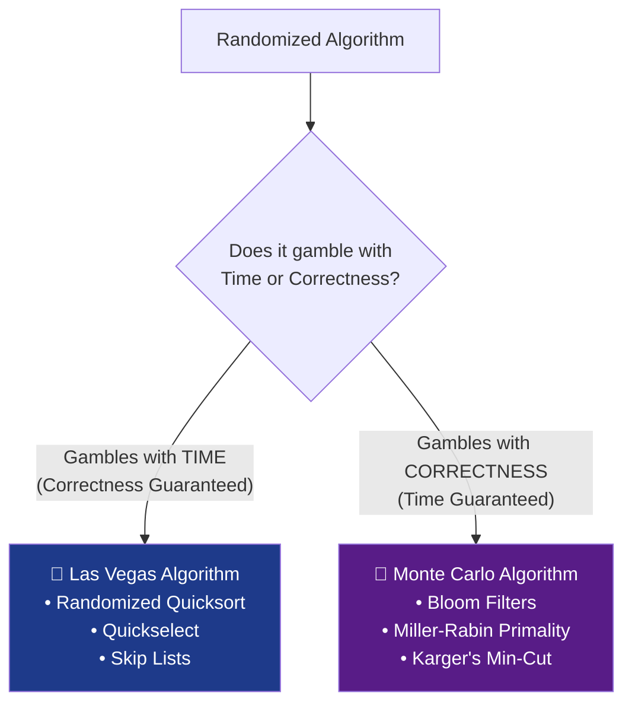
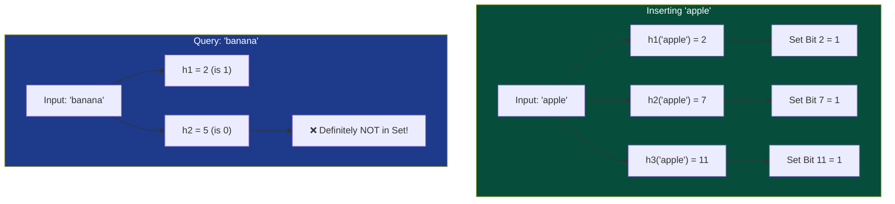

# Chapter 08: Randomized Algorithms — Flipping Coins to Win

> *"Randomness is not the absence of order; it is an algorithmic weapon against malicious inputs."*

---

## 🧒 Explain Like I'm 5: The Sneaky Magician

Imagine a sneaky magician hides a gold coin in one of **1,000 closed boxes**:
- If you use a predictable, deterministic rule (like *"I always check Box 1, then Box 2..."*), the magician watches your eyes and moves the coin to the very last box you check. You do **1,000 checks**.
- But what if you pull a **die out of your pocket and roll it randomly**?
- The magician cannot predict which box you will pick next. They cannot construct a worst-case trap for you!



By introducing random coin tosses into the code, we strip the adversary of their power.

---

## 🟢 Undergraduate Foundation: Las Vegas vs Monte Carlo

Every randomized algorithm belongs to one of two fundamental families:

```
┌───────────────────────────┬───────────────────────────┐
│ 🎰 LAS VEGAS ALGORITHMS   │ 🎲 MONTE CARLO ALGORITHMS │
├───────────────────────────┼───────────────────────────┤
│ • ALWAYS correct output   │ • ALWAYS fast (fixed time)│
│ • Runtime is RANDOM       │ • Output has ERROR CHANCE │
│ • Example: QuickSort      │ • Example: Bloom Filter   │
│   (always sorts properly, │   (instant response, but  │
│    runtime usually O(NlogN)│   may have false positive)│
└───────────────────────────┴───────────────────────────┘
```



---

### 1. Las Vegas in Action: Randomized Quicksort
In standard Quicksort, choosing the first element as the pivot means an already-sorted array triggers the disastrous worst-case:

$$T(n) = T(n-1) + O(n) = \Theta(n^2)$$

By choosing a pivot **uniformly at random** from the subarray:
- No adversary can craft an input that reliably forces $\Theta(n^2)$.
- The expected number of comparisons is provably:
  $$\mathbb{E}[C] = 2n \ln n + O(n) \approx 1.386 \, n \log_2 n$$
- The algorithm **never outputs an incorrectly sorted array**. It only gambles with the clock.

---

### 2. Monte Carlo in Action: Error Amplification
Suppose a Monte Carlo algorithm has an error probability $\le 1/2$ (e.g., it reports whether a number is composite, with a 50% chance of a false claim).
- Run the algorithm **$k$ independent times** with fresh coin flips.
- The probability that it fails all $k$ times is:
  $$P(\text{failure}) \le \left(\frac{1}{2}\right)^k$$
- For $k = 100$:
  $$P(\text{failure}) \le 2^{-100} \approx 7.8 \times 10^{-31}$$
  This error rate is millions of times smaller than the probability of an asteroid destroying the server rack during execution!

---

## 🟡 Master's Deep-Dive: The Mathematical Toolkit

How do we prove that a randomized algorithm will not blow up in production? We use the **Three Classical Probability Inequalities**.

### 1. Markov's Inequality (First-Order Bound)
Requires only that $X$ is a non-negative random variable and we know its expectation $\mathbb{E}[X]$:

$$P(X \ge a) \le \frac{\mathbb{E}[X]}{a}$$

*Example*: If average runtime $\mathbb{E}[T] = 10 \text{ ms}$, the probability that a run takes $\ge 100 \text{ ms}$ is at most $\frac{10}{100} = 10\%$.

---

### 2. Chebyshev's Inequality (Second-Order Bound)
Utilizes the **Variance** $\sigma^2 = \text{Var}(X)$ to bound deviations from the mean:

$$P(|X - \mu| \ge k\sigma) \le \frac{1}{k^2}$$

*Example*: The probability that execution time deviates from the mean by more than $5$ standard deviations is at most $\frac{1}{5^2} = 4\%$.

---

### 3. Chernoff Bounds (Exponential Tail Bounds)
The nuclear weapon of randomized algorithm analysis. Let $X = \sum_{i=1}^n X_i$ be the sum of independent Bernoulli random variables ($0$ or $1$). For any $\delta > 0$:

$$P(X \ge (1+\delta)\mu) \le e^{-\frac{\mu \delta^2}{3}} \quad \text{and} \quad P(X \le (1-\delta)\mu) \le e^{-\frac{\mu \delta^2}{2}}$$

Because the probability decays **exponentially**, we can prove that an algorithm succeeds **With High Probability (w.h.p.)**:

$$P(\text{success}) \ge 1 - \frac{1}{n^c} \quad \text{for any constant } c \ge 1$$

---

## 🏗️ Probabilistic Data Structures

### 1. Bloom Filters (Burton Howard Bloom, 1970)
A space-efficient probabilistic data structure for set membership:
- Uses a bit array of $m$ bits (all initialized to $0$).
- Uses $k$ independent hash functions $h_1, h_2, \dots, h_k$.



- **Zero False Negatives**: If it returns NO, the element is definitely not in the set.
- **Possible False Positives**: If all $k$ bits are 1, the element *might* be in the set, or those bits were set by other elements.
- **Optimal Number of Hash Functions**:
  $$k = \frac{m}{n} \ln 2 \approx 0.693 \frac{m}{n}$$
- **False Positive Probability**:
  $$p \approx \left(1 - e^{-kn/m}\right)^k \approx (0.6185)^{m/n}$$
  *Rule of thumb*: $10$ bits per element ($m/n = 10$) with $k = 7$ hash functions yields a **$< 1\%$ false positive rate**!

---

### 2. Skip Lists (William Pugh, 1990)
A probabilistic alternative to Balanced Binary Search Trees (AVL/Red-Black):

```
Level 3: [HEAD] ─────────────────────────────► [30] ──────────────────────► [NIL]
Level 2: [HEAD] ─────────────► [15] ─────────► [30] ─────────► [50] ──────► [NIL]
Level 1: [HEAD] ───► [7] ────► [15] ──► [22] ─► [30] ──► [40] ─► [50] ───► [NIL]
Level 0: [HEAD] ─►5─►7─►10─►15─►20─►22─►25─►30─►35─►40─►45─►50─►60──────► [NIL]
```

- A hierarchy of linked lists.
- To insert an element, repeatedly flip a fair coin ($p = 1/2$). The number of consecutive heads determines how many levels high the tower is built.
- **Expected Height**: $O(\log n)$.
- **Search, Insert, Delete**: All run in **$O(\log n)$ expected time** with zero tree rotations! (Used in Redis Sorted Sets).

---

## 🔴 PhD Horizon: Karger's Min-Cut & Derandomization

<details>
<summary><strong>Expand PhD Deep-Dive: Karger's Min-Cut & The Derandomization Hypothesis</strong></summary>

### 1. Karger's Contraction Algorithm (David Karger, 1993)
Given an undirected multigraph $G = (V, E)$, find a cut $(S, V \setminus S)$ with the minimum number of crossing edges.
- **The Algorithm**:
  1. Pick an edge $(u, v)$ uniformly at random from $E$.
  2. **Contract** $u$ and $v$ into a single super-node (discard self-loops).
  3. Repeat until only **2 super-nodes** remain.
  4. The crossing edges between the 2 remaining nodes define the cut.
- **Success Probability**:
  $$P(\text{success}) \ge \frac{2}{n(n-1)} = \frac{1}{\binom{n}{2}}$$
- Running this simple contraction $O(n^2 \log n)$ times finds the true global minimum cut with probability $\ge 1 - 1/n$!

### 2. The Derandomization Hypothesis ($P = BPP$)
Can every randomized algorithm be converted to a deterministic polynomial-time algorithm without loss of efficiency?
- **Impagliazzo & Wigderson (1997)** proved that if there exist problems in $\text{EXPTIME}$ that require exponential circuit size, then **$P = BPP$**!
- Under this widely accepted hardness assumption, randomness does not grant any fundamental polynomial computational power — it merely simplifies algorithm design!

</details>

---

## 💻 Python 3.14 Verification: Production-Grade Bloom Filter

Here is an executable, zero-dependency Bloom Filter validating theoretical false positive rates:

```python
import hashlib
import math


class BloomFilter:

    def __init__(self, expected_items: int, false_positive_rate: float = 0.01):
        self.n = expected_items
        self.p = false_positive_rate

        # Optimal bit array size: m = - (n * ln(p)) / (ln(2)^2)
        self.m = int(-1 * (self.n * math.log(self.p)) / (math.log(2) ** 2))

        # Optimal number of hash functions: k = (m / n) * ln(2)
        self.k = int((self.m / self.n) * math.log(2))
        self.bit_array = [False] * self.m

    def _hashes(self, item: str) -> list[int]:
        """Kirsch-Mitzenmacher optimization: generate k hashes from 2 hash values:

        g_i(x) = (h1(x) + i * h2(x)) % m.
        """
        encoded = item.encode("utf-8")
        h1 = int(hashlib.sha256(encoded).hexdigest(), 16)
        h2 = int(hashlib.md5(encoded).hexdigest(), 16)

        return [(h1 + i * h2) % self.m for i in range(self.k)]

    def add(self, item: str):
        for bit_idx in self._hashes(item):
            self.bit_array[bit_idx] = True

    def contains(self, item: str) -> bool:
        return all(self.bit_array[bit_idx] for bit_idx in self._hashes(item))


if __name__ == "__main__":
    n_items = 10_000
    bf = BloomFilter(expected_items=n_items, false_positive_rate=0.01)

    # Insert items
    for i in range(n_items):
        bf.add(f"user_{i}")

    # 1. Verify Zero False Negatives
    for i in range(n_items):
        assert (
            bf.contains(f"user_{i}") is True
        ), "False negative detected! (Impossible)"

    # 2. Measure False Positive Rate
    test_queries = 10_000
    false_positives = 0
    for i in range(n_items, n_items + test_queries):
        if bf.contains(f"user_{i}"):
            false_positives += 1

    empirical_fp_rate = false_positives / test_queries
    print(f"Allocated Bits (m)      : {bf.m:,} (~{bf.m / n_items:.1f} bits/item)")
    print(f"Hash Functions (k)      : {bf.k}")
    print(f"Expected FP Rate        : 1.00%")
    print(f"Empirical FP Rate       : {empirical_fp_rate * 100:.2f}%")

    assert (
        empirical_fp_rate < 0.02
    ), f"False positive rate too high: {empirical_fp_rate}"
    print(
        "✅ Verification passed: Bloom Filter maintained zero false negatives and <1% FP rate!"
    )
```

---

## 🔗 Connections to Coding Patterns

- **Pattern 10: Hash Maps**: Python dictionaries use randomized hash seeds (SipHash) on startup to prevent **Hash DoS attacks** (where an adversary crafts collisions that degrade $O(1)$ lookup into $O(N)$).
- **Pattern 19: Top K Elements & QuickSelect**: Randomizing the pivot in QuickSelect yields guaranteed expected $O(N)$ selection without the high constants of the deterministic Median of Medians.
- **Pattern 29: Ordered Set**: Skip Lists achieve the same $O(\log N)$ search/insertion as Red-Black trees with dramatically simpler pointer operations.

---

## 🧪 Self-Test Questions

1. **What is the fundamental difference between a Las Vegas algorithm and a Monte Carlo algorithm?**
2. **If a Bloom Filter returns `False`, what is the exact probability that the item was actually in the set?**
3. **Why does QuickSort need a random pivot when partitioning an array that is already sorted?**
4. **State the optimal ratio of hash functions $k$ to bit allocation $m/n$ in a Bloom filter.**
5. **How does a Skip List achieve $O(\log n)$ search height without performing any tree rotations?**

<details>
<summary><strong>Click to view answers</strong></summary>

1. A Las Vegas algorithm **never produces an incorrect answer**; its running time is a random variable. A Monte Carlo algorithm runs in a **fixed, deterministic amount of time**, but has a bounded probability of making an error.
2. **Exactly 0%**. Bloom Filters have **zero false negatives**. If the filter returns `False`, at least one of the item's hashed bit positions is `0`, which guarantees the element was never added.
3. If Quicksort deterministically chooses the first (or last) element as the pivot, an already sorted array partitions into sizes $0$ and $n-1$ at every step. This triggers the catastrophic worst-case runtime of $\Theta(n^2)$. Randomly choosing the pivot ensures balanced splits on average, regardless of initial order.
4. $k = \frac{m}{n} \ln 2 \approx 0.693 \frac{m}{n}$. For roughly 10 bits per element ($m/n = 10$), the optimal number of hash functions is $k = 7$.
5. By promoting nodes to higher levels through independent geometric coin flips (each element has a $1/2$ probability of advancing to level $i+1$). Because the number of nodes decreases by a factor of 2 at each higher level, the total expected height is bounded at $O(\log n)$ without requiring rebalancing rotations.

</details>

---

## 🧭 Navigation

| ← Previous | ↑ Master Index | Next → |
|:---|:---:|---:|
| [← Ch 07: Approximation Algorithms](07_approximation_algorithms.md) | [🏛️ Theoretical Foundations Index](README.md) | [Ch 09: Heuristics & Metaheuristics →](09_heuristics_and_metaheuristics.md) |

