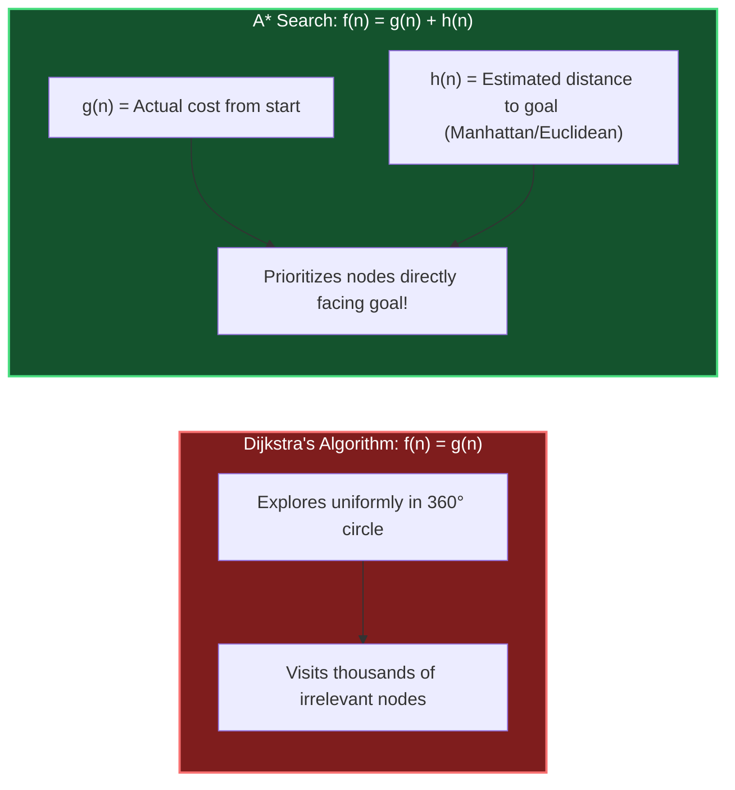

# Chapter 09: Heuristics & Search — Navigating Combinatorial Explosions

> *"When a problem space contains more combinations than atoms in the universe, you cannot explore every path. You need heuristics: smart rules of thumb that prune 99.9% of the search tree."*

---

## 💡 1. The Napkin Analogy: The Foggy Mountain & The Compass

Imagine descending a mountain in dense fog:
- **Brute Force**: Walk every single trail on the mountain until you find the parking lot (takes days $\implies O(2^N)$).
- **Greedy Search**: Take whichever step goes down steepest right now. Fast, but you get trapped in a muddy pothole (local minimum).
- **Heuristic Navigation ($A^*$ Search)**: You carry a compass and GPS altimeter. Even when the trail twists, you prioritize paths that move closer to the parking lot coordinates.

```
┌─────────────────────────────────────────────────────────────────────────────┐
│ 🧭 HEURISTIC:                                                               │
│ A computational rule of thumb that estimates the distance to the goal.      │
│ It does not guarantee perfection on its own, but it guides the search away  │
│ from billions of dead-end paths.                                            │
└─────────────────────────────────────────────────────────────────────────────┘
```

---

## 📊 2. The Visual Whiteboard: $A^*$ Search vs. Dijkstra

Dijkstra’s algorithm explores blindly in all directions like an expanding circle.  
**$A^*$ Search uses a heuristic "flashlight" to focus the search toward the target:**



### The Golden Rule of $A^*$: Admissibility
For $A^*$ to guarantee the **shortest path**, the heuristic $h(n)$ must be **admissible**:
- It must **never overestimate** the true cost to the goal.
- On a 2D grid:
  - 4-directional movement (Up/Down/Left/Right) $\implies$ Use **Manhattan Distance**: $|x_1 - x_2| + |y_1 - y_2|$.
  - 8-directional movement / Euclidean space $\implies$ Use **Euclidean Distance**: $\sqrt{(x_1 - x_2)^2 + (y_1 - y_2)^2}$.

---

## 🗣️ 3. The 30-Second Interview Talk Track

### Explaining Backtracking Pruning (N-Queens / Sudoku)
> *"A naive exhaustive search across an $N \times N$ board searches $O(N^N)$ states, which hangs the program. To make this optimal, we introduce **Constraint Propagation and Branch-and-Bound Pruning**:  
> 1. We maintain hash sets for columns, main diagonals ($r - c$), and anti-diagonals ($r + c$) to check validity in $O(1)$ time.  
> 2. We employ the **Most Constrained Variable heuristic**: at each step, we place candidates in the row with the fewest legal choices remaining.  
> 
> By abandoning impossible branches immediately, we prune over 99.9% of states, allowing an $N = 14$ board to solve in a few milliseconds."*

---

## 🧠 4. Senior Systems Reality: Heuristics in Production Infrastructure

```
┌──────────────────────────────────────┬─────────────────────────────────────────────────────────┐
│ Real-World System                    │ Heuristic Technique Used                                │
├──────────────────────────────────────┼─────────────────────────────────────────────────────────┤
│ Google Maps / GPS Routing            │ A* with Contraction Hierarchies: Precomputes highway    │
│                                      │ shortcuts to route across countries in 10 ms.           │
├──────────────────────────────────────┼─────────────────────────────────────────────────────────┤
│ PostgreSQL Query Planner             │ Genetic Query Optimizer (`GEQO`): When an SQL query     │
│                                      │ joins > 12 tables, exhaustive search is too slow;       │
│                                      │ Postgres uses heuristic genetic search for join plans.  │
├──────────────────────────────────────┼─────────────────────────────────────────────────────────┤
│ Chess & Game AI                      │ Alpha-Beta Pruning: Discards entire minimax subtrees    │
│                                      │ that the opponent will never allow you to enter.        │
└──────────────────────────────────────┴─────────────────────────────────────────────────────────┘
```

---

## 🎯 5. Constraint Triage & FAANG Traps

### Trap 1: Inadmissible Heuristics
If your heuristic function overestimates distance (e.g., Manhattan distance on a grid that allows diagonal shortcuts), $A^*$ can return a sub-optimal path! Always ensure $h(n) \le \text{actual distance}$.

### Trap 2: Missing Backtracking State Cleanup
In recursive backtracking, forgetting to undo the state change after the recursive call mutates the state for sibling branches:
```python
# ❌ BUG: State persists into sibling branches!
visited.add(next_node)
backtrack(next_node)
# 💥 BUG: Forgot `visited.remove(next_node)`!
```

---

## 🧭 Navigation
- **Previous**: [Ch 08: Randomized Algorithms](./08_randomized_algorithms.md)
- **Next**: [Ch 10: Information Theory & Entropy](./10_information_theory_and_entropy.md)
