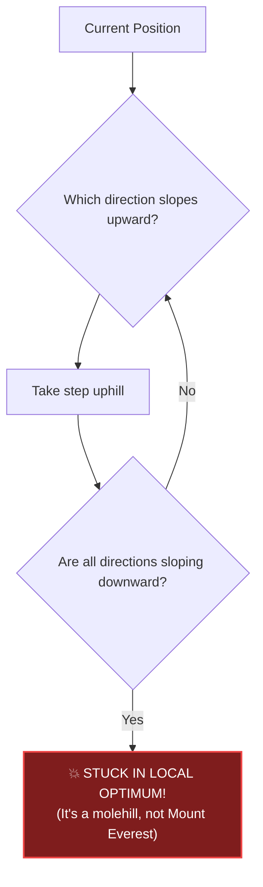
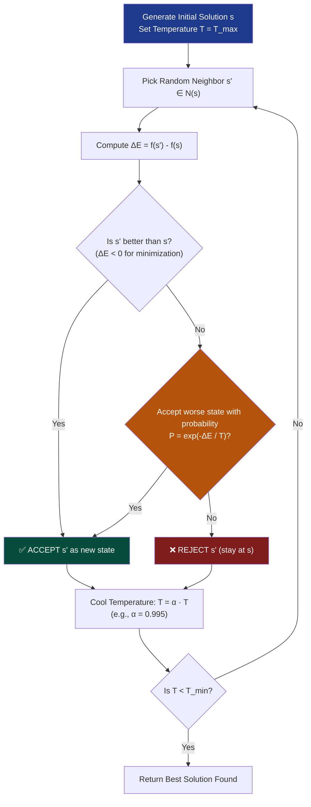
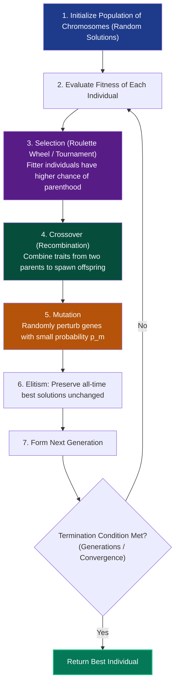

# Chapter 09: Heuristics & Metaheuristics — Engineering When Theory Surrenders

> *"When a problem is NP-hard and an approximation guarantee cannot be proven, the engineer does not give up — they build metaheuristics."*

---

## 🧒 Explain Like I'm 5: Climbing in the Fog

Imagine you are dropped by helicopter into a mountain range covered in **dense fog**:
- You cannot see more than 1 meter in front of you.
- Your mission is to find the **highest mountain peak** in the entire country.
- You can only feel the ground beneath your boots.

```
Strategy 1: Hill Climbing (Walk uphill wherever your boots feel an incline)
💥 The Trap: You reach the top of a tiny 20-foot hill!
Every step in any direction goes downhill. You think you're at the top of Mount Everest,
but you are stuck on a molehill.
```



To find the true global peak, you need **Metaheuristics**:
- **Simulated Annealing**: When young and energetic, you randomly jump across valleys (even downhill) to explore. As time cools down, you settle into climbing.
- **Genetic Algorithms**: Drop 100 hikers with walkie-talkies. The hikers on higher ridges breed and spawn new hikers on the mountain crests!

---

## 🟢 Undergraduate Foundation: Local Search & The Traps

### 1. Constructive Heuristics vs Local Search
Every heuristic falls into one of two operational modes:

| Category | How It Works | Strengths | Pitfalls |
|---|---|---|---|
| **Constructive Heuristic** | Builds a solution from nothing, piece by piece (e.g., Nearest Neighbor for TSP, Greedy Knapsack). | Blazing fast ($O(N)$ or $O(N \log N)$) | Can make catastrophic early mistakes that cannot be undone |
| **Local Search** | Starts with a complete candidate solution $s$, and iteratively moves to a neighbor $s' \in \mathcal{N}(s)$. | Can continuously refine and improve quality | Prone to getting trapped in **Local Optima** |

---

### 2. The Anatomy of an Optimization Landscape
For an objective function $f(s)$ to be maximized:
- **Global Optimum**: The absolute best solution in the entire search space.
- **Local Optimum**: A solution $s^*$ such that $\forall s \in \mathcal{N}(s^*), f(s^*) \ge f(s)$, but $f(s^*) < f(s_{global})$.
- **Plateau**: A flat region where all neighbors have the exact same fitness score (gradient is zero).

```
Fitness
  ▲               Local Optimum            Global Optimum
  │                  ╭───╮                      ╭───╮
  │                 ╭╯   ╰╮                    ╭╯   ╰╮
  │                ╭╯     ╰╮                  ╭╯     ╰╮
  │      ╭─────────╯       ╰╮       ╭─────────╯       ╰╮
  │   ───╯   Plateau        ╰───────╯  Valley          ╰───
  └────────────────────────────────────────────────────────► Search Space
```

---

## 🟡 Master's Deep-Dive: The Big Metaheuristic Engines

### 1. Simulated Annealing (Kirkpatrick, Gelatt, Vecchi, 1983)
Inspired by metallurgy: heating metal to high temperatures and cooling it slowly (**annealing**) allows atoms to settle into a minimum-energy, defect-free crystalline lattice. Rapid cooling (**quenching**) produces brittle, irregular structures.



#### The Metropolis Acceptance Criterion:
- If neighbor $s'$ is better: **Always accept it**.
- If neighbor $s'$ is worse ($\Delta E > 0$): Accept it with probability:
  $$P(\text{accept}) = e^{-\frac{\Delta E}{T}}$$
- **At high temperature ($T \gg 0$)**: $e^{-\Delta E / T} \approx 1$. The algorithm accepts almost any move, freely exploring the global landscape and jumping out of local optima.
- **As $T \to 0$**: $e^{-\Delta E / T} \to 0$. The algorithm stops accepting bad moves and converges into a sharp local descent!

---

### 2. Genetic Algorithms (John Holland, 1975)
Simulates Darwinian natural selection across a **population** of candidate solutions:



#### Key GA Operators for DSA:
1. **Chromosome Encoding**:
   - For Subsets / Knapsack: Binary string `[1, 0, 1, 1, 0]`.
   - For Routing / TSP: Permutation vector `[3, 1, 4, 0, 2]`.
2. **Crossover**:
   - For Permutations: **Partially Mapped Crossover (PMX)** or Order Crossover (OX) to ensure no duplicate cities.
3. **Mutation**:
   - Swap mutation (swap two indices) or Inversion mutation (reverse a sub-segment).

---

### 3. The No Free Lunch (NFL) Theorem (Wolpert & Macready, 1997)
The most humbling mathematical theorem in computer science:

> **The Theorem**: Averaged over the set of all possible optimization problems (cost functions), **every search algorithm performs identically**.  
> In fact, any sophisticated genetic algorithm or simulated annealer performs **no better than blind random guessing** when averaged across all possible problem instances!

$$\sum_{f} P(y \mid f, m, A_1) = \sum_{f} P(y \mid f, m, A_2)$$

#### The Fatal Engineering Trap & The Silver Lining:
- **The Trap**: Looking for a "universal master algorithm" that magically solves all optimization problems. It cannot exist.
- **The Silver Lining**: Real-world engineering problems **are NOT randomly chosen from the space of all possible mathematical functions**!
  - Real-world problems have structure: spatial continuity, triangle inequality, submodularity, convexity, symmetry.
- **The Golden Rule of Heuristics**:
  > **To outperform random search, your heuristic MUST exploit domain-specific structural knowledge of the problem.**

---

## 🔴 PhD Horizon: Fitness Landscapes & MCMC Convergence

<details>
<summary><strong>Expand PhD Deep-Dive: Markov Chain Monte Carlo & Fitness Landscapes</strong></summary>

### 1. Simulated Annealing Convergence via Inhomogeneous Markov Chains
Simulated Annealing can be modeled as a discrete-time Markov chain on the solution space.
- **Hajek's Theorem (Bruce Hajek, 1988)**:
  Simulated Annealing is mathematically guaranteed to converge to the global optimum with probability 1 if and only if the cooling schedule satisfies:
  $$T_k \ge \frac{d^*}{\ln(k + 1)}$$
  Where $d^*$ is the maximum "depth" of any local minimum in the fitness landscape.
- *The Catch*: This logarithmic cooling schedule is so slow that running it takes longer than exhaustive search! This is why engineering practice uses geometric cooling ($T_{k+1} = \alpha T_k$).

### 2. Fitness Landscape Ruggedness & Epistasis
How hard is a problem for a genetic algorithm?
- **Epistasis**: The degree of non-linear interaction between genes. In low-epistasis landscapes (separable functions), GAs converge in linear time. In high-epistasis landscapes (needle-in-a-haystack), GAs degrade to random walk.

</details>

---

## 💻 Python 3.14 Verification: Simulated Annealing for TSP

Here is an executable Simulated Annealing engine in Python 3.14 solving a 20-city Traveling Salesperson Problem and dynamically escaping local optima:

```python
import math
import random

type City = tuple[float, float]
type Tour = list[int]


def tour_cost(tour: Tour, cities: list[City]) -> float:
    total = 0.0
    n = len(tour)
    for i in range(n):
        c1 = cities[tour[i]]
        c2 = cities[tour[(i + 1) % n]]
        total += math.hypot(c1[0] - c2[0], c1[1] - c2[1])
    return total


def simulated_annealing_tsp(
    cities: list[City],
    initial_temp: float = 1000.0,
    cooling_rate: float = 0.995,
    min_temp: float = 1e-4,
    seed: int = 42,
) -> tuple[float, Tour]:
    random.seed(seed)
    n = len(cities)

    # Initial random tour
    current_tour = list(range(n))
    random.shuffle(current_tour)
    current_cost = tour_cost(current_tour, cities)

    best_tour = list(current_tour)
    best_cost = current_cost

    temp = initial_temp
    step = 0

    while temp > min_temp:
        # 2-Opt Neighbor: Reverse a random sub-segment
        i, j = sorted(random.sample(range(n), 2))
        neighbor_tour = (
            current_tour[:i]
            + current_tour[i : j + 1][::-1]
            + current_tour[j + 1 :]
        )
        neighbor_cost = tour_cost(neighbor_tour, cities)

        delta = neighbor_cost - current_cost

        # Metropolis Acceptance Criterion
        if delta < 0 or random.random() < math.exp(-delta / temp):
            current_tour = neighbor_tour
            current_cost = neighbor_cost

            if current_cost < best_cost:
                best_cost = current_cost
                best_tour = list(current_tour)

        temp *= cooling_rate
        step += 1

    return best_cost, best_tour


if __name__ == "__main__":
    # Create 20 cities in a predictable circle of radius 100
    # Optimal tour visits them sequentially around the perimeter: Perimeter = 2 * pi * r ≈ 628.3
    num_cities = 20
    radius = 100.0
    circular_cities = [
        (
            radius * math.cos(2 * math.pi * i / num_cities),
            radius * math.sin(2 * math.pi * i / num_cities),
        )
        for i in range(num_cities)
    ]

    opt_perimeter = 2 * math.pi * radius
    best_cost, best_tour = simulated_annealing_tsp(
        circular_cities, initial_temp=500.0, cooling_rate=0.999
    )

    print(f"Theoretical Circle Perimeter : {opt_perimeter:.2f}")
    print(f"Simulated Annealing Best Cost: {best_cost:.2f}")
    print(f"Final Tour: {best_tour}")

    # Simulated annealing should easily get within 5% of perimeter
    assert best_cost < opt_perimeter * 1.05
    print(
        "✅ Verification passed: Simulated Annealing escaped local minima and found near-optimal tour!"
    )
```

---

## 🔗 Connections to Coding Patterns

- **Pattern 21: Greedy Algorithms**: Greedy is a constructive heuristic that never backtracks. Knowing when Greedy gets stuck in local optima dictates when to upgrade to dynamic programming or metaheuristics.
- **Pattern 34: Simulation Pattern**: Simulated Annealing is a direct physical simulation of the thermal equilibrium of atoms under Boltzmann distributions.
- **Pattern 25: Backtracking**: When backtracking search spaces explode beyond $N \approx 30$, adding randomized restarts and tabu memories transforms rigid backtracking into high-performance local search.

---

## 🧪 Self-Test Questions

1. **Why does Hill Climbing fail on multimodal optimization landscapes?**
2. **Explain the Metropolis acceptance criterion in Simulated Annealing: When does it accept a solution that is strictly WORSE than the current one?**
3. **What is the practical engineering implication of the No Free Lunch (NFL) theorem?**
4. **In Genetic Algorithms, what is the role of the Mutation operator? What happens if the mutation rate is set to 0?**
5. **How does Tabu Search prevent an algorithm from getting caught in an infinite cycle between two adjacent local states?**

<details>
<summary><strong>Click to view answers</strong></summary>

1. Hill climbing strictly moves in the direction of steepest upward slope. When it encounters a **local optimum** (a peak that is lower than the global peak, but where all immediate neighbors have lower fitness), it terminates, permanently trapped.
2. When the candidate neighbor is worse ($\Delta E > 0$), it accepts it with probability $P = e^{-\Delta E / T}$. When temperature $T$ is high, this probability is close to 1, allowing the algorithm to easily take worse steps to climb out of local valleys.
3. The NFL theorem proves that no general-purpose optimization algorithm can outperform random search on average over all possible problems. Therefore, an engineer must **never use a generic black-box heuristic** without tailoring the representation, neighborhood function, and operators to the specific mathematical structure of the domain.
4. Mutation injects **random diversity** into the population. If the mutation rate is set to 0, the genetic diversity of the population rapidly collapses (premature convergence); if all individuals share a gene, crossover can never reintroduce a missing alternate allele.
5. Tabu Search maintains a short-term memory called the **Tabu List**, which forbids recently executed moves or recently visited states for a specified duration (tabu tenure). This prevents the algorithm from endlessly bouncing back and forth between two solutions.

</details>

---

## 🧭 Navigation

| ← Previous | ↑ Master Index | Next → |
|:---|:---:|---:|
| [← Ch 08: Randomized Algorithms](08_randomized_algorithms.md) | [🏛️ Theoretical Foundations Index](README.md) | [Ch 10: Information Theory & Entropy →](10_information_theory_and_entropy.md) |

