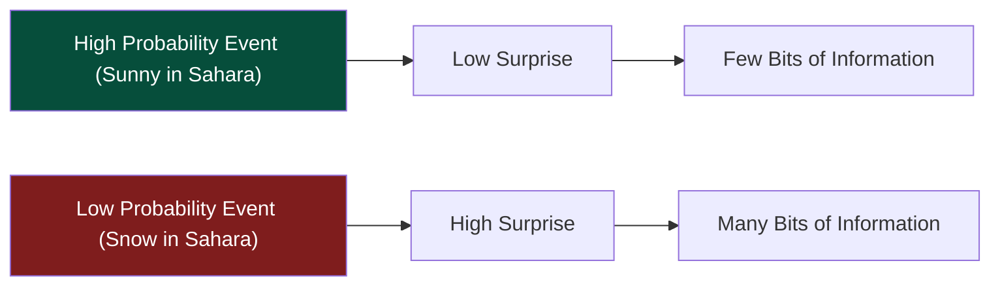
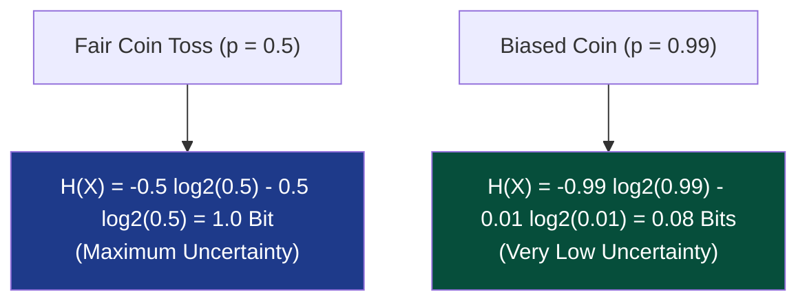
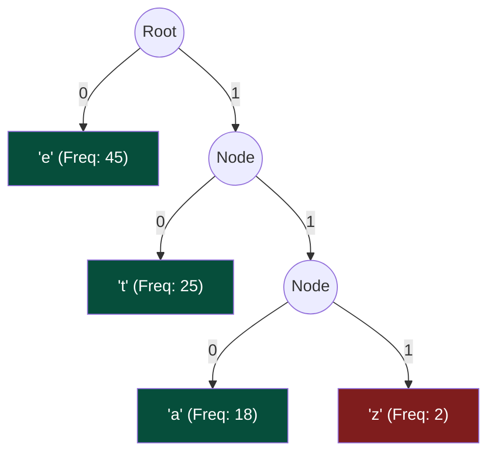

# Chapter 10: Information Theory & Entropy — The Physics of Surprise

> *"Information is the resolution of uncertainty."* — Claude E. Shannon  
> *"If you want to understand why sorting takes N log N comparisons, don't look at the array. Look at the entropy."*

---

## 📍 Level 100 — The Napkin Sketch: The Weather in the Sahara

Imagine your friend calls you every morning from two different places:
- **Location 1: The Sahara Desert**.  
  They say: *"Good morning! It's sunny and hot."*  
  Are you surprised? Not at all ($P \approx 99.9\%$). That message gave you **almost 0 new information**.
- **Location 2: Antarctica**.  
  They call and scream: *"Good morning! It's 95°F outside and I'm wearing a swimsuit!"*  
  Are you surprised? You are completely stunned ($P \approx 0.00001\%$). That message carried **massive information**.



**Information is the measurement of surprise.** If an event was 100% predictable, transmitting it requires 0 bits. If an event was unpredictable, transmitting it requires many bits.

---

## 🎯 Level 200 — Street Fundamentals: Entropy = Average Surprise

> 🧠 **Mental Model Card**
> - **Entropy is Surprise:** If a message tells you *"The sun rose this morning"*, the surprise is 0 $\implies$ 0 bits of information. If a message tells you *"Snowing in Miami in July!"*, surprise is maximum $\implies$ lots of bits.
> - **Formula in Plain English:** $H(X) = \sum p(x) \log_2 \frac{1}{p(x)}$.
>   - Rare event ($p = 0.001$) $\implies \log_2(1000) \approx 10$ bits of information.
>   - Certain event ($p = 1.0$) $\implies \log_2(1) = 0$ bits of information.
> - **The Compression Limit:** You can *never* compress data into fewer bits than its Shannon Entropy $H(X)$ without losing information.
> - **The Sorting Lower Bound:** Sorting an unsorted array of $N$ items requires distinguishing between $N!$ equally likely outcomes. Entropy $= \log_2(N!) \approx N \log_2 N$. That is the true physical reason why comparison sorting is $\Omega(N \log N)$!

### Street Information Theory Cheat Sheet

| Concept | Meaning | Engineering Application |
|---|---|---|
| **Shannon Entropy $H(X)$** | Theoretical minimum average bits per symbol | gzip, zstd, Brotli compression limits |
| **Huffman Coding** | Prefix-free variable-length binary tree | JPEG, MP3, Gzip deflation phase |
| **Kolmogorov Complexity** | Length of shortest program that outputs string | Software complexity, Occam's Razor |
| **Information Limit on Sorting** | $\lceil \log_2(N!) \rceil \approx N \log_2 N$ bits | Proof that comparison sorting cannot beat $\Omega(N \log N)$ |

---

## ⚙️ Level 300 — Working Professional: Shannon Entropy

In 1948, Claude Shannon published *"A Mathematical Theory of Communication"*, single-handedly founding the digital information age.

### 1. The Mathematical Definition of Entropy
Let $X$ be a discrete random variable with outcomes $x \in \mathcal{X}$ and probability mass function $p(x) = P(X = x)$.

The **Self-Information** (or surprise) of observing outcome $x$ is:

$$I(x) = \log_2\left(\frac{1}{p(x)}\right) = -\log_2 p(x)$$

The **Shannon Entropy $H(X)$** is the expected value of surprise across all possible outcomes:

$$H(X) = \mathbb{E}[I(X)] = -\sum_{x \in \mathcal{X}} p(x) \log_2 p(x)$$

- **Units**: Measured in **Bits** (when using $\log_2$), or **Nats** (when using $\ln$).
- **The Minimum Entropy**: $H(X) = 0$ bits (occurs when one outcome has probability $1$; zero uncertainty).
- **The Maximum Entropy**: For an alphabet of $N$ symbols, entropy is maximized when all outcomes are equally likely (Uniform distribution):
  $$H_{max} = \log_2 N \text{ bits}$$



---

### 2. Shannon's Source Coding Theorem
> **The Theorem**: You cannot compress data from a random variable $X$ into an average code length shorter than its Shannon Entropy $H(X)$ without losing information.

$$L_{avg} \ge H(X)$$

Entropy is the **immutable speed-of-light boundary** of lossless data compression.

---

### 3. Huffman Coding: Optimal Prefix-Free Trees (Pattern 21)
David Huffman discovered an optimal greedy algorithm to construct a variable-length prefix code:
- Frequent symbols receive **short bitstrings** (e.g., `'e'` $\to$ `01`).
- Rare symbols receive **long bitstrings** (e.g., `'z'` $\to$ `110101`).
- **Prefix-Free Property**: No codeword is a prefix of another codeword (ensuring unambiguous parsing without commas or delimiters).



#### Huffman's Bound:
$$H(X) \le L_{\text{Huffman}} < H(X) + 1$$

---

## 🔬 Level 400 — Staff & Senior Engineer: Information Theory in Data Structures

### 1. The Information-Theoretic Sorting Bound: The Real Reason for $\Omega(n \log n)$
Why does comparison sorting require $n \log n$ comparisons?

1. An unsorted array of $n$ distinct elements can arrive in any of **$n!$ permutations**.
2. If all permutations are equally likely, the initial entropy of the unsorted array is:
   $$H(X) = \log_2(n!) \text{ bits}$$
3. When your algorithm compares two elements ($A[i] \le A[j]$), it asks a binary question with only **two possible answers** (YES or NO).
4. The maximum information a binary comparison can extract is:
   $$I_{\text{comparison}} \le H(\text{binary}) \le 1.0 \text{ bit}$$
5. To reduce the entropy to zero (a completely sorted array), the algorithm must extract at least $\log_2(n!)$ bits of information:
   $$\text{Comparisons} \ge \frac{H(X)}{1.0} = \lceil \log_2(n!) \rceil \ge n \log_2 n - n \log_2 e = \Omega(n \log n)$$

> **The Enlightenment**: Merge Sort is not fast because John von Neumann was clever. **Merge Sort is optimal because each comparison extracts nearly 1 full bit of entropy by bisecting the remaining permutation space in half!**

---

### 2. Kolmogorov Complexity: Algorithmic Entropy
Andrey Kolmogorov proposed measuring the information content of a specific object $s$ (not an ensemble):

> The **Kolmogorov Complexity $K(s)$** is the length of the shortest computer program (in Python or Turing machine bytecode) that outputs string $s$.

Consider two strings of 10,000 digits:
- String A: `01010101010101010101...` (repeating `01`)  
  *Python program*: `print("01" * 5000)` $\implies$ Length $\approx 25$ bytes $\implies$ **Low complexity ($K(A)$ is tiny)**.
- String B: `74920185829104857291...` (true random coin flips)  
  *Shortest program*: Must embed the entire literal string! $\implies$ Length $\approx 10,000$ bytes $\implies$ **High complexity ($K(B) \approx |B|$)**.

#### The Berry Paradox and Uncomputability of $K(s)$:
**Theorem**: The function $K(s)$ is **uncomputable**. No algorithm can calculate the true Kolmogorov complexity of an arbitrary string.
- *Proof Intuition*: Consider the phrase: *"The smallest positive integer that cannot be defined in fewer than twenty English words."*  
  That sentence defines the integer in **fourteen words**! A logical paradox.

---

## 🎓 Level 500 — Researcher's Corner: The Incompressibility Method in DSA Proofs

<details>
<summary><strong>Expand PhD Deep-Dive: The Incompressibility Method & Shellsort</strong></summary>

### The Incompressibility Method (Paul Vitányi & Ming Li)
How do you prove average-case lower bounds for complex algorithms without doing horrifying probability integrals?

**The Core Idea**:
1. Most strings are **algorithmically incompressible** ($K(x) \ge |x|$).
2. Feed an incompressible input $x$ into the algorithm.
3. If the algorithm terminated too quickly, its execution trace would allow us to reconstruct $x$ using fewer than $K(x)$ bits!
4. This contradiction proves the algorithm **must have taken a long time**!

This elegant proof technique was used to settle the 40-year open question of the average-case runtime of **Shellsort** with two passes ($O(n^{3/2})$).

</details>

---

## 💻 Python 3.14 Verification: Shannon Entropy vs Huffman Encoding

Here is executable Python 3.14 code calculating the exact **Shannon Entropy $H(X)$** of a text and building a **Huffman Prefix Tree** to prove that $H(X) \le L_{avg} < H(X) + 1$:

```python
from collections import Counter
import heapq
import math
from typing import NamedTuple


class HuffmanNode(NamedTuple):
    freq: int
    char: str | None
    left: "HuffmanNode | None" = None
    right: "HuffmanNode | None" = None

    def __lt__(self, other: "HuffmanNode") -> bool:
        return self.freq < other.freq


def calculate_shannon_entropy(text: str) -> float:
    n = len(text)
    counts = Counter(text)
    entropy = 0.0
    for count in counts.values():
        p = count / n
        entropy -= p * math.log2(p)
    return entropy


def build_huffman_codes(text: str) -> dict[str, str]:
    counts = Counter(text)
    heap: list[HuffmanNode] = [
        HuffmanNode(freq=f, char=c) for c, f in counts.items()
    ]
    heapq.heapify(heap)

    if len(heap) == 1:
        return {heap[0].char: "0"}

    while len(heap) > 1:
        n1 = heapq.heappop(heap)
        n2 = heapq.heappop(heap)
        parent = HuffmanNode(freq=n1.freq + n2.freq, char=None, left=n1, right=n2)
        heapq.heappush(heap, parent)

    root = heap[0]
    codes: dict[str, str] = {}

    def traverse(node: HuffmanNode, prefix: str):
        if node.char is not None:
            codes[node.char] = prefix
            return
        if node.left:
            traverse(node.left, prefix + "0")
        if node.right:
            traverse(node.right, prefix + "1")

    traverse(root, "")
    return codes


if __name__ == "__main__":
    sample_text = "abracadabra_sim_sala_bim_data_structures_and_algorithms"
    n = len(sample_text)

    # 1. Theoretical Entropy
    entropy = calculate_shannon_entropy(sample_text)

    # 2. Huffman Compression
    codes = build_huffman_codes(sample_text)
    encoded_bits = sum(len(codes[c]) for c in sample_text)
    avg_bit_length = encoded_bits / n

    print(f"Sample Text Length       : {n} characters")
    print(f"Alphabet Size            : {len(set(sample_text))} unique symbols")
    print(f"Shannon Entropy H(X)     : {entropy:.3f} bits/symbol")
    print(f"Huffman Average Length L : {avg_bit_length:.3f} bits/symbol")
    print(
        f"Naive Fixed-Length ASCII : 8.000 bits/symbol (or {math.ceil(math.log2(len(set(sample_text))))} bits/symbol)"
    )

    # Verify Shannon's Bound: H(X) <= L < H(X) + 1
    assert entropy <= avg_bit_length < entropy + 1.0
    print(
        "✅ Verification passed: Huffman code length strictly obeyed Shannon's bounds!"
    )
```

---

## 🔗 Connections to Coding Patterns

- **Pattern 21: Greedy Algorithms**: Huffman Coding is the gold-standard interview example of a greedy tree building algorithm that is provably optimal.
- **Pattern 26: Trie**: A Huffman encoding tree is a specialized binary prefix-trie. Navigating the bits `0` and `1` through the trie decodes the compressed stream in $O(1)$ amortized time per character.
- **Pattern 10: Hash Maps**: The entropy of a hash function's output distribution determines its collision frequency. High entropy $\implies$ near-zero collisions $\implies$ $O(1)$ performance.

---

## 🧪 Self-Test Questions

1. **What is the Shannon entropy of a fair 8-sided die?**
2. **Explain why comparison-based sorting requires $\Omega(n \log n)$ operations using the concept of entropy.**
3. **What is the Prefix-Free property in Huffman coding, and why is it mandatory for streaming decompression?**
4. **Why is Kolmogorov Complexity uncomputable? What paradox arises if an algorithm could compute it?**
5. **If an event occurs with probability $p = 1/1024$, how many bits of information does observing that event convey?**

<details>
<summary><strong>Click to view answers</strong></summary>

1. A fair 8-sided die has uniform probabilities $p = 1/8$ for each face. The entropy is $H(X) = \log_2(8) = \mathbf{3.0\text{ bits}}$.
2. An array of $n$ distinct elements has $n!$ possible initial permutations, carrying $H = \log_2(n!)$ bits of uncertainty. Each binary comparison yields at most 1 bit of information. Therefore, at least $\lceil \log_2(n!) \rceil \ge n \log_2 n - n \log_2 e = \Omega(n \log n)$ comparisons are required to resolve all uncertainty.
3. A code is prefix-free if no valid symbol's codeword forms the beginning prefix of any other codeword (e.g., if `'a'` is `01`, no other symbol can start with `01`). This ensures that the receiver can decode bits instantaneously on the fly without needing lookahead buffers or delimiter markers.
4. If $K(s)$ were computable, we could enumerate all programs in order of length and find the smallest integer that cannot be described in under $M$ characters. But the program that does this enumeration would itself describe that integer in fewer than $M$ characters — triggering the **Berry Paradox**.
5. $I(x) = -\log_2(p) = -\log_2(1/1024) = \log_2(1024) = \mathbf{10\text{ bits}}$ of information.

</details>

---

## 🧭 Navigation

| ← Previous | ↑ Master Index | Next → |
|:---|:---:|---:|
| [← Ch 09: Heuristics & Metaheuristics](09_heuristics_and_metaheuristics.md) | [🏛️ Theoretical Foundations Index](README.md) | [Ch 11: Metatheorems & Folklore →](11_metatheorems_and_folklore.md) |

