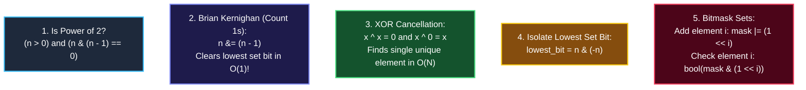

# Chapter 10: Information & Bit Efficiency — Squeezing Bits & Memory

> *"Every conditional branch in your code is a question. Information theory tells you how many questions you must ask to find truth, and bit manipulation lets you answer them in a single CPU cycle."*

---

## 💡 1. The Napkin Analogy: The Light Switch & The Morse Code

Think about communication efficiency:
- **The 1-Bit Decision**: A single light switch (0 or 1) can distinguish between 2 states. Two switches can distinguish $2^2 = 4$ states. To identify one item among $N$ choices, you need $\log_2 N$ switches.  
  *(This is why Binary Search takes $\log_2 N$ comparisons).*
- **Morse Code & Huffman Trees**: In the English language, the letter **'E'** appears in 12% of words, while **'Z'** appears in 0.07%. Morse code gives 'E' a single short dot (`.`), and 'Z' two dashes and two dots (`--..`).
  - By assigning **short bit sequences to frequent items** and **longer sequences to rare items**, you compress data dramatically.

```
┌─────────────────────────────────────────────────────────────────────────────┐
│ 💾 HUFFMAN ENCODING:                                                        │
│ Use a Min-Heap to repeatedly merge the two lowest-frequency symbols.         │
│ Produces a prefix-free optimal binary tree in O(N log N) time.               │
└─────────────────────────────────────────────────────────────────────────────┘
```

---

## 📊 2. The Visual Whiteboard: The 5 Essential Bit Manipulation Tricks

In technical coding interviews, bit manipulation is the ultimate test of low-level efficiency:



### Visualizing Brian Kernighan's Algorithm
```
Original n:      1 0 1 1 0 0    (Decimal 44)
n - 1:           1 0 1 0 1 1    (Flips lowest set bit and trailing zeros)
n & (n - 1):     1 0 1 0 0 0    ➜ Lowest set bit is erased in 1 operation!
```

---

## 🗣️ 3. The 30-Second Interview Talk Track

### Explaining XOR Single Number ($O(N)$ Time, $O(1)$ Space)
> *"Because XOR is commutative, associative, and satisfies $x \oplus x = 0$ and $x \oplus 0 = x$, if we take the running XOR of all array elements, every duplicate number will cancel itself out to 0, leaving only the single unique value. This achieves linear $O(N)$ time with strictly $O(1)$ auxiliary space."*

### Explaining Brian Kernighan’s Bit Count
> *"Rather than shifting through all 32 or 64 bit positions, we use Brian Kernighan’s expression `n &= (n - 1)`. Each iteration strips off the lowest set 1-bit in constant time. The loop runs exactly $K$ times, where $K$ is the number of set bits, providing an optimal $O(K)$ runtime."*

---

## 🧠 4. Senior Systems Reality: Bitmasks vs. Set Containers

Suppose your algorithm needs to track which of 20 items have been visited:
- **Junior Approach**: `visited = set()` or `boolean[] visited = new boolean[20]`.
  - Allocates heap objects, creates pointer chasing, incurs garbage collection overhead.
- **Senior Lead Approach**: `visited_mask = 0` (a single 32-bit integer).
  - Fits inside a single CPU register.
  - Adding a visited item is 1 CPU cycle: `visited_mask |= (1 << i)`.
  - Checking if visited is 1 CPU cycle: `if (visited_mask & (1 << i)):`.
  - Copying state in recursion takes **zero memory allocations** (just pass an integer by value)!

---

## 🎯 5. Constraint Triage & FAANG Traps

### The Operator Precedence Trap
In Python, C++, and Java, **bitwise operators (`&`, `|`, `^`) have lower precedence than comparison operators (`==`, `!=`)**!

```python
# ❌ TRAP: Evaluates as `n & (1 == 0)` which is always 0!
if n & 1 == 0:
    print("Even")

# ✅ SENIOR FIX: Always wrap bitwise operations in parentheses!
if (n & 1) == 0:
    print("Even")
```

### Bit Shifts on 32-bit vs. 64-bit Integers
- In Python, integers have arbitrary precision (they grow automatically).
- In Java/C++, shifting by $\ge 32$ bits on a 32-bit `int` or negative sign bits can cause undefined behavior or integer overflow. Use `1ULL << i` or `1L << i` in C++/Java.

---

## 🧭 Navigation
- **Previous**: [Ch 09: Heuristics & Search](./09_heuristics_and_metaheuristics.md)
- **Next**: [Ch 11: Metatheorems & Folklore](./11_metatheorems_and_folklore.md)
