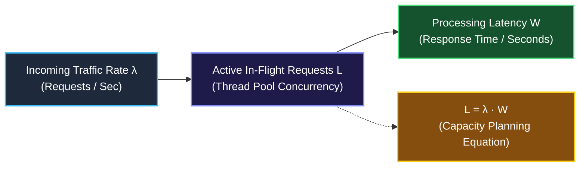

# Chapter 11: Engineering Laws & Folklore — Systems Wisdom Every Lead Must Know

> *"Junior engineers optimize inner loops. Staff engineers optimize architecture using fundamental physical and computational laws."*

---

## 💡 1. The Napkin Analogy: The Pregnancy Myth & The Coffee Line

### 1. Amdahl's Law: The 9-Women Pregnancy Myth
> *"Nine women cannot produce a baby in one month."*

If you have an algorithm where 20% of the work must run sequentially (such as waiting on a database lock or merging final results), **adding 1,000 CPU cores will never make it run more than 5× faster!**

```
┌─────────────────────────────────────────────────────────────────────────────┐
│ ⚡ AMDAHL'S LAW:                                                            │
│ If a fraction (1 - P) of your program is serial, your maximum possible      │
│ speedup on infinite processors is capped at:                                │
│                     Speedup ≤ 1 / (1 - P)                                   │
│ • If 50% is serial ➜ Max speedup is 2×                                      │
│ • If 10% is serial ➜ Max speedup is 10×                                     │
│ • If 1% is serial  ➜ Max speedup is 100×                                    │
└─────────────────────────────────────────────────────────────────────────────┘
```

---

### 2. Little's Law: The Coffee Shop Queue ($L = \lambda W$)
Imagine standing inside a coffee shop:
- $L$ = Number of customers inside the store.
- $\lambda$ = Arrival rate (e.g., 2 customers per minute).
- $W$ = Average time a customer spends inside (e.g., 5 minutes).

$$L = \lambda \times W = 2 \times 5 = 10 \text{ customers inside the store.}$$

In backend systems: **Concurrency = Throughput $\times$ Latency**.  
If your service handles **1,000 requests/sec** and each DB query takes **100 ms (0.1s)**, your connection pool must hold at least $1000 \times 0.1 = \mathbf{100 \text{ active connections}}$ to avoid queuing!

---

### 3. The Pigeonhole Principle: Duplicates Guaranteed
If you have **10 pigeons** and only **9 pigeonholes**, at least one hole **must contain 2 or more pigeons**.

In coding interviews: If an array contains $N + 1$ integers and every integer is in the range $[1 \dots N]$, **a duplicate is mathematically guaranteed to exist**.

---

## 📊 2. The Visual Whiteboard: Little's Law in Backend Infrastructure



---

## 🗣️ 3. The 30-Second Interview Talk Track

### Explaining Cycle Detection via Pigeonhole Principle (LeetCode 287)
> *"Because the array has length $N + 1$ and contains values in the range $[1 \dots N]$, by the **Pigeonhole Principle**, at least one value must repeat.  
> 
> Rather than using an $O(N)$ hash set, we treat the array as a directed graph where index $i$ points to node `nums[i]`. Because a duplicate value exists, two distinct indices point to the same destination, which creates a cycle. We can find the duplicate value in $O(N)$ time and strictly $O(1)$ space using **Floyd's Tortoise and Hare cycle detection algorithm**."*

### Explaining System Scaling Limits (Amdahl's Law)
> *"While we can distribute the map phase across 64 worker threads, the sequential reduce aggregation represents 15% of total runtime. By **Amdahl's Law**, our maximum attainable speedup is bounded by $\frac{1}{0.15} \approx 6.6\times$. To achieve greater scale, we must re-architect the reduce step into a hierarchical tree aggregation rather than adding more cores."*

---

## 🧠 4. Senior Systems Reality: CAP Theorem & PACELC

Every Senior / Lead engineer knows the CAP theorem:
- In a distributed system with a **Network Partition ($P$)**, you must choose between **Consistency ($C$)** (fail the request) or **Availability ($A$)** (serve potentially stale data).

```
┌──────────────────────────────────────┬─────────────────────────────────────────────────────────┐
│ System                               │ CAP Stance during Network Partitions                    │
├──────────────────────────────────────┼─────────────────────────────────────────────────────────┤
│ PostgreSQL / MySQL (Primary-Replica) │ CP: Refuses inconsistent writes to preserve data safety │
│ Cassandra / DynamoDB (AP Mode)       │ AP: Accepts local writes, reconciles with Eventual      │
│                                      │     Consistency (Vector Clocks / LWW)                   │
└──────────────────────────────────────┴─────────────────────────────────────────────────────────┘
```

---

## 🎯 5. Constraint Triage & FAANG Traps

### The Thread Over-Provisioning Trap
- Spawning 500 OS threads for 8 CPU cores does NOT make code faster.
- Thread context switching overhead and CPU cache thrashing will make it **slower than a single-threaded loop**!
- Rule of thumb: CPU-bound tasks need `num_threads = num_cpu_cores`. I/O-bound tasks use `L = \lambda \cdot W` to size async pools.

---

## 🧭 Navigation
- **Previous**: [Ch 10: Information Theory & Entropy](./10_information_theory_and_entropy.md)
- **Next**: [Ch 12: The Master Interview Triage](./12_kill_mode_vs_pull_plug.md)
