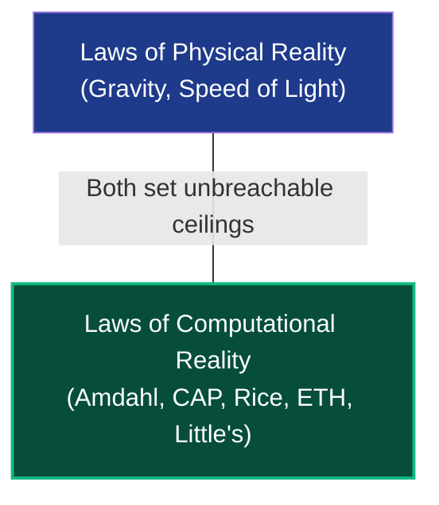
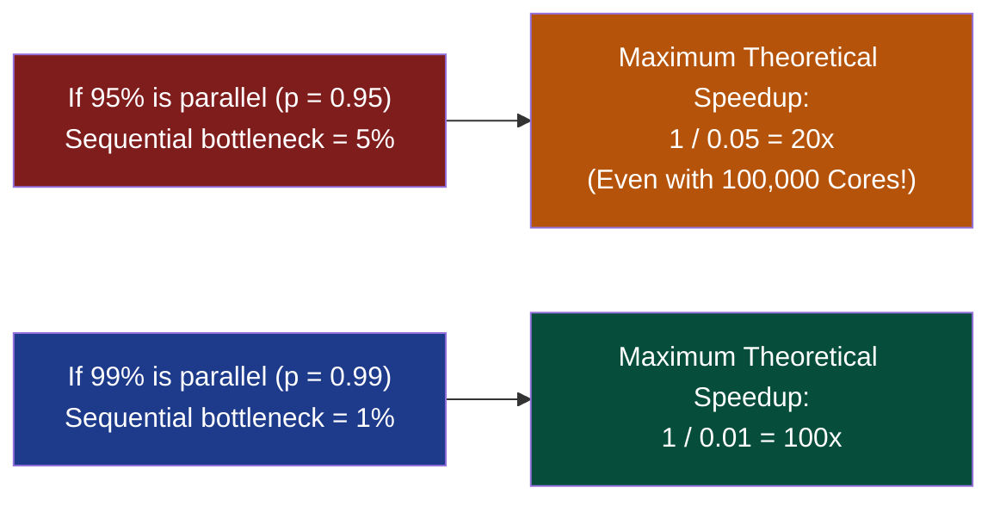
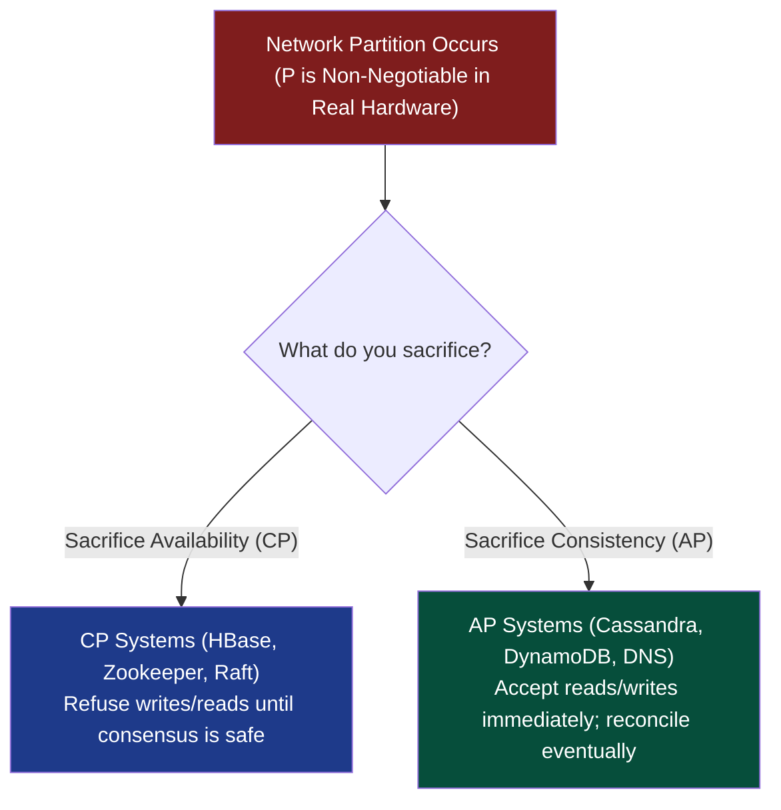

# Chapter 11: Metatheorems, Hypotheses & Folklore — The Back-Pocket Canon

> *"The junior engineer knows algorithms. The senior engineer knows design patterns. The principal engineer knows the universal laws of computational physics."*

---

## 📍 Level 100 — The Napkin Sketch: The Unwritten Laws of the Universe

Just as the physical world has gravity, the speed of light, and the laws of thermodynamics, computer science has **immutable metatheorems**:
- You cannot build a perpetual motion machine in physics.
- You cannot write a compiler that detects all bugs (Rice's Theorem).
- You cannot make a program 1,000 times faster by buying 1,000 CPU cores if part of your code is sequential (Amdahl's Law).
- You cannot have 100% database consistency and 100% availability when the underwater cable is cut (CAP Theorem).



These are the **unwritten laws** of engineering. When you know them, you never waste months attempting the impossible.

---

## 🎯 Level 200 — Street Fundamentals: The 6 Laws Every Staff Engineer Uses

> 🧠 **Mental Model Card**
> - **Amdahl's Law:** Throwing 1,000 CPU cores at an algorithm with a 5% serial bottleneck yields at most a 20x speedup ($1 / 0.05 = 20$). The sequential bottleneck caps parallel scalability.
> - **Little's Law ($L = \lambda W$):** The number of concurrent requests in a system equals arrival rate $\times$ average latency. Sizing thread pools, connection pools, and microservice buffers.
> - **Pigeonhole Principle:** Putting $N+1$ items into $N$ slots guarantees at least one slot holds $\ge 2$ items. Cycle detection in linked lists and hash collisions.
> - **CAP Theorem:** In a distributed network with partitions, you can choose Consistency OR Availability, never both.

### The 6 Laws Cheat Sheet

| Law / Theorem | Core Formula / Rule | Staff Engineer Takeaway |
|---|---|---|
| **Amdahl's Law** | $S(s) = \frac{1}{(1-p) + p/s} \le \frac{1}{1-p}$ | Optimize the serial portion first before adding GPU/multithreading. |
| **Little's Law** | $L = \lambda \cdot W$ | Sizing Kubernetes pods: 1,000 req/sec $\times$ 50ms latency $= 50$ in-flight requests. |
| **Pigeonhole Principle** | $\lceil N / K \rceil$ items in 1 bucket | Floyd's cycle finding, duplicate detection in range $[1, N]$. |
| **CAP & PACELC** | Consistency vs Availability during Partition | DynamoDB (AP) vs CockroachDB (CP). Latency vs Consistency when normal. |
| **Exponential Time Hypothesis** | 3-SAT requires $2^{cn}$ time | Don't hunt for $2^{o(n)}$ algorithms for NP-complete problems. |
| **Curse of Dimensionality** | Sphere volume collapses to boundary | High-dimensional vector search requires HNSW / approximate nearest neighbor. |

---

## ⚙️ Level 300 — Working Professional: The Core Systems & Proof Laws

### 1. Amdahl's Law vs Gustafson's Law
How much faster does your algorithm run when you throw more CPU cores at it?

Let $p$ be the parallelizable fraction of an algorithm ($0 \le p \le 1$), and $k$ be the number of CPU cores.

#### Amdahl's Law (Gene Amdahl, 1967):
$$S(k) = \frac{1}{(1 - p) + \frac{p}{k}}$$

As $k \to \infty$ (infinite CPU cores), the speedup hits a strict **asymptotic ceiling**:

$$S_{max} = \lim_{k \to \infty} S(k) = \frac{1}{1 - p}$$



> **The Architectural Lesson**: Never optimize the parallel parts of your code until you have ruthlessly minimized the **sequential fraction** ($1 - p$).

---

### 2. Little's Law (John Little, 1961)
The foundational mathematical theorem governing queueing systems, web servers, and database connection pools:

$$L = \lambda \cdot W$$

Where:
- $L$: Average number of requests/items inside the system (Concurrency).
- $\lambda$: Long-term average arrival rate of requests (Throughput, e.g., requests per second).
- $W$: Average time a request spends in the system (Latency).

*Example*:
Your service receives $\lambda = 500 \text{ req/sec}$.  
Average database latency $W = 0.02 \text{ seconds}$ (20 ms).  
The average number of active in-flight requests is:
$$L = 500 \times 0.02 = 10 \text{ concurrent connections}$$
If your thread pool or connection pool is sized smaller than 10, requests will queue and latency will spike exponentially!

---

### 3. The Pigeonhole Principle (Dirichlet's Box Principle)
> If $n + 1$ pigeons are placed into $n$ pigeonholes, then at least one pigeonhole must contain at least two pigeons.

#### Generalized Formulation:
If $n$ items are distributed into $k$ boxes, at least one box contains at least:

$$\left\lceil \frac{n}{k} \right\rceil \text{ items}$$

#### Applications in DSA:
- **Pattern 06 (Cyclic Sort)**: An array of $n$ numbers in range $[1, n-1]$ *must* contain at least one duplicate.
- **Hash Collisions**: Any hash function mapping 64-bit keys into a 32-bit integer table *must* produce collisions (at least $2^{32}$ keys per bucket on average).
- **Cycle Detection (Pattern 03)**: A deterministic state machine with $S$ finite states running for $S+1$ steps *must* visit a state twice, proving a cycle exists.

---

### 4. The CAP Theorem & PACELC (Eric Brewer, 2000)
In any distributed asynchronous data store, you can guarantee at most **two of three properties**:
1. **Consistency ($C$)**: Every read receives the most recent write or an error.
2. **Availability ($A$)**: Every non-failing node returns a response (without guarantee of latest data).
3. **Partition Tolerance ($P$)**: The system continues to operate despite arbitrary network dropped messages.



#### The PACELC Extension (Daniel Abadi, 2012):
The CAP theorem only describes behavior during rare network partitions. PACELC explains everyday behavior:
> **I**f there is a **P**artition: trade off **A**vailability vs **C**onsistency;  
> **E**lse (normal operation): trade off **L**atency vs **C**onsistency.

---

## 🔬 Level 400 — Staff & Senior Engineer: Hypotheses & Discrete Physics

### 1. The Exponential Time Hypothesis (ETH)
Formulated by Impagliazzo and Paturi (2001):
> **The Hypothesis**: 3-SAT cannot be solved in $2^{o(n)}$ time (where $n$ is the number of variables). There exists some constant $c > 0$ such that 3-SAT requires $\Omega(2^{c n})$ time.

#### Why ETH Matters to Developers:
While $P \ne NP$ merely says *"3-SAT has no polynomial algorithm"*, ETH says *"You cannot even get sub-exponential time like $2^{\sqrt{n}}$ or $2^{O(\log^2 n)}$!"*
- Under ETH, **Vertex Cover** cannot be solved in $2^{o(k)} n^{O(1)}$.
- Under ETH, **Clique** cannot be solved in $f(k) n^{o(k)}$.

---

### 2. Ramsey Theory: "Complete Disorder is Impossible"
In any sufficiently large structure, order is guaranteed to emerge:

**The Party Problem ($R(3, 3) = 6$)**:
In any gathering of **6 people**, there are either:
- At least 3 people who all mutually know each other, **OR**
- At least 3 people who are all mutual strangers.

*Proof*: Model as $K_6$ (complete graph on 6 vertices). Color an edge BLUE if two people know each other, RED if strangers. Pick person $A$. $A$ has 5 incident edges. By the Pigeonhole Principle, at least $\lceil 5/2 \rceil = 3$ edges must share the same color (say BLUE, connecting to $B, C, D$). If any edge between $(B, C), (C, D), (B, D)$ is BLUE, we have a BLUE triangle. If none are BLUE, they are all RED $\implies$ a RED triangle. Q.E.D.

---

### 3. The Curse of Dimensionality
When algorithms manipulate data in high-dimensional vector spaces (e.g., embeddings with $d = 512$ or $d = 1536$):
1. **Empty Space Phenomenon**: The volume of a hypersphere of radius $r$ in dimension $d$ approaches 0 as $d \to \infty$:
   $$V_d(r) = \frac{\pi^{d/2}}{\Gamma(d/2 + 1)} r^d \xrightarrow{d \to \infty} 0$$
   Almost all the volume of a hypercube lives in its sharp outer corners!
2. **Distance Concentration**: As $d \to \infty$, the distance between *any* two random points approaches the same value:
   $$\lim_{d \to \infty} \frac{\text{dist}_{max} - \text{dist}_{min}}{\text{dist}_{min}} = 0$$
3. **Algorithmic Collapse**: Spatial partitioning trees ($k$-d trees, R-trees) degenerate into linear scans when $d > 20$. In high dimensions, **Approximate Nearest Neighbor (ANN)** using HNSW (Hierarchical Navigable Small World) graphs is mandatory.

---

## 🎓 Level 500 — Researcher's Corner: Courcelle's Theorem & Graph Minors

<details>
<summary><strong>Expand PhD Deep-Dive: Courcelle's Theorem & Robertson-Seymour</strong></summary>

### Courcelle's Theorem (Bruno Courcelle, 1990)
> Any graph property expressible in **Monadic Second-Order Logic ($\text{MSO}_2$)** can be solved in **linear time $O(n)$** on any graph family with bounded treewidth!

Many classic $NP$-hard problems (Independent Set, 3-Coloring, Hamiltonian Path) can be written in $\text{MSO}_2$. If your graph is a tree (treewidth 1) or has treewidth $\le k$, dynamic programming on tree decompositions solves these $NP$-hard problems in $O(f(k) \cdot n)$ linear time!

### Robertson-Seymour Theorem (Graph Minors, 2004)
A 500-page mathematical monument:
> Every minor-closed family of graphs can be characterized by a **finite set of forbidden minors**.

*Consequence*: Testing whether a graph is planar, can be embedded on a torus, or has knotless embedding can be decided in $O(n^3)$ polynomial time!

</details>

---

## 💻 Python 3.14 Verification: Amdahl's Law Speedup Ceilings

Here is executable Python 3.14 code modeling Amdahl's Law across various parallel fractions ($p = 0.50, 0.90, 0.95, 0.99$) and computing the asymptotic ceiling:

```python
def amdahl_speedup(p: float, cores: int) -> float:
    """Computes theoretical speedup S(k) = 1 / ((1 - p) + p / k)."""
    if cores <= 0:
        raise ValueError("Cores must be > 0")
    sequential = 1.0 - p
    parallel = p / cores
    return 1.0 / (sequential + parallel)


def amdahl_asymptotic_ceiling(p: float) -> float:
    """Computes maximum possible speedup with infinite cores: S_max = 1 / (1 - p)."""
    return 1.0 / (1.0 - p)


if __name__ == "__main__":
    parallel_fractions = [0.50, 0.90, 0.95, 0.99]
    core_counts = [1, 2, 4, 8, 16, 64, 256, 1024, 1_000_000]

    print(
        f"{'Parallel %':<12} | {'Max Speedup (∞)':<16} | {'Speedup @ 16 Cores':<20} | {'Speedup @ 1024 Cores':<20}"
    )
    print("-" * 75)

    for p in parallel_fractions:
        ceiling = amdahl_asymptotic_ceiling(p)
        s_16 = amdahl_speedup(p, 16)
        s_1024 = amdahl_speedup(p, 1024)
        print(
            f"{p*100:>5.1f}%      | {ceiling:>10.2f}x       | {s_16:>14.2f}x       | {s_1024:>16.2f}x"
        )

    # Key Assertions
    assert (
        abs(amdahl_asymptotic_ceiling(0.95) - 20.0) < 1e-5
    )  # 5% sequential -> max 20x
    assert (
        abs(amdahl_asymptotic_ceiling(0.99) - 100.0) < 1e-5
    )  # 1% sequential -> max 100x
    print(
        "\n✅ Verification passed: Amdahl's Law asymptotic speedup ceilings mathematically verified!"
    )
```

---

## 🔗 Connections to Coding Patterns

- **Pattern 31: Multi-threaded**: Amdahl's law governs parallel algorithm scaling. Thread contention on mutexes increases the sequential fraction $(1-p)$, destroying speedup.
- **Pattern 06: Cyclic Sort**: Built entirely upon the Pigeonhole Principle ($n$ numbers placed in $n$ array index slots).
- **Pattern 28: Union Find**: Used in Kruskal's algorithm to maintain partition trees, directly related to graph minor reductions.

---

## 🧪 Self-Test Questions

1. **According to Amdahl's Law, if 10% of an algorithm's execution must run sequentially on a single thread, what is the absolute maximum speedup possible with 50,000 CPU cores?**
2. **State Little's Law and explain how it determines the required connection pool size for an API server.**
3. **Why does the CAP Theorem state that you must choose between Consistency and Availability during a network partition?**
4. **Explain how the Pigeonhole Principle proves that any lossless compression algorithm MUST expand the size of at least one file.**
5. **Why do spatial search structures like $k$-d trees fail in dimensions $d > 50$?**

<details>
<summary><strong>Click to view answers</strong></summary>

1. Using $S_{max} = \frac{1}{1 - p}$: With sequential fraction $1 - p = 0.10$, maximum speedup is $1 / 0.10 = \mathbf{10\times}$. Even with 50,000 cores, the speedup can never exceed 10.
2. Little's Law is $L = \lambda W$. If an API receives $\lambda = 1,000 \text{ req/sec}$ and each database query takes an average latency of $W = 50 \text{ ms} = 0.05 \text{ s}$, then average concurrent database connections is $L = 1000 \times 0.05 = \mathbf{50\text{ connections}}$. The pool must have at least 50 connections to prevent queuing.
3. In a network partition, nodes on side A cannot communicate with nodes on side B. If a write arrives on side A:
   - If you accept the write, side B cannot see it $\implies$ **Consistency is lost**.
   - If you reject or delay the write until side B is reachable $\implies$ **Availability is lost**.
4. Suppose an algorithm could compress all files of length $N$ bits into files of length $< N$ bits. There are $2^N$ files of length $N$, but only $\sum_{i=0}^{N-1} 2^i = 2^N - 1$ possible compressed files. By the Pigeonhole Principle, at least two different inputs would map to the identical compressed output, making lossless decompression mathematically impossible!
5. In high dimensions, the **Curse of Dimensionality** causes the distance between any two random points to concentrate (the ratio of max distance to min distance approaches 1). Spatial partitioning trees rely on hyperplanes to separate points into distinct halves; in high dimensions, almost every query overlaps every partition bounding box, causing the search to degenerate into an $O(N)$ linear scan.

</details>

---

## 🧭 Navigation

| ← Previous | ↑ Master Index | Next → |
|:---|:---:|---:|
| [← Ch 10: Information Theory & Entropy](10_information_theory_and_entropy.md) | [🏛️ Theoretical Foundations Index](README.md) | [Ch 12: Kill Mode vs Pull the Plug →](12_kill_mode_vs_pull_plug.md) |

