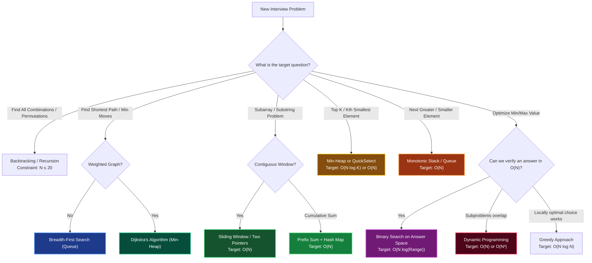

# Chapter 12: The Master Interview Triage & Decision Engine

> *"In a live coding assessment, panic is the enemy. Constraints are your compass. If you know the constraints, you already know the solution before writing a single line of code."*

---

## 💡 1. The Napkin Analogy: The ER Trauma Protocol

When an ER trauma surgeon receives a patient, they do not guess treatments at random. They check the **vital signs** first: heart rate, blood pressure, oxygen saturation.

In a FAANG live coding interview, **the problem constraints are the vital signs**:

```
┌─────────────────────────────────────────────────────────────────────────────┐
│ 🏥 VITAL SIGN 1: What is the size of N? (10, 10³, 10⁵, 10⁹?)                │
│ 🏥 VITAL SIGN 2: Is the input sorted or can it be sorted?                   │
│ 🏥 VITAL SIGN 3: Are negative numbers allowed?                              │
│ 🏥 VITAL SIGN 4: Are we finding an exact match, an optimum, or all combos?  │
└─────────────────────────────────────────────────────────────────────────────┘
```

Just as vital signs dictate the emergency room protocol, **constraints dictate the algorithmic pattern**.

---

## 📊 2. The Visual Whiteboard: The 45-Minute Emergency Playbook

### The 45-Minute Clock

```mermaid
gantt
    title The 45-Minute Live Coding Timeline
    dateFormat mm
    axisFormat %M min

    section Phase 1: Diagnose
    Clarify Questions & Check Constraints     :00, 05m
    section Phase 2: Design
    State Brute Force & Pitch Optimal Plan   :05, 10m
    Agree with Interviewer on Big-O          :10, 15m
    section Phase 3: Build
    Write Clean, Bug-Free Idiomatic Code     :15, 35m
    section Phase 4: Verify
    Dry-Run with Edge Cases & Defend Space   :35, 45m
```



---

### The Master Algorithm Decision Tree

When reading an interview prompt, follow this instant visual decision tree:



---

## ⚡ 3. The Lead Engineer's Constraint-to-Complexity Rosetta Stone

Imprint this table in memory. In 95% of LeetCode / FAANG assessments, the value of $N$ tells you the intended solution:

| Given Constraint $N$ | Required Time Complexity | Algorithms That Pass ($< 1$ Second) | Immediate Pattern Triggers |
|---|---|---|---|
| **$N \le 10$** | $O(N!)$ or $O(N^2 \cdot 2^N)$ | Permutations, Traveling Salesperson | Full permutations, factorial search |
| **$N \le 20$** | $O(2^N)$ or $O(N \cdot 2^N)$ | Subsets, Bitmask DP, Backtracking | Include/Exclude decisions, bitmasks |
| **$N \le 100$** | $O(N^4)$ or $O(N^3)$ | Floyd-Warshall, 3D Matrix DP | All-pairs shortest path, matrix multiplication |
| **$N \le 500$** | $O(N^3)$ | 3Sum, Interval DP | Nested triple loops, burst balloons |
| **$N \le 5,000$** | $O(N^2)$ | 2Sum (hash/brute), 2D Grid DP | Nested double loops, LCS, Edit Distance |
| **$N \le 10^5$** | $O(N \log N)$ or $O(N)$ | Sorting, Heaps, Two Pointers, Sliding Window | MergeSort, BST, Monotonic Stack, Dijkstra |
| **$N \le 10^6$** | $O(N)$ | Hash Table, Prefix Sum, Kadane's | Single pass array, frequency array |
| **$N \ge 10^9$** | $O(\log N)$ or $O(1)$ | Binary Search, Fast Math, Bitwise | Binary search on answer, Euclidean GCD |

---

## 🗣️ 4. The 30-Second Interview Talk Track: The Emergency "Unsticking" Script

### What to say when you are completely blank at Minute 10
> *"To ensure we establish a working baseline, let's start with the brute-force approach. A naive search checking every combination would take $O(2^N)$ [or $O(N^2)$] time. However, notice that we are repeatedly performing linear scans to look up previously seen values. If we trade $O(N)$ auxiliary space with a hash table [or prefix sum], we can reduce each lookup from $O(N)$ to $O(1)$, bringing our total time down to an optimal $O(N)$."*

### What to say when asked: "Can we do better in space?"
> *"Our current solution takes $O(N)$ auxiliary space to store visited states. If we are permitted to sort or modify the input array in-place, we could replace the hash set with a two-pointer approach, reducing auxiliary space to $O(1)$ while keeping the time complexity at $O(N \log N)$."*

### What to say when an edge case is spotted
> *"Before running the main logic, let me handle the boundary conditions: empty array, single-element input, all identical elements, and negative values. This guarantees our pointers will never go out of bounds."*

---

## 🧠 5. Senior Systems Reality: The 5 Most Deadly Implementation Traps

### 1. Integer Overflow in Binary Search
- **The Bug**: `mid = (low + high) / 2` can overflow in typed languages (Java, C++, Go) when `low + high > 2^31 - 1`.
- **The Senior Fix**: Always write `mid = low + (high - low) // 2`.

### 2. Modifying Collections During Iteration
```python
# ❌ BUG: Modifying list while iterating causes skipped elements!
for item in my_list:
    if condition(item):
        my_list.remove(item)

# ✅ SENIOR FIX: List comprehension or index iteration backwards
my_list = [item for item in my_list if not condition(item)]
```

### 3. Off-By-One Boundary Conditions in Binary Search
- If searching for exact value: `while low <= high:` and update `high = mid - 1`.
- If searching for insertion boundary (bisect left): `while low < high:` and update `high = mid`.

### 4. Graph Cycle Infinite Loops
- In any graph traversal (BFS/DFS), **always add nodes to the `visited` set immediately when pushing/enqueuing**, NOT when popping!
- Enqueuing without marking visited causes exponential duplicate nodes in the queue, exhausting RAM.

### 5. Hash Collision Denial of Service (Algorithmic Complexity Attacks)
- Built-in hash maps rely on hash functions that can degrade to $O(N)$ per operation if an adversary crafts inputs with identical hash codes.
- In competitive programming or production APIs receiving untrusted user input, randomized hash seeds prevent $O(N^2)$ attack vectors.

---

## 🧭 Navigation
- **Previous**: [Ch 11: Metatheorems & Folklore](./11_metatheorems_and_folklore.md)
- **Hub**: [🏛️ Back to Foundations README](./README.md)
