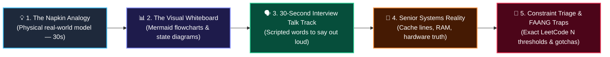
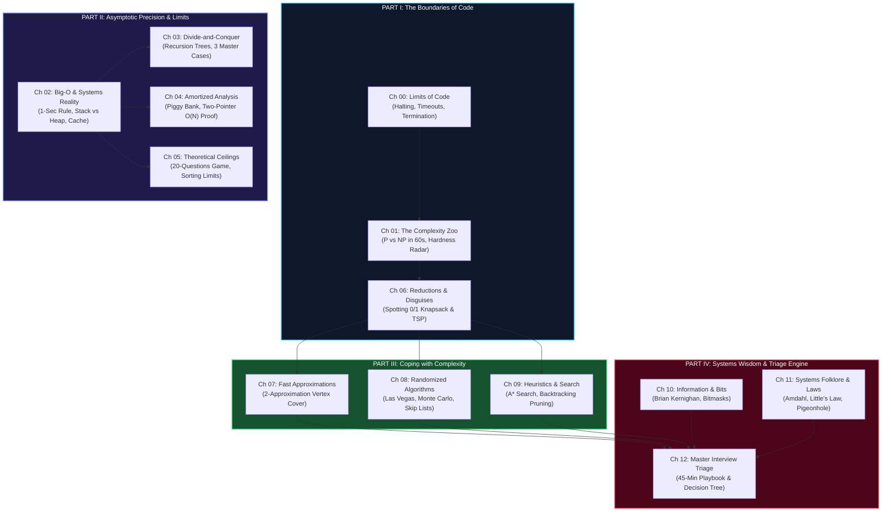

# 🏛️ Theoretical Foundations of DSA (The Lead Engineer's Guide)

> *"Before you write code, you must know what can be computed, how fast it will run, and whether an optimal solution is even mathematically possible."*

Welcome to the **Lead Engineer's Theoretical Foundations Guide** — a pragmatic, whiteboard-first reference designed specifically for senior software engineers (10+ YoE) preparing for FAANG technical assessments and live coding rounds.

---

## 🧭 Why This Guide Exists

In technical assessments and system-level coding interviews, developers encounter three plateaus:

```
┌─────────────────────────────────────────────────────────────────────────────┐
│ LEVEL 1: SYNTACTIC RECALL ("I know Two Pointers and Sliding Window")        │
│ You can solve common LeetCode mediums by recognizing surface syntax.        │
│ 💥 Plateau: Paralyzed when a problem deviates from textbook templates.      │
├─────────────────────────────────────────────────────────────────────────────┤
│ LEVEL 2: MECHANICAL IMPLEMENTATION ("I can code a Trie or Min-Heap")        │
│ You understand data structure mechanics.                                    │
│ 💥 Plateau: You get Time Limit Exceeded (TLE) because you couldn't deduce   │
│    the required complexity from the constraints before coding.              │
├─────────────────────────────────────────────────────────────────────────────┤
│ LEVEL 3: LEAD THEORETICAL INTUITION ("I see the limits and constraints")    │
│ You look at a problem and immediately classify it:                          │
│ • "N = 10⁵ ➜ Must be O(N log N) or O(N). O(N²) will fail."                  │
│ • "The comparison lower bound is Ω(N log N) ➜ Can't sort faster."           │
│ • "This is Subset Sum in disguise ➜ NP-hard, use Bitmask DP or Branch-Bound"│
│ • "Amortized O(1) loop ➜ Left pointer only moves forward, strictly O(N)."   │
└─────────────────────────────────────────────────────────────────────────────┘
```

This guide gives you **Level 3 Intuition** without the academic math bloat.

---

## 🎯 The Uniform 5-Step Whiteboard Framework

Every chapter in this module is structured around a uniform, interview-focused template:



---

## 🗺️ Master Curriculum Roadmap



---

## 📑 Complete Chapter Catalog

| # | Chapter Title | Core Mental Model | The Interview Weapon |
|---|---|---|---|
| **00** | [Computation & Computability](./00_computation_and_computability.md) | The Broken Code Reviewer (Halting Problem) | Proving recursion termination; why linters have false positives |
| **01** | [The Complexity Zoo](./01_complexity_classes_zoo.md) | The Sudoku Puzzle (P vs NP) | Recognizing NP-hard problems; pseudo-polynomial DP traps |
| **02** | [Asymptotic Analysis Deep Cuts](./02_asymptotic_analysis_deep.md) | The Speed Limit (Big-O / $\Theta$ / $\Omega$) | The 1-Second Rule ($10^8$ ops); CPU cache lines (Array vs Linked List) |
| **03** | [Recurrences & Master Theorem](./03_recurrences_and_master_theorem.md) | Corporate Hierarchy (Recursion Tree) | The 3 Master Cases in 3 plain sentences; stack frame memory tax |
| **04** | [Amortized Analysis](./04_amortized_analysis.md) | Coffee Punch Card / Piggy Bank | Two-pointer $O(N)$ proof; Monotonic Stack; P99 latency spikes |
| **05** | [Lower Bounds & Impossibility](./05_lower_bounds_and_impossibility.md) | The 20-Questions Game ($\Omega(N \log N)$) | Comparison ceilings; escaping to $O(N)$ via Counting/Bucket Sort |
| **06** | [NP-Completeness & Reductions](./06_np_completeness_and_reductions.md) | The Mask / Costume Party | Spotting LeetCode disguises; the $N \le 20$ Bitmask giveaway |
| **07** | [Approximation Algorithms](./07_approximation_algorithms.md) | The Moving Truck (80/20 Rule) | 2-Approximation for Vertex Cover; Power of Two Choices |
| **08** | [Randomized Algorithms](./08_randomized_algorithms.md) | Las Vegas vs Monte Carlo | Beating QuickSort adversaries; Dutch National Flag 3-way partition |
| **09** | [Heuristics & Search](./09_heuristics_and_metaheuristics.md) | The Foggy Mountain Compass | $A^*$ Search vs Dijkstra; backtracking constraint pruning |
| **10** | [Information Theory & Entropy](./10_information_theory_and_entropy.md) | Morse Code & Light Switches | Top 5 Bit Manipulation tricks (Brian Kernighan, XOR cancellation) |
| **11** | [Metatheorems & Folklore](./11_metatheorems_and_folklore.md) | 9-Women Pregnancy Myth & Coffee Line | Amdahl's Law, Little's Law ($L = \lambda W$), Pigeonhole cycle finding |
| **12** | [Master Interview Triage](./12_kill_mode_vs_pull_plug.md) | ER Trauma Surgeon Protocol | The 45-Minute Emergency Playbook, Decision Flowchart & Constraint Matrix |

---

## ⚡ The Lead Engineer's Constraint-to-Complexity Rosetta Stone

| Given Constraint $N$ | Required Time Complexity | Algorithms That Pass ($< 1$ Second) | Immediate Pattern Triggers |
|---|---|---|---|
| **$N \le 10$** | $O(N!)$ or $O(N^2 \cdot 2^N)$ | Permutations, Traveling Salesperson | Full permutations, factorial search |
| **$N \le 20$** | $O(2^N)$ or $O(N \cdot 2^N)$ | Subsets, Bitmask DP, Backtracking | Include/Exclude decisions, bitmasks |
| **$N \le 100$** | $O(N^4)$ or $O(N^3)$ | Floyd-Warshall, 3D Matrix DP | All-pairs shortest path, matrix multiplication |
| **$N \le 500$** | $O(N^3)$ | 3Sum, Interval DP | Nested triple loops, burst balloons |
| **$N \le 5,000$** | $O(N^2)$ | 2Sum (hash/brute), 2D Grid DP | Nested double loops, LCS, Edit Distance |
| **$N \le 10^5$** | $O(N \log N)$ or $O(N)$ | Sorting, Heaps, Two Pointers, Sliding Window | MergeSort, BST, Monotonic Stack, Dijkstra |
| **$N \le 10^6$** | $O(N)$ | Hash Table, Prefix Sum, Kadane's | Single pass array, frequency array |
| **$N \ge 10^9$** | $O(\log N)$ or $O(1)$ | Binary Search, Fast Math, Bitwise | Binary search on answer, Euclidean GCD |

---

## 🧭 Navigation
- **Next Chapter**: [Ch 00: Computation & Computability](./00_computation_and_computability.md)
- **Engine Rooms (Pillar 1)**: [Data Structure Engines (`001 - Array and String`)](../001%20-%20Array%20and%20String/)
