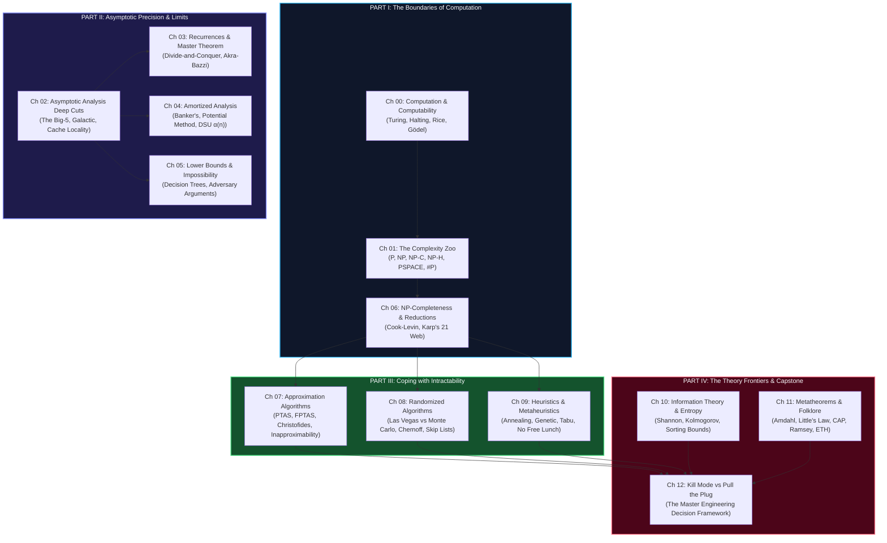

# 🏛️ Theoretical Foundations of Computer Science & DSA (The Complete Guide)

> *"Computers are to computing what telescopes are to astronomy."* — Edsger W. Dijkstra  
> *"If you only know patterns, you know how to fight. If you know theoretical computer science, you know whether the war can even be won."*

Welcome to **Theoretical Foundations of Computer Science & DSA** — the forensic-level, from-first-principles treatise on the computational universe. This module provides the theoretical bedrock beneath all 43 problem-solving patterns in this repository.

---

## 🧭 Why This Module Exists

In technical assessments, competitive programming, and high-scale systems engineering, developers typically experience three distinct plateaus:

```
┌─────────────────────────────────────────────────────────────────────────────┐
│ LEVEL 1: PATTERN MEMORIZATION ("I know Two Pointers and Sliding Window")    │
│ You can solve common LeetCode Mediums by recognizing surface syntax.        │
│ 💥 Plateau: As soon as a problem deviates slightly, you're paralyzed.      │
├─────────────────────────────────────────────────────────────────────────────┤
│ LEVEL 2: DATA STRUCTURE MASTERY ("I can implement AVL Trees and DSU")       │
│ You understand how containers organize memory and access pointers.          │
│ 💥 Plateau: You don't know why your solution gets Time Limit Exceeded (TLE) │
│    or whether an exact polynomial algorithm even exists.                    │
├─────────────────────────────────────────────────────────────────────────────┤
│ LEVEL 3: THEORETICAL BEDROCK ("I see the complexity class & lower bounds")   │
│ You look at a problem and immediately classify it:                          │
│ • "This is 3-Partition disguised as task scheduling → NP-hard."             │
│ • "The comparison lower bound is Ω(N log N) → cannot sort faster."          │
│ • "Rice's Theorem proves this is undecidable → stop writing exact code."    │
│ • "Kill Mode vs Pull the Plug: Switch to FPT or Christofides approximation."│
└─────────────────────────────────────────────────────────────────────────────┘
```

This guide takes you from **Level 1 to Level 3**.

---

## 🗺️ Master Curriculum Roadmap



---

## 📑 Complete Chapter Catalog

Each chapter features a unified 5-level curriculum reinforced by 4 engineering lenses:
- 📍 **Level 100 — The Napkin Sketch**: Tangible physical analogy, zero jargon (30 seconds)
- 🎯 **Level 200 — Street Fundamentals**: Permanent Memory Mantra & **🎯 The FAANG Bar-Raiser Squeeze Box** (3 interview traps) (5 minutes)
- ⚙️ **Level 300 — Working Professional**: Core mechanics, production code, edge cases (15 minutes)
- 🔬 **Level 400 — Staff & Senior Engineer**: Hardware cache lines, branch prediction, memory pyramids, scale limits (30 minutes)
- 🎓 **Level 500 — Researcher's Corner**: Formal theorems, open conjectures, seminal papers (collapsible)

| # | Chapter Title | Core Topics | Key Theorems / Concepts |
|---|---|---|---|
| **00** | [Computation & Computability](./00_computation_and_computability.md) | Turing Machines, Decidability, Undecidability | Church-Turing Thesis, Halting Problem, Rice's Theorem, Gödel's Incompleteness |
| **01** | [The Complexity Zoo](./01_complexity_classes_zoo.md) | Periodic Table of Computational Hardness | P, NP, NP-Complete, NP-Hard, co-NP, PSPACE, BPP, #P, FPT |
| **02** | [Asymptotic Analysis Deep Cuts](./02_asymptotic_analysis_deep.md) | Beyond naive Big-O; Real-world runtime | Big-Five ($\Theta, \Omega, O, o, \omega$), Galactic Algorithms, Cache Lines, Timsort |
| **03** | [Recurrences & Master Theorem](./03_recurrences_and_master_theorem.md) | Analyzing Divide-and-Conquer | Substitution, Recursion Trees, 3 Master Cases, Akra-Bazzi, Recurrence Catalog |
| **04** | [Amortized Analysis](./04_amortized_analysis.md) | Pricing operations in the aggregate | Aggregate Method, Banker's (Accounting), Physicist's (Potential), DSU $\alpha(n)$ |
| **05** | [Lower Bounds & Impossibility](./05_lower_bounds_and_impossibility.md) | The mathematical limits of performance | Comparison Sorting $\Omega(n \log n)$, Adversary Arguments, Cell Probe Model |
| **06** | [NP-Completeness & Reductions](./06_np_completeness_and_reductions.md) | The grand translation web of hardness | Karp vs Cook, Cook-Levin, Karp's 21 NP-Complete Web, Proving Recipe |
| **07** | [Approximation Algorithms](./07_approximation_algorithms.md) | Provably near-optimal solutions | $\rho$-Approximations, Christofides 1.5-TSP, Set Cover Greedy, PTAS/FPTAS, PCP |
| **08** | [Randomized Algorithms](./08_randomized_algorithms.md) | Harnessing coin flips for speed & simplicity | Las Vegas vs Monte Carlo, Chernoff Bounds, Bloom Filters, Skip Lists |
| **09** | [Heuristics & Metaheuristics](./09_heuristics_and_metaheuristics.md) | Engineering when exact algorithms surrender | Simulated Annealing, Genetic Algorithms, Tabu Search, No Free Lunch (NFL) |
| **10** | [Information Theory & Entropy](./10_information_theory_and_entropy.md) | The mathematics of surprise and compression | Shannon Entropy, Huffman Trees, Kolmogorov Complexity, Sorting Limits |
| **11** | [Metatheorems & Folklore](./11_metatheorems_and_folklore.md) | The mental models of principal engineers | Amdahl vs Gustafson, Little's Law, CAP/PACELC, Ramsey Theory, ETH |
| **12** | [Kill Mode vs Pull the Plug](./12_kill_mode_vs_pull_plug.md) | The Master Engineering Triage System | Input Constraint Sizing, Triage Pipeline, All 43 Patterns Complexity Mapping |

---

## ⚡ The Back-Pocket Theoretical Canon

Keep these eight foundational laws at your fingertips:

| Metatheorem / Law | Formulation / Statement | Practical Engineering Rule |
|---|---|---|
| **Church-Turing Thesis** | Any function computable by any physical mechanism is computable by a Turing machine. | You cannot invent a "super-hardware" that breaks the laws of computability. |
| **Rice's Theorem** | Every non-trivial semantic property of a program is undecidable. | Perfect static code checkers, malware detectors, and dead-code removers are mathematically impossible. |
| **Cook-Levin Theorem** | Boolean Satisfiability (SAT) is NP-Complete. | If you can efficiently solve SAT, you can efficiently solve thousands of industrial optimization problems. |
| **No Free Lunch (NFL)** | Averaged over all objective functions, all search algorithms perform identically. | There is no "universal master algorithm." Every efficient optimizer exploits domain-specific structure. |
| **Information-Theoretic Sorting Bound** | Sorting $N$ items by pairwise comparisons requires $\lceil \log_2(N!) \rceil = \Omega(N \log N)$ comparisons. | You cannot write an $O(N)$ comparison sort. (Linear sorts like Radix sort must bypass comparisons). |
| **Amdahl's Law** | Speedup $S = \frac{1}{(1-p) + \frac{p}{k}}$ where $p$ is the parallelizable fraction. | Throwing 1,000 CPU cores at an algorithm with 10% sequential bottleneck caps speedup at $10\times$. |
| **Little's Law** | Average items in system $L = \lambda W$ (Arrival rate $\times$ Average wait time). | The foundational relationship for rate limiting, connection pooling, and queue sizing in distributed systems. |
| **Exponential Time Hypothesis (ETH)** | 3-SAT cannot be solved in $2^{o(n)}$ time. | NP-hard problems do not just lack polynomial solutions; many are strictly bounded from sub-exponential time. |

---

## 👤 Persona Reading Matrix

| Your Current Goal | Primary Chapters | Secondary Chapters | Skip for Now |
|---|---|---|---|
| **Undergraduate Student** (Acing Algorithms exams) | Ch 01, 02, 03, 04, 05, 06 | Ch 00, 07, 08 | Ch 09, 10, 11 |
| **Master's Student / Competitive Programmer** | Ch 01, 02, 03, 04, 06, 08, 12 | Ch 05, 07, 10 | Ch 00, 11 |
| **Staff / Principal Systems Engineer** | Ch 01, 06, 07, 09, 11, 12 | Ch 04, 08, 10 | Ch 03 |
| **PhD Researcher / Theoretical Enthusiast** | Full curriculum end-to-end + all 🔴 PhD Horizon details blocks | — | — |
