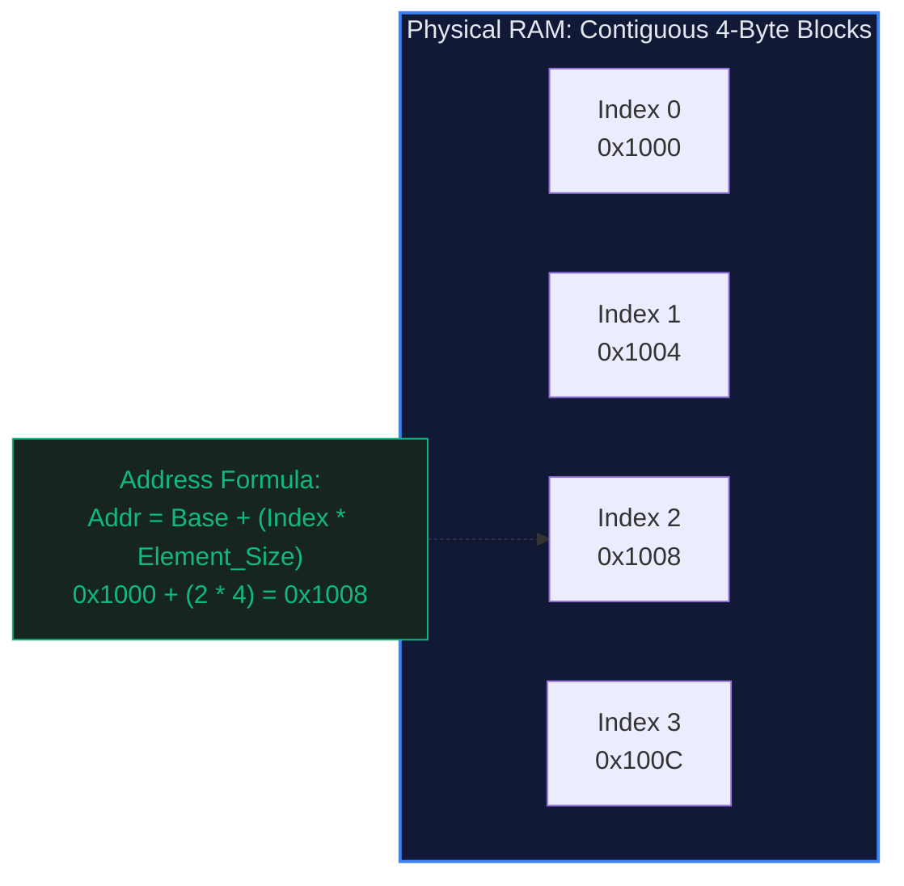

# 🧱 Array and String: The Contiguous Memory Foundation

> *"All computation begins with memory. Arrays are the only data structure that matches physical computer hardware byte-for-byte."*

---

## 📍 Level 100 — The Napkin Sketch (30 Seconds)

### The Real-World Analogy
Imagine a row of identical numbered postal mailboxes cemented side-by-side along a brick wall:

```
[ Box 0 ] [ Box 1 ] [ Box 2 ] [ Box 3 ] [ Box 4 ]
  0x100     0x104     0x108     0x10C     0x110
```

To deliver a letter to **Box 3**, you do NOT walk past Box 0, then Box 1, then Box 2. Instead, you instantly know Box 3 sits exactly `3 × width` down the wall. You step directly in front of Box 3 in one stride. That is $O(1)$ random access.

Now imagine a **String** in modern languages (Python, Java, Go). A string is like a **frozen ice cube tray**. You cannot pop out the letter 'a' in the middle and slide in 'b' without melting down the entire ice tray and refreezing an entirely new one. That is **immutability**.

```
Original:  ["C", "A", "T"]  (Frozen in memory)
Mutation:  s[1] = "O"       ❌ ILLEGAL!
Remelted:  ["C", "O", "T"]  ✅ Allocated as a brand new block elsewhere
```

### The Core Invariant
> **The Contiguous Memory Invariant:** Every element in an array sits at memory address $\text{Base} + (i \times \text{Size})$. Because arithmetic is instant, accessing any element takes identical constant time $O(1)$, regardless of whether the array holds ten elements or ten billion.

---

## 🎯 Level 200 — Street Fundamentals (5 Minutes)

> 🧠 **Mental Model Card**
> - **Core Superpower:** $O(1)$ instant index lookup and cache-line prefetching speed.
> - **The Kryptonite:** $O(N)$ insertion/deletion anywhere except the back (requires shifting elements).
> - **When to Reach for It:** Any time you need indexed access, linear scanning, two pointers, or sequential streaming.
> - **When to Run Away:** Frequent insertions or deletions in the middle with unknown sizes $\to$ Reach for a **Linked List** or **B-Tree**.
> - **Budget:** Read: $O(1)$ | Append: Amortized $O(1)$ | Insert/Delete (arbitrary): $O(N)$ | Search (unsorted): $O(N)$ | Search (sorted): $O(\log N)$

### The Decision Matrix

| Container Type | Random Read | Append (End) | Insert (Middle) | Memory Overhead | Resizing Strategy |
|---|:---:|:---:|:---:|---|---|
| **Static Array** (`int[]`) | $O(1)$ | $O(1)$ (if room) | $O(N)$ | Zero overhead (raw bytes) | Fixed at birth, cannot grow |
| **Dynamic Array** (Python `list`) | $O(1)$ | Amortized $O(1)$ | $O(N)$ | 12.5% to 50% extra capacity | Doubles or grows by $1.125\times$ |
| **Immutable String** (`str`) | $O(1)$ | $O(N)$ (creates copy) | $O(N)$ | String header + UTF-8/32 bytes | Never resizes (allocates new) |
| **Mutable Buffer** (`list[str]`) | $O(1)$ | Amortized $O(1)$ | $O(N)$ | Dynamic array of char references | `"".join(...)` batch converts |

### Memory Offset Mechanics



### Street Code Snippets: The 4 Must-Know Idioms

```python
# 1. In-place Reverse (Two Pointers) — O(N) Time, O(1) Space
def reverse_array(arr: list[int]) -> None:
    left, right = 0, len(arr) - 1
    while left < right:
        arr[left], arr[right] = arr[right], arr[left]
        left += 1
        right -= 1

# 2. In-place Compaction (Remove Duplicates from Sorted Array)
def remove_duplicates(nums: list[int]) -> int:
    if not nums:
        return 0
    write_idx = 1
    for read_idx in range(1, len(nums)):
        if nums[read_idx] != nums[read_idx - 1]:
            nums[write_idx] = nums[read_idx]
            write_idx += 1
    return write_idx  # Length of unique prefix

# 3. Running Prefix Sums — Enables O(1) Subarray Sum Queries
def build_prefix_sums(nums: list[int]) -> list[int]:
    pref = [0] * (len(nums) + 1)
    for i, x in enumerate(nums):
        pref[i + 1] = pref[i] + x
    return pref  # Subarray sum nums[L..R] = pref[R + 1] - pref[L]

# 4. Fast String Building — O(N) Time (NEVER use `s += char` in loops!)
def build_string_fast(n: int) -> str:
    chunks: list[str] = []
    for i in range(n):
        chunks.append(str(i))
    return "".join(chunks)  # Single O(N) allocation instead of O(N^2) quadratic churn
```

---

## ⚙️ Level 300 — Working Professional (15 Minutes)

### Real-System Architecture: Why Arrays Dominate Systems
Hardware CPU architectures are built to love arrays:
1. **Cache Lines & Spatial Locality**: Modern CPUs fetch RAM in **64-byte chunks** (Cache Lines). When you read `arr[0]`, the CPU pre-fetches `arr[1]` through `arr[15]` directly into ultra-fast L1 cache (1 nanosecond latency).
2. **Linked Lists Destroy Cache**: Linked list nodes are scattered randomly throughout the heap. Every `node.next` access is a potential **Cache Miss**, stalling the CPU for ~100-200 cycles waiting for main memory.
3. **Branch Prediction**: Sequential memory iteration allows hardware stream prefetchers to anticipate memory addresses before instructions even execute.

```
Array (Contiguous):
[ L1 Cache Hit | L1 Cache Hit | L1 Cache Hit | L1 Cache Hit ]  ⚡ ~1ns

Linked List (Scattered Pointers):
[ Cache Miss → Wait 100ns ] ──> [ Cache Miss → Wait 100ns ]    🐌 ~100ns
```

### Complete Implementation: Production Dynamic Array

```python
"""
Production Dynamic Array Implementation from Scratch.
Demonstrates geometric over-allocation, bounds verification, and amortized resizing.
"""

from typing import Any, Iterator, Optional

class DynamicArray:
    """A resilient, dynamically resizing array similar to Python list or C++ std::vector."""

    INITIAL_CAPACITY: int = 4
    GROWTH_FACTOR: int = 2

    def __init__(self, initial_capacity: Optional[int] = None) -> None:
        self._capacity: int = initial_capacity if initial_capacity else self.INITIAL_CAPACITY
        self._size: int = 0
        self._buffer: list[Any] = [None] * self._capacity

    def __len__(self) -> int:
        return self._size

    def __getitem__(self, index: int) -> Any:
        self._validate_index(index)
        return self._buffer[index]

    def __setitem__(self, index: int, value: Any) -> None:
        self._validate_index(index)
        self._buffer[index] = value

    def append(self, item: Any) -> None:
        """Appends item to the end in amortized O(1) time."""
        if self._size == self._capacity:
            self._resize(self._capacity * self.GROWTH_FACTOR)
        self._buffer[self._size] = item
        self._size += 1

    def pop(self) -> Any:
        """Removes and returns the last element in O(1) time."""
        if self._size == 0:
            raise IndexError("pop from empty dynamic array")
        self._size -= 1
        val = self._buffer[self._size]
        self._buffer[self._size] = None  # Prevent memory leak

        # Optional shrink to preserve memory footprint
        if 0 < self._size <= self._capacity // 4:
            self._resize(max(self.INITIAL_CAPACITY, self._capacity // 2))
        return val

    def insert(self, index: int, item: Any) -> None:
        """Inserts an element at an arbitrary index in O(N) time."""
        if not (0 <= index <= self._size):
            raise IndexError(f"Insert index {index} out of bounds for size {self._size}")
        if self._size == self._capacity:
            self._resize(self._capacity * self.GROWTH_FACTOR)

        # Shift elements right to create a slot
        for i in range(self._size, index, -1):
            self._buffer[i] = self._buffer[i - 1]

        self._buffer[index] = item
        self._size += 1

    def _resize(self, new_capacity: int) -> None:
        """Allocates a new buffer and migrates elements in O(N) time."""
        new_buffer: list[Any] = [None] * new_capacity
        for i in range(self._size):
            new_buffer[i] = self._buffer[i]
        self._buffer = new_buffer
        self._capacity = new_capacity

    def _validate_index(self, index: int) -> None:
        if not (0 <= index < self._size):
            raise IndexError(f"Index {index} out of bounds for size {self._size}")

    def __iter__(self) -> Iterator[Any]:
        for i in range(self._size):
            yield self._buffer[i]

    def __repr__(self) -> str:
        items = [repr(self._buffer[i]) for i in range(self._size)]
        return f"DynamicArray([{', '.join(items)}], size={self._size}, capacity={self._capacity})"
```

### Critical Edge Cases & Failure Modes
1. **The Quadratic String Trap**:
   ```python
   # ❌ BUG: O(N^2) runtime. Every iteration re-copies the whole string so far!
   s = ""
   for char in huge_stream:
       s += char

   # ✅ FIX: Amortized O(N) total runtime
   buf = []
   for char in huge_stream:
       buf.append(char)
   s = "".join(buf)
   ```
2. **Off-by-One in Half-Open Intervals**: Standard CS indices are $[0, N)$ (inclusive start, exclusive end). Slicing `arr[0:k]` gives exactly $k$ elements. Remember: $\text{Length} = \text{End} - \text{Start}$.
3. **Resizing Overhead Spikes**: While `append` is amortized $O(1)$, an individual append that triggers a resize is $O(N)$. In hard real-time systems (audio processing, algorithmic trading), this sudden $O(N)$ pause creates unacceptable tail latency.

---

## 🔬 Level 400 — Staff & Senior Engineer (30 Minutes)

### Mathematical Proof of Amortized $O(1)$ Append
Why does geometric doubling guarantee $O(1)$ average time? Let us prove it using the **Aggregate Method** and **Banker's Method** (formalized in [Ch 04: Amortized Analysis](../000%20-%20Theoretical%20Foundations%20%28The%20Complete%20Guide%29/04_amortized_analysis.md)):

Suppose we start with capacity 1 and insert $N = 2^k$ elements.
Resizes occur at sizes: $1, 2, 4, 8, \dots, 2^{k-1}$.
The total cost to copy elements during resizes is:
$$\sum_{j=0}^{k-1} 2^j = 2^k - 1 = N - 1$$
Adding the $N$ individual constant-time writes:
$$\text{Total Cost} = N + (N - 1) = 2N - 1 < 2N$$
$$\text{Amortized Cost per Operation} = \frac{\text{Total Cost}}{N} = \frac{2N - 1}{N} < 2 = O(1)$$

**What if we grew by an additive constant (e.g. $+1000$ elements instead of $\times 2$)?**
Then $N$ insertions require $N / 1000$ resizes.
Total copy work $= 1000 + 2000 + \dots + N \approx \frac{N^2}{2000} = O(N^2)$.
Amortized cost per append becomes $O(N)$! **Geometric growth is mandatory for $O(1)$ amortized append.**

### Python CPython Growth Formula
In CPython (`listobject.c`), the growth factor is not a pure $2\times$ (which wastes memory), but approximately $1.125\times$:
$$\text{new\_allocated} = \text{new\_size} + (\text{new\_size} \gg 3) + (\text{new\_size} < 9 \ ? \ 3 : 6)$$
Sequence of capacities: $0, 4, 8, 16, 24, 32, 40, 52, 64, 76, \dots$
This strikes an optimal balance between avoiding frequent $O(N)$ reallocations and minimizing unused heap memory.

---

## 🎓 Level 500 — Researcher's Corner (Collapsible)

<details>
<summary><b>📜 Cache-Oblivious Layouts & Advanced String Structures (Click to expand)</b></summary>

### 1. Cache-Oblivious Memory Models (Frigo et al., 1999)
In classical algorithmic analysis, we assume a flat RAM model with uniform access cost. In reality, modern architectures have a hierarchical memory hierarchy with unknown cache line size $B$ and cache size $M$.
A **Cache-Oblivious Algorithm** achieves optimal memory transfers across *all* levels of the cache hierarchy simultaneously without tuning for specific hardware constants $B$ or $M$. The canonical example is the **Van Emde Boas Layout** for static search trees mapped onto contiguous arrays.

### 2. Suffix Arrays & FM-Index
In computational genomics, searching across human DNA ($3 \times 10^9$ base pairs) cannot afford quadratic string comparison.
- **Suffix Array**: An integer array containing the starting indices of all sorted suffixes of a text $T$. Searchable in $O(M \log N)$ or $O(M + \log N)$ with LCP (Longest Common Prefix) arrays.
- **FM-Index (Ferragina & Manzini)**: Combines the Burrows-Wheeler Transform (BWT) with compact rank vectors to search arbitrary patterns in $O(M)$ time within compressed space smaller than the original text!
</details>

---

## 🧭 Navigation & Cross-Pillar Bridges

| ← Upstream (Theoretical Foundations) | ↑ Fundamentals Hub | Downstream (Tactical Patterns) → |
|:---|:---:|---:|
| [🏛️ Ch 04: Amortized Analysis](../000%20-%20Theoretical%20Foundations%20%28The%20Complete%20Guide%29/04_amortized_analysis.md) | [📚 Fundamentals Index](../README.md) | [02 - Two Pointers →](../../02%20-%20Two%20Pointers/) |

> ### ⚔️ Algorithmic Patterns Powered by Arrays:
> - **[Pattern 02: Two Pointers](../../02%20-%20Two%20Pointers/)** — Shrinking search bounds from both ends of a sorted array.
> - **[Pattern 04: Sliding Window](../../04%20-%20Sliding%20Window/)** — Maintaining running contiguous subarray invariants in $O(N)$.
> - **[Pattern 05: Merge Intervals](../../05%20-%20Merge%20Intervals/)** — Sorting interval tuples and scanning sequentially.
