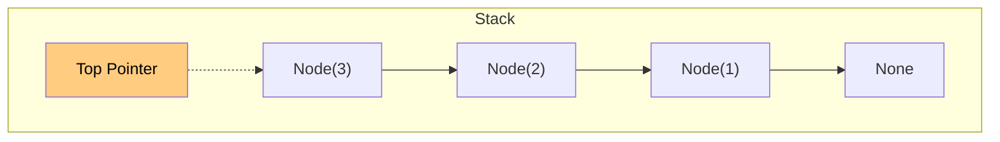
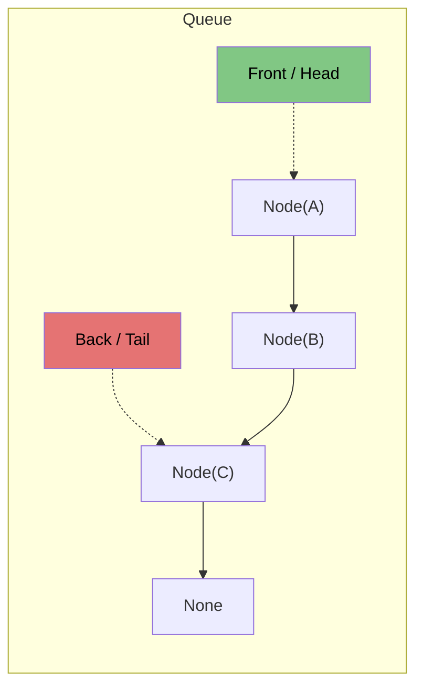

# 🚶‍♂️ Walkthrough: Queue and Stack Implementation

## 👶 Explain Like I'm 5
- **Stack**: Think of a stack of pancakes. You always add new pancakes to the **top**, and when you want to eat one, you take it from the **top**. The very first pancake you put down is the last one you eat! (LIFO = Last In, First Out).
- **Queue**: Think of waiting in line at a theme park. When you arrive, you go to the **back** of the line. The ride operators only let people on from the **front** of the line. The first person to get in line is the first to ride! (FIFO = First In, First Out).

## 🎯 Core Strategy
**Using Linked Nodes for $O(1)$ Operations**.

While you could just use an Array (Python `list`), adding to the front of a Python list is an $O(N)$ operation because all other elements have to shift over! By using a custom Node structure:
1. **Stack**: We only need a `_head` pointer.
   - `push()`: Create a node pointing to `_head`, and update `_head` to the new node.
   - `pop()`: Grab the value at `_head`, and update `_head = _head.next`.
2. **Queue**: We need both a `_head` and `_tail` pointer.
   - `enqueue()`: Attach a node to `_tail.next`, and update `_tail` to the new node.
   - `dequeue()`: Grab the value at `_head`, update `_head = _head.next`. (If the queue becomes empty, we must also set `_tail = None`).

By utilizing `__slots__` and PEP 695 Generics (`class Stack[T]:`), this implementation is blisteringly fast and consumes significantly less memory than a native Python class.

## 🏃‍♂️ Step-by-Step Execution (Dry Run)

### Stack:
**Operations**: `push(1)`, `push(2)`, `pop()`
1. **`push(1)`**: `_head` = Node(1) -> None
2. **`push(2)`**: `_head` = Node(2) -> Node(1) -> None
3. **`pop()`**: returns 2. `_head` moves to Node(1).

### Queue:
**Operations**: `enqueue("A")`, `enqueue("B")`, `dequeue()`
1. **`enqueue("A")`**: `_head` = `_tail` = Node("A")
2. **`enqueue("B")`**: `_tail.next` = Node("B"). `_tail` = Node("B"). 
   - `_head` -> "A" -> "B" <- `_tail`
3. **`dequeue()`**: returns "A". `_head` moves to Node("B").

## 📊 Visual Diagram

### Stack (LIFO)

### Queue (FIFO)

## 🛑 Complexity
- **Time:** $O(1)$ for all Push, Pop, Enqueue, and Dequeue operations.
- **Space:** $O(N)$ for storing $N$ elements as Nodes.
