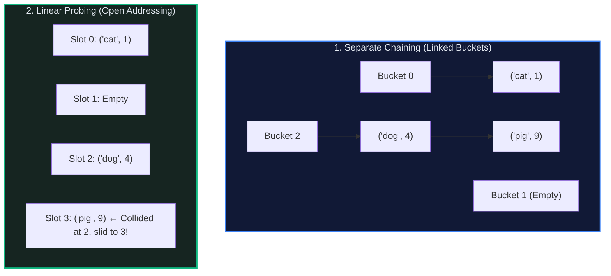

# 🗝️ Hash Table: The Constant-Time Associative Engine

> *"If the array is the atom of contiguous memory, the hash table is the crown jewel of applied computer science — turning arbitrary strings, objects, and numbers into instant $O(1)$ lookups."*

---

## 📍 Level 100 — The Napkin Sketch (30 Seconds)

### The Real-World Analogy
Imagine arriving at a luxury hotel banquet with 1,000 guests. You hand your heavy winter coat to the **Coat Check Valet**:

```
Your Name: "Alice Smith"
Valet Math: Valet runs Alice's name through a quick magic formula → Ticket #42
Your Coat: Placed onto Hook #42
```

When you return at midnight, the valet does **not** search through 1,000 coats one by one. You show Ticket `#42`, and the valet walks straight to Hook `#42` in three seconds flat. That is a **Hash Table**:
1. **Key** ("Alice Smith") $\to$ converted into an integer index via a **Hash Function**.
2. **Value** (Your Coat) $\to$ stored directly at that index in a contiguous array.

```
Key ("Alice")  ──[ Hash Function ]──> Index 42 ──> Bucket[42] = Coat
Key ("Bob")    ──[ Hash Function ]──> Index 87 ──> Bucket[87] = Coat
```

### The Collision Invariant
> **The Pigeonhole Reality:** Because the set of possible keys (infinite strings) is vastly larger than the number of array slots (e.g., 16 buckets), two distinct keys *will* eventually hash to the identical slot (e.g. `hash("John") % 16 == 5` and `hash("Jane") % 16 == 5`). A hash table's greatness lies not in avoiding collisions, but in **resolving collisions gracefully**.

---

## 🎯 Level 200 — Street Fundamentals (5 Minutes)

> 🧠 **Mental Model Card**
> - **Core Superpower:** $O(1)$ average-time key lookup, insertion, and deletion.
> - **The Kryptonite:** Keys must be **hashable and immutable**; worst-case degrades to $O(N)$ if all keys collide.
> - **When to Reach for It:** Instant membership checks (`x in set`), frequency counting, caching, grouping by signature.
> - **When to Run Away:** When you need **sorted order**, range queries (`find keys between 10 and 50`), or nearest neighbors $\to$ Reach for a **Binary Search Tree** or **B-Tree**.
> - **Budget:** Average: $O(1)$ Time, $O(N)$ Space | Worst Case (High Collisions): $O(N)$ Time.

### The Decision Matrix: Collision Resolution Strategies

| Strategy | How It Works | Cache Locality | Deletion Complexity | Behavior Under High Load |
|---|---|:---:|:---:|---|
| **Separate Chaining** | Each bucket holds a linked list of collided entries | 🟡 Poor (pointer chasing) | Clean ($O(1)$ list delete) | Gracefully degrades as chains grow |
| **Linear Probing** (Open Addressing) | If slot is occupied, check `(slot + 1) % M` | 🟢 Excellent (contiguous RAM) | Complex (requires tombstone markers) | Clustering cascades; dies if load factor $> 0.8$ |
| **Quadratic Probing** | Probe `(slot + i^2) % M` | 🟢 Good | Complex (requires tombstones) | Eliminates primary clustering |
| **Double Hashing** | Probe `(slot + i * hash2(k)) % M` | 🟡 Moderate | Complex | Optimal distribution among open-address schemes |
| **Python Compact Dict** (Python 3.6+) | Dense entries array + sparse index hash map | 🟢 Superior | Tombstone compaction on resize | Preserves insertion order with 30-50% less RAM |

### Collision Resolution Visualized



### Street Code Snippets: The 4 Must-Know Idioms

```python
# 1. Frequency Counter — O(N) Time, O(U) Space (U = unique items)
from collections import Counter, defaultdict

def count_frequencies(words: list[str]) -> dict[str, int]:
    freq: dict[str, int] = defaultdict(int)
    for w in words:
        freq[w] += 1
    return freq

# 2. Two Sum Complement Pattern — O(N) Time, O(N) Space
def two_sum(nums: list[int], target: int) -> list[int]:
    seen: dict[int, int] = {}  # val -> index
    for i, num in enumerate(nums):
        complement = target - num
        if complement in seen:
            return [seen[complement], i]
        seen[num] = i
    return []

# 3. Anagram Signature Grouping — O(N * K log K) Time
def group_anagrams(strs: list[str]) -> list[list[str]]:
    groups: dict[str, list[str]] = defaultdict(list)
    for s in strs:
        key = "".join(sorted(s))  # Canonical signature
        groups[key].append(s)
    return list(groups.values())

# 4. LRU Cache Integration via OrderedDict / Hash + DLL
from collections import OrderedDict
lru = OrderedDict()
lru["a"] = 1
lru.move_to_end("a")  # Marked as most recently used in O(1)
```

---

## ⚙️ Level 300 — Working Professional (15 Minutes)

### Real-System Architecture: How CPython Re-Engineered Dicts
Prior to Python 3.6, dicts wasted ~30% of memory with empty hash slots containing pointers.
Raymond Hettinger designed the **Compact Dict**:
1. **Dense `entries` array**: Stores `[hash, key, value]` sequentially in insertion order.
2. **Sparse `indices` array**: A small byte-array (holding 8-bit integers) indexed by hash modulo:

```
Entries Table (Dense, preserves insertion order):
Index 0: [hash("tim"), "tim", 99]
Index 1: [hash("amy"), "amy", 42]

Hash Indices (Sparse, 8 slots):
[ -1, 0, -1, -1, 1, -1, -1, -1 ]
       ↑           ↑
     "tim"       "amy"
```
Lookup: `hash(key) % 8` $\to$ reads byte from `indices` $\to$ accesses exact row in `entries`.

### Complete Implementation: Production Hash Table (Separate Chaining)

```python
"""
Production Hash Table Implementation using Separate Chaining.
Demonstrates load factor monitoring, geometric rehashing, and full mapping protocol.
"""

from typing import Any, Iterator, Optional

class HashNode:
    """A key-value pair node in a collision chain."""
    __slots__ = ("key", "value", "next")

    def __init__(self, key: Any, value: Any, next_node: Optional["HashNode"] = None) -> None:
        self.key: Any = key
        self.value: Any = value
        self.next: Optional[HashNode] = next_node


class HashTable:
    """A resilient, dynamically resizing hash map with separate chaining.

    Complexity:
        - Get: Average O(1), Worst O(N)
        - Put: Average O(1), Worst O(N) on resize
        - Delete: Average O(1), Worst O(N)
        - Space: O(N + M) where M is bucket count
    """

    INITIAL_BUCKETS: int = 16
    MAX_LOAD_FACTOR: float = 0.75

    def __init__(self, capacity: Optional[int] = None) -> None:
        self._capacity: int = capacity if capacity else self.INITIAL_BUCKETS
        self._size: int = 0
        self._buckets: list[Optional[HashNode]] = [None] * self._capacity

    def __len__(self) -> int:
        return self._size

    @property
    def load_factor(self) -> float:
        """Returns alpha = N / M."""
        return self._size / self._capacity

    def _hash(self, key: Any) -> int:
        """Computes bucket index using Python's built-in hash with bit masking."""
        return (hash(key) & 0x7FFFFFFF) % self._capacity

    def __setitem__(self, key: Any, value: Any) -> None:
        """Inserts or updates a key-value pair in average O(1) time."""
        index = self._hash(key)
        head = self._buckets[index]

        # Scan chain for existing key
        curr = head
        while curr:
            if curr.key == key:
                curr.value = value
                return
            curr = curr.next

        # Insert new node at head of chain
        new_node = HashNode(key, value, head)
        self._buckets[index] = new_node
        self._size += 1

        # Check resize threshold
        if self.load_factor > self.MAX_LOAD_FACTOR:
            self._rehash(self._capacity * 2)

    def __getitem__(self, key: Any) -> Any:
        """Retrieves value associated with key, raising KeyError if absent."""
        index = self._hash(key)
        curr = self._buckets[index]
        while curr:
            if curr.key == key:
                return curr.value
            curr = curr.next
        raise KeyError(f"Key '{key}' not found in hash table")

    def __delitem__(self, key: Any) -> None:
        """Deletes key-value pair in average O(1) time."""
        index = self._hash(key)
        curr = self._buckets[index]
        prev: Optional[HashNode] = None

        while curr:
            if curr.key == key:
                if prev:
                    prev.next = curr.next
                else:
                    self._buckets[index] = curr.next
                self._size -= 1
                return
            prev = curr
            curr = curr.next

        raise KeyError(f"Key '{key}' not found for deletion")

    def __contains__(self, key: Any) -> bool:
        try:
            self.__getitem__(key)
            return True
        except KeyError:
            return False

    def _rehash(self, new_capacity: int) -> None:
        """Re-allocates bucket array and migrates all existing nodes."""
        old_buckets = self._buckets
        self._capacity = new_capacity
        self._buckets = [None] * self._capacity
        self._size = 0  # Re-counted during re-insertion

        for head in old_buckets:
            curr = head
            while curr:
                self.__setitem__(curr.key, curr.value)
                curr = curr.next

    def __iter__(self) -> Iterator[Any]:
        """Iterates over all stored keys."""
        for head in self._buckets:
            curr = head
            while curr:
                yield curr.key
                curr = curr.next
```

### Critical Edge Cases & Failure Modes
1. **Mutable Objects as Keys**:
   ```python
   # ❌ ILLEGAL: TypeError: unhashable type: 'list'
   d = {}
   d[[1, 2]] = "error"

   # ✅ FIX: Convert to immutable tuple
   d[(1, 2)] = "success"
   ```
2. **Hash Flooding DoS Attacks**: If an attacker knows your hash function, they can send 100,000 keys that all hash to slot 0. Lookup time degrades from $O(1)$ to $O(N)$, locking up the web server. Modern languages protect against this using **randomized hash seeds** (e.g. SipHash in Python and Ruby).

---

## 🔬 Level 400 — Staff & Senior Engineer (30 Minutes)

### Mathematical Proof of $O(1)$ Expected Search Time
Let $N$ be the number of keys stored in $M$ buckets.
The **load factor** is $\alpha = \frac{N}{M}$.

Assume **Simple Uniform Hashing**: Any given key is equally likely to hash into any of the $M$ slots, independently of where any other key has hashed.

For an **unsuccessful search** (key not present):
The expected number of elements examined is simply the expected length of the chain at bucket $h(k)$:
$$E[\text{search cost}] = 1 + \alpha$$
*(The $1$ accounts for computing the hash and accessing the bucket pointer).*

For a **successful search**:
The expected number of elements examined is:
$$E[\text{search cost}] \le 1 + \frac{\alpha}{2} + \frac{\alpha}{2N} = O(1 + \alpha)$$

As long as we maintain $\alpha \le \text{constant}$ (by doubling $M$ whenever $\alpha \ge 0.75$), **expected search, insert, and delete take strict $O(1)$ time.**

### Universal Hashing
What if an adversary maliciously generates keys to violate uniform hashing?
We choose a hash function $h$ at random from a **2-Universal Family** $\mathcal{H}$ of hash functions:
$$\Pr_{h \in \mathcal{H}}[h(x) = h(y)] \le \frac{1}{M} \quad \text{for all } x \neq y$$
Even if an adversary picks the worst possible keys, the expected collision rate remains bounded by $\frac{1}{M}$, making deliberate hash-DoS mathematically impossible.

---

## 🎓 Level 500 — Researcher's Corner (Collapsible)

<details>
<summary><b>📜 Perfect Hashing & FKS Two-Level Scheme (Click to expand)</b></summary>

### The FKS Two-Level Hashing Scheme (Fredman, Komlós, Szemerédi, 1984)
Can we achieve **$O(1)$ WORST-CASE lookup** with **zero collisions** in $O(N)$ space?
Yes, for static sets (e.g. dictionary of English words, compiler keyword tables):

1. **Level 1**: Hash $N$ keys into $M = N$ primary buckets using a universal hash function. Let $c_i$ be the number of keys hashing to bucket $i$.
2. **Level 2**: Each bucket $i$ contains its *own* second-level hash table of size $S_i = c_i^2$.
3. **The Magic**: By the Birthday Paradox, hashing $c_i$ elements into $c_i^2$ slots has collision probability $< 1/2$. If a collision occurs, simply re-roll the secondary hash function until zero collisions occur!
4. **Total Space Bound**:
   $$\sum_{i=1}^M c_i^2 < 2N = O(N)$$
   Worst-case lookup takes exactly **2 hash computations and 2 memory reads** with 100% certainty!
</details>

---

## 🧭 Navigation & Cross-Pillar Bridges

| ← Previous Module | ↑ Fundamentals Hub | Next Module → |
|:---|:---:|---:|
| [🧱 001 - Array and String](../001%20-%20Array%20and%20String/) | [📚 Fundamentals Index](../README.md) | [🔄 003 - Recursion and Call Stack →](../003%20-%20Recursion%20and%20the%20Call%20Stack/) |

> ### ⚔️ Algorithmic Patterns Powered by Hash Tables:
> - **[Pattern 10: Hash Maps](../../10%20-%20Hash%20Maps/)** — Frequency counting, anagram grouping, Two-Sum indexing.
> - **[Pattern 08: Stacks](../../08%20-%20Stacks/)** — Matching bracket pairs using hash table lookups.
> - **[Pattern 19: Top K Elements](../../19%20-%20Top%20K%20Elements/)** — Count frequency via hash map $\to$ min-heap selection.
