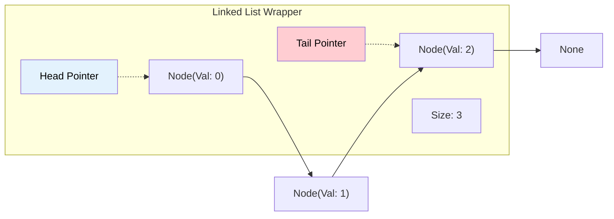
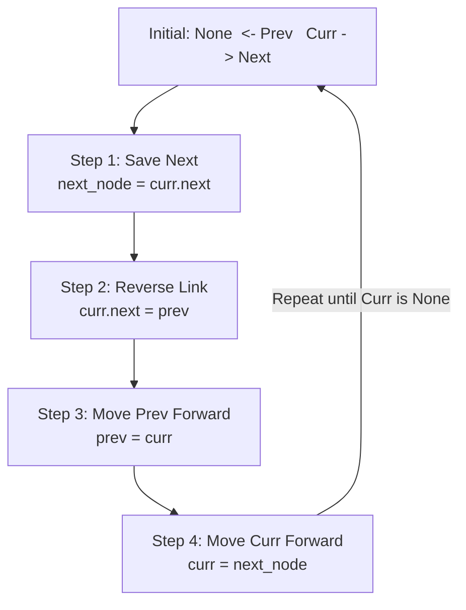

# 🚶‍♂️ Walkthrough: Singly Linked List Implementation

## 👶 Explain Like I'm 5
Imagine you have a group of friends forming a line by holding hands. 
Instead of standing perfectly shoulder-to-shoulder (like an Array), they can be standing anywhere in the room! 
To keep the line intact, each friend just points to the next person. 
If you know who the first person (the **Head**) is, you can just ask them who is next, and walk down the whole line!
If you also keep track of who the very last person (the **Tail**) is, when a new friend wants to join the end of the line, you don't have to start from the Head and walk all the way down. You just tell the Tail to point to the new friend, and the new friend becomes the new Tail!

## 🎯 Core Strategy
**Memory Efficiency and $O(1)$ Tail Pointers**.

Our custom `LinkedList` class in Python 3.14 uses several advanced techniques to achieve high performance:
1. **`__slots__`**: Normally, Python objects use a dictionary (`__dict__`) to store attributes. This is flexible but wastes a LOT of memory. By defining `__slots__ = ("val", "next")`, we tell Python exactly what attributes exist, cutting the memory footprint of each node by over 60%!
2. **Generics**: Using the modern `class Node[T]:` syntax (PEP 695), we ensure the linked list is type-safe and modern.
3. **Tracking Size and Tail**: We manually track `self._size` and `self._tail`.
   - `len(my_list)` is an $O(1)$ lookup instead of an $O(N)$ traversal.
   - `my_list.append(val)` is an $O(1)$ operation because we can attach the new node directly to `_tail.next` and update `_tail`.
4. **Pattern Matching (`match`/`case`)**: Used in `insert_at()` to elegantly handle boundary cases (inserting at `0` -> prepend, inserting at `size` -> append).

## 🏃‍♂️ Step-by-Step Execution (Dry Run)
**Operations**: `append(1)`, `append(2)`, `prepend(0)`, `reverse()`

**1. `append(1)`**:
- List is empty. `new_node = Node(1)`.
- `Head` = `new_node`. `Tail` = `new_node`. Size = 1.
- `LinkedList[1]`

**2. `append(2)`**:
- List has tail `Node(1)`. `new_node = Node(2)`.
- `Tail.next` = `new_node`. (1 now points to 2).
- `Tail` = `new_node`. Size = 2.
- `LinkedList[1 -> 2]`

**3. `prepend(0)`**:
- `new_node = Node(0, next=Head)`. (0 points to 1).
- `Head` = `new_node`. Size = 3.
- `LinkedList[0 -> 1 -> 2]`

**4. `reverse()`**:
- `prev = None`, `curr = Head (0)`. `Tail` is updated to become `Head (0)`.
- Loop 1: `next_node = 1`. `0.next = None`. `prev = 0`. `curr = 1`.
- Loop 2: `next_node = 2`. `1.next = 0`. `prev = 1`. `curr = 2`.
- Loop 3: `next_node = None`. `2.next = 1`. `prev = 2`. `curr = None`.
- Loop finishes. `Head` = `prev (2)`.
- `LinkedList[2 -> 1 -> 0]` ✅

## 📊 Visual Diagram

### Structure of a Linked List

### Pointer Reversal Process

## 🛑 Complexity
- **Time:**
  - `append()` / `prepend()`: $O(1)$
  - `head()` / `tail()`: $O(1)$
  - `len()`: $O(1)$
  - `insert_at()`: $O(N)$ to traverse to the insertion point.
  - `delete()` / `search()`: $O(N)$
  - `reverse()`: $O(N)$
- **Space:** 
  - $O(N)$ to store the nodes in memory. `__slots__` significantly minimizes the constant overhead.
