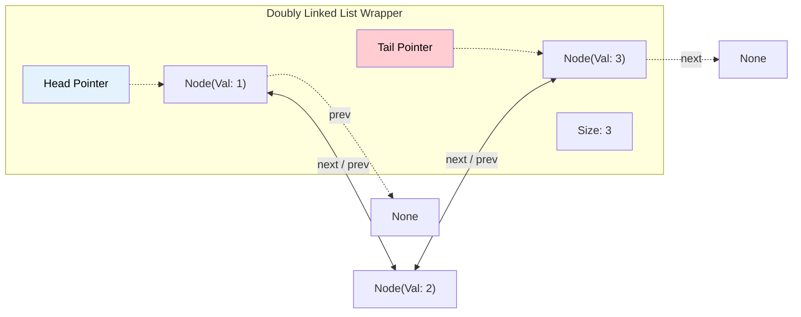

# 🚶‍♂️ Walkthrough: Doubly Linked List Implementation

## 👶 Explain Like I'm 5
A Singly Linked List is like a one-way street: you can only drive forward. 
A **Doubly Linked List** is a two-way street! Every person in the line knows exactly who is in front of them (`next`) AND exactly who is behind them (`prev`).
Because you can walk backward, some things become much easier. For example, if I hand you a node and say "delete this", in a Singly Linked List, you have to run all the way from the beginning to find the guy standing *before* the node. But in a Doubly Linked List, the node already knows who is behind it! So deletion is instant!

## 🎯 Core Strategy
**Bidirectional Pointers and $O(1)$ Removals**.

Our custom `DoublyLinkedList` in Python 3.14 builds upon the efficiency of our Singly Linked List:
1. **`__slots__ = ("val", "next", "prev")`**: We add a `prev` pointer but keep the memory footprint extremely small by strictly defining slots.
2. **Optimized `insert_at`**: Since we know the `_size` of the list, if you want to insert a node at index 90 out of 100, we don't start at the Head and walk forward 90 steps. We start at the Tail and walk backward 10 steps! This cuts traversal time in half on average.
3. **`__reversed__` Magic Method**: We implement `__reversed__` using the `prev` pointers, which allows Python's native `reversed(dll)` function to work seamlessly in $O(1)$ space.
4. **$O(1)$ Node Deletion**: We added a private `_remove_node` helper. If you have the direct reference to a node, you can unlink it instantly by connecting `node.prev.next = node.next` and `node.next.prev = node.prev`.

## 🏃‍♂️ Step-by-Step Execution (Dry Run)
**Operations**: `append(1)`, `append(2)`, `reverse()`

**1. `append(1)`**:
- List is empty. `new_node = Node(1, prev=None, next=None)`.
- `Head` = `new_node`. `Tail` = `new_node`.
- `DLL[1]`

**2. `append(2)`**:
- `new_node = Node(2, prev=Tail, next=None)`. (2 points back to 1).
- `Tail.next = new_node`. (1 points forward to 2).
- `Tail` = `new_node`.
- `DLL[1 <-> 2]`

**3. `reverse()`**:
- `curr = Head (1)`. Update `Tail` to become `Head (1)`.
- Loop 1 (`curr` = 1):
  - `next_node = curr.next` (which is 2).
  - Swap! `curr.next = curr.prev` (None). `curr.prev = next_node` (2).
  - `prev_node = 1`. `curr = 2`.
- Loop 2 (`curr` = 2):
  - `next_node = curr.next` (which is None).
  - Swap! `curr.next = curr.prev` (1). `curr.prev = next_node` (None).
  - `prev_node = 2`. `curr = None`.
- Loop finishes. Update `Head` to `prev_node (2)`.
- Result: `Head` is 2, pointing forward to 1. 1 points backward to 2.
- `DLL[2 <-> 1]` ✅

## 📊 Visual Diagram

### Structure of a Doubly Linked List

## 🛑 Complexity
- **Time:**
  - `append()` / `prepend()`: $O(1)$
  - `head()` / `tail()`: $O(1)$
  - `len()`: $O(1)$
  - `insert_at()`: $O(N)$ (but optimized to $N/2$ max traversals).
  - `delete()` / `search()`: $O(N)$
  - Direct Node Deletion (`_remove_node`): $O(1)$
  - `reverse()`: $O(N)$
- **Space:** 
  - $O(N)$ to store the nodes. Each node has one extra pointer (`prev`) compared to a Singly Linked List.
