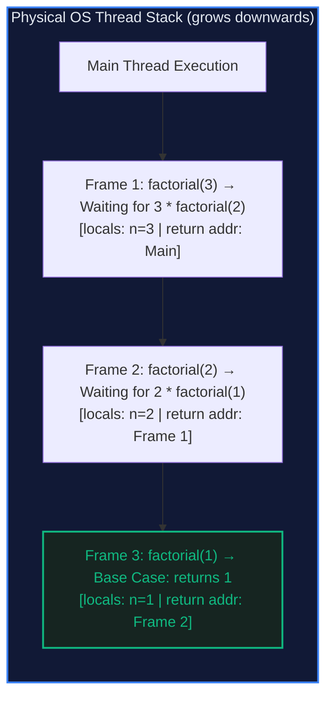

# 🔄 Recursion and the Call Stack: The Inductive Engine

> *"To understand recursion, you must first understand recursion. But to master recursion for senior interviews, you must understand the call stack."*

---

## 📍 Level 100 — The Napkin Sketch (30 Seconds)

### The Real-World Analogy: Russian Matryoshka Dolls
Imagine holding a large Russian nesting doll. You pop it open, and inside sits an identical doll, only 10% smaller. You pop that open, and find another identical, smaller doll:

```
[ Outer Doll (N) ]
  └── [ Inside Doll (N-1) ]
        └── [ Inside Doll (N-2) ]
              └── [ Solid Wood Core (Base Case) ] 🛑
```

You keep opening dolls until you reach the **tiny solid wooden doll at the center**. That solid doll cannot be opened. It is your **Base Case**.
Once you hit the base case, you start closing the dolls back up, from innermost to outermost, snapping each layer shut until the original doll is fully assembled.

What if a doll maker forgot to place the solid core doll at the center?
You would keep opening dolls forever until your table collapses under the weight. In a computer, that table collapse is called a **Stack Overflow**.

### The Core Invariant
> **The Inductive Invariant:** A recursive function $f(n)$ assumes that $f(k)$ already computes the correct answer for all strictly smaller inputs $k < n$. Your only responsibility is:
> 1. Handle the smallest possible input directly (**Base Case**).
> 2. Reduce the current problem into strictly smaller inputs (**Shrinkage**).
> 3. Combine the results (**Combination**).

---

## 🎯 Level 200 — Street Fundamentals (5 Minutes)

> 🧠 **Mental Model Card**
> - **The Core Superpower:** Elegantly expresses self-similar structures (trees, graphs, expressions, permutations) in 5 lines of code.
> - **The Kryptonite:** Hidden memory cost ($O(D)$ memory on the hardware call stack, where $D$ is the maximum call depth).
> - **When to Reach for It:** Trees, Graphs (DFS), Divide-and-Conquer, Backtracking, Dynamic Programming recurrences.
> - **When to Run Away:** Linear sequential iteration where a simple `for` or `while` loop runs in $O(1)$ auxiliary space.
> - **Complexity Budget:**
>   - **Time:** $(\text{Total Nodes in Recursion Tree}) \times (\text{Work Done per Node})$.
>   - **Space:** $(\text{Maximum Depth of Call Stack}) \times (\text{Memory per Stack Frame})$.

### The Hardware Call Stack Mechanics

When your program calls a function, the CPU pushes an **Activation Record (Stack Frame)** onto the thread's call stack:



Every frame stores:
1. **Parameters** passed into the call (`n = 3`).
2. **Local Variables** declared inside the function.
3. **Return Address**: The exact CPU instruction to resume when this child function finishes.

### The 3 Canonical Recursive Archetypes

```python
# Archetype 1: Linear Recursion (Single Branch) — e.g. Binary Search
# Time: O(log N), Space: O(log N) stack frames
def binary_search(arr: list[int], target: int, low: int, high: int) -> int:
    if low > high:
        return -1  # Base Case 1: Exhausted
    mid = low + (high - low) // 2
    if arr[mid] == target:
        return mid  # Base Case 2: Found
    elif arr[mid] > target:
        return binary_search(arr, target, low, mid - 1)  # Recurse left
    else:
        return binary_search(arr, target, mid + 1, high)  # Recurse right


# Archetype 2: Binary Branching (Divide & Conquer) — e.g. Tree Height
# Time: O(N), Space: O(Height) stack frames
def max_depth(node) -> int:
    if not node:
        return 0  # Base Case: Empty tree has height 0
    left_h = max_depth(node.left)
    right_h = max_depth(node.right)
    return 1 + max(left_h, right_h)  # Combine step


# Archetype 3: Multi-Branching Backtracking — e.g. Generate Subsets
# Time: O(2^N), Space: O(N) max depth
def generate_subsets(nums: list[int]) -> list[list[int]]:
    results: list[list[int]] = []
    subset: list[int] = []

    def dfs(idx: int) -> None:
        if idx == len(nums):
            results.append(list(subset))  # Base Case: Reached leaf
            return
        # Decision 1: Include nums[idx]
        subset.append(nums[idx])
        dfs(idx + 1)
        # Backtrack (Undo decision)
        subset.pop()
        # Decision 2: Exclude nums[idx]
        dfs(idx + 1)

    dfs(0)
    return results
```

---

## ⚙️ Level 300 — Working Professional (15 Minutes)

### Real-System Architecture: The Danger of Stack Overflow
1. **Fixed Stack Limits**: Unlike the heap (which can allocate gigabytes of RAM), the OS thread stack is strictly bounded:
   - Linux default: 8 MB.
   - Windows default: 1 MB.
   - Python default: `sys.getrecursionlimit()` is set to **1000 calls**.
2. **CPython's Rejection of Tail-Call Optimization (TCO)**:
   In Scheme or Haskell, tail-recursive functions are automatically compiled into flat loops. Guido van Rossum explicitly rejected TCO in Python because **preserving the full stack trace is vital for debugging in production**.
   Therefore, any recursive algorithm that can recurse $N \ge 1000$ deep in Python *must* be converted into an iterative loop.

### How to Convert Any Recursive Algorithm to Iteration
Every recursion can be converted to an iterative loop using an **explicit manual stack** allocated on the heap. Heap memory is gigabytes in size, completely eliminating stack overflows:

```python
"""
Demonstrating Recursive DFS vs Explicit Heap Stack Simulation.
"""

from typing import Optional

class TreeNode:
    def __init__(self, val: int = 0, left: Optional["TreeNode"] = None, right: Optional["TreeNode"] = None) -> None:
        self.val = val
        self.left = left
        self.right = right


def inorder_traversal_iterative(root: Optional[TreeNode]) -> list[int]:
    """Iterative In-order traversal using an explicit list as the call stack.

    Time: O(N)
    Space: O(H) on the heap — immune to Python RecursionError!
    """
    result: list[int] = []
    stack: list[TreeNode] = []
    curr = root

    while curr or stack:
        # Push all left children onto stack (simulating downward recursion)
        while curr:
            stack.append(curr)
            curr = curr.left

        # Pop from stack (simulating return from child recursion)
        curr = stack.pop()
        result.append(curr.val)

        # Move to right subtree
        curr = curr.right

    return result
```

### Critical Edge Cases & Failure Modes
1. **Missing Base Case**: Function recurses infinitely until `RecursionError: maximum recursion depth exceeded`.
2. **Non-Shrinking Subproblems**: Calling `f(n)` from `f(n)` without decrementing $n$.
3. **Pass-by-Reference in Backtracking**: Appending a mutable list without copying:
   ```python
   # ❌ BUG: Appends reference to same list; ending with [ [], [], [] ]
   results.append(path)

   # ✅ FIX: Create shallow copy snapshot
   results.append(list(path))  # or path[:]
   ```

---

## 🔬 Level 400 — Staff & Senior Engineer (30 Minutes)

### Visualizing the Recursion Tree & Master Complexity
Every recursive function maps to a directed **Recursion Tree**. To analyze time complexity, compute:
$$\text{Total Time} = \sum_{\text{level } j=0}^D (\text{Number of nodes at level } j) \times (\text{Work done at level } j)$$

For Merge Sort: $T(N) = 2T(N/2) + O(N)$
- Level 0: 1 node of size $N \implies N$ work
- Level 1: 2 nodes of size $N/2 \implies 2 \times (N/2) = N$ work
- Level 2: 4 nodes of size $N/4 \implies 4 \times (N/4) = N$ work
- Depth $D = \log_2 N$.
- **Total Work** $= N \times \log_2 N = O(N \log N)$!

*(For formal proofs across all recurrence topologies, see [Ch 03: Recurrences & Master Theorem](../000%20-%20Theoretical%20Foundations%20%28The%20Complete%20Guide%29/03_recurrences_and_master_theorem.md)).*

### Tail Call Optimization (TCO) Under the Hood
In assembly code, a regular function call emits:
```assembly
CALL _child_function    ; Pushes Return Address to Stack
...
RET                     ; Pops Return Address
```
If the recursive call is in **Tail Position** (the return value of the recursive call is returned immediately without further operations):
```python
def tail_factorial(n: int, accumulator: int = 1) -> int:
    if n <= 1:
        return accumulator
    return tail_factorial(n - 1, n * accumulator)  # Pure tail call
```
A compiler with TCO replaces the `CALL` with a `JMP`:
```assembly
MOV rdi, rax            ; Update accumulator
SUB rsi, 1              ; Decrement n
JMP _tail_factorial     ; Reuse identical stack frame!
```
Stack depth drops from $O(N)$ to **$O(1)$**!

---

## 🎓 Level 500 — Researcher's Corner (Collapsible)

<details>
<summary><b>📜 The Y Combinator & Anonymous Recursion (Click to expand)</b></summary>

### How Does a Function Recurse Without a Name?
In Alonzo Church's Lambda Calculus, functions have no names. How can a function invoke itself without a name identifier?
Haskell Curry discovered the **Fixed-Point Y Combinator**:
$$Y = \lambda f . (\lambda x . f (x \ x)) \ (\lambda x . f (x \ x))$$

For any function $F$, $Y(F) = F(Y(F))$.
In Python, this mathematical marvel can be written directly:

```python
# The Y Combinator in Python: Enables recursive factorial without named recursion!
Y = lambda f: (lambda x: f(lambda v: x(x)(v)))(lambda x: f(lambda v: x(x)(v)))

# Define factorial without referencing its own name
factorial_logic = lambda rec: lambda n: 1 if n <= 1 else n * rec(n - 1)

anonymous_factorial = Y(factorial_logic)
assert anonymous_factorial(5) == 120  # Works purely through lambda calculus!
```
</details>

---

## 🧭 Navigation & Cross-Pillar Bridges

| ← Previous Module | ↑ Fundamentals Hub | Next Module → |
|:---|:---:|---:|
| [🗝️ 002 - Hash Table](../002%20-%20Hash%20Table/) | [📚 Fundamentals Index](../README.md) | [🔀 004 - Sorting Algorithms →](../004%20-%20Sorting%20Algorithms/) |

> ### ⚔️ Algorithmic Patterns Powered by Recursion:
> - **[Pattern 11 & 12: Tree BFS & DFS](../../11%20-%20Tree%20Breadth%20First%20Search/)** — Pre-order, in-order, post-order recursive tree traversal.
> - **[Pattern 16: Subsets](../../16%20-%20Subsets/)** — State-space tree exploration via backtracking.
> - **[Pattern 36: Divide & Conquer](../../36%20-%20Divide%20and%20Conquer/)** — Splitting problems in halves and recombining.
