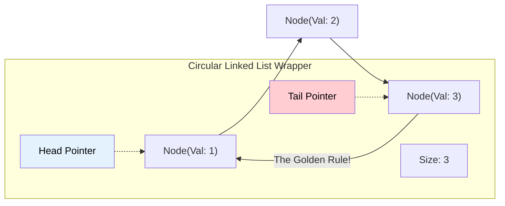

# 🚶‍♂️ Walkthrough: Circular Linked List Implementation

## 👶 Explain Like I'm 5
Imagine a group of friends holding hands to form a circle. 
In a normal Linked List, the last person has one hand free because there is no one left to hold. 
In a **Circular Linked List**, the last person reaches around and holds the hand of the FIRST person!
There is no "end" to the line. If you keep walking forward, you will eventually end up exactly where you started.
This is incredibly useful for things that repeat forever, like turns in a multiplayer board game (Player 1 -> Player 2 -> Player 3 -> back to Player 1!).

## 🎯 Core Strategy
**Infinite loops and $O(1)$ Rotations**.

Our custom `CircularLinkedList` in Python 3.14 is built for speed and safety:
1. **The Golden Rule**: The Tail's `next` pointer MUST always point to the Head. `self._tail.next = self._head`.
2. **Safe Traversal**: If we write a standard `while curr:` loop, it will run infinitely! Therefore, our `__iter__` method uses a `while True` loop and manually `break`s the loop the moment `curr == self._head` again.
3. **$O(1)$ Rotations**: A unique superpower of the Circular Linked List is the `rotate()` method. To shift the entire list by 1, we don't have to move any nodes! We just reassign the labels: the old Head becomes the new Tail, and the node after the old Head becomes the new Head! That takes instant $O(1)$ time.

## 🏃‍♂️ Step-by-Step Execution (Dry Run)
**Operations**: `append(1)`, `append(2)`, `rotate()`

**1. `append(1)`**:
- List is empty. `new_node = Node(1)`.
- `Head` = `new_node`. `Tail` = `new_node`.
- Golden Rule: `new_node.next = new_node`. (It points to itself, forming a circle of 1!).
- `CLL[1 -> (back to 1)]`

**2. `append(2)`**:
- `new_node = Node(2)`.
- `new_node.next = Head`. (2 points to 1).
- `Tail.next = new_node`. (1 points to 2).
- `Tail` = `new_node`.
- `CLL[1 -> 2 -> (back to 1)]`

**3. `rotate()`**:
- `Tail` is updated to be the `Head (1)`.
- `Head` is updated to be `Head.next (2)`.
- `CLL[2 -> 1 -> (back to 2)]` ✅

## 📊 Visual Diagram

### Structure of a Circular Linked List

## 🛑 Complexity
- **Time:**
  - `append()` / `prepend()`: $O(1)$
  - `head()` / `tail()`: $O(1)$
  - `rotate()`: $O(1)$ (Super fast shift!)
  - `len()`: $O(1)$
  - `insert_at()`: $O(N)$
  - `delete()` / `search()`: $O(N)$
- **Space:** 
  - $O(N)$ to store the nodes in memory. `__slots__` is used to keep overhead low.
