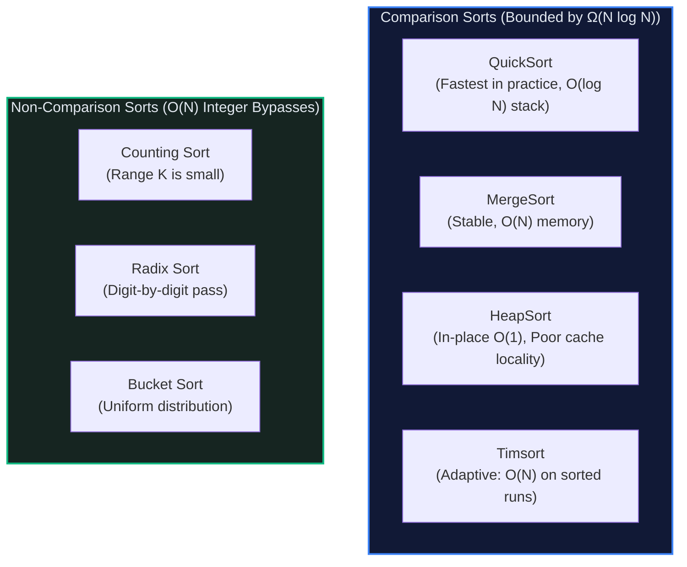

# 🔀 Sorting Algorithms: The Order From Chaos Engine

> *"Sorting is the universal pre-processing step. Spending $O(N \log N)$ upfront transforms impossible search, grouping, and pairing problems into trivial $O(1)$ and $O(\log N)$ operations."*

---

## 📍 Level 100 — The Napkin Sketch (30 Seconds)

### The Real-World Analogy
Imagine receiving a shuffled deck of 52 playing cards:
- **Insertion Sort** is how humans sort cards in their hands: You pick one card, scan left, and slide it directly into its rightful spot. Simple, fast for tiny hands, disastrous for 100,000 cards.
- **Quick Sort** is a school teacher dividing a chaotic playground of children:
  ```
  Teacher picks one child as the "Pivot".
  "Everyone shorter than the Pivot, go to the left fence!"
  "Everyone taller than the Pivot, go to the right fence!"
  Now repeat the same game within the left and right groups.
  ```
- **Counting Sort** is sorting Lego bricks by color: You do **not** compare a yellow brick to a blue brick. You simply place 5 colored buckets on the floor, toss the bricks into their buckets, and dump them out in order. Zero comparisons.

### The Core Invariant
> **The Information-Theoretic Invariant:** If an algorithm sorts solely by comparing pairs of elements (`a < b`), it is mathematically impossible to beat $\Omega(N \log N)$ worst-case time, because distinguishing among $N!$ permutations requires at least $\lceil \log_2(N!) \rceil \approx N \log_2 N$ binary decisions. To beat $O(N \log N)$, you must use **non-comparison** sorts (Counting, Radix, Bucket) that exploit the internal bit or digit structure of keys.

---

## 🎯 Level 200 — Street Fundamentals (5 Minutes)

> 🧠 **Mental Model Card**
> - **The Core Idea:** Imposing monotonic order turns unsorted $O(N)$ searches into $O(\log N)$ binary search, groups duplicates together, and unlocks two pointers.
> - **When to Reach for It:** "Find pairs/triplets", "Merge overlapping intervals", "Longest consecutive sequence", "Group anagrams".
> - **When to Run Away:** When you only need the **single Minimum, Maximum, or Median** $\to$ Use a linear scan ($O(N)$) or Quickselect ($O(N)$ average), NOT a full sort.
> - **Stability:** A sort is **Stable** if elements with identical keys retain their original relative order. Vital when multi-column sorting (e.g. sort by Name, then sort by Department).

### The Master Sorting Decision Matrix

| Algorithm | Best Time | Average Time | Worst Time | Space | Stable? | In-Place? | Real-World Use Case |
|---|:---:|:---:|:---:|:---:|:---:|:---:|---|
| **Insertion Sort** | $O(N)$ | $O(N^2)$ | $O(N^2)$ | $O(1)$ | ✅ Yes | ✅ Yes | Small arrays ($N \le 32$) and nearly-sorted streams |
| **Merge Sort** | $O(N \log N)$ | $O(N \log N)$ | $O(N \log N)$ | $O(N)$ | ✅ Yes | ❌ No | Linked lists, external file sorting, guaranteed worst-case |
| **Quick Sort** | $O(N \log N)$ | $O(N \log N)$ | $O(N^2)$ | $O(\log N)$ | ❌ No | ✅ Yes | In-memory arrays with high cache locality |
| **Heap Sort** | $O(N \log N)$ | $O(N \log N)$ | $O(N \log N)$ | $O(1)$ | ❌ No | ✅ Yes | Embedded systems with strict $O(1)$ memory guarantees |
| **Counting Sort** | $O(N + K)$ | $O(N + K)$ | $O(N + K)$ | $O(K)$ | ✅ Yes | ❌ No | Integers in small range $[0, K]$ (e.g. ages, alphabet counts) |
| **Radix Sort** | $O(D \cdot (N + B))$ | $O(D \cdot (N + B))$ | $O(D \cdot (N + B))$ | $O(N + B)$ | ✅ Yes | ❌ No | 32-bit/64-bit integers, fixed-length strings |
| **Timsort** (Python/Java) | $O(N)$ | $O(N \log N)$ | $O(N \log N)$ | $O(N)$ | ✅ Yes | ❌ No | Standard library default: hybrid of Merge + Insertion |

### The Comparison vs Non-Comparison Barrier



### Street Code Snippets: 3 Core Workhorses

```python
# 1. 3-Way QuickSort (Dutch National Flag Partitioning)
# Immune to O(N^2) duplicates degradation!
import random

def quicksort_3way(arr: list[int], low: int, high: int) -> None:
    if low >= high:
        return
    # Random pivot to eliminate sorted array worst-case
    p_idx = random.randint(low, high)
    arr[low], arr[p_idx] = arr[p_idx], arr[low]
    pivot = arr[low]

    lt, i, gt = low, low + 1, high
    while i <= gt:
        if arr[i] < pivot:
            arr[lt], arr[i] = arr[i], arr[lt]
            lt += 1
            i += 1
        elif arr[i] > pivot:
            arr[i], arr[gt] = arr[gt], arr[i]
            gt -= 1
        else:
            i += 1

    quicksort_3way(arr, low, lt - 1)
    quicksort_3way(arr, gt + 1, high)


# 2. Counting Sort — O(N + K) Non-comparison sorting
def counting_sort(nums: list[int]) -> list[int]:
    if not nums:
        return []
    min_val, max_val = min(nums), max(nums)
    k = max_val - min_val + 1
    counts = [0] * k

    for x in nums:
        counts[x - min_val] += 1

    sorted_res: list[int] = []
    for val_offset, count in enumerate(counts):
        sorted_res.extend([val_offset + min_val] * count)
    return sorted_res
```

---

## ⚙️ Level 300 — Working Professional (15 Minutes)

### Real-System Architecture: Why Production Uses Timsort
Invented by Tim Peters in 2002 for Python and adopted by Java `Arrays.sort()` and Android:
1. **Real-world data is almost never random**: Most datasets already have chunks of pre-sorted elements ("runs").
2. **Natural Run Detection**: Timsort scans the input and identifies existing ascending or strictly descending runs. Descending runs are reversed in $O(M)$ time.
3. **Insertion Sort for Micro-Runs**: If a run is shorter than a threshold $\text{MIN\_RUN}$ (usually 32 to 64), Timsort uses Insertion Sort (which has ultra-low constant factors and runs in cache) to extend it.
4. **Merge Stack with Invariants**: It pushes runs onto a stack and merges them using balanced rules ($A > B + C$ and $B > C$) to ensure the merge tree is strictly balanced, achieving $O(N)$ best case and $O(N \log N)$ worst case.

### Complete Implementation: In-Place HeapSort

```python
"""
Production-Grade In-Place Heap Sort.
Achieves O(N log N) time and strict O(1) auxiliary space without external arrays.
"""

def heapsort(arr: list[int]) -> None:
    """Sorts arr in-place in ascending order using a Max-Heap.

    Time Complexity:
        - Build Max-Heap: O(N) via Floyd's bottom-up sift-down
        - N Extractions: N * O(log N) = O(N log N)
        - Total Time: O(N log N)
    Space Complexity:
        - O(1) strictly in-place.
    """
    n = len(arr)

    def sift_down(start: int, end: int) -> None:
        root = start
        while True:
            child = 2 * root + 1  # Left child index
            if child > end:
                break
            # Pick largest child
            if child + 1 <= end and arr[child] < arr[child + 1]:
                child += 1
            if arr[root] < arr[child]:
                arr[root], arr[child] = arr[child], arr[root]
                root = child  # Continue down
            else:
                break

    # Phase 1: Build Max-Heap in O(N) time bottom-up
    for i in range((n - 2) // 2, -1, -1):
        sift_down(i, n - 1)

    # Phase 2: Extract elements one by one from heap to back of array
    for end in range(n - 1, 0, -1):
        # Swap current max (at index 0) to its final position at 'end'
        arr[0], arr[end] = arr[end], arr[0]
        # Re-heapify remaining elements [0 ... end - 1]
        sift_down(0, end - 1)
```

### Critical Edge Cases & Failure Modes
1. **QuickSort Pivot Traps**:
   - Picking `arr[0]` on an already-sorted array creates an unbalanced $N, N-1, N-2, \dots$ recursion tree, blowing up to **$O(N^2)$ time** and stack overflow.
   - Arrays with all identical values (`[5, 5, 5, 5, 5]`) degrade standard 2-way QuickSort to $O(N^2)$. **Always use 3-way partitioning.**
2. **Float `NaN` Invalidation**:
   In IEEE-754 floats, `nan == nan` is `False`, and `nan < 5` is `False`. If an array contains `NaN`, comparison transitivity fails, causing standard sorting algorithms to scramble or crash.

---

## 🔬 Level 400 — Staff & Senior Engineer (30 Minutes)

### Why QuickSort Beats HeapSort in Cache Locality
Both QuickSort and HeapSort require $O(N \log N)$ average comparisons. Yet in production benchmarks on modern CPUs, **QuickSort is typically 2x to 3x faster than HeapSort**. Why?
- **QuickSort Spatial Locality**: QuickSort scans elements sequentially using two inward-moving pointers. Every memory access hits the identical L1 cache line (64 bytes). The CPU hardware prefetcher predicts every subsequent read effortlessly.
- **HeapSort Cache Thrashing**: Sift-down navigates from index $i \to 2i + 1 \to 4i + 3$. As the heap grows large (e.g. 10 million integers), children reside in completely distant memory pages. Almost every single step of `sift_down` incurs an **L3 cache miss or TLB miss**, forcing the CPU to stall for hundreds of clock cycles.

### External Merge Sort (Sorting Data Bigger than RAM)
What if you need to sort a **500 Gigabyte file** on a machine with only **8 Gigabytes of RAM**?
You cannot load the file into memory. You must use **External Merge Sort**:
1. **Phase 1 (Chunk Sorting)**:
   - Read 8 GB of data from disk into RAM.
   - Sort it in RAM using QuickSort/Timsort.
   - Write the sorted chunk back to disk as `chunk_0.bin`.
   - Repeat for all $500 / 8 = 63$ chunks.
2. **Phase 2 (K-Way Merge)**:
   - Open 63 file streams simultaneously.
   - Maintain a Min-Heap of size 63 containing the first element from each chunk.
   - Repeatedly pop the minimum element into an output buffer and refill from the corresponding chunk file.
   - Total I/O cost: Exactly $2 \times (\text{File Size})$ reads and writes!

---

## 🎓 Level 500 — Researcher's Corner (Collapsible)

<details>
<summary><b>📜 Sub-O(N log N) Integer Sorting on the Word RAM Model (Click to expand)</b></summary>

### Beating $O(N \log N)$ for General Integers
In 2002, Yijie Han and Mikkel Thorup proved that $W$-bit integers can be sorted in:
$$O(N \sqrt{\log \log N}) \quad \text{randomized time}$$
$$O(N \log \log N) \quad \text{deterministic time}$$
on the standard Word RAM model with $O(N)$ space.
This broke the long-standing belief that general integer sorting required $\Omega(N \log N)$ or large digit ranges.

### The AKS Sorting Network (Ajtai, Komlós, Szemerédi, 1983)
Can $N$ items be sorted in parallel using fixed comparator circuits?
The **AKS Sorting Network** proved that a network of comparators can sort $N$ items in:
$$\text{Depth } = O(\log N) \quad \text{and} \quad \text{Total Comparators } = O(N \log N)$$
While the theoretical depth is asymptotically optimal, the hidden constant factor is so astronomical ($> 10^{10}$) that it remains an academic milestone rather than practical hardware circuit.
</details>

---

## 🧭 Navigation & Cross-Pillar Bridges

| ← Previous Module | ↑ Fundamentals Hub | Next Module → |
|:---|:---:|---:|
| [🔄 003 - Recursion and Call Stack](../003%20-%20Recursion%20and%20the%20Call%20Stack/) | [📚 Fundamentals Index](../README.md) | [📥 005 - Queue and Stack →](../005%20-%20Queue%20and%20Stack/) |

> ### ⚔️ Algorithmic Patterns Powered by Sorting:
> - **[Pattern 05: Merge Intervals](../../05%20-%20Merge%20Intervals/)** — Sort intervals by start time $\to$ linear merge scan.
> - **[Pattern 06: Cyclic Sort](../../06%20-%20Cyclic%20Sort/)** — $O(N)$ in-place cycle placement for numbers in range $[1, N]$.
> - **[Pattern 35: Sorting](../../35%20-%20Sorting/)** — Custom comparator problems and Dutch National Flag invariants.
