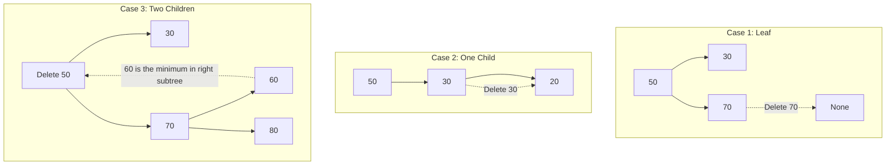

# 🚶‍♂️ Walkthrough: Binary Search Tree

## 👶 Explain Like I'm 5
Imagine a guessing game where you try to guess a number between 1 and 100. 
If you guess 50, and I say "Lower!", you instantly know the answer is between 1 and 49. You just threw away 50 numbers!
A Binary Search Tree (BST) is built exactly like this game. Every circle (Node) has a number. 
- Anything smaller than that number goes to its Left.
- Anything bigger than that number goes to its Right.
When you want to find a number, you just ask "Is it bigger or smaller?" and go down the correct path. It's super fast!

## 🎯 Core Strategy
1. **Insert & Search**: Start at the root. If the value is less than the current node, go left. If it is greater, go right. If you hit `None`, insert the node there (or return `False` if searching).
2. **Delete**: This is the tricky part!
   - **No Children**: Just delete the node by returning `None` to the parent.
   - **One Child**: Return the only child to the parent, effectively bypassing the deleted node.
   - **Two Children**: You can't just delete it, or the tree breaks! Find the **In-Order Successor** (the smallest number in the Right Subtree). Copy that successor's value into the current node, and then recursively delete the original successor node.
3. **Traversals (Generators)**:
   - Python's `yield` and `yield from` are amazing for trees. Instead of passing an array down the recursive stack to collect values, we just yield them.
   - **In-Order** (Left, Root, Right) gives you a sorted list!

## 🏃‍♂️ Step-by-Step Execution (Dry Run)
**Operations**: `Insert(50, 30, 70)`, `Delete(50)`

1. **Insertions**:
   - `50` becomes Root.
   - `30` is < 50, goes Left of 50.
   - `70` is > 50, goes Right of 50.
   - Tree is balanced: `30 <- 50 -> 70`
2. **Delete(50)**:
   - 50 has TWO children! We can't just erase it.
   - Find In-Order Successor: Go to Right Subtree (70), and go as far Left as possible. There is no Left, so 70 is the successor.
   - Replace 50's value with 70. Node becomes `70`.
   - Recursively delete `70` from the Right Subtree. Since 70 is a leaf there, it just returns `None`.
   - Tree becomes: `30 <- 70 -> None`.

## 📊 Visual Diagram

### The 3 Deletion Cases

## 🛑 Complexity
- **Time:**
  - `insert()`, `search()`, `delete()`: $O(H)$ where $H$ is the height of the tree. In a balanced tree, $H = \log(N)$. In the worst-case (skewed tree), $H = N$.
  - Traversals: $O(N)$
- **Space:** $O(H)$ memory for the recursive call stack.
