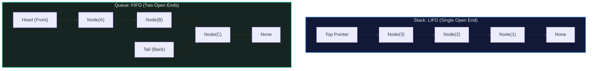

# 📥 Queue and Stack: The LIFO & FIFO Linear Primitives

> *"A stack remembers where you came from; a queue manages where you are going. Together, they form the twin engines of depth-first and breadth-first search."*

---

## 📍 Level 100 — The Napkin Sketch (30 Seconds)

### The Real-World Analogies

#### 1. The Stack (LIFO: Last In, First Out)
Think of a **spring-loaded cafeteria tray dispenser**:
- When the dishwasher adds clean trays, they are pushed down onto the **top**.
- When you take a tray to eat lunch, you take the **top** tray.
- The very first tray placed at the bottom of the dispenser stays there until every tray above it has been removed.

```
Push(C) ──>  [ Tray C ]  (Top)  ──> Pop() returns C
             [ Tray B ]
             [ Tray A ]  (Bottom)
```

#### 2. The Queue (FIFO: First In, First Out)
Think of a **ticket line at a movie theater**:
- New arrivals join the line at the **back** (Enqueue).
- The ticket teller serves customers strictly from the **front** (Dequeue).
- The first person to arrive is the first person into the theater. Cutting the line is illegal.

```
Enqueue("Bob") ──> [ Back: Bob ] ──> [ Front: Alice ] ──> Dequeue() returns Alice
```

### The Core Invariants
> **Stack Invariant:** Access is strictly restricted to a single point of entry and exit: the `Top`.
> **Queue Invariant:** Elements enter exclusively at the `Tail` and exit exclusively at the `Head`.

---

## 🎯 Level 200 — Street Fundamentals (5 Minutes)

> 🧠 **Mental Model Card**
> - **Stack (LIFO):** Reach for when you need **Undo/Redo**, **matching nested structures** (parentheses, HTML/JSON tags), **DFS graph exploration**, or **Monotonic trends** (Next Greater Element).
> - **Queue (FIFO):** Reach for when you need **Breadth-First Search (level-by-level)**, **buffer processing**, **rate limiting**, or **task scheduling**.
> - **⚠️ The Fatal Python Interview Trap:**
>   - **NEVER** use a Python `list` as a Queue: `queue.pop(0)` is **$O(N)$ Time** because it shifts all $N-1$ elements in memory!
>   - **ALWAYS** use `collections.deque`: `deque.popleft()` is strict **$O(1)$ Time**!

### The Decision Matrix

| Container | Order | Push Time | Pop Time | Peek Time | Under the Hood | Standard Python Idiom |
|---|:---:|:---:|:---:|:---:|---|---|
| **Stack** | LIFO | $O(1)$ | $O(1)$ | $O(1)$ | Dynamic array or Linked list | `stack = []` (`append` / `pop`) |
| **Queue** | FIFO | $O(1)$ | $O(1)$ | $O(1)$ | Doubly linked list of blocks | `from collections import deque` (`append` / `popleft`) |
| **Deque** | Double-Ended | $O(1)$ | $O(1)$ | $O(1)$ | Circular block-ring buffer | `deque` (`append`, `appendleft`, `pop`, `popleft`) |
| **Priority Queue** | Priority | $O(\log N)$ | $O(\log N)$ | $O(1)$ | Binary heap array | `import heapq` (`heappush` / `heappop`) |

### Visualizing Operations



### Street Code Snippets: 3 Core Interview Patterns

```python
from collections import deque

# 1. Valid Parentheses Matching (Stack Pattern)
def is_valid_parentheses(s: str) -> bool:
    bracket_map = {")": "(", "}": "{", "]": "["}
    stack: list[str] = []
    for char in s:
        if char in bracket_map:
            top = stack.pop() if stack else "#"
            if bracket_map[char] != top:
                return False
        else:
            stack.append(char)
    return len(stack) == 0


# 2. BFS Level-Order Traversal (Queue Pattern)
def bfs_levels(root) -> list[list[int]]:
    if not root:
        return []
    result: list[list[int]] = []
    queue = deque([root])
    while queue:
        level_size = len(queue)
        level: list[int] = []
        for _ in range(level_size):
            node = queue.popleft()  # O(1) dequeue!
            level.append(node.val)
            if node.left: queue.append(node.left)
            if node.right: queue.append(node.right)
        result.append(level)
    return result


# 3. Monotonic Decreasing Stack (Next Greater Element)
def next_greater_elements(nums: list[int]) -> list[int]:
    res = [-1] * len(nums)
    stack: list[int] = []  # Stores indices
    for i, x in enumerate(nums):
        while stack and nums[stack[-1]] < x:
            prev_idx = stack.pop()
            res[prev_idx] = x
        stack.append(i)
    return res
```

---

## ⚙️ Level 300 — Working Professional (15 Minutes)

### Real-System Architecture: Production Engineering
1. **The Operating System Call Stack**:
   Every thread in Linux, macOS, or Windows has a fixed-size hardware call stack. When a function calls another, an activation record is pushed. When it returns, the record is popped.
2. **Redis Lists (`quicklist`)**:
   Redis implements list commands (`LPUSH`, `RPOP`) using a hybrid data structure called a **quicklist** — a doubly linked list of 4KB contiguous memory pages (ziplists). This avoids allocating individual heap nodes while enabling $O(1)$ push/pop at both ends.
3. **High-Performance Ring Buffers (Circular Arrays)**:
   In network packet sniffers, audio drivers, and the Linux kernel's `epoll` notification mechanism, queues are implemented as fixed-capacity circular ring buffers in contiguous memory.

### Complete Implementation: Fixed-Capacity Circular Ring Buffer

```python
"""
Production Fixed-Capacity Ring Buffer Queue.
Guarantees zero memory allocation after initialization, zero pointer overhead, and O(1) ops.
"""

from typing import Any, Optional

class CircularQueue:
    """A high-performance circular ring buffer queue."""

    def __init__(self, capacity: int) -> None:
        self._capacity: int = capacity
        self._buffer: list[Any] = [None] * capacity
        self._head: int = 0
        self._tail: int = 0
        self._size: int = 0

    def is_empty(self) -> bool:
        return self._size == 0

    def is_full(self) -> bool:
        return self._size == self._capacity

    def enqueue(self, item: Any) -> bool:
        """Enqueues item at tail in O(1) time. Returns False if full."""
        if self.is_full():
            return False
        self._buffer[self._tail] = item
        self._tail = (self._tail + 1) % self._capacity
        self._size += 1
        return True

    def dequeue(self) -> Optional[Any]:
        """Dequeues item from head in O(1) time. Returns None if empty."""
        if self.is_empty():
            return None
        val = self._buffer[self._head]
        self._buffer[self._head] = None  # GC cleanup
        self._head = (self._head + 1) % self._capacity
        self._size -= 1
        return val

    def peek(self) -> Optional[Any]:
        return None if self.is_empty() else self._buffer[self._head]

    def __len__(self) -> int:
        return self._size
```

### Critical Edge Cases & Failure Modes
1. **Memory Leak in Object Queues**:
   If a custom queue implementation shifts `head` pointer without setting `buffer[old_head] = None`, references to large objects linger on the heap, preventing Python's garbage collector from freeing them.
2. **Queue Poisoning in Producer-Consumer Systems**:
   When a consumer thread crashes while processing a dequeued job, the job is lost forever unless an **acknowledgment queue (ACK/NACK)** pattern is used (e.g. RabbitMQ message redelivery).

---

## 🔬 Level 400 — Staff & Senior Engineer (30 Minutes)

### Contiguous Ring Buffer vs Linked List Queue: Cache Analysis
Why does `collections.deque` in Python use a doubly linked list of 64-element contiguous arrays rather than single-node linked lists?
- **Single-Node Linked Queue**:
  Every `enqueue` calls `malloc(sizeof(Node))`. Nodes are scattered randomly in physical RAM. Traversal incurs a **cache miss on every dereference**.
- **Chunked Ring Buffer (`collections.deque`)**:
  Memory is allocated in chunks of 64 elements. Within each chunk, elements are adjacent in physical memory (cache hit on every sequential access). Pointers between chunks are traversed only once every 64 operations!

```
Single Node (Pointers): [Node] ──cache miss──> [Node] ──cache miss──> [Node]
Chunked (Python deque): [ 64 Contiguous Elements ] ──> [ 64 Contiguous Elements ]
```

---

## 🎓 Level 500 — Researcher's Corner (Collapsible)

<details>
<summary><b>📜 Lock-Free Concurrent Queues (Michael & Scott, 1996) (Click to expand)</b></summary>

### The Michael-Scott Lock-Free Queue
In multi-core operating systems, using a mutex lock on a queue forces all worker threads to serialize, creating a major CPU bottleneck.
In 1996, Maged Michael and Michael Scott invented the **Non-Blocking Lock-Free Concurrent Queue** using atomic **Compare-And-Swap (CAS)** instructions:

1. The queue maintains `head` and `tail` atomic pointers with a dummy sentinel node.
2. An `enqueue` reads `tail`, reads `tail.next`, and attempts an atomic `CAS(tail.next, NULL, new_node)`.
3. If CAS succeeds, it swings `tail` to `new_node`.
4. Even if a thread is preempted halfway through, other threads assist in swinging the `tail` pointer forward, guaranteeing system-wide **Wait-Free Progress**!
</details>

---

## 🧭 Navigation & Cross-Pillar Bridges

| ← Previous Module | ↑ Fundamentals Hub | Next Module → |
|:---|:---:|---:|
| [🔀 004 - Sorting Algorithms](../004%20-%20Sorting%20Algorithms/) | [📚 Fundamentals Index](../README.md) | [🔗 006 - Linked List →](../006%20-%20Linked%20List/) |

> ### ⚔️ Algorithmic Patterns Powered by Stacks & Queues:
> - **[Pattern 08: Stacks](../../08%20-%20Stacks/)** — Parentheses, expression evaluation, backspace string compare.
> - **[Pattern 09: Monotonic Stack](../../09%20-%20Monotonic%20Stack/)** — Next Greater Element, Daily Temperatures, Largest Rectangle in Histogram.
> - **[Pattern 11: Tree Breadth First Search](../../11%20-%20Tree%20Breadth%20First%20Search/)** — Level-order traversal using queues.
