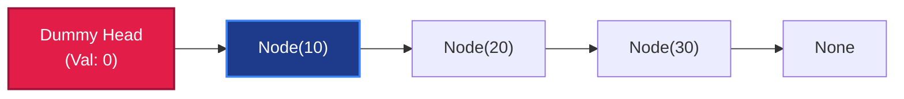

# 🔗 Singly Linked List: The Pointer-Chain Primitive

> *"Arrays bind memory in rigid contiguous blocks. Linked lists liberate memory across the heap — trading instant index calculation for flexible $O(1)$ insertion and splicing."*

---

## 📍 Level 100 — The Napkin Sketch (30 Seconds)

### The Real-World Analogy: The Scavenger Hunt
Imagine a treasure hunt across a city:
- In an **Array**, all 10 clues are locked inside consecutive numbered lockers in the same train station (`Locker 0, Locker 1, Locker 2...`). To find Clue 7, you walk straight to Locker 7.
- In a **Linked List**, Clue 0 is under a bench in Central Park. It contains a scrap of paper reading: *"The next clue is taped behind the clock at Grand Central."* Grand Central holds a note pointing to the Brooklyn Bridge.

```
[ Head: Park ] ──next──> [ Grand Central ] ──next──> [ Brooklyn Bridge ] ──next──> None
```

To reach Clue 3, you **cannot teleport**. You *must* visit Clue 0, then Clue 1, then Clue 2. This is $O(N)$ sequential traversal.
However, if you want to insert a new stop between Grand Central and Brooklyn Bridge, you do **not** have to move any lockers. You simply rewrite one scrap of paper to point to your new location.

### The Core Invariant
> **The Pointer Invariant:** A linked list node has zero knowledge of its index, its predecessors, or the total length of the list. It holds only its payload value (`val`) and a directed forward pointer (`next`).

---

## 🎯 Level 200 — Street Fundamentals (5 Minutes)

> 🧠 **Mental Model Card**
> - **Core Superpower:** $O(1)$ insertion and deletion at known pointer locations; zero memory reallocation or element shifting.
> - **The Kryptonite:** $O(N)$ random access; binary search is impossible; high cache-miss penalty.
> - **When to Reach for It:** Streaming data where capacity is unknown, queues, stacks, or when manipulating pointer topologies (LRU cache, adjacency lists).
> - **When to Run Away:** Frequent index lookups (`arr[i]`), binary search, or when memory overhead per element must be minimal.
> - **Budget:** Prepend: $O(1)$ | Append (with tail): $O(1)$ | Search/Index: $O(N)$ | Reverse: $O(N)$ Time, $O(1)$ Space.

### The Decision Matrix: Array vs Linked List

| Feature | Dynamic Array (Python `list`) | Singly Linked List | Doubly Linked List |
|---|:---:|:---:|:---:|
| **Random Access (`get(i)`)** | ⚡ $O(1)$ | 🐌 $O(N)$ | 🐌 $O(N)$ |
| **Prepend (`push_front`)** | 🐌 $O(N)$ (shifts elements) | ⚡ $O(1)$ | ⚡ $O(1)$ |
| **Append (`push_back`)** | Amortized $O(1)$ | ⚡ $O(1)$ (with tail) | ⚡ $O(1)$ |
| **Insert After Node** | 🐌 $O(N)$ | ⚡ $O(1)$ | ⚡ $O(1)$ |
| **Delete Current Node** | 🐌 $O(N)$ | ⚠️ $O(N)$ (needs predecessor) | ⚡ $O(1)$ |
| **Memory Overhead** | Low (contiguous buffer) | High (pointer per node) | Highest (2 pointers per node) |
| **CPU Cache Locality** | 🟢 Exceptional (L1 hit) | 🔴 Poor (heap scattered) | 🔴 Poor (heap scattered) |

### The Sentinel (Dummy Head) Pattern



> **The Sentinel Rule:** In 90% of interview linked-list problems, create a `dummy = ListNode(0, head)`. It eliminates every corner case:
> - Deleting the actual head node.
> - Inserting before the head node.
> - Operating on an empty list (`head is None`).

### Street Code Snippets: 3 Core Interview Workhorses

```python
# 1. In-Place Reversal — O(N) Time, O(1) Space
def reverse_list(head):
    prev, curr = None, head
    while curr:
        nxt = curr.next     # 1. Save forward pointer
        curr.next = prev    # 2. Reverse link
        prev = curr         # 3. Advance prev
        curr = nxt          # 4. Advance curr
    return prev  # New head!


# 2. Fast & Slow Pointers (Midpoint & Cycle Detection)
def find_middle(head):
    slow = fast = head
    while fast and fast.next:
        slow = slow.next          # 1 step
        fast = fast.next.next     # 2 steps
    return slow  # Exact midpoint!


# 3. Sentinel Node Deletion (Remove All Nodes Matching Val)
def remove_elements(head, val: int):
    dummy = ListNode(0, head)
    curr = dummy
    while curr.next:
        if curr.next.val == val:
            curr.next = curr.next.next  # Bypass node
        else:
            curr = curr.next
    return dummy.next
```

---

## ⚙️ Level 300 — Working Professional (15 Minutes)

### Real-System Architecture: Production Engineering
1. **Memory Allocators (`malloc` Free Lists)**:
   The C runtime allocator manages available heap memory using segregated linked lists of free memory blocks. When you call `free(ptr)`, the block is prepended to the free list in $O(1)$ time.
2. **Hash Table Collision Chains**:
   As seen in [002 - Hash Table](../002%20-%20Hash%20Table/), separate chaining stores collided entries in singly linked node lists.
3. **The `__slots__` Optimization in Python**:
   Standard Python objects store attributes in a dynamic `__dict__`, consuming ~152 bytes per instance. By declaring `__slots__ = ("val", "next")`, the footprint drops to **48 bytes per node** — a 68% memory savings!

### Complete Implementation: Production Singly Linked List

```python
"""
Production Singly Linked List Implementation with __slots__ and Type Hints.
"""

from typing import Any, Iterator, Optional

class ListNode:
    __slots__ = ("val", "next")

    def __init__(self, val: Any, next_node: Optional["ListNode"] = None) -> None:
        self.val: Any = val
        self.next: Optional[ListNode] = next_node


class LinkedList:
    """A resilient singly linked list with O(1) tail tracking."""

    def __init__(self) -> None:
        self._head: Optional[ListNode] = None
        self._tail: Optional[ListNode] = None
        self._size: int = 0

    def __len__(self) -> int:
        return self._size

    def is_empty(self) -> bool:
        return self._size == 0

    def append(self, val: Any) -> None:
        """Appends value to the tail in O(1) time."""
        new_node = ListNode(val)
        if not self._head:
            self._head = self._tail = new_node
        else:
            assert self._tail is not None
            self._tail.next = new_node
            self._tail = new_node
        self._size += 1

    def prepend(self, val: Any) -> None:
        """Prepends value to the head in O(1) time."""
        new_node = ListNode(val, self._head)
        self._head = new_node
        if self._size == 0:
            self._tail = new_node
        self._size += 1

    def pop_front(self) -> Any:
        """Removes and returns head value in O(1) time."""
        if not self._head:
            raise IndexError("pop from empty linked list")
        val = self._head.val
        self._head = self._head.next
        self._size -= 1
        if self._size == 0:
            self._tail = None
        return val

    def reverse(self) -> None:
        """Reverses list in-place in O(N) time and O(1) auxiliary space."""
        prev: Optional[ListNode] = None
        curr = self._head
        self._tail = self._head
        while curr:
            nxt = curr.next
            curr.next = prev
            prev = curr
            curr = nxt
        self._head = prev

    def __iter__(self) -> Iterator[Any]:
        curr = self._head
        while curr:
            yield curr.val
            curr = curr.next
```

### Critical Edge Cases & Failure Modes
1. **The Lost Pointer Trap**:
   `curr.next = prev` before storing `nxt = curr.next`. The rest of the list is severed and permanently lost to memory.
2. **Circular Pointer Traps During Reversal**:
   Failing to set the original head's `.next` to `None` creates an infinite 2-node cycle at the tail!
3. **Empty List Boundary Conditions**:
   Forgetting to update `_tail = None` when the final element is popped leaves a dangling tail pointing to a defunct node.

---

## 🔬 Level 400 — Staff & Senior Engineer (30 Minutes)

### The Hardware Reality: Why Linked Lists Suffer on Modern CPUs
On paper, inserting into a linked list is $O(1)$ and inserting into an array is $O(N)$.
Yet in modern real-world benchmarks, **inserting into a dynamic array of 5,000 elements is frequently faster than inserting into a linked list**. Why?

1. **Pointer Chasing & Cache Misses**:
   Every linked list node is allocated at an arbitrary heap address. Following `curr.next` requires a random memory fetch (~100 nanoseconds latency).
   Arrays sit in contiguous physical RAM. When the CPU reads `arr[0]`, the hardware prefetcher loads the entire 64-byte cache line into L1 cache (~1 nanosecond latency).
2. **Memory Blowup**:
   On a 64-bit architecture, each node pointer consumes 8 bytes. For a 4-byte integer payload, a singly linked list consumes $3\times$ the memory of an array; a doubly linked list consumes $5\times$!
3. **Unrolled Linked Lists (The Engineering Compromise)**:
   High-performance systems use **Unrolled Linked Lists**, where each node contains an array of 16 to 64 elements. This retains $O(1)$ block-level splicing while maximizing CPU cache locality.

---

## 🎓 Level 500 — Researcher's Corner (Collapsible)

<details>
<summary><b>📜 Skip Lists & Probabilistic Multi-Level Search (Click to expand)</b></summary>

### Skip Lists (William Pugh, 1990)
Can a linked list achieve $O(\log N)$ search, insertion, and deletion without self-balancing tree rotations?
William Pugh invented the **Skip List** by adding geometric "express lanes" of forward pointers:

```
Level 3: Head ─────────────────────────> Node(17) ─────────────────────────> None
Level 2: Head ───────────> Node(7) ────> Node(17) ───────────> Node(25) ────> None
Level 1: Head ──> Node(3) ──> Node(7) ──> Node(17) ──> Node(19) ──> Node(25) ──> None
```

- Each node flips a coin to determine how many levels high it rises.
- Searching drops down levels whenever the target is smaller than the next express pointer.
- Expected search, insert, and delete take **strict $O(\log N)$ time** in $O(N)$ space.
- Used in production inside **Redis Sorted Sets (ZSET)** and **LevelDB / RocksDB MemTables**!
</details>

---

## 🧭 Navigation & Cross-Pillar Bridges

| ← Previous Module | ↑ Fundamentals Hub | Next Module → |
|:---|:---:|---:|
| [📥 005 - Queue and Stack](../005%20-%20Queue%20and%20Stack/) | [📚 Fundamentals Index](../README.md) | [↔️ 007 - Doubly Linked List →](../007%20-%20Doubly%20Linked%20List/) |

> ### ⚔️ Algorithmic Patterns Powered by Linked Lists:
> - **[Pattern 03: Fast & Slow Pointers](../../03%20-%20Fast%20&%20Slow%20Pointers/)** — Cycle detection (Floyd's algorithm) and list midpoints.
> - **[Pattern 07: In-place Reversal of a LinkedList](../../07%20-%20In-place%20Reversal%20of%20a%20LinkedList/)** — Reversing sublists $[L \dots R]$ and $k$-group reversals.
> - **[007 - Doubly Linked List](../007%20-%20Doubly%20Linked%20List/)** — Bidirectional node links enabling $O(1)$ arbitrary deletions.
