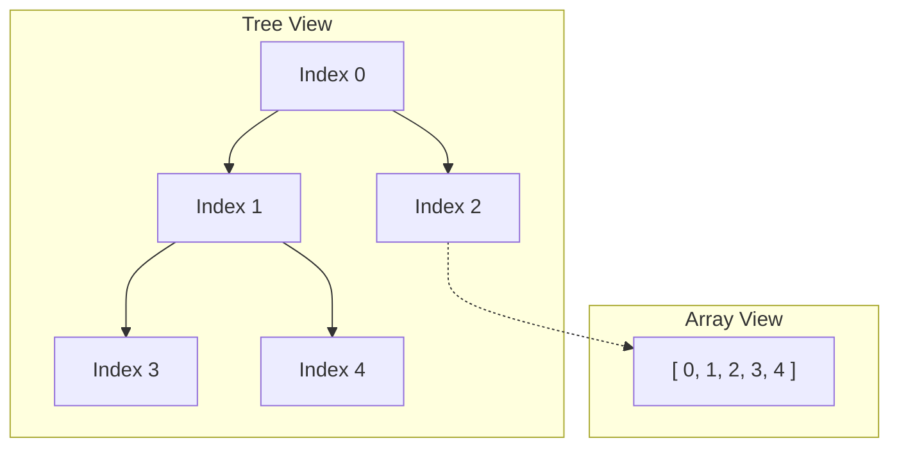
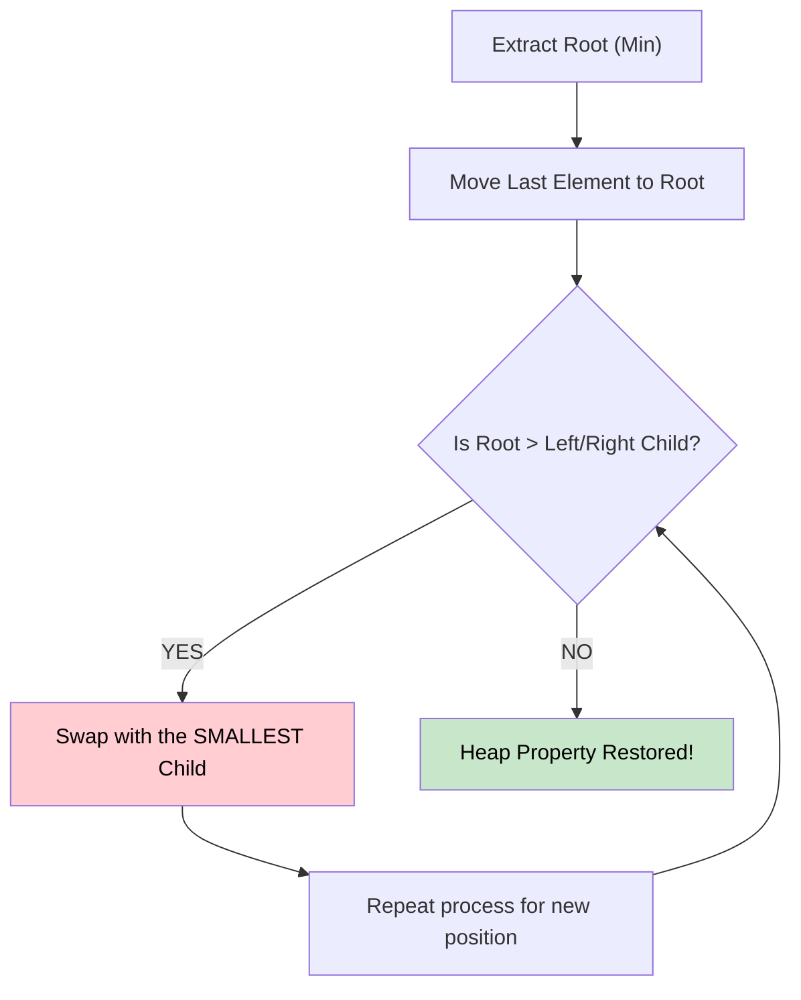

# 🚶‍♂️ Walkthrough: Min and Max Heap Implementation

## 👶 Explain Like I'm 5
A **Heap** is a special tree that is completely filled level by level. Because there are no gaps, we don't actually need to use `Left` or `Right` pointers like a Binary Search Tree! We can just put all the elements into a single, flat list (array).
- If you are at index `i`, your left child is at `2 * i + 1`, and your right child is at `2 * i + 2`.
- In a **Min Heap**, the parent is ALWAYS smaller than its children. The absolute smallest number in the entire tree is guaranteed to be sitting at the very top (index 0).
- When a new number joins, it goes to the end of the list, and then we "bubble it up" (`sift_up`) by swapping it with its parent until it's larger than its parent.
- When we remove the top number, we take the guy at the very end of the list, put him at the top, and "bubble him down" (`sift_down`) by swapping him with his smallest child until things are right again.

## 🎯 Core Strategy
1. **The Array Representation**: No `Node` objects. Just a standard Python `list`.
2. **Dynamic Comparison (`_compare`)**: By passing an `is_min_heap` boolean and an optional `key` function, our single `Heap` class can magically behave as a Min Heap, a Max Heap, or even prioritize objects based on specific attributes!
3. **`_sift_up(index)`**: Used during `push`. Compares node at `index` with `(index - 1) // 2`. Swaps if the node is "more extreme" than its parent.
4. **`_sift_down(index)`**: Used during `pop`. Compares node at `index` with `2 * i + 1` and `2 * i + 2`. Finds the "most extreme" of the three. If the node itself is not the most extreme, it swaps with the child that is, and recurses down.

## 🏃‍♂️ Step-by-Step Execution (Dry Run)
**Operations on MinHeap**: `push(10)`, `push(4)`, `push(15)`, `pop()`

1. **`push(10)`**: List is `[10]`.
2. **`push(4)`**: List is `[10, 4]`.
   - `sift_up(1)`: Parent is `(1-1)//2 = 0`. Compare 4 and 10. `4 < 10`, so swap!
   - List is `[4, 10]`.
3. **`push(15)`**: List is `[4, 10, 15]`.
   - `sift_up(2)`: Parent is 0. Compare 15 and 4. `15 > 4`, do nothing.
4. **`pop()`**:
   - Save the top element: `4`.
   - Move the last element `15` to the top, and pop the end: `[15, 10]`.
   - `sift_down(0)`: Left child is 1 (value 10). Right child is 2 (doesn't exist).
   - Compare 15 and 10. `10 < 15`, so swap!
   - List is `[10, 15]`.
   - Return `4`.

## 📊 Visual Diagram

### Array vs Tree Representation (Math Magic)

### Sift Down Process (Pop)

## 🛑 Complexity
- **Time:**
  - `push()`: $O(\log N)$ to sift up.
  - `pop()`: $O(\log N)$ to sift down.
  - `peek()`: $O(1)$.
- **Space:** $O(N)$ for the underlying array storing the elements.
