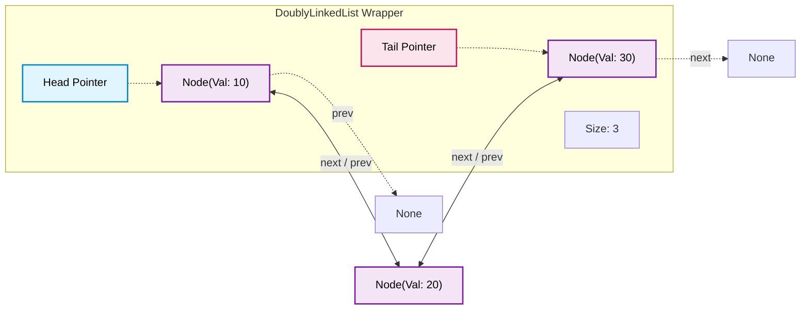
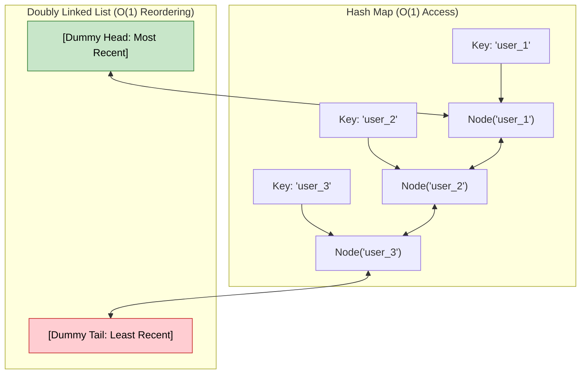

# 🚶‍♂️ Walkthrough: Doubly Linked List Implementation

> **Level**: Fundamentals 101 to Staff Architect & Research  
> **Prerequisites**: [001 - Array and String](file:///Users/aparv/Library/CloudStorage/OneDrive-Personal/G-Drive/Interviews/knowledge/DSA/00%20-%20Fundamentals/001%20-%20Array%20and%20String/array_and_string_walkthrough.md), [006 - Linked List](file:///Users/aparv/Library/CloudStorage/OneDrive-Personal/G-Drive/Interviews/knowledge/DSA/00%20-%20Fundamentals/006%20-%20Linked%20List/linked_list_walkthrough.md)  
> **Source Code**: [doubly_linked_list.py](file:///Users/aparv/Library/CloudStorage/OneDrive-Personal/G-Drive/Interviews/knowledge/DSA/00%20-%20Fundamentals/007%20-%20Doubly%20Linked%20List/doubly_linked_list.py)

---

## 🧭 Executive Curriculum Roadmap

```
Level 100: The Napkin Sketch ──────► 30s physical analogy: The Two-Way Train & Handshake Chain
Level 200: Street Fundamentals ────► FAANG cheat card, Sentinel trick, Decision matrix & LRU triage
Level 300: Working Professional ───► Sentinel-bounded DLL, O(1) removal, bidirectional traversal
Level 400: Staff & Senior Arch ────► Cache line penalty, Linux intrusive list_head, LRU composition
Level 500: Researcher's Corner ────► XOR Linked List (A ^ B compression), formal invariant proofs
```

---

## 🐣 Level 100: The Napkin Sketch

### The Two-Way Train Analogy
In a Singly Linked List, train cars are linked with one-way magnetic couplers: car $A$ pulls car $B$, but car $B$ has no connection backwards to car $A$. If you stand inside car $B$ and need to detach it, you cannot reach the coupler behind you! You must walk all the way from the engine ($Head$) to car $A$ just to unhook car $B$.

A **Doubly Linked List (DLL)** equips every train car with **two sturdy handshakes**:
- **Right Hand (`next`)**: Clamps onto the car in front of you.
- **Left Hand (`prev`)**: Clamps onto the car behind you.

```
       ┌───────┐            ┌───────┐            ┌───────┐
None ◄─┤ Prev  │    ┌──────►│ Prev  │    ┌──────►│ Prev  │
       │ Node1 │    │       │ Node2 │    │       │ Node3 │─► None
       │ Next  ├────┘◄──────┤ Next  ├────┘◄──────┤ Next  │
       └───────┘            └───────┘            └───────┘
```

### The Core Dilemma: Why Pay 2x for Pointers?
In a Singly Linked List, deleting a node requires finding its **predecessor**, which takes $O(N)$ time unless already given. In a Doubly Linked List, because every node already holds a direct reference to its predecessor (`node.prev`), **arbitrary deletion given a node pointer takes absolute $O(1)$ time**:

$$\text{node.prev.next} = \text{node.next}$$
$$\text{node.next.prev} = \text{node.prev}$$

Two pointer updates, zero searching, done.

### Visual Architecture



---

## ⚡ Level 200: Street Fundamentals (The Interview Cheat Card)

### Mental Model Card
```
[Sentinel Head] <=====> [Node 1] <=====> [Node 2] <=====> [Node 3] <=====> [Sentinel Tail]
  (dummy head)                                                               (dummy tail)
```
> **Pro Tip (The Sentinel Trick)**: Always place permanent dummy sentinel nodes at both ends (`head` and `tail`). You will never write an `if node.prev is None:` or `if node.next is None:` check during an interview again!

### Operations & Complexity Matrix

| Operation | Time (Best) | Time (Average) | Time (Worst) | Space (Aux) | Interview Caveat |
| :--- | :--- | :--- | :--- | :--- | :--- |
| **`prepend(val)`** | $O(1)$ | $O(1)$ | $O(1)$ | $O(1)$ | Update 4 pointer links (or 2 with sentinels). |
| **`append(val)`** | $O(1)$ | $O(1)$ | $O(1)$ | $O(1)$ | Requires maintaining an explicit `tail` pointer. |
| **`head()` / `tail()`** | $O(1)$ | $O(1)$ | $O(1)$ | $O(1)$ | Instant lookup via wrapper references. |
| **`insert_at(idx)`** | $O(1)$ | $O(N/2)$ | $O(N)$ | $O(1)$ | Bi-directional traversal optimization (from head or tail). |
| **`search(val)`** | $O(1)$ | $O(N)$ | $O(N)$ | $O(1)$ | Must traverse linearly; no random access. |
| **`delete_node(node)`** | $O(1)$ | $O(1)$ | $O(1)$ | $O(1)$ | **The killer feature**: $O(1)$ arbitrary removal given node pointer. |
| **`reverse()`** | $O(N)$ | $O(N)$ | $O(N)$ | $O(1)$ | Swap `prev` and `next` pointers for every node. |

---

### Decision Matrix: When to Pick Which List

```
                          ┌────────────────────────┐
                          │   Need O(1) Indexing?  │
                          └───────────┬────────────┘
                                      │
                         YES ─────────┴───────── NO
                          │                       │
                 ┌────────────────┐     ┌──────────────────┐
                 │ Dynamic Array  │     │ Need Bidirect /  │
                 │   or Vector    │     │ O(1) Node Remove?│
                 └────────────────┘     └─────────┬────────┘
                                                  │
                                     YES ─────────┴───────── NO
                                      │                       │
                             ┌────────────────┐     ┌──────────────────┐
                             │ Doubly Linked  │     │ Singly Linked    │
                             │ (e.g. LRU, Q)  │     │ List (low memory)│
                             └────────────────┘     └──────────────────┘
```

| Data Structure | Random Access | Memory Overhead per Node | $O(1)$ Deletion with Node Ref | Bi-directional Traversal |
| :--- | :--- | :--- | :--- | :--- |
| **Dynamic Array** | $O(1)$ | None (contiguous payload) | $O(N)$ (requires shifting) | Yes (index-based) |
| **Singly Linked List** | $O(N)$ | 1 Pointer (`next`) | $O(N)$ (must find predecessor) | No |
| **Doubly Linked List** | $O(N)$ | 2 Pointers (`next` + `prev`) | **$O(1)$** (instant unlink) | **Yes** |
| **Python `deque`** | $O(1)$ ends | Block-allocated buffers | $O(N)$ arbitrary | Yes |

---

### FAANG Pattern Recognition & Triage Rules
1. **LRU Cache (LeetCode 146)**: Hash Map + Doubly Linked List. The hash map maps `key -> Node`, and the DLL maintains access ordering. When a node is touched, unlinking it and moving it to the head takes $O(1)$ time because of `node.prev` and `node.next`.
2. **LFU Cache (LeetCode 460)**: Hash Map of Frequencies to Doubly Linked Lists.
3. **Browser History (LeetCode 1472)**: Stepping forward and backward across visited URLs with clear invalidation of forward history upon new navigation.
4. **Music / Video Playlist Player**: Seamlessly hopping between `next_track()` and `prev_track()`.

---

### Common Interview Trapdoors
- ❌ **The Orphan Pointer Bug**: Forgetting to update both directions: you do `curr.prev.next = curr.next`, but forget `curr.next.prev = curr.prev`. The backward link is now pointing to a zombie node!
- ❌ **Null Dereference at Boundary**: Attempting `node.prev.next` when `node.prev` is `None` (deleting the head). Solution: either explicitly update `self.head`, or use Sentinel Dummy Nodes.
- ❌ **Memory Leaks in GC Environments**: In languages with reference counting without cyclic GC (e.g. classic C++ `std::shared_ptr`), circular `next`/`prev` references can prevent deallocation. In Python, cyclic GC resolves this, but explicitly clearing `prev` and `next` upon node removal is good engineering hygiene.

---

## 🛠️ Level 300: Working Professional (Clean Architecture & Code)

### Sentinel-Bounded Doubly Linked List Implementation
Below is the standard enterprise-grade pattern for interview code: using **dummy head and dummy tail** to achieve zero-branching pointer manipulation.

```python
"""
Enterprise-Grade Doubly Linked List with Sentinel Boundaries
Python 3.14 Compatible
"""
from typing import Optional, Generic, TypeVar, Iterator

T = TypeVar("T")

class DLLNode(Generic[T]):
    __slots__ = ("val", "prev", "next")

    def __init__(
        self,
        val: Optional[T] = None,
        prev: Optional["DLLNode[T]"] = None,
        next_node: Optional["DLLNode[T]"] = None,
    ) -> None:
        self.val: Optional[T] = val
        self.prev: Optional["DLLNode[T]"] = prev
        self.next: Optional["DLLNode[T]"] = next_node

    def __repr__(self) -> str:
        return f"DLLNode({self.val})"


class DoublyLinkedList(Generic[T]):
    """
    Doubly Linked List bounded by sentinel dummy nodes.
    Guarantees that self.head and self.tail are never null.
    """
    __slots__ = ("head", "tail", "_size")

    def __init__(self) -> None:
        # Sentinel dummy nodes
        self.head: DLLNode[T] = DLLNode()
        self.tail: DLLNode[T] = DLLNode()
        self.head.next = self.tail
        self.tail.prev = self.head
        self._size: int = 0

    def __len__(self) -> int:
        return self._size

    def is_empty__(self) -> bool:
        return self._size == 0

    def append(self, val: T) -> DLLNode[T]:
        """Appends value to the tail of the list in O(1) time."""
        return self._insert_between(val, self.tail.prev, self.tail)

    def prepend(self, val: T) -> DLLNode[T]:
        """Prepends value to the head of the list in O(1) time."""
        return self._insert_between(val, self.head, self.head.next)

    def _insert_between(
        self, val: T, predecessor: DLLNode[T], successor: DLLNode[T]
    ) -> DLLNode[T]:
        """Internal helper: Inserts a new node between two existing adjacent nodes in O(1)."""
        new_node = DLLNode(val=val, prev=predecessor, next_node=successor)
        predecessor.next = new_node
        successor.prev = new_node
        self._size += 1
        return new_node

    def remove_node(self, node: DLLNode[T]) -> T:
        """
        Unlinks a given node in O(1) time.
        Does not require finding the predecessor!
        """
        if node is self.head or node is self.tail:
            raise ValueError("Cannot remove sentinel nodes.")
        
        predecessor = node.prev
        successor = node.next
        
        predecessor.next = successor
        successor.prev = predecessor
        
        # Disconnect node completely for clean garbage collection
        val = node.val
        node.prev = None
        node.next = None
        self._size -= 1
        return val

    def get_at(self, index: int) -> T:
        """
        Retrieves element at index with O(N/2) bidirectional search.
        Chooses head or tail based on proximity to index.
        """
        if not 0 <= index < self._size:
            raise IndexError("Index out of bounds")

        # Bidirectional optimization: walk from closest end
        if index < self._size // 2:
            curr = self.head.next
            for _ in range(index):
                curr = curr.next
        else:
            curr = self.tail.prev
            for _ in range(self._size - 1 - index):
                curr = curr.prev
        return curr.val

    def __iter__(self) -> Iterator[T]:
        curr = self.head.next
        while curr is not self.tail:
            yield curr.val
            curr = curr.next

    def __reversed__(self) -> Iterator[T]:
        curr = self.tail.prev
        while curr is not self.head:
            yield curr.val
            curr = curr.prev
```

---

### Step-by-Step Execution: Reverse in Place

Reversing a doubly linked list is cleaner than reversing a singly linked list because every node has symmetric links. All we do is visit every node and **swap its `prev` and `next` pointers**.

```
Initial:   [Head] ⇄ [10] ⇄ [20] ⇄ [30] ⇄ [Tail]

Step 1 (Node 10):
  temp = 10.next (20)
  10.next = 10.prev (Head)
  10.prev = temp (20)

Step 2 (Node 20):
  temp = 20.next (30)
  20.next = 20.prev (10)
  20.prev = temp (30)

Step 3 (Node 30):
  temp = 30.next (Tail)
  30.next = 30.prev (20)
  30.prev = temp (Tail)

Final Step:
  Swap wrapper references Head ⇄ Tail.
Result:    [Head] ⇄ [30] ⇄ [20] ⇄ [10] ⇄ [Tail]  (reversed!)
```

```python
def reverse(self) -> None:
    """In-place pointer reversal in O(N) time and O(1) space."""
    curr = self.head
    while curr is not None:
        # Swap prev and next
        curr.prev, curr.next = curr.next, curr.prev
        # Move forward using the swapped pointer (which was originally .prev)
        curr = curr.prev
    
    # Finally swap head and tail sentinels
    self.head, self.tail = self.tail, self.head
```

---

## 🏛️ Level 400: Staff & Senior Engineer (Systems Architecture)

### 1. The Hardware Reality: Cache Penalty & Spatial Locality
In modern CPUs, accessing L1 cache takes $\approx 1\,\text{ns}$ (4 clock cycles), while fetching from main DRAM takes $\approx 60\text{--}100\,\text{ns}$.
- A contiguous array of integers fits 16 elements per 64-byte L1 cache line ($16 \times 4\text{ bytes} = 64\text{ bytes}$). Traversing an array causes 1 cache miss every 16 elements.
- A Doubly Linked List node in 64-bit Python occupies **48 bytes** minimum:
  - 8-byte pointer to value
  - 8-byte pointer to next
  - 8-byte pointer to prev
  - 16-byte Python object header (`ob_refcnt`, `ob_type`)
- Because nodes are dynamically allocated via `malloc()` across the heap, each pointer dereference (`curr = curr.next`) triggers a **random memory jump**. In worst cases, DLL traversal incurs a cache miss **on almost every single node**.

```
Memory Layout Comparison (64-byte Cache Line):

Array:
[Elem 0 | Elem 1 | Elem 2 | Elem 3 | Elem 4 | Elem 5 | ... ] -> 1 cache line fetch loads 16 elements!

Doubly Linked List:
Heap Addr 0x100: [Node 1] ───(pointer jump)───► Heap Addr 0x940: [Node 2]
(Cache Miss!)                                    (Cache Miss!)
```

> **Senior Takeaway**: Never use a linked list for bulk numerical processing or high-throughput linear iteration. Use a linked list *only* when the workload requires topological rearrangement or instant $O(1)$ arbitrary deletions without index invalidation.

---

### 2. The Linux Kernel `list_head`: Intrusive Linked Lists
In standard computer science textbooks, nodes contain data:
```c
struct Node {
    void* data;
    struct Node* next;
    struct Node* prev;
};
```
The Linux kernel inverted this model by inventing the **Intrusive Doubly Linked List** (`include/linux/list.h`):

```c
struct list_head {
    struct list_head *next, *prev;
};

// Any struct can be linked into multiple lists simultaneously!
struct task_struct {
    pid_t pid;
    char comm[16];
    struct list_head run_list;     // Links into the scheduler run queue
    struct list_head tasks;        // Links into the global task list
};
```
To retrieve the parent struct from a `list_head*`, Linux uses the famous `container_of` macro based on `offsetof`:
$$\text{container\_of}(ptr, type, member) = (type*)((char*)ptr - \text{offsetof}(type, member))$$

**Why Staff Engineers Care**:
- Intrusive lists require **zero heap allocations** when inserting an object into a list.
- An object can simultaneously exist in 5 different lists (e.g. priority queue, timeout list, global list) with zero wrapper overhead.

---

### 3. Production Architecture: The LRU Cache Decomposition
In production distributed caches (Memcached, Redis) and in-memory caches, Doubly Linked Lists are paired with Hash Tables to implement Least Recently Used (LRU) eviction:



- When `get(key)` is called: Look up node in map ($O(1)$) $\to$ `unlink(node)` ($O(1)$) $\to$ `prepend(node)` ($O(1)$).
- When cache is full: `evict()` unlinks `tail.prev` in $O(1)$ $\to$ removes key from hash map in $O(1)$.

---

## 🔬 Level 500: Researcher's Corner

<details>
<summary><strong>1. Memory Compression: The XOR Linked List (Theoretical Doubly Linked List in 1 Pointer)</strong></summary>

Can we build a bidirectional list using only **one pointer per node**? Yes, using the Bitwise XOR involution property:
$$X \oplus X = 0, \quad X \oplus 0 = X, \quad (A \oplus B) \oplus A = B$$

Instead of storing `next` and `prev`, each node stores:
$$\text{node.npx} = \text{address}(\text{prev}) \oplus \text{address}(\text{next})$$

#### Forward Traversal:
When standing at `curr` with predecessor `prev`:
$$\text{address}(\text{next}) = \text{node.npx} \oplus \text{address}(\text{prev})$$
Because $(\text{prev} \oplus \text{next}) \oplus \text{prev} = \text{next}$.

#### Backward Traversal:
When standing at `curr` with successor `next`:
$$\text{address}(\text{prev}) = \text{node.npx} \oplus \text{address}(\text{next})$$

#### Trade-offs:
- **Pros**: Halves the pointer memory footprint (1 pointer field instead of 2).
- **Cons**: Cannot traverse starting from an arbitrary interior node without knowing its neighbor! Highly incompatible with generational garbage collectors (which trace real object references, not XOR-masqueraded integers).
</details>

<details>
<summary><strong>2. Invariant Proof: Sentinel Guarantees</strong></summary>

Let $L$ be a Doubly Linked List with Sentinels $H$ (head) and $T$ (tail).
The structural invariants are:
1. $H.\text{prev} = \text{NULL}$
2. $T.\text{next} = \text{NULL}$
3. $\forall u \in L \setminus \{H, T\}: u.\text{next}.\text{prev} = u \land u.\text{prev}.\text{next} = u$
4. $L.\text{size} = 0 \iff H.\text{next} = T \land T.\text{prev} = H$

**Proof of No Boundary Null Checks**:
Under these invariants, any operation inserting between nodes $A$ and $B$ (where $A.\text{next} = B$) operates strictly on non-null references because:
- $H$ always has a non-null `.next` (at minimum $T$).
- $T$ always has a non-null `.prev` (at minimum $H$).
Therefore, boundary edge cases are mathematically eliminated.
</details>

---

## 🔗 Cross-Pillar Linkage & Navigation
- **Previous**: [006 - Linked List (Singly Linked List)](file:///Users/aparv/Library/CloudStorage/OneDrive-Personal/G-Drive/Interviews/knowledge/DSA/00%20-%20Fundamentals/006%20-%20Linked%20List/linked_list_walkthrough.md)
- **Next**: [008 - Circular Linked List](file:///Users/aparv/Library/CloudStorage/OneDrive-Personal/G-Drive/Interviews/knowledge/DSA/00%20-%20Fundamentals/008%20-%20Circular%20Linked%20List/circular_linked_list_walkthrough.md)
- **Theory Grounding**: [000 - Theoretical Foundations/001 - Algorithmic Complexity Foundations](file:///Users/aparv/Library/CloudStorage/OneDrive-Personal/G-Drive/Interviews/knowledge/DSA/00%20-%20Fundamentals/000%20-%20Theoretical%20Foundations/001%20-%20Algorithmic%20Complexity%20Foundations/algorithmic_complexity_walkthrough.md)
- **Pattern Application**: [017 - The Pattern Cracker/005 - In-Place Reversal of a LinkedList](file:///Users/aparv/Library/CloudStorage/OneDrive-Personal/G-Drive/Interviews/knowledge/DSA/00%20-%20Fundamentals/017%20-%20The%20Pattern%20Cracker/005%20-%20In-Place%20Reversal%20of%20a%20LinkedList/005_in_place_reversal_of_a_linkedlist.md)
