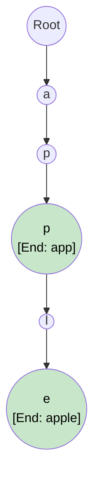

# 🚶‍♂️ Walkthrough: Trie (Prefix Tree) Implementation

## 👶 Explain Like I'm 5
A **Trie** is a tree built out of letters. 
If you want to store the words "CAT", "CAR", and "CART", you don't store them in three separate boxes. 
You make a single path for "C" -> "A". 
Then, the tree splits! One path goes to "T" (for CAT), and another path goes to "R" (for CAR). From "R", the path can continue to "T" (for CART).
This is exactly how your phone's autocomplete works. When you type "CA", it looks at the Trie, goes down the "C" -> "A" path, and sees that "T" and "R" are valid next choices!

## 🎯 Core Strategy
1. **The Dictionary Node**: Unlike a Binary Tree which has `.left` and `.right`, a TrieNode has a `.children` dictionary mapping a string character to the next `TrieNode`. This allows a node to easily have up to 26 (or more) children!
2. **`is_end_of_word` Flag**: Because "CAR" and "CART" share a path, when we stop at the "R" node for "CAR", we must flip a boolean flag `is_end_of_word = True`. This tells us that "CAR" is a complete word in our dictionary, not just a prefix for "CART".
3. **Traversal**: Both `insert`, `search`, and `starts_with` use the exact same looping logic: 
   - Look at the character.
   - If it's in the `children` dictionary, step into that child node.
   - If not, either create it (for insert) or return False (for search).

## 🏃‍♂️ Step-by-Step Execution (Dry Run)
**Operations**: `insert("app")`, `insert("apple")`, `search("app")`

1. **`insert("app")`**:
   - `root`: Create 'a' -> Node('a')
   - Node('a'): Create 'p' -> Node('p1')
   - Node('p1'): Create 'p' -> Node('p2')
   - Node('p2'): Set `is_end_of_word = True`.
2. **`insert("apple")`**:
   - `root`: 'a' exists! Step into Node('a').
   - Node('a'): 'p' exists! Step into Node('p1').
   - Node('p1'): 'p' exists! Step into Node('p2').
   - Node('p2'): Create 'l' -> Node('l')
   - Node('l'): Create 'e' -> Node('e')
   - Node('e'): Set `is_end_of_word = True`.
3. **`search("app")`**:
   - 'a' exists. Step down.
   - 'p' exists. Step down.
   - 'p' exists. Step down to Node('p2').
   - Loop finishes. Node('p2').is_end_of_word == True! Return True. ✅

## 📊 Visual Diagram

## 🛑 Complexity
- **Time:**
  - `insert(word)`: $O(L)$ where $L$ is the length of the word.
  - `search(word)`: $O(L)$.
  - `starts_with(prefix)`: $O(L)$.
- **Space:** 
  - $O(N \times L)$ in the absolute worst case if every single word shares zero letters with any other word. However, because of shared prefixes, the actual memory used is significantly compressed!
