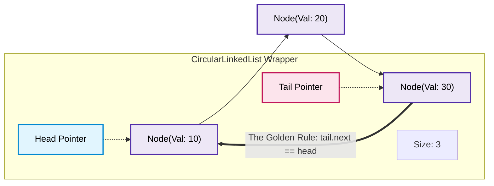

# 🚶‍♂️ Walkthrough: Circular Linked List Implementation

> **Level**: Fundamentals 101 to Staff Architect & Research  
> **Prerequisites**: [001 - Array and String](file:///Users/aparv/Library/CloudStorage/OneDrive-Personal/G-Drive/Interviews/knowledge/DSA/00%20-%20Fundamentals/001%20-%20Array%20and%20String/array_and_string_walkthrough.md), [006 - Linked List](file:///Users/aparv/Library/CloudStorage/OneDrive-Personal/G-Drive/Interviews/knowledge/DSA/00%20-%20Fundamentals/006%20-%20Linked%20List/linked_list_walkthrough.md)  
> **Source Code**: [circular_linked_list.py](file:///Users/aparv/Library/CloudStorage/OneDrive-Personal/G-Drive/Interviews/knowledge/DSA/00%20-%20Fundamentals/008%20-%20Circular%20Linked%20List/circular_linked_list.py)

---

## 🧭 Executive Curriculum Roadmap

```
Level 100: The Napkin Sketch ──────► 30s physical analogy: The Merry-Go-Round & Ring Dance
Level 200: Street Fundamentals ────► Cheat card, O(1) rotation superpower, Josephus & Round-Robin
Level 300: Working Professional ───► The Tail-Only pointer trick, infinite loop prevention, clean code
Level 400: Staff & Senior Arch ────► Lock-free ring buffers (LMAX Disruptor), OS CPU scheduling
Level 500: Researcher's Corner ────► The Josephus Recurrence J(n, k) proof & dynamic programming
```

---

## 🐣 Level 100: The Napkin Sketch

### The Merry-Go-Round Analogy
A standard Linked List is like a one-way footpath through the forest: you walk until the path ends at a dead end (`None`).

A **Circular Linked List (CLL)** is a **Merry-Go-Round**:
- There is **no dead end**.
- The very last seat on the carousel is chained directly back into the very first seat!
- If you walk forward continuously, you will pass each seat over and over in an infinite cycle.

```
                  ┌──────────────────────────────────┐
                  │                                  ▼
             ┌─────────┐      ┌─────────┐      ┌─────────┐
             │ Node 1  ├─────►│ Node 2  ├─────►│ Node 3  │
             └─────────┘      └─────────┘      └────┬────┘
                  ▲                                 │
                  └─────────────────────────────────┘
```

### The Core Dilemma: Why Build a Ring?
Many real-world computer systems are **periodic loops**:
- Turn-based board games (Player 1 $\to$ Player 2 $\to$ Player 3 $\to$ Player 1).
- Time-sharing CPU schedulers allocating 10ms slices to each active process.
- Audio playback looping a continuous sample.

In a normal list, looping requires checking for the end, resetting the pointer back to the head, and handling empty-list boundaries. In a Circular Linked List, **cycling is structurally automatic**. Furthermore, rotating the list (shifting who is "first") is an instantaneous **$O(1)$ pointer reassignment**.

### Visual Architecture



---

## ⚡ Level 200: Street Fundamentals (The Interview Cheat Card)

### Mental Model Card
```
            +------------------------------------+
            |                                    |
            v                                    |
Head ---> [ 10 ] ---> [ 20 ] ---> [ 30 ] <--- Tail
```
> **The Golden Invariant**: For any non-empty Circular Linked List, `self.tail.next` **MUST** point to `self.head`. In a single-node list, `self.head.next == self.head`.

### Operations & Complexity Matrix

| Operation | Time (Best) | Time (Average) | Time (Worst) | Space (Aux) | Interview Caveat |
| :--- | :--- | :--- | :--- | :--- | :--- |
| **`rotate()`** | **$O(1)$** | **$O(1)$** | **$O(1)$** | $O(1)$ | **Superpower**: `head = head.next; tail = tail.next`. Zero node movement! |
| **`append(val)`** | $O(1)$ | $O(1)$ | $O(1)$ | $O(1)$ | Insert after `tail`, update `tail = new_node`, preserve `tail.next = head`. |
| **`prepend(val)`** | $O(1)$ | $O(1)$ | $O(1)$ | $O(1)$ | Insert before `head`, update `head = new_node`, update `tail.next = head`. |
| **`head()` / `tail()`** | $O(1)$ | $O(1)$ | $O(1)$ | $O(1)$ | Direct pointer access. |
| **`search(val)`** | $O(1)$ | $O(N)$ | $O(N)$ | $O(1)$ | Must use a sentinel stop condition (`curr == head` on 2nd visit). |
| **`delete(val)`** | $O(1)$ | $O(N)$ | $O(N)$ | $O(1)$ | Must maintain predecessor link to splice around the target node. |

---

### Decision Matrix: Circular Linked List vs Alternatives

| Requirement | Circular Linked List | Circular Array (Ring Buffer) | Standard Singly Linked List |
| :--- | :--- | :--- | :--- |
| **Dynamic Resizing** | Endless $O(1)$ insertions without realloc | Costly $O(N)$ reallocations or fixed capacity | Endless $O(1)$ insertions |
| **Cache Locality** | Poor (scattered heap nodes) | **Exceptional** (contiguous memory block) | Poor |
| **Rotation Speed** | **$O(1)$** pointer bump | $O(1)$ index modulo arithmetic | $O(N)$ to link tail to head |
| **Infinite Streaming** | Yes (natural cyclic loop) | Yes (using index `(head + 1) % cap`) | No (requires explicit wrap-around checks) |
| **Memory Overhead** | 1 pointer per element | **Zero** pointer overhead | 1 pointer per element |

---

### FAANG Pattern Recognition & Triage Rules
1. **Round-Robin Task Scheduling**: Given $N$ tasks, execute each for time quantum $Q$. The currently executing task is at `head`. When its quantum expires, call `rotate()`. If finished, call `delete(curr)`.
2. **The Josephus Elimination Problem**: $N$ people in a circle; every $k$-th person is eliminated until 1 remains. A circular linked list provides an intuitive direct simulation.
3. **Continuous Audio / Texture Loopers**: Media engines streaming infinite repeat tracks without allocating memory on loops.
4. **Ring Buffers with Dynamic Node Payloads**: When individual message payloads have varying sizes and cannot be held in fixed-size contiguous array slots.

---

### Common Interview Trapdoors
- ❌ **The Infinite Loop Disaster**: Writing `while curr:` will run forever because `curr` is never `None`! Always write:
  ```python
  curr = self.head
  while True:
      # process curr
      curr = curr.next
      if curr is self.head:
          break
  ```
- ❌ **Single-Node Deletion Blunder**: When `self._size == 1`, deleting the only node requires setting `self.head = None` and `self.tail = None`. If you run standard two-node unlinking logic, you end up with a self-referencing zombie pointer.
- ❌ **Dangling Tail Next**: When prepending a new head, forgetting to update `self.tail.next = new_head`.

---

## 🛠️ Level 300: Working Professional (Clean Architecture & Code)

### Senior Architectural Trick: The Single "Tail-Only" Pointer
Many engineers maintain both `self.head` and `self.tail`. But observe:
- `self.tail` is the last node.
- `self.tail.next` is **always** the head!

By storing **only `self.tail`**, we halve our wrapper reference overhead while retaining $O(1)$ access to **both** the head and the tail:

```
Tail-Only Reference:
self.tail ──────► [ Node 3 (Tail) ]
                       │
                       ▼ (tail.next)
                  [ Node 1 (Head) ] ───► [ Node 2 ] ───► [ Node 3 ]
```

### Complete Enterprise Implementation

```python
"""
Enterprise Circular Linked List Implementation
Python 3.14 Compatible
"""
from typing import Optional, Generic, TypeVar, Iterator

T = TypeVar("T")

class Node(Generic[T]):
    __slots__ = ("val", "next")

    def __init__(self, val: T, next_node: Optional["Node[T]"] = None) -> None:
        self.val: T = val
        self.next: Optional["Node[T]"] = next_node

    def __repr__(self) -> str:
        return f"Node({self.val})"


class CircularLinkedList(Generic[T]):
    """
    Circular Linked List maintaining explicit head and tail pointers
    with O(1) rotation and safe cyclic iteration.
    """
    __slots__ = ("_head", "_tail", "_size")

    def __init__(self) -> None:
        self._head: Optional[Node[T]] = None
        self._tail: Optional[Node[T]] = None
        self._size: int = 0

    def __len__(self) -> int:
        return self._size

    def is_empty(self) -> bool:
        return self._size == 0

    def append(self, val: T) -> None:
        """Appends value to the tail and maintains circular link in O(1)."""
        new_node = Node(val)
        if self._head is None:
            self._head = new_node
            self._tail = new_node
            new_node.next = new_node  # Points to itself
        else:
            assert self._tail is not None
            new_node.next = self._head
            self._tail.next = new_node
            self._tail = new_node
        self._size += 1

    def prepend(self, val: T) -> None:
        """Prepends value to the head in O(1)."""
        new_node = Node(val)
        if self._head is None:
            self._head = new_node
            self._tail = new_node
            new_node.next = new_node
        else:
            assert self._tail is not None
            new_node.next = self._head
            self._head = new_node
            self._tail.next = self._head  # Update tail's loop-back
        self._size += 1

    def rotate(self) -> None:
        """
        Rotates the list forward by 1 step in O(1) time.
        The current head becomes the tail; head.next becomes the new head.
        """
        if self._size <= 1:
            return
        assert self._head is not None and self._tail is not None
        self._tail = self._head
        self._head = self._head.next

    def delete(self, val: T) -> bool:
        """Removes the first occurrence of val. Returns True if found."""
        if self._head is None:
            return False

        curr = self._head
        prev = self._tail

        while True:
            if curr.val == val:
                # Case 1: Only 1 node in list
                if self._size == 1:
                    self._head = None
                    self._tail = None
                else:
                    assert prev is not None and self._tail is not None
                    prev.next = curr.next
                    if curr is self._head:
                        self._head = curr.next
                    if curr is self._tail:
                        self._tail = prev
                self._size -= 1
                return True

            prev = curr
            curr = curr.next
            if curr is self._head:
                break

        return False

    def __iter__(self) -> Iterator[T]:
        """Safe single-pass iteration across all elements without looping infinitely."""
        if self._head is None:
            return
        curr = self._head
        while True:
            yield curr.val
            curr = curr.next
            if curr is self._head:
                break
```

---

### Step-by-Step Dry Run: The $O(1)$ Rotation Superpower

Let our list be `[10 -> 20 -> 30 -> (back to 10)]`.
- Current state: `Head = 10`, `Tail = 30`.

```
Initial State:
Head ──► [ 10 ] ──► [ 20 ] ──► [ 30 ] ◄── Tail
  ▲                              │
  └──────────────────────────────┘

Execute: rotate()
Step 1: self._tail = self._head       (Tail moves from 30 to 10)
Step 2: self._head = self._head.next  (Head moves from 10 to 20)

Resulting State:
Head ──► [ 20 ] ──► [ 30 ] ──► [ 10 ] ◄── Tail
  ▲                              │
  └──────────────────────────────┘
```
**Cost**: Exactly 2 pointer assignments. No nodes were moved, created, or deleted. Complexity is strictly $O(1)$.

---

## 🏛️ Level 400: Staff & Senior Engineer (Systems Architecture)

### 1. Operating System Process Scheduling: The Round-Robin Queue
In operating system kernels, CPU time is sliced into discrete quanta (e.g., $10\,\text{ms}$). A circular linked list represents the **Run Queue**:

```
           [ Process 1 ] ──► [ Process 2 ] ──► [ Process 3 ]
                 ▲                                   │
                 └───────────────────────────────────┘
```
When CPU timer interrupts occur:
1. Save register context of `head` (Process 1).
2. If Process 1 still needs CPU time, execute `rotate()` $\to$ Process 2 is now `head`.
3. If Process 1 completed its job, unlink `head` in $O(1)$ and assign CPU to the new `head`.

---

### 2. High-Throughput Systems: Lock-Free Ring Buffers vs Circular Linked Lists
In production trading engines and high-throughput messaging architectures (e.g., the **LMAX Disruptor**), engineers frequently compare **Circular Linked Lists** against **Contiguous Ring Buffers**:

```
LMAX Disruptor Ring Buffer (Contiguous Power-of-2 Array):
Index:     [ 0 | 1 | 2 | 3 | 4 | 5 | 6 | 7 ]
Sequence:  head_sequence = 1042
Slot:      slot = 1042 & (8 - 1) = 2
```

| Dimension | Circular Linked List | Contiguous Ring Buffer (Disruptor) |
| :--- | :--- | :--- |
| **Memory Allocation** | Dynamic `malloc` per node | Pre-allocated fixed buffer (zero runtime GC) |
| **Cache Miss Rate** | High ($\approx 90\%$ miss on pointer chase) | Near $0\%$ (sequential memory prefetching) |
| **False Sharing** | Nodes scattered across cache lines | Cache line padding (`@Contended` / 64-byte align) |
| **Concurrency** | Requires node pointer locks (CAS on 2 pointers) | Single sequence number CAS (Wait-Free / Lock-Free) |

> **Staff Architect Recommendation**: For enterprise event queues processing $>1,000,000\text{ ops/sec}$, use a **Contiguous Ring Buffer**. Reserve **Circular Linked Lists** for scenarios where capacity must expand dynamically without pre-allocation and where individual items are arbitrary structures.

---

## 🔬 Level 500: Researcher's Corner

<details>
<summary><strong>1. Mathematical Deep Dive: The Josephus Problem $J(n, k)$</strong></summary>

The Josephus Problem models $n$ people numbered $0, 1, \dots, n-1$ standing in a circle. Starting at person $0$, counting proceeds clockwise; every $k$-th person is eliminated. The process repeats until only 1 person remains.

#### Simulation Complexity (Circular Linked List):
Traversing $k$ steps for $n-1$ eliminations takes:
$$T(n, k) = O(n \cdot k) \text{ time}, \quad O(n) \text{ space}$$

#### Closed Recurrence Relation:
After the first person ($k-1 \bmod n$) is eliminated, $n-1$ people remain. Shifting the indices produces the recurrence:
$$J(n, k) = (J(n - 1, k) + k) \bmod n$$
with base case:
$$J(1, k) = 0$$

#### The $O(n)$ Dynamic Programming Solution:
Instead of simulating with node links, compute bottom-up in $O(n)$ time and $O(1)$ space:
```python
def josephus(n: int, k: int) -> int:
    survivor = 0
    for i in range(2, n + 1):
        survivor = (survivor + k) % i
    return survivor
```

#### Special Case $k = 2$ (Powers of 2 Binary Trick):
If $k = 2$, let $n = 2^m + l$ where $0 \le l < 2^m$.
The survivor is simply:
$$J(n, 2) = 2l + 1$$
Bitwise: **Rotate $n$'s binary representation one bit to the left!**
</details>

<details>
<summary><strong>2. Structural Invariant Proof: Cycle Connectedness</strong></summary>

Let $G = (V, E)$ be a directed graph formed by a Circular Linked List of size $n \ge 1$.
1. $\forall u \in V, \text{out\_degree}(u) = 1$.
2. $\forall u \in V, \text{in\_degree}(u) = 1$.
3. The graph is strongly connected: $\forall u, v \in V$, there exists a path $u \rightsquigarrow v$.
4. The diameter of the graph is exactly $n - 1$.
5. Traversing from any node $u$ via $n$ consecutive `.next` operations arrives back at $u$:
   $$\text{next}^{(n)}(u) = u$$
</details>

---

## 🔗 Cross-Pillar Linkage & Navigation
- **Previous**: [007 - Doubly Linked List](file:///Users/aparv/Library/CloudStorage/OneDrive-Personal/G-Drive/Interviews/knowledge/DSA/00%20-%20Fundamentals/007%20-%20Doubly%20Linked%20List/doubly_linked_list_walkthrough.md)
- **Next**: [009 - Binary Search Tree](file:///Users/aparv/Library/CloudStorage/OneDrive-Personal/G-Drive/Interviews/knowledge/DSA/00%20-%20Fundamentals/009%20-%20Binary%20Search%20Tree/bst_walkthrough.md)
- **Theory Grounding**: [000 - Theoretical Foundations/001 - Algorithmic Complexity Foundations](file:///Users/aparv/Library/CloudStorage/OneDrive-Personal/G-Drive/Interviews/knowledge/DSA/00%20-%20Fundamentals/000%20-%20Theoretical%20Foundations/001%20-%20Algorithmic%20Complexity%20Foundations/algorithmic_complexity_walkthrough.md)
- **Pattern Application**: [017 - The Pattern Cracker/003 - Fast and Slow Pointers (Cycle Detection)](file:///Users/aparv/Library/CloudStorage/OneDrive-Personal/G-Drive/Interviews/knowledge/DSA/00%20-%20Fundamentals/017%20-%20The%20Pattern%20Cracker/003%20-%20Fast%20and%20Slow%20Pointers/003_fast_and_slow_pointers.md)
