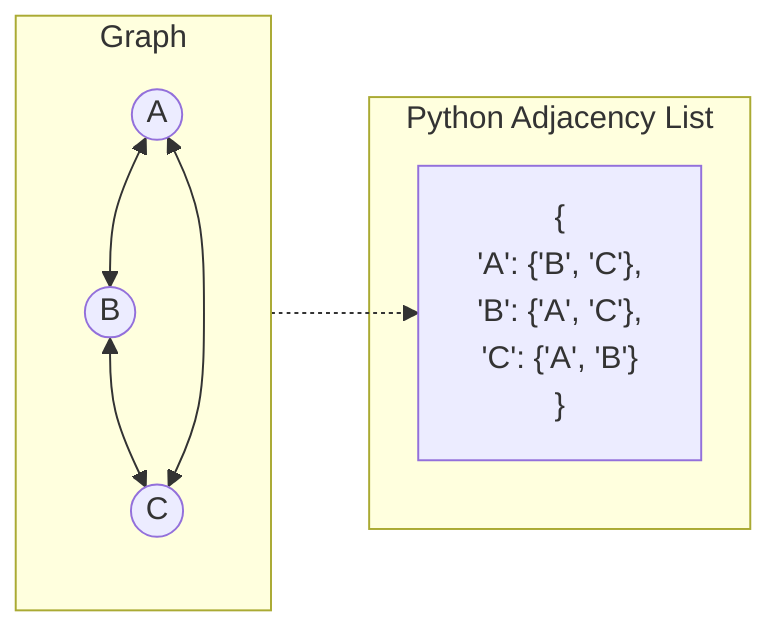

# 🚶‍♂️ Walkthrough: Graph (Adjacency List)

## 👶 Explain Like I'm 5
A Graph is just a bunch of dots (Vertices) connected by lines (Edges). 
Imagine you are making a list of your friends, and next to each friend's name, you write down a list of *their* friends.
- Alice: [Bob, Charlie]
- Bob: [Alice]
- Charlie: [Alice, David]
This is called an **Adjacency List**! It is the smartest way to store a Graph because it only uses space for the friendships that *actually exist*. (Instead of making a giant grid of every human on earth and writing "Not Friends" in 99.9% of the boxes).

## 🎯 Core Strategy
1. **The Dictionary of Sets**: In Python, we represent the Adjacency List as a dictionary mapping the vertex to a `set` of its neighbors: `dict[T, set[T]]`. 
   - Why a `set` instead of a `list`? Because checking if an edge exists (e.g., `if "Bob" in Alice_neighbors`) takes $O(N)$ in a list, but $O(1)$ instant time in a `set`!
2. **Directed vs Undirected**: We use an `_is_directed` boolean flag.
   - If `False` (Undirected), calling `add_edge(A, B)` will add B to A's set, AND A to B's set.
   - If `True` (Directed), it only adds B to A's set.
3. **Removing a Vertex**: This is the most expensive operation. If we delete "Alice", we must delete her row from the dictionary, but we ALSO must go into Bob's and Charlie's sets and erase Alice from there!

## 🏃‍♂️ Step-by-Step Execution (Dry Run)
**Operations on Undirected Graph**: `add_edge(A, B)`, `add_edge(B, C)`, `remove_vertex(C)`

1. **`add_edge("A", "B")`**:
   - Add "A" to dict -> `{"A": set()}`
   - Add "B" to dict -> `{"A": set(), "B": set()}`
   - Add B to A -> `{"A": {"B"}, "B": set()}`
   - Add A to B -> `{"A": {"B"}, "B": {"A"}}`
2. **`add_edge("B", "C")`**:
   - Dict becomes: `{"A": {"B"}, "B": {"A", "C"}, "C": {"B"}}`
3. **`remove_vertex("C")`**:
   - Step 1: Delete "C" from the dictionary keys.
     - Dict: `{"A": {"B"}, "B": {"A", "C"}}`
   - Step 2: Loop through all remaining sets and discard "C".
     - A's set: `{"B"}` -> discard C -> no change.
     - B's set: `{"A", "C"}` -> discard C -> `{"A"}`.
   - Final Dict: `{"A": {"B"}, "B": {"A"}}` ✅

## 📊 Visual Diagram

### Graph vs Adjacency List Mapping

## 🛑 Complexity
- **Time:**
  - `add_vertex()`: $O(1)$
  - `add_edge()`: $O(1)$
  - `remove_edge()`: $O(1)$
  - `get_neighbors()`: $O(1)$
  - `remove_vertex()`: $O(V)$ where $V$ is the number of vertices, because it must scan all sets to remove dangling edge references.
- **Space:** $O(V + E)$ where $V$ is the number of vertices and $E$ is the number of edges. This is significantly more optimal than an Adjacency Matrix which consumes $O(V^2)$ space!
