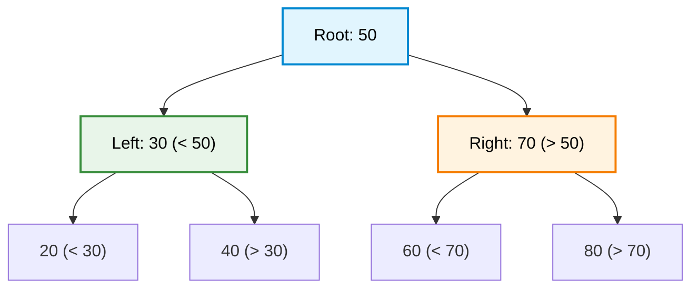
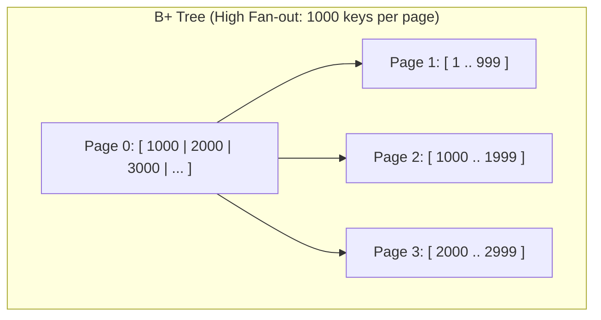

# 🚶‍♂️ Walkthrough: Binary Search Tree (BST)

> **Level**: Fundamentals 101 to Staff Architect & Research  
> **Prerequisites**: [001 - Array and String](../001%20-%20Array%20and%20String/array_and_string_walkthrough.md), [003 - Recursion and the Call Stack](../003%20-%20Recursion%20and%20the%20Call%20Stack/recursion_walkthrough.md), [006 - Linked List](../006%20-%20Linked%20List/linked_list_walkthrough.md)  
> **Source Code**: [bst.py](../009%20-%20Binary%20Search%20Tree/bst.py)

---

## 🧭 Executive Curriculum Roadmap

```
Level 100: The Napkin Sketch ──────► 30s physical analogy: The Guessing Game & Sorting Funnel
Level 200: Street Fundamentals ────► Cheat card, Inorder invariant, 3 Deletion cases, BST vs Hash
Level 300: Working Professional ───► Clean recursive & iterative code, generator traversals
Level 400: Staff & Senior Arch ────► Degeneration, AVL vs Red-Black, B+ Trees in Database Storage
Level 500: Researcher's Corner ────► Inorder Monotonicity proof, Treaps & Randomized Search Trees
```

---

## 🐣 Level 100: The Napkin Sketch

### The Number Guessing Game Analogy
Imagine playing a guessing game: *"I am thinking of a secret number between 1 and 100."*
- Your first guess is **50**.
- The host says: **"Lower!"**

With a single word, you instantly discard numbers 50 through 100! Your search universe is sliced in half. You next guess 25, then 12, homing in on the target in at most $\log_2(100) \approx 7$ questions.

A **Binary Search Tree (BST)** organizes data in computer memory to play this exact guessing game on every query:
- Every node holds a value $X$.
- Every node in the **Left Subtree** has a value strictly $< X$.
- Every node in the **Right Subtree** has a value strictly $> X$.

```
                       [ 50 ]
                      /      \
            (all < 50)        (all > 50)
             [ 30 ]              [ 70 ]
            /      \            /      \
         [ 20 ]   [ 40 ]     [ 60 ]   [ 80 ]
```

### The Core Dilemma: Why Not Just Use an Array or Hash Table?
- **Sorted Array**: Searing $O(\log N)$ search via binary search, but inserting or deleting an element requires shifting $O(N)$ elements.
- **Hash Table**: Blazing $O(1)$ average lookup, but destroys all ordering! Finding `min()`, `max()`, `successor()`, or scanning a range `[A, B]` requires an exhaustive $O(N)$ scan.
- **Binary Search Tree**: The sweet spot. When balanced, it delivers **$O(\log N)$ search, $O(\log N)$ insertion, and $O(\log N)$ deletion**, while preserving strict sorted order!

### Visual Architecture



---

## ⚡ Level 200: Street Fundamentals (The Interview Cheat Card)

### Mental Model Card
```
                [ Root: X ]
               /           \
     Left Subtree         Right Subtree
   (ALL keys < X)        (ALL keys > X)
```
> **The Golden Invariant**: An **In-Order Traversal (Left $\to$ Root $\to$ Right)** on a valid BST produces elements in **strictly non-decreasing sorted order**! If an algorithm requires sorted output, in-order traversal gives it for free in $O(N)$ time.

### Operations & Complexity Matrix

| Operation | Balanced Tree (Avg) | Degenerate Skewed Tree (Worst) | Space (Call Stack) | Notes |
| :--- | :--- | :--- | :--- | :--- |
| **`search(val)`** | $O(\log N)$ | $O(N)$ | $O(H)$ | Prunes half the search space at each branch. |
| **`insert(val)`** | $O(\log N)$ | $O(N)$ | $O(H)$ | Walks to leaf, attaches new child. |
| **`delete(val)`** | $O(\log N)$ | $O(N)$ | $O(H)$ | 3 cases: Leaf, 1 Child, 2 Children (In-order Successor). |
| **`find_min()` / `max()`** | $O(\log N)$ | $O(N)$ | $O(1)$ | Go all the way left (`min`) or right (`max`). |
| **`inorder_traversal()`** | $O(N)$ | $O(N)$ | $O(H)$ | Visits all nodes; outputs sorted sequence. |
| **`range_query(L, R)`** | $O(H + K)$ | $O(N)$ | $O(H)$ | Prunes subtrees outside $[L, R]$; $K$ is number of matches. |

---

### The 3 Cases of BST Deletion

```
Case 1: Deleting a Leaf Node (No children)
        [ 50 ]                      [ 50 ]
       /      \                    /      \
    [ 30 ]   [ 70 ]      ===>   [ 30 ]    None
               \
             Delete 70 directly -> replace parent's pointer with None.

Case 2: Deleting a Node with 1 Child
        [ 50 ]                      [ 50 ]
       /      \                    /      \
    [ 30 ]   [ 70 ]      ===>   [ 30 ]   [ 80 ]
               \
              [ 80 ]
             Bypass 70: point 50.right directly to 80.

Case 3: Deleting a Node with 2 Children
        [ 50 (Delete!) ]            [ 60 (Successor copied!) ]
       /                \          /                          \
    [ 30 ]             [ 70 ] ===> [ 30 ]                    [ 70 ]
                      /                                       /
                    [ 60 ]                                  None
    Step 1: Find In-Order Successor (smallest node in right subtree = 60).
    Step 2: Copy successor's value (60) into target node (50).
    Step 3: Recursively delete successor (60) from right subtree (Case 1 or 2).
```

---

### Decision Matrix: BST vs Alternatives

| Feature | Balanced BST | Hash Table | Sorted Dynamic Array | Binary Heap |
| :--- | :--- | :--- | :--- | :--- |
| **Search** | $O(\log N)$ | **$O(1)$** average | $O(\log N)$ | $O(N)$ |
| **Insert** | $O(\log N)$ | **$O(1)$** average | $O(N)$ | $O(\log N)$ |
| **Delete** | $O(\log N)$ | **$O(1)$** average | $O(N)$ | $O(\log N)$ |
| **Min / Max** | $O(\log N)$ | $O(N)$ | **$O(1)$** | **$O(1)$** (`peek`) |
| **Successor / Predecessor** | **$O(\log N)$** | $O(N)$ | $O(\log N)$ | $O(N)$ |
| **Range Queries $[L, R]$** | **$O(\log N + K)$** | $O(N)$ | $O(\log N + K)$ | $O(N)$ |
| **Memory Locality** | Poor (pointers) | Moderate | **Optimal** (contiguous) | **Optimal** (contiguous array) |

---

### FAANG Pattern Recognition & Triage Rules
1. **Validate BST (LeetCode 98)**:
   - *Wrong way*: Check `node.left.val < node.val < node.right.val`.
   - *Right way*: Thread bounding intervals `(low, high)` through recursion:
     $$\text{is\_valid}(node, low, high) \implies low < node.val < high$$
     Left child must satisfy $(low, node.val)$; right child must satisfy $(node.val, high)$.
2. **Lowest Common Ancestor (LCA) in BST (LeetCode 235)**:
   - If both $p$ and $q$ are $< root$, LCA is in left subtree.
   - If both $p$ and $q$ are $> root$, LCA is in right subtree.
   - Otherwise, **$root$ is the split point**, and hence the LCA! Takes $O(H)$ time without extra space.
3. **K-th Smallest Element in BST (LeetCode 230)**:
   - Perform iterative In-Order traversal with a stack; decrement $k$ on each node visit; return when $k = 0$.

---

### Common Interview Trapdoors
- ❌ **The Local BST Fallacy**: Validating only local parent-child relations. A node can be $< its parent$ but still violate an ancestor three levels up!
- ❌ **The Degenerate Skew Bug**: Inserting sorted data `[1, 2, 3, 4, 5]` into a raw BST transforms it into a Linked List of height $N$, degrading operations from $O(\log N)$ to $O(N)$.
- ❌ **Dangling References in Deletion**: Failing to update the parent's pointer when deleting a node in languages requiring explicit memory management or parent tracking.

---

## 🛠️ Level 300: Working Professional (Clean Architecture & Code)

### Production-Grade BST Implementation
Below is the clean, type-hinted, generator-powered implementation from [bst.py](../009%20-%20Binary%20Search%20Tree/bst.py).

```python
"""
Enterprise Binary Search Tree (BST)
Python 3.14 Compatible
"""
from typing import Optional, Generic, TypeVar, Iterator, Generator

T = TypeVar("T")

class BSTNode(Generic[T]):
    __slots__ = ("val", "left", "right")

    def __init__(self, val: T) -> None:
        self.val: T = val
        self.left: Optional["BSTNode[T]"] = None
        self.right: Optional["BSTNode[T]"] = None

    def __repr__(self) -> str:
        return f"BSTNode({self.val})"


class BinarySearchTree(Generic[T]):
    __slots__ = ("root", "_size")

    def __init__(self) -> None:
        self.root: Optional[BSTNode[T]] = None
        self._size: int = 0

    def __len__(self) -> int:
        return self._size

    def is_empty(self) -> bool:
        return self.root is None

    def insert(self, val: T) -> None:
        """Inserts value into BST maintaining ordering in O(H)."""
        if self.root is None:
            self.root = BSTNode(val)
            self._size += 1
            return

        curr = self.root
        while True:
            if val < curr.val:
                if curr.left is None:
                    curr.left = BSTNode(val)
                    self._size += 1
                    return
                curr = curr.left
            elif val > curr.val:
                if curr.right is None:
                    curr.right = BSTNode(val)
                    self._size += 1
                    return
                curr = curr.right
            else:
                return  # Value already exists (no duplicates)

    def search(self, val: T) -> bool:
        """Iterative search in O(H) time and O(1) space."""
        curr = self.root
        while curr is not None:
            if val == curr.val:
                return True
            elif val < curr.val:
                curr = curr.left
            else:
                curr = curr.right
        return False

    def delete(self, val: T) -> bool:
        """Deletes a node by value. Returns True if deleted."""
        initial_size = self._size
        self.root = self._delete_recursive(self.root, val)
        return self._size < initial_size

    def _delete_recursive(
        self, node: Optional[BSTNode[T]], val: T
    ) -> Optional[BSTNode[T]]:
        if node is None:
            return None

        if val < node.val:
            node.left = self._delete_recursive(node.left, val)
        elif val > node.val:
            node.right = self._delete_recursive(node.right, val)
        else:
            # Found node to delete!
            self._size -= 1
            # Case 1 & 2: 0 or 1 child
            if node.left is None:
                return node.right
            if node.right is None:
                return node.left

            # Case 3: 2 children. Find in-order successor (min in right subtree)
            successor = self._find_min(node.right)
            node.val = successor.val
            # Delete successor from right subtree (size already decremented above, restore temporarily)
            self._size += 1
            node.right = self._delete_recursive(node.right, successor.val)

        return node

    def _find_min(self, node: BSTNode[T]) -> BSTNode[T]:
        curr = node
        while curr.left is not None:
            curr = curr.left
        return curr

    def inorder(self) -> Generator[T, None, None]:
        """Generator yielding elements in strictly sorted order: Left -> Root -> Right."""
        yield from self._inorder_helper(self.root)

    def _inorder_helper(self, node: Optional[BSTNode[T]]) -> Generator[T, None, None]:
        if node is not None:
            yield from self._inorder_helper(node.left)
            yield node.val
            yield from self._inorder_helper(node.right)
```

---

## 🏛️ Level 400: Staff & Senior Engineer (Systems Architecture)

### 1. The Skew Degeneration Problem
A raw BST has a catastrophic weakness: **insertion order dictates tree shape**.
- Inserting `[50, 30, 70, 20, 40]` produces a balanced tree of height $H = 2$. Search takes $O(\log N)$.
- Inserting sorted records `[10, 20, 30, 40, 50]` produces a stick (linked list) of height $H = 5$. Search degrades to $O(N)$!

```
Balanced Tree (Optimal):              Skewed Tree (Degenerate):
          30                                   10
        /    \                                   \
      20      40                                  20
     /          \                                   \
   10            50                                  30
                                                       \
                                                        40
                                                          \
                                                           50
Height = log2(N)                               Height = N
```

---

### 2. Self-Balancing Trees: AVL vs Red-Black Trees
To conquer the degeneration problem, modern software engines utilize self-balancing binary search trees:

| Feature | AVL Tree | Red-Black Tree |
| :--- | :--- | :--- |
| **Balance Invariant** | Heights of left and right subtrees differ by at most 1 ($|h_L - h_R| \le 1$). | Number of black nodes on any path from root to leaf is identical; no two consecutive red nodes. |
| **Strictness** | **Strictly balanced** (height $\le 1.44 \log_2 N$). | **Loosely balanced** (height $\le 2 \log_2(N + 1)$). |
| **Lookup Performance** | Faster ($O(\log N)$ with smaller constant factor due to shallower depth). | Slightly slower lookup than AVL. |
| **Insert / Delete Cost** | Up to $O(\log N)$ rotations on deletion. | At most **2 rotations** on insert, **3 rotations** on delete. |
| **Production Usage** | Read-heavy in-memory indexes. | Linux kernel Completely Fair Scheduler (CFS), Java `TreeMap`, C++ `std::map`. |

---

### 3. Disk & Database Engines: Why Databases Use B+ Trees Instead of BSTs
In production databases (MySQL InnoDB, PostgreSQL, SQLite), index data lives on SSD/NVMe or spinning disks.
- In a BST, each node stores 1 key and has 2 pointers. To find a record in $10^7$ rows, a BST requires traversing $\log_2(10^7) \approx 24$ levels.
- If every node fetch triggers a random disk read ($\approx 10\,\text{ms}$ on HDD, $\approx 50\,\mu\text{s}$ on NVMe), 24 hops would require $> 1\,\text{ms}$ per lookup!
- **B+ Tree Solution**: Increase the branching factor (**fan-out**) to match the filesystem page size ($4\,\text{KB}$ or $16\,\text{KB}$). A B+ Tree node holds $1,000$ keys.
  $$\text{Depth} = \log_{1000}(10^7) \approx 2.3 \implies 3 \text{ disk accesses max!}$$



---

## 🔬 Level 500: Researcher's Corner

<details>
<summary><strong>1. Mathematical Invariant Proof: Monotonicity of In-Order Traversal</strong></summary>

**Theorem**: Let $T$ be a binary tree satisfying the BST property. The sequence of keys visited during an in-order traversal of $T$ is monotonically non-decreasing.

**Proof by Structural Induction**:
- **Base Case**: If $T$ is empty, the sequence is empty, which vacuously satisfies monotonicity.
- **Inductive Step**: Assume the inductive hypothesis holds for any subtree with $< n$ nodes. Let $T$ have root $r$ with left subtree $T_L$ and right subtree $T_R$.
  1. By induction, in-order traversal of $T_L$ yields a sorted sequence $S_L$, and $T_R$ yields a sorted sequence $S_R$.
  2. By definition of the BST property:
     $$\forall x \in S_L, \quad x < \text{key}(r)$$
     $$\forall y \in S_R, \quad \text{key}(r) < y$$
  3. The full in-order traversal sequence is the concatenation:
     $$S = S_L \mathbin{\Vert} \langle \text{key}(r) \rangle \mathbin{\Vert} S_R$$
  4. Since $S_L$ is sorted, $\max(S_L) < \text{key}(r) < \min(S_R)$, and $S_R$ is sorted, the entire concatenated sequence $S$ is strictly monotonic. $\blacksquare$
</details>

<details>
<summary><strong>2. Treaps: Randomized Binary Search Trees</strong></summary>

A **Treap** (Tree + Heap) marries a BST with a Binary Heap to achieve self-balancing with zero complex rotation invariants:
- Every node has a search key $K$ and a randomly assigned priority $P \sim \text{Uniform}(0, 1)$.
- **BST Invariant on $K$**: Left child has $K < K_{node}$; right child has $K > K_{node}$.
- **Heap Invariant on $P$**: Parent has priority $P \ge P_{children}$ (Max-Heap on $P$).

By assigning independent random priorities, the resulting tree structure is statistically identical to inserting the keys in random permutation order. Thus:
$$\mathbb{E}[\text{Height}] = O(\log N)$$
Insertion and deletion simply perform normal BST operations followed by standard heap rotations to restore the priority heap invariant.
</details>

