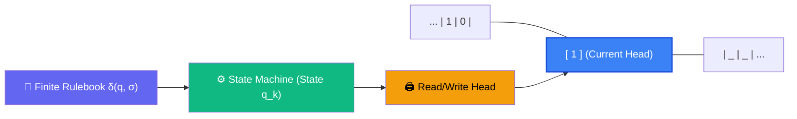
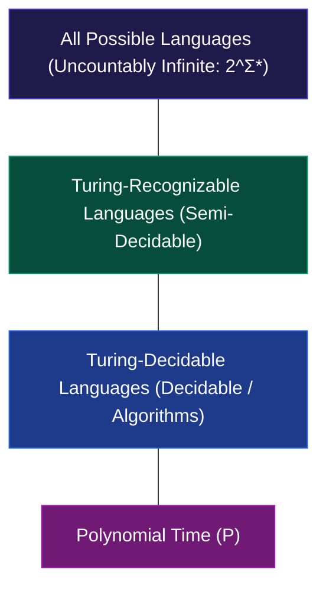

# Chapter 00: Computation & Computability — What Can a Machine Even Do?

> *"Before asking how fast an algorithm can run, you must answer a more terrifying question: Can an algorithm exist at all?"*

---

## 🧒 Explain Like I'm 5: The Magic Typewriter

Imagine a mechanical typewriter sitting on an infinitely long bench:
- It has an **endless roll of paper tape** divided into square boxes.
- Each box can hold a single symbol (like `0`, `1`, or blank `_`).
- A movable **read/write stamp head** hovers over one box at a time.
- Inside the typewriter is a **tiny rulebook** with a fixed number of rules:
  > *"If you are in state A and see a 0: write 1, move the tape right one square, switch to state B."*
- It has two special bells: a **Green Bell (Accept)** and a **Red Bell (Reject)**.



This typewriter is the **Turing Machine**. Alan Turing proved in 1936 that this astonishingly simple mechanical contraption can simulate *every computer that has ever existed or will ever exist* — from supercomputers to quantum processors.

---

## 🟢 Undergraduate Foundation: The Architecture of Computation

### 1. The Formal Definition of a Turing Machine
Mathematically, a deterministic one-tape Turing Machine (TM) is a 7-tuple:

$$M = \langle Q, \Sigma, \Gamma, \delta, q_0, q_{accept}, q_{reject} \rangle$$

Where:
1. $Q$ is a finite, non-empty set of **states**.
2. $\Sigma$ is the **input alphabet** (not containing the blank symbol $\text{\textvisiblespace}$).
3. $\Gamma$ is the **tape alphabet**, where $\Sigma \subset \Gamma$ and $\text{\textvisiblespace} \in \Gamma$.
4. $\delta : Q \times \Gamma \to Q \times \Gamma \times \{L, R\}$ is the **transition function**. Given the current state and current scanned symbol, it outputs: (next state, symbol to write, direction to move head).
5. $q_0 \in Q$ is the **start state**.
6. $q_{accept} \in Q$ is the **accepting state**.
7. $q_{reject} \in Q$ is the **rejecting state** ($q_{reject} \ne q_{accept}$).

### 2. The Three Possible Fates of a Program
When a Turing Machine runs on an input string $w$, exactly one of three outcomes occurs:
1. **Accept**: Enters $q_{accept}$ and halts.
2. **Reject**: Enters $q_{reject}$ and halts.
3. **Loop Forever**: Never enters an accept or reject state. It consumes infinite time.

A language $L$ is **Turing-Recognizable** (or Recursively Enumerable) if some TM accepts all strings in $L$ (and either rejects or loops on strings not in $L$).  
A language $L$ is **Turing-Decidable** (or Recursive) if some TM accepts strings in $L$ and rejects strings not in $L$, **guaranteeing it never loops forever**.



### 3. The Church-Turing Thesis
> **The Thesis**: Any real-world algorithmic computation can be simulated by a Turing Machine.

This is a *thesis* (a philosophical assertion about physical reality), not a mathematical theorem, because "intuitive algorithm" is an informal concept. However, every model of computation ever conceived — $\lambda$-calculus (Alonzo Church), register machines, cellular automata, quantum computers, Python interpreters — has been proven equivalent in computing power to a standard Turing machine.

### 4. The Halting Problem: The First Impossibility Proof
Can we write a program `halts(program_code, input_data)` that analyzes any program and returns `True` if it finishes, or `False` if it runs forever?

**Theorem (Alan Turing, 1936)**: The Halting Problem is **undecidable**. No such algorithm exists.

#### Proof via Diagonalization (Cantor's Method)
Assume for contradiction that an analyzer function `halts(f, x)` exists that never hangs:

```python
def halts(target_function, input_arg) -> bool:
    """Hypothetical perfect analyzer that always halts and tells the truth."""
    pass  # Imagine this works
```

Now, construct the troublemaker program `opposite(f)`:

```python
def opposite(target_function):
    """If target_function halts on itself, loop forever. If it loops, halt immediately."""
    if halts(target_function, target_function):
        while True:
            pass  # Loop infinitely
    else:
        return True  # Halt immediately
```

Now ask: **What happens if we run `opposite(opposite)`?**
- **Case 1**: `halts(opposite, opposite)` returns `True` (it predicts `opposite` halts).  
  Then by definition of `opposite`, it enters `while True:` and **loops forever**. Contradiction!
- **Case 2**: `halts(opposite, opposite)` returns `False` (it predicts `opposite` loops forever).  
  Then by definition of `opposite`, it hits `return True` and **halts immediately**. Contradiction!

Since both cases lead to a logical contradiction, the assumption that `halts` could exist is false. Q.E.D.

```
                  PROGRAM INPUTS
               P1      P2      P3     ...   opposite
        P1   HALT    LOOP    HALT    ...     HALT
        P2   LOOP    LOOP    HALT    ...     LOOP
        P3   HALT    HALT    LOOP    ...     HALT
        ...  ...     ...     ...     ...     ...
  opposite   LOOP    HALT    LOOP    ...      💥 PARADOX!
```

---

## 🟡 Master's Deep-Dive: Rice's Theorem & Reduction

### 1. Rice's Theorem: The Universal Wall of Static Analysis
Students often think: *"Okay, halting is undecidable, but surely I can check if a function returns 0, or if it has dead code, or if it sorts an array?"*

**Rice's Theorem (Henry Gordon Rice, 1953)** crushes this hope:
> Any non-trivial semantic property of a Turing-recognizable language is undecidable.

- **Semantic Property**: A property about what the program *computes* (its input-output behavior), rather than its syntax (number of lines, variable names).
- **Non-trivial**: At least one program has the property, and at least one program does not.

#### Formal Proof by Reduction from $A_{TM}$
Let $P$ be a non-trivial semantic property. Without loss of generality, assume the empty language $\emptyset \notin P$. Since $P$ is non-trivial, there exists some machine $M_L$ such that $L(M_L) \in P$.

Suppose a decider $R_P$ exists for property $P$. We can build a decider for the Halting problem $A_{TM} = \{\langle M, w \rangle \mid M \text{ accepts } w\}$:

```text
Algorithm Decider_A_TM(M, w):
  1. Construct a new machine M_prime(x):
       a. Run original machine M on input w.
       b. If M accepts w:
            Run machine M_L on input x, and return its result.
       c. If M does not accept:
            Loop or reject.
  2. Run decider R_P on <M_prime>.
  3. If R_P accepts: return ACCEPT. Else: return REJECT.
```

- If $M$ accepts $w$, then $M'$ behaves identically to $M_L$, so $L(M') = L(M_L) \in P$. $R_P$ outputs ACCEPT.
- If $M$ does not accept $w$, then $M'$ never accepts anything, so $L(M') = \emptyset \notin P$. $R_P$ outputs REJECT.

Thus, if $R_P$ existed, we would have solved the Halting Problem. Since the Halting Problem is undecidable, $R_P$ cannot exist. Rice's Theorem holds. Q.E.D.

#### Practical Engineering Takeaway
| What You Want to Build | Can It Be 100% Sound and Complete? | Rice's Theorem Verdict |
|---|---|---|
| Perfect Antivirus | ❌ No | Cannot decide if program executes malicious payload |
| Perfect Dead Code Eliminator | ❌ No | Cannot decide if branch is mathematically reachable |
| Perfect Memory Leak Detector | ❌ No | Cannot decide if allocated pointer will be dereferenced |
| Linting / Type Checking | ⚠️ Must be heuristic | Must reject some valid code or miss some bugs |

---

## 🔴 PhD Horizon: Gödel's Incompleteness & The Arithmetical Hierarchy

<details>
<summary><strong>Expand PhD Deep-Dive: Formal Incompleteness & Arithmetical Hierarchy</strong></summary>

### 1. Gödel's First Incompleteness Theorem (1931)
Kurt Gödel proved that in any consistent formal mathematical system $F$ capable of doing basic arithmetic (like Peano Arithmetic):
1. There exist statements in $F$ that are **true**, but cannot be proven within $F$.
2. The consistency of $F$ cannot be proven within $F$ itself.

**The Isomorphism to Computability**:
Gödel's proof constructs a statement $G$: *"This statement is not provable in F."*  
In computer science terms:
Define $T = \{ \langle M \rangle \mid M \text{ never halts on blank input} \}$. The statement that a specific $M$ loops forever is a mathematical truth, but because the Halting Problem is undecidable, there is no mechanical deductive system that can prove this property for all such machines.

### 2. The Arithmetical Hierarchy ($\Sigma_n^0, \Pi_n^0, \Delta_n^0$)
Not all undecidable problems are equally hard. Computability theory stratifies undecidability into the **Arithmetical Hierarchy**:

$$\Delta_1^0 = \text{Decidable (Recursive)}$$
$$\Sigma_1^0 = \text{Turing-Recognizable} = \{ x \mid \exists y \, R(x, y) \}$$
$$\Pi_1^0 = \text{Co-Turing-Recognizable} = \{ x \mid \forall y \, R(x, y) \}$$
$$\Sigma_2^0 = \{ x \mid \exists y \, \forall z \, R(x, y, z) \} \quad (\text{e.g., } L_{TOTAL} = \{ \langle M \rangle \mid M \text{ halts on ALL inputs} \})$$

Every additional alternation of existential ($\exists$) and universal ($\forall$) quantifiers moves up a level of uncomputability. The problem of determining whether a program halts on *all* inputs ($\Sigma_2^0$-complete) is strictly more uncomputable than whether it halts on *one* input ($\Sigma_1^0$-complete)!

</details>

---

## 💻 Python 3.14 Verification: A Turing Machine Simulator

Here is a fully functional, executable Turing Machine in Python 3.14 implementing a binary incrementer (takes binary `1011` $\to$ outputs `1100`):

```python
from collections import defaultdict
from dataclasses import dataclass
from typing import Literal

type Direction = Literal["L", "R"]
type State = str


@dataclass(frozen=True)
class Transition:
    next_state: State
    write_symbol: str
    direction: Direction


class TuringMachine:

    def __init__(
        self,
        states: set[State],
        alphabet: set[str],
        tape_alphabet: set[str],
        transitions: dict[tuple[State, str], Transition],
        start_state: State,
        accept_state: State,
        reject_state: State,
        blank_symbol: str = "_",
    ):
        self.states = states
        self.alphabet = alphabet
        self.tape_alphabet = tape_alphabet
        self.transitions = transitions
        self.start_state = start_state
        self.accept_state = accept_state
        self.reject_state = reject_state
        self.blank = blank_symbol

    def run(self, input_string: str, max_steps: int = 1000) -> tuple[bool, str]:
        tape: defaultdict[int, str] = defaultdict(lambda: self.blank)
        for i, char in enumerate(input_string):
            tape[i] = char

        head: int = 0
        state: State = self.start_state
        steps: int = 0

        while steps < max_steps:
            if state == self.accept_state:
                return True, self._read_tape(tape)
            if state == self.reject_state:
                return False, self._read_tape(tape)

            current_sym = tape[head]
            key = (state, current_sym)
            if key not in self.transitions:
                return False, self._read_tape(tape)  # No transition -> halt reject

            trans = self.transitions[key]
            tape[head] = trans.write_symbol
            head += 1 if trans.direction == "R" else -1
            state = trans.next_state
            steps += 1

        raise TimeoutError("Execution exceeded maximum steps (Potential infinite loop)")

    def _read_tape(self, tape: defaultdict[int, str]) -> str:
        if not tape:
            return ""
        min_idx = min(tape.keys())
        max_idx = max(tape.keys())
        return "".join(tape[i] for i in range(min_idx, max_idx + 1)).strip(self.blank)


# ─────────────────────────────────────────────────────────────
# Example: Binary Incrementer (+1 to a binary string)
# e.g., "1011" (11) + 1 = "1100" (12)
# ─────────────────────────────────────────────────────────────
if __name__ == "__main__":
    rules = {
        # Scan to the right end of the number
        ("q_scan", "0"): Transition("q_scan", "0", "R"),
        ("q_scan", "1"): Transition("q_scan", "1", "R"),
        ("q_scan", "_"): Transition("q_add", "_", "L"),
        # Add 1: carry when seeing 1, flip to 0 and move left
        ("q_add", "1"): Transition("q_add", "0", "L"),
        ("q_add", "0"): Transition("q_done", "1", "L"),
        ("q_add", "_"): Transition("q_done", "1", "L"),  # overflow digit (e.g. 111 -> 1000)
        # Rewind to start
        ("q_done", "0"): Transition("q_done", "0", "L"),
        ("q_done", "1"): Transition("q_done", "1", "L"),
        ("q_done", "_"): Transition("q_accept", "_", "R"),
    }

    tm = TuringMachine(
        states={"q_scan", "q_add", "q_done", "q_accept", "q_reject"},
        alphabet={"0", "1"},
        tape_alphabet={"0", "1", "_"},
        transitions=rules,
        start_state="q_scan",
        accept_state="q_accept",
        reject_state="q_reject",
    )

    accepted, result = tm.run("1011")
    assert accepted is True
    assert result == "1100", f"Expected 1100, got {result}"

    accepted, result = tm.run("111")
    assert result == "1000", f"Expected 1000, got {result}"

    print("✅ Turing Machine verification passed! (1011 + 1 = 1100, 111 + 1 = 1000)")
```

---

## 🔗 Connections to Coding Patterns

- **Pattern 25: Backtracking & Pattern 34: Simulation**: Recursion trees are state-space explorations of Turing configurations. A backtracking algorithm that fails to prune cyclic branches becomes an undecidable loop.
- **Pattern 10: Hash Maps**: Hashing attempts to construct finite finger-prints of infinite input sets. Rice's Theorem tells us that no hash function can classify semantic behavior.
- **Pattern 03: Fast & Slow Pointers**: Floyd's cycle detection solves the "Halting Problem" for finite state spaces ($O(N)$ memory), but cannot solve it when memory is unbounded.

---

## 🧪 Self-Test Questions

1. **Why does the Halting Problem proof fail if we assume the analyzer function itself can loop infinitely?**
2. **What is the difference between a language being Turing-Recognizable versus Turing-Decidable?**
3. **True or False**: Rice's theorem states that you cannot determine if a Python program has more than 50 lines of code. Explain why.
4. **Why did Church and Turing's independent formulations (Lambda Calculus vs Turing Machines) end up with the exact same computational boundaries?**
5. **A junior engineer claims to have written a GitHub Action that checks if any function in your repository will ever throw an unhandled exception for all possible inputs. What theorem refutes this?**

<details>
<summary><strong>Click to view answers</strong></summary>

1. If the analyzer is allowed to loop, the construction of `opposite` does not create a paradox: when `opposite` is fed to `opposite`, the analyzer simply loops forever instead of asserting a contradictory boolean output.
2. For a Decidable language, the machine must halt on **all** inputs (either Accept or Reject). For a Recognizable language, the machine is only required to halt on inputs that are in the language; on inputs not in the language, it is allowed to run forever.
3. **False**. Checking line count is a **syntactic** property, not a semantic property. Syntactic properties are easily decidable via a parser. Rice's theorem only applies to semantic properties (properties of the language recognized by the program).
4. Because the class of computable functions reflects the fundamental limits of discrete symbol manipulation. The Church-Turing Thesis states that any physically realizable discrete mechanical process maps to these equivalent formulations.
5. **Rice's Theorem**. Throwing an unhandled exception on some input is a non-trivial semantic property of program behavior. Therefore, a sound and complete checker for all arbitrary programs is undecidable.
</details>
