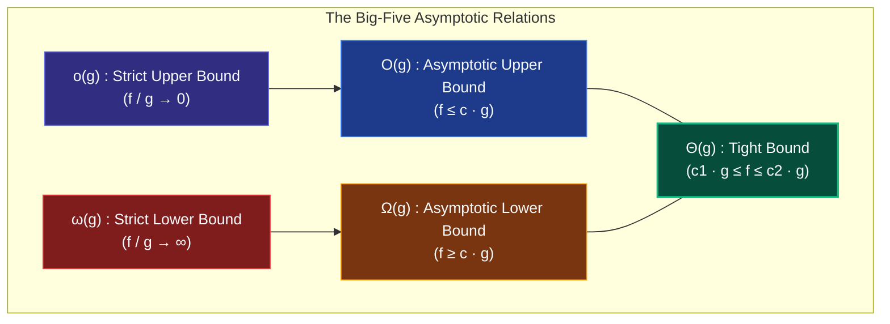
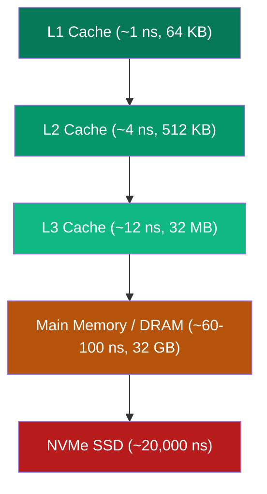

# Chapter 02: Asymptotic Analysis Deep Cuts — Beyond Naive Big-O

> *"In theory, there is no difference between theory and practice. In practice, there is."* — Jan L. A. van de Snepscheut

---

## 🧒 Explain Like I'm 5: The Grand Animal Race

Imagine a race across the Sahara desert between different creatures:
- 🐢 **Tortoise**: Walks at a steady 1 meter per minute, carrying a rock.
- 🐎 **Racehorse**: Gallops at 30 miles per hour.
- 🚀 **Rocket**: Needs 2 hours to warm up its engines, fuel up, and run ignition checks, but once it launches, it travels at 15,000 miles per hour.

```
Race over 10 meters:  🐎 Racehorse wins. 🚀 Rocket is still warming up.
Race to the Moon:     🚀 Rocket obliterates the Racehorse before the horse leaves the county.
```

**Asymptotics is the study of the race to the Moon.** Asymptotic analysis doesn't care who is winning in the first 10 meters ($n = 5$). It tells you who wins when the journey stretches to infinity ($n \to \infty$).

---

## 🟢 Undergraduate Foundation: The Big-Five Rigorous Definitions

Many programmers carelessly say *"The algorithm is Big-O of N"* when they actually mean **Theta ($\Theta$)**. In formal computer science and staff-level design, precision matters.



### 1. Formal Mathematical Definitions
Let $f(n)$ and $g(n)$ be functions from $\mathbb{N} \to \mathbb{R}^+$.

| Notation | Pronunciation | Formal Definition | Intuition | Analogy |
|---|---|---|---|---|
| **$O(g(n))$** | "Big-O of $g$" | $\exists c > 0, n_0 > 0 \text{ s.t. } \forall n \ge n_0: f(n) \le c \cdot g(n)$ | Upper bound (grows no faster than $g$) | $\le$ |
| **$\Omega(g(n))$** | "Big-Omega of $g$" | $\exists c > 0, n_0 > 0 \text{ s.t. } \forall n \ge n_0: f(n) \ge c \cdot g(n)$ | Lower bound (grows at least as fast as $g$) | $\ge$ |
| **$\Theta(g(n))$** | "Theta of $g$" | $\exists c_1, c_2, n_0 > 0 \text{ s.t. } c_1 g(n) \le f(n) \le c_2 g(n)$ | Tight bound (grows at the same rate as $g$) | $=$ |
| **$o(g(n))$** | "Little-o of $g$" | $\forall c > 0, \exists n_0 > 0 \text{ s.t. } \forall n \ge n_0: f(n) < c \cdot g(n)$ | Strictly dominated ($f$ becomes negligible vs $g$) | $<$ |
| **$\omega(g(n))$** | "Little-omega of $g$" | $\forall c > 0, \exists n_0 > 0 \text{ s.t. } \forall n \ge n_0: f(n) > c \cdot g(n)$ | Strictly dominating ($f$ dwarfs $g$) | $>$ |

---

### 2. The Limit Quotient Rule: The Calculus Shortcut
To determine the asymptotic relationship between $f(n)$ and $g(n)$, compute the limit of their ratio:

$$L = \lim_{n \to \infty} \frac{f(n)}{g(n)}$$

- **If $L = 0$**: $f(n) \in o(g(n))$ and $f(n) \in O(g(n))$. ($g$ grows strictly faster).
- **If $0 < L < \infty$**: $f(n) \in \Theta(g(n))$. (Both grow at the exact same rate; $c_1 \le L \le c_2$).
- **If $L = \infty$**: $f(n) \in \omega(g(n))$ and $f(n) \in \Omega(g(n))$. ($f$ grows strictly faster).
- **If $L$ does not exist (oscillates)**: Use the supremum/infimum definitions.

---

### 3. The Universal Growth Hierarchy
Memorize this ordering — it is the backbone of computational ranking:

$$O(1) \ll O(\alpha(n)) \ll O(\log \log n) \ll O(\log n) \ll O(\sqrt{n}) \ll O(n) \ll O(n \log n) \ll O(n^2) \ll O(n^3) \ll O(2^n) \ll O(n!) \ll O(n^n)$$

Where $\alpha(n)$ is the **Inverse Ackermann function** (effectively $\le 4$ for any input up to the number of particles in the universe!).

---

### 4. The 4 Cases: Worst, Best, Average, and Expected
Never confuse **Cases** (which input distribution you are analyzing) with **Bounds** ($O, \Omega, \Theta$):

```
                       INPUT DISTRIBUTION
                Best Case     Average Case     Worst Case
              ┌─────────────┬───────────────┬──────────────┐
       O(·)   │ Upper bound │ Upper bound   │ Upper bound  │
              │ on best     │ on average    │ on worst     │
 BOUNDS       ├─────────────┼───────────────┼──────────────┤
       Θ(·)   │ Tight bound │ Tight bound   │ Tight bound  │
              │ on best     │ on average    │ on worst     │
              ├─────────────┼───────────────┼──────────────┤
       Ω(·)   │ Lower bound │ Lower bound   │ Lower bound  │
              │ on best     │ on average    │ on worst     │
              └─────────────┴───────────────┴──────────────┘
```

- **Worst-Case Running Time**: The maximum steps over *all* inputs of size $n$.
- **Best-Case Running Time**: The minimum steps over *all* inputs of size $n$.
- **Average-Case Running Time**: The mathematical expectation $\mathbb{E}[T(n)] = \sum_{x} P(x) \cdot T(x)$ over a specified probability distribution of inputs.
- **Expected Running Time**: For **randomized algorithms**, the expected steps over the internal random coin flips, regardless of the input!

---

## 🟡 Master's Deep-Dive: When Big-O Lies in Production

### 1. The Hardware Reality: Cache Lines & Memory Pyramids
Big-O assumes the **Uniform Cost RAM Model**: accessing *any* memory address takes $O(1)$ time.  
**On modern silicon, this assumption is completely false.**



- Reading from main memory is **100 times slower** than reading from L1 cache.
- When the CPU fetches a byte, it loads a **64-byte Cache Line**.
- **Vector (Array) Traversal**: Contiguous memory $\implies$ Hardware prefetcher loads future elements into L1 before you even ask for them $\implies$ **0 cache misses**.
- **Linked List Traversal**: Pointers scatter across the heap $\implies$ Every node access triggers a cache miss and stalls the CPU for 200 cycles!
- **Result**: An $O(N)$ linked list search can be **$30\times$ slower** than an $O(N)$ array scan on $10^6$ elements!

---

### 2. The Galactic Algorithms Gallery
A **Galactic Algorithm** is an algorithm that has a better asymptotic runtime than any other known algorithm, but the constant factor is so astronomically vast that it will never be faster on any dataset smaller than the observable universe.

1. **Matrix Multiplication (Coppersmith-Winograd / Alman-Vassilevska Williams)**:
   - Standard: $O(n^3)$
   - Strassen (1969): $O(n^{2.807})$ (Crossover point: $n \approx 1000$, practical)
   - Galactic state of the art: $O(n^{2.371})$ — requires matrices larger than all digital data on Earth to outperform Strassen.
2. **Integer Multiplication (Harvey & Hoeven, 2019)**:
   - Standard grade-school: $O(n^2)$
   - Karatsuba: $O(n^{1.585})$
   - Harvey & Hoeven: $O(n \log n)$ — provably optimal, but only outperforms Schönhage-Strassen for integers with more than $10^{10^{38}}$ digits!
3. **Minimum Spanning Tree (Bernard Chazelle, 2000)**:
   - Runs in $O(m \cdot \alpha(m, n))$ deterministic time. Practically, Prim's with Fibonacci heap or Kruskal's is always preferred.

---

### 3. Input-Sensitive & Adaptive Algorithms
Real-world datasets are rarely completely random. Often they are partially sorted or contain repeated structures.

- **Timsort (Python's Built-in Sort)**:
  - Worst case: $O(n \log n)$
  - Best case (already sorted or reverse sorted): **$O(n)$**!
  - It identifies naturally occurring sorted chunks ("runs") and merges them using balanced galloping mode.
- **Chan's Convex Hull Algorithm**:
  - Output-sensitive: Runs in $O(n \log h)$ where $h$ is the number of vertices on the *output* convex hull. If $h$ is small, it runs in nearly linear time!

---

## 🔴 PhD Horizon: Fine-Grained Complexity & The Hardness Conjectures

<details>
<summary><strong>Expand PhD Deep-Dive: Fine-Grained Complexity (SETH & 3SUM)</strong></summary>

Classical complexity asks: *"Is it in $P$ or $NP$?"*  
**Fine-Grained Complexity** asks: *"If it's in $P$, can we solve it in $O(n)$ instead of $O(n^2)$?"*

### 1. The Strong Exponential Time Hypothesis (SETH)
Postulates that CNF-SAT cannot be solved in $(2-\epsilon)^n$ time for any $\epsilon > 0$ as clause size increases.
- **Consequence**: Under SETH, the **Edit Distance** (Levenshtein Distance) problem between two strings of length $n$ **CANNOT be solved in $O(n^{2-\epsilon})$ time**!
- That means the classic $O(n^2)$ dynamic programming algorithm you write for LeetCode is **conditionally optimal**! No faster algorithm can ever exist unless SETH is false!

### 2. The 3SUM Conjecture
Given $n$ integers, do three of them sum to zero?
- Standard Two Pointers / Hash solution: $O(n^2)$.
- **Conjecture**: 3SUM cannot be solved in $O(n^{2-\epsilon})$ time.
- Many computational geometry problems (e.g., finding collinear points) reduce from 3SUM and thus are conditionally bounded at $\Omega(n^2)$.

### 3. The All-Pairs Shortest Path (APSP) Conjecture
Floyd-Warshall runs in $O(n^3)$. The APSP conjecture asserts no algorithm can solve all-pairs shortest paths in $O(n^{3-\epsilon})$ for general graphs.

</details>

---

## 💻 Python 3.14 Verification: Contiguous Array vs Linked List Cache Reality

Here is an executable microbenchmark proving that CPU cache lines dominate constant factors:

```python
import time
from dataclasses import dataclass


@dataclass
class ListNode:
    val: int
    next: "ListNode | None" = None


def benchmark_cache_locality(n: int = 1_000_000) -> tuple[float, float]:
    # 1. Contiguous Array (Dense memory layout)
    arr = list(range(n))

    # 2. Linked List (Scattered node allocations)
    head = ListNode(0)
    curr = head
    for i in range(1, n):
        curr.next = ListNode(i)
        curr = curr.next

    # Benchmark Array Traversal
    t0 = time.perf_counter()
    total_arr = 0
    for x in arr:
        total_arr += x
    t_arr = time.perf_counter() - t0

    # Benchmark Linked List Traversal
    t0 = time.perf_counter()
    total_ll = 0
    curr = head
    while curr:
        total_ll += curr.val
        curr = curr.next
    t_ll = time.perf_counter() - t0

    assert total_arr == total_ll
    return t_arr, t_ll


if __name__ == "__main__":
    n_elements = 500_000
    t_arr, t_ll = benchmark_cache_locality(n_elements)

    ratio = t_ll / t_arr
    print(f"Elements: {n_elements:,}")
    print(f"Contiguous Array Scan : {t_arr:.5f} seconds")
    print(f"Linked List Pointer Hop: {t_ll:.5f} seconds")
    print(f"👉 Linked List is {ratio:.1f}x SLOWER despite identical O(N) Big-O!")
```

---

## 🔗 Connections to Coding Patterns

- **Pattern 02: Two Pointers**: Works in $O(N)$ time with $O(1)$ auxiliary space and sequential index increments — maximizes cache line utilization.
- **Pattern 10: Hash Maps**: Average-case $O(1)$ lookup, but worst-case $\Theta(N)$ under hash collisions. In latency-critical systems, worst-case $\Theta(\log N)$ balanced trees (Pattern 29: Ordered Set) are preferred over hash maps.
- **Pattern 35: Linear Sorting Algorithm**: Radix and Counting sort achieve $O(N)$ by operating in the non-comparison model, circumventing the $\Omega(N \log N)$ comparison barrier.

---

## 🧪 Self-Test Questions

1. **True or False: If an algorithm runs in $O(N^2)$, its worst-case running time must be proportional to $N^2$.**
2. **What is the difference between $o(g(n))$ and $O(g(n))$ in terms of limits?**
3. **Why is Floyd's cycle detection (Pattern 03) considered $O(N)$ time even though the pointers move at different speeds and may lap each other?**
4. **Define a "Galactic Algorithm" and give one real-world example.**
5. **Under the Strong Exponential Time Hypothesis (SETH), why can we stop trying to find an $O(N \log N)$ algorithm for string Edit Distance?**

<details>
<summary><strong>Click to view answers</strong></summary>

1. **False**. $O(N^2)$ is merely an **upper bound**. An algorithm that runs in $O(N)$ is also technically in $O(N^2)$! To claim it is proportional to $N^2$, you must prove the bound is tight: $\Theta(N^2)$.
2. For $O(g(n))$, $\lim \frac{f(n)}{g(n)} < \infty$ (it can be any finite constant $c$, or 0). For $o(g(n))$, the limit **must be strictly 0** ($\lim \frac{f(n)}{g(n)} = 0$).
3. Fast pointer advances 2 steps while slow advances 1. The distance between them in the cycle decreases by 1 on each iteration. In a cycle of length $C$, they meet in at most $C$ steps. Since $C \le N$, total steps $\le 2N = O(N)$.
4. A Galactic Algorithm has a superior asymptotic runtime as $N \to \infty$, but its constant factors or crossover points are so astronomically large that it is completely impractical on any real dataset. Example: Harvey-Hoeven $O(N \log N)$ integer multiplication or Coppersmith-Winograd matrix multiplication.
5. Because researchers have proven that if Edit Distance could be solved in $O(N^{2-\epsilon})$ time, then SAT could be solved in $(2-\delta)^n$ time, which would violate SETH. Thus, the classic $O(N^2)$ DP is conditionally optimal.
</details>
