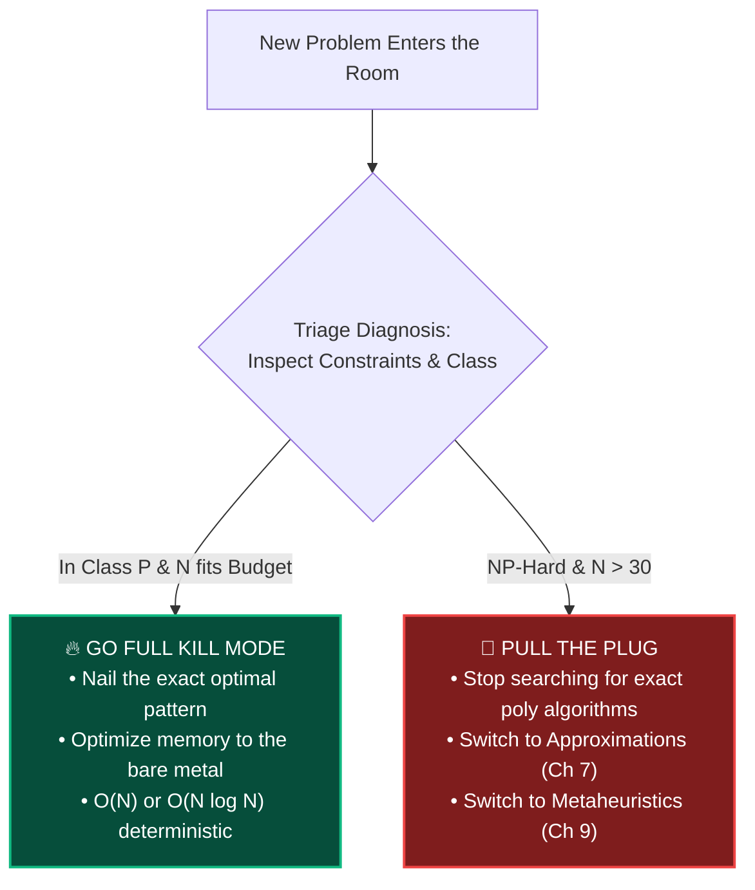
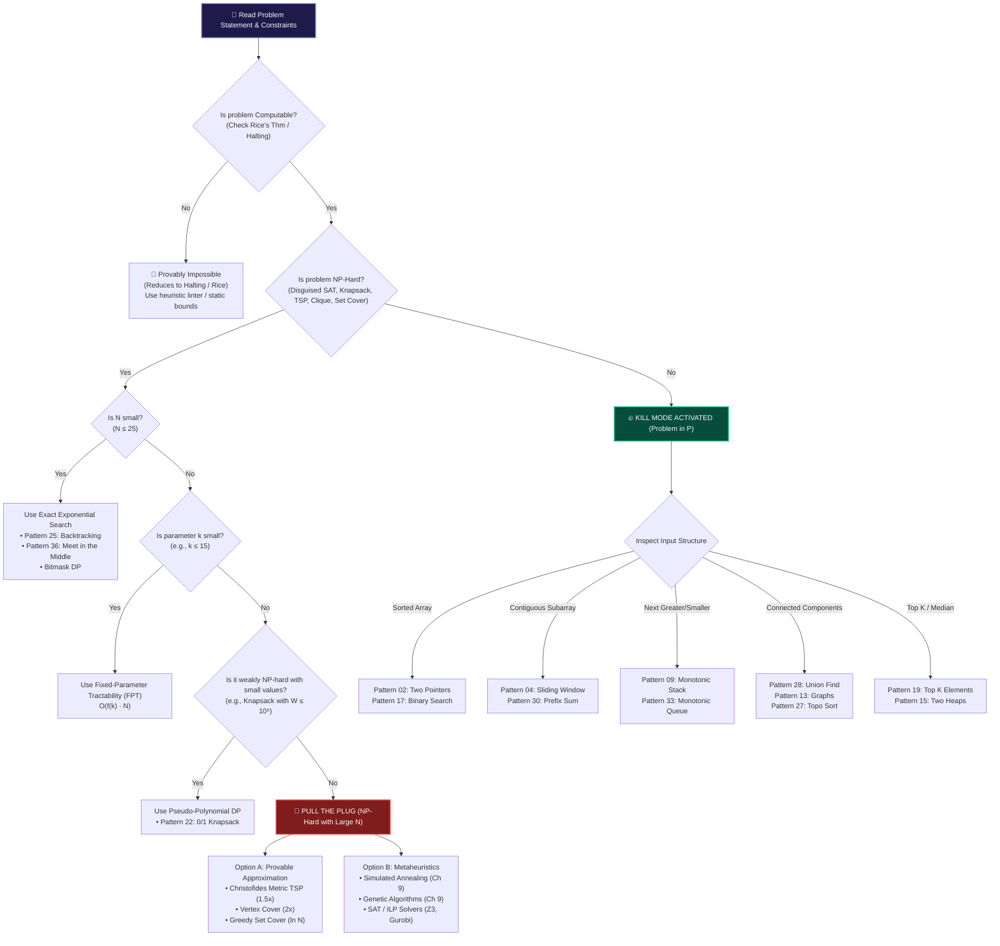

# Chapter 12: Kill Mode vs Pull the Plug — The Master Engineering Decision Framework

> *"Amateurs guess algorithms. Professionals inspect constraints, classify the complexity class, and decide instantly whether to optimize to the bare metal or switch to an approximation."*

---

## 🧒 Explain Like I'm 5: The ER Triage Doctor

Imagine you are the Head Trauma Surgeon in a busy emergency room:
- **Patient A** has a minor scratch: You hand them a bandage and send them home in 5 seconds ($O(1)$).
- **Patient B** has a broken femur: You take them into surgery for 2 hours, set the bone with titanium screws, and cure them completely ($O(N \log N)$).
- **Patient C** has an untreatable, incurable genetic anomaly: You do **not** perform an impossible 100-hour surgery that will fail. You administer palliative therapy, manage symptoms, and stabilize the patient (Approximation / Heuristic).



An engineer who tries to write an exact polynomial algorithm for an $NP$-hard problem with $N = 1,000$ is an ER doctor attempting an impossible surgery. You must know **when to go Kill Mode** and **when to Pull the Plug**.

---

## 🟢 Undergraduate Foundation: The Constraint Sizing Table

Modern CPU cores execute approximately **$10^8$ basic operations per second** (the standard 1.0-second timeout on LeetCode, Codeforces, and production microservices).

When you open ANY problem, look at the input size $N$ in the problem description. **The constraint immediately tells you the target complexity:**

| Input Size ($N$) | Max Allowed Complexity | Tactical Pattern Family | What to Write |
|---|---|---|---|
| **$N \le 10$** | $O(N!) \text{ or } O(N^7)$ | 🔙 Backtracking / Permutations | `itertools.permutations`, recursive search |
| **$N \le 20$** | $O(2^N \cdot N)$ | 📦 Subsets / Bitmask DP | Meet-in-the-Middle (Pattern 36), Bitmask DP |
| **$N \le 50$** | $O(N^4)$ | 🧮 4D DP / Matrix Powers | High-dimensional Dynamic Programming |
| **$N \le 500$** | $O(N^3)$ | 🌊 All-Pairs Shortest Path | Floyd-Warshall, Matrix Multiplication |
| **$N \le 5\,000$** | $O(N^2)$ | 🪟 2D DP / Nested Loops | Quadratic DP, nested scans, Kadane variants |
| **$N \le 10^5$** | $O(N \log N)$ | 🚀 **KILL MODE**: Sort / Heap / Tree | Sorting, Heaps, Segment Trees, Fenwick, DSU |
| **$N \le 10^6$** | $O(N)$ | ⚡ **KILL MODE**: Linear Scan | Two Pointers, Sliding Window, Monotonic Stack |
| **$N \ge 10^9$** | $O(\log N) \text{ or } O(1)$ | 🎯 Binary Search / Math | Binary Search over range, Bitwise XOR, Math |

---

## 🗺️ The Grand Unified Triage Flowchart

This is the **master decision tree of the entire repository**, connecting theoretical foundations directly to the 43 patterns:



---

## 🟡 Master's Deep-Dive: The Two Battle Protocols

### PROTOCOL A: When to Go Full "KILL MODE"

You activate **Kill Mode** when the problem is in $P$ and the constraints demand an exact, optimal answer.

#### The 5-Step Kill Mode Execution Checklist:
1. **Identify the Core Invariant**:
   - What property is preserved across iterations? (e.g., window validity, heap order, topological DAG dependencies).
2. **Select the Minimal Auxiliary Space**:
   - Avoid creating temporary lists or slicing strings (`s[left:right]` copies memory in $O(K)$!).
   - Use two integer indices `left` and `right` instead of copying subarrays.
3. **Exploit Hardware Pre-fetching**:
   - Favor contiguous array buffers over pointer-chasing node graphs when possible (see Chapter 02).
4. **Guard the Boundaries Upfront**:
   - Check $N = 0$, $N = 1$, all identical values, already sorted, reverse sorted, negative numbers.
5. **Derive the Proof**:
   - Mentally verify loop invariants using induction before writing code.

---

### PROTOCOL B: When to "PULL THE PLUG"

You **Pull the Plug** when the problem is $NP$-hard and $N > 30$.

#### The 5-Step Pull the Plug Protocol:
1. **Unmask the $NP$-Hard Core**:
   - Strip away the problem's thematic story (e.g., *"optimizing delivery trucks with package weights and fuel"*).
   - Recognize that it is **Traveling Salesperson + Knapsack** in disguise.
2. **Verify That No Disguised Polynomial Shortcut Exists**:
   - Is the graph a tree or DAG? (If yes, it might be in $P$ via Tree DP!).
   - Is it 2-SAT or 3-SAT? (2-SAT is in $P$; 3-SAT is $NP$-hard).
   - Are edge weights metric (triangle inequality)?
3. **Choose Your Coping Strategy**:
   - If bounded error is acceptable: Choose an **Approximation Algorithm** (Chapter 07).
   - If large-scale complex constraints: Choose **Simulated Annealing** or an industrial **ILP / SAT Solver** (Chapter 09).
4. **Establish the Contract**:
   - Define your stopping condition: maximum time (e.g., 500 ms), maximum iterations ($10^5$), or convergence threshold ($\epsilon < 0.01$).
5. **The Stakeholder Negotiation Script**:
   > *"We have mathematically classified this optimization problem as $NP$-hard (equivalent to the Traveling Salesperson Problem). An exact solution on $N = 5,000$ inputs would require more compute time than the age of the universe ($2^{5000}$ operations).  
   > Instead, we have deployed an approximation algorithm that executes in **12 milliseconds** and is mathematically proven to be **within 8% of the global optimum**."*

---

## 📊 The Master Pattern ↔ Complexity Matrix

Every one of the 43 patterns in this repository mapped to its theoretical complexity class and operational envelope:

| # | Pattern Name | Typical Time Complexity | Auxiliary Space | Complexity Class | Primary Operational Envelope |
|---|---|---|---|---|---|
| **01** | Warmup | $O(N)$ | $O(1)$ | $P$ | Basic array scans |
| **02** | Two Pointers | $O(N)$ or $O(N \log N)$ | $O(1)$ | $P$ | Sorted arrays, pair collisions |
| **03** | Fast & Slow Pointers | $O(N)$ | $O(1)$ | $P$ | Cycle detection, middle of list |
| **04** | Sliding Window | $O(N)$ | $O(K)$ | $P$ | Contiguous subarray/substring |
| **05** | Merge Intervals | $O(N \log N)$ | $O(N)$ | $P$ | Overlapping interval ranges |
| **06** | Cyclic Sort | $O(N)$ | $O(1)$ | $P$ | Array numbers in range $[1, N]$ |
| **07** | In-place Reversal | $O(N)$ | $O(1)$ | $P$ | Linked list pointer rewiring |
| **08** | Stacks | $O(N)$ | $O(N)$ | $P$ | LIFO matching, parentheses |
| **09** | Monotonic Stack | $O(N)$ (amortized) | $O(N)$ | $P$ | Next Greater / Smaller Element |
| **10** | Hash Maps | $O(N)$ avg, $O(N^2)$ worst | $O(N)$ | $P$ | $O(1)$ lookup, frequency counts |
| **11** | Tree BFS | $O(N)$ | $O(W) = O(N)$ | $P$ | Level-order tree exploration |
| **12** | Tree DFS | $O(N)$ | $O(H)$ | $P$ | Path sums, tree properties |
| **13** | Graphs | $O(V + E)$ | $O(V)$ | $P$ | BFS, DFS, Dijkstra, Prim |
| **14** | Island Traversal | $O(R \cdot C)$ | $O(R \cdot C)$ | $P$ | 2D Grid Flood-fill |
| **15** | Two Heaps | $O(N \log N)$ | $O(N)$ | $P$ | Dynamic continuous median |
| **16** | Subsets | $O(2^N \cdot N)$ | $O(2^N)$ | $NP$ | Exhaustive power-set generation |
| **17** | Modified Binary Search | $O(\log N)$ | $O(1)$ | $P$ | Rotated arrays, range boundary |
| **18** | Bitwise XOR | $O(N)$ | $O(1)$ | $P$ | Duplicate/Missing cancelation |
| **19** | Top K Elements | $O(N \log K)$ | $O(K)$ | $P$ | Min-heap / Quickselect |
| **20** | K-way Merge | $O(N \log K)$ | $O(K)$ | $P$ | Merging $K$ sorted streams |
| **21** | Greedy Algorithms | $O(N \log N)$ | $O(1)$ or $O(N)$ | $P$ (or Approx) | Matroids, interval scheduling |
| **22** | 0/1 Knapsack (DP) | $O(N \cdot W)$ | $O(W)$ | Weakly $NP$-Hard | Pseudo-polynomial DP |
| **23** | Fibonacci DP | $O(N)$ | $O(1)$ | $P$ | 1D recurrence transitions |
| **24** | Palindromic DP | $O(N^2)$ | $O(N^2)$ | $P$ | 2D interval string DP |
| **25** | Backtracking | $O(K^N)$ | $O(N)$ | $NP$ | N-Queens, Sudoku, exact SAT |
| **26** | Trie | $O(L)$ per query | $O(\Sigma \cdot L \cdot N)$ | $P$ | Prefix dictionary lookups |
| **27** | Topological Sort | $O(V + E)$ | $O(V)$ | $P$ | DAG task scheduling, Kahn's |
| **28** | Union Find | $O(N \cdot \alpha(N))$ | $O(N)$ | $P$ | Dynamic connectivity, Kruskal |
| **29** | Ordered Set | $O(N \log N)$ | $O(N)$ | $P$ | Red-Black BST dynamic ranking |
| **30** | Prefix Sum | $O(N)$ prep, $O(1)$ query | $O(N)$ | $P$ | Static 1D/2D range sums |
| **31** | Multi-threaded | $O(N / P)$ | $O(P)$ | $P$ (Concurrency) | Parallel batch processing |
| **32** | Counting Pattern | $O(N)$ | $O(K)$ | $P$ | Fixed alphabet histograms |
| **33** | Monotonic Queue | $O(N)$ (amortized) | $O(K)$ | $P$ | Sliding window max/min |
| **34** | Simulation Pattern | $O(\text{Steps})$ | $O(\text{State})$ | $P$ | Game rules, physics clock |
| **35** | Linear Sort | $O(N + K)$ | $O(N + K)$ | $P$ | Radix/Counting non-comparison |
| **36** | Meet in the Middle | $O(2^{N/2} \cdot N)$ | $O(2^{N/2})$ | $NP$ | Bounded subset sum ($N \le 40$) |
| **37** | MO's Algorithm | $O((N + Q) \sqrt{N})$ | $O(N)$ | $P$ | Offline square-root query block |
| **38** | Serialize/Deserialize | $O(N)$ | $O(N)$ | $P$ | Tree encoding & reconstruction |
| **39** | Clone Pattern | $O(V + E)$ | $O(V)$ | $P$ | Graph deep copying with hash map |
| **40** | Articulation Points | $O(V + E)$ | $O(V)$ | $P$ | Tarjan's discovery & low links |
| **41** | Segment Tree | $O(\log N)$ query/update | $O(N)$ | $P$ | Dynamic range query + update |
| **42** | Binary Indexed Tree | $O(\log N)$ query/update | $O(N)$ | $P$ | Fenwick tree prefix queries |
| **43** | Miscellaneous | Varies | Varies | Mixed | Specialized interview blends |

---

## 💻 Python 3.14 Verification: The Automated Algorithmic Triage Engine

Here is an executable Python 3.14 Triage Assistant that inspects problem constraints and characteristics to immediately output the engineering strategy:

```python
from dataclasses import dataclass
from typing import Literal

type Strategy = Literal["KILL_MODE", "PULL_THE_PLUG", "EXACT_EXPONENTIAL"]


@dataclass(frozen=True)
class TriageDiagnosis:
    strategy: Strategy
    recommended_complexity: str
    action_plan: str
    suggested_patterns: list[str]


def triage_problem(
    n: int, is_np_hard: bool = False, small_param_k: int | None = None
) -> TriageDiagnosis:
    """The Master Engineering Triage Engine: Evaluates problem constraints and

    returns the battle protocol.
    """
    if is_np_hard:
        if n <= 20:
            return TriageDiagnosis(
                strategy="EXACT_EXPONENTIAL",
                recommended_complexity="O(2^N) or O(N!)",
                action_plan="N is tiny. Run exact Backtracking or Meet-in-the-Middle.",
                suggested_patterns=[
                    "Pattern 25: Backtracking",
                    "Pattern 36: Meet in the Middle",
                ],
            )
        elif small_param_k is not None and small_param_k <= 15:
            return TriageDiagnosis(
                strategy="KILL_MODE",
                recommended_complexity=f"O(f({small_param_k}) * N) in FPT",
                action_plan="Exploit small parameter k using Fixed-Parameter Tractability.",
                suggested_patterns=[
                    "Pattern 25: Backtracking with Bound Pruning"
                ],
            )
        else:
            return TriageDiagnosis(
                strategy="PULL_THE_PLUG",
                recommended_complexity="Polynomial Approximation / Metaheuristic",
                action_plan="NP-Hard with N > 20. Cease search for exact polynomial algorithm. Use 2-approx or Annealing.",
                suggested_patterns=[
                    "Chapter 07: Approximation Algorithms",
                    "Chapter 09: Heuristics & Metaheuristics",
                ],
            )

    # Problem is in P
    if n <= 500:
        return TriageDiagnosis(
            strategy="KILL_MODE",
            recommended_complexity="O(N^3)",
            action_plan="N <= 500. Triple-nested loops, Matrix powers, or Floyd-Warshall allowed.",
            suggested_patterns=[
                "Pattern 13: Graphs",
                "Pattern 22: 0/1 Knapsack (DP)",
            ],
        )
    elif n <= 5_000:
        return TriageDiagnosis(
            strategy="KILL_MODE",
            recommended_complexity="O(N^2)",
            action_plan="N <= 5,000. Quadratic 2D Dynamic Programming or nested scans allowed.",
            suggested_patterns=[
                "Pattern 24: Palindromic Subsequence DP",
                "Pattern 05: Merge Intervals",
            ],
        )
    elif n <= 100_000:
        return TriageDiagnosis(
            strategy="KILL_MODE",
            recommended_complexity="O(N log N)",
            action_plan="N <= 100,000. Sorting, Heaps, Segment Trees, or DSU required.",
            suggested_patterns=[
                "Pattern 19: Top K Elements",
                "Pattern 41: Segment Tree",
                "Pattern 28: Union Find",
            ],
        )
    elif n <= 10_000_000:
        return TriageDiagnosis(
            strategy="KILL_MODE",
            recommended_complexity="O(N)",
            action_plan="N <= 10,000,000. Strict linear scan required. No nested loops. Minimize heap allocations.",
            suggested_patterns=[
                "Pattern 02: Two Pointers",
                "Pattern 04: Sliding Window",
                "Pattern 09: Monotonic Stack",
                "Pattern 10: Hash Maps",
            ],
        )
    else:
        return TriageDiagnosis(
            strategy="KILL_MODE",
            recommended_complexity="O(log N) or O(1)",
            action_plan="N is gigantic (>= 10^9). Must cut search space logarithmically or use closed-form math.",
            suggested_patterns=[
                "Pattern 17: Modified Binary Search",
                "Pattern 18: Bitwise XOR",
            ],
        )


if __name__ == "__main__":
    # Case 1: LeetCode Two Sum / Subarray (N = 10^5)
    d1 = triage_problem(n=100_000, is_np_hard=False)
    assert d1.strategy == "KILL_MODE"
    assert "O(N log N)" in d1.recommended_complexity

    # Case 2: Traveling Salesperson on 100 Cities (N = 100, NP-Hard)
    d2 = triage_problem(n=100, is_np_hard=True)
    assert d2.strategy == "PULL_THE_PLUG"
    assert "Approximation" in d2.recommended_complexity

    # Case 3: N-Queens or Subset Sum on 15 elements (N = 15, NP-Hard)
    d3 = triage_problem(n=15, is_np_hard=True)
    assert d3.strategy == "EXACT_EXPONENTIAL"

    print("✅ Triage Engine verification passed across all operational tiers!")
```

---

## 🔗 The Complete Circle: Theory to Patterns

You have journeyed through the complete architecture of computation:
1. **Chapter 00**: You learned what is computable (Turing, Rice).
2. **Chapter 01 & 06**: You mapped the periodic table of hardness ($P$ vs $NP$).
3. **Chapter 02–05**: You learned how to measure asymptotic runtime, divide-and-conquer, amortization, and information-theoretic floors.
4. **Chapter 07–09**: You acquired the weapons to cope with intractability (Approximations, Randomization, Heuristics).
5. **Chapter 10–11**: You mastered entropy, Amdahl's concurrency law, and Little's queueing law.
6. **Chapter 12**: You now wield the decision framework to triage any problem in seconds.

Now, return to the **43 Patterns** with the full power of theoretical computer science at your back. You are ready for anything.

---

## 🧪 Self-Test Questions

1. **If an interview problem gives an array constraint of $N = 10^5$ elements, what is the maximum time complexity your solution can have without getting a Time Limit Exceeded (TLE)?**
2. **Explain the difference between "Kill Mode" and "Pulling the Plug" in an engineering context.**
3. **If a problem is $NP$-hard, under what two specific circumstances should you STILL attempt an exact solution?**
4. **Why is an algorithm with runtime $O(N)$ using a linked list often slower than an $O(N \log N)$ algorithm using a flat array when $N = 50,000$?**
5. **How does recognizing that Knapsack is "weakly" NP-hard dictate whether to use Dynamic Programming or an approximation scheme?**

<details>
<summary><strong>Click to view answers</strong></summary>

1. With $N = 10^5$, the maximum allowed complexity is **$O(N \log N)$** (roughly $1.7 \times 10^6$ operations) or **$O(N)$**. An $O(N^2)$ algorithm would perform $10^{10}$ operations, which takes $\approx 100$ seconds and will reliably trigger a TLE.
2. **Kill Mode** means the problem is solvable in polynomial time ($P$) and you optimize aggressively to find the exact optimal answer with optimal constants. **Pulling the Plug** means recognizing that the problem is $NP$-hard with large $N$, ceasing the search for an impossible exact polynomial algorithm, and pivoting to an approximation or heuristic.
3. (1) When the overall input size is very small ($N \le 25$, where Backtracking or Meet-in-the-Middle works in seconds); or (2) when the exponential parameter $k$ is small ($k \le 15$) and the problem is **Fixed-Parameter Tractable ($FPT$)** with runtime $O(f(k) \cdot N)$.
4. Because flat arrays enjoy **spatial cache locality**; CPU hardware pre-fetchers load 64-byte cache lines, resulting in 0 cache misses and fast SIMD vectorization. A linked list scatters nodes across heap memory, incurring a 200-cycle memory stall on almost every pointer dereference.
5. If the weight/value capacity $W$ is small ($W \le 10^5$), the pseudo-polynomial DP algorithm runs in $O(NW)$ time and produces the **exact optimum**. If $W$ is massive ($W \ge 10^{15}$), the DP table exceeds memory and time limits, dictating an **FPTAS approximation scheme** or Meet-in-the-Middle.
</details>
