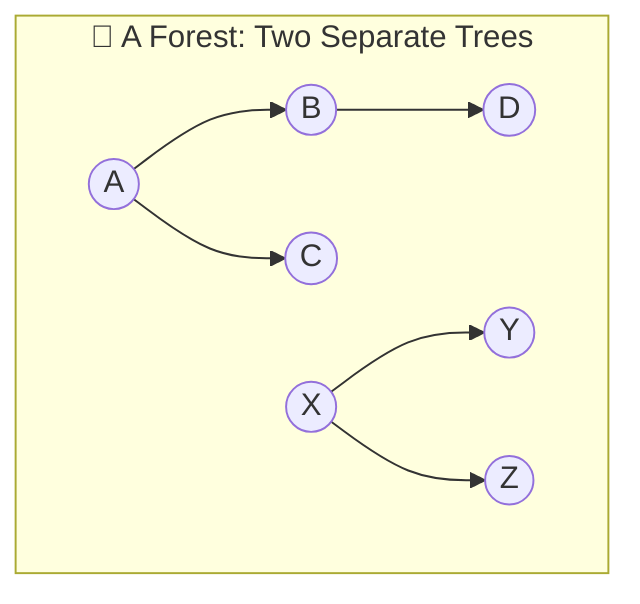
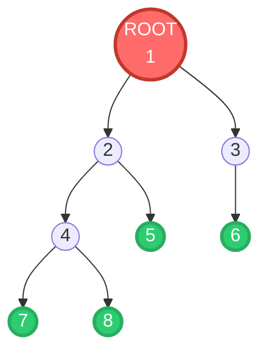
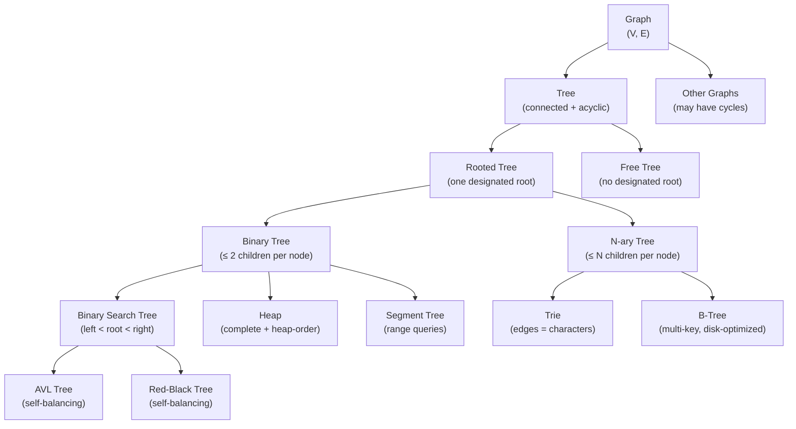

# Chapter 1: What Is a Tree? 🌳

---

## 👶 Explain Like I'm 5

Imagine your family tree hanging on the wall at Grandma's house.

At the very top is **Great-Grandma**. She has two children — Grandpa Joe and Grandpa Sam.
Grandpa Joe has three children. Grandpa Sam has one child.
Those children have their own children, and so on.

Notice two very important things:
1. **Everyone has exactly one parent** (except Great-Grandma at the top — she has none).
2. **There are NO loops.** You can't follow the "parent" chain and end up back where you started. Your grandmother cannot also be your granddaughter!

That's a **Tree**. It's a group of things (nodes) connected by relationships (edges), with one single starting point (the root), where every connection flows *downward* and **loops are strictly forbidden**.

---

## 🎯 Formal Computer Science Definition

> **A Tree** is a connected, acyclic, undirected graph with `N` nodes and exactly `N − 1` edges.

When we designate one specific node as the **root**, it becomes a **rooted tree**, and suddenly direction appears — every node has a parent (except the root) and zero or more children.

A **Forest** is a collection of zero or more disjoint trees (i.e., multiple disconnected trees grouped together).



---

## 📚 The Complete Terminology Bible

Every single term you will encounter in interviews and textbooks — defined, visualized, and never forgotten.



| Term | Definition | Example (in diagram above) |
|------|-----------|---------------------------|
| **Node (Vertex)** | A single element holding a value | `1`, `2`, `3`, `4`, `5`, `6`, `7`, `8` |
| **Edge** | A connection between two nodes | The line from `1 → 2` |
| **Root** | The single node with no parent. The topmost node | Node `1` (red) |
| **Leaf** | A node with **zero** children. The bottommost nodes | `5`, `6`, `7`, `8` (green) |
| **Internal Node** | A node with **at least one** child (not a leaf) | `1`, `2`, `3`, `4` |
| **Parent** | The node directly **above** a given node | `2` is the parent of `4` and `5` |
| **Child** | A node directly **below** a given node | `4` and `5` are children of `2` |
| **Sibling** | Nodes that share the **same parent** | `4` and `5` are siblings. `2` and `3` are siblings. |
| **Ancestor** | Any node on the path from a node **up to the root** | Ancestors of `7`: `4`, `2`, `1` |
| **Descendant** | Any node reachable by going **down** from a node | Descendants of `2`: `4`, `5`, `7`, `8` |
| **Subtree** | A node and **all its descendants** (forms a tree itself) | The subtree rooted at `2` = `{2, 4, 5, 7, 8}` |
| **Depth of a node** | Number of edges from the **root** to that node | `depth(1)=0`, `depth(2)=1`, `depth(7)=3` |
| **Height of a node** | Number of edges on the **longest downward path** to a leaf | `height(1)=3`, `height(4)=1`, `height(7)=0` |
| **Height of a tree** | Height of the **root** = longest root-to-leaf path | `3` (path: 1→2→4→7) |
| **Level** | All nodes at the **same depth**. Level `k` = all nodes at depth `k` | Level 0: `{1}`. Level 1: `{2,3}`. Level 2: `{4,5,6}`. Level 3: `{7,8}` |
| **Degree of a node** | Number of **children** a node has | `degree(1)=2`, `degree(4)=2`, `degree(7)=0` |
| **Width** | The maximum number of nodes at any single level | `3` (Level 2 has `{4, 5, 6}`) |
| **Path** | A sequence of nodes where each consecutive pair is connected by an edge | `1 → 2 → 4 → 7` |

> [!TIP]
> **Memory trick for Depth vs Height:**
> - **Depth** = how **deep** in the water you are (measured from the **surface/top** = root, going **down**)
> - **Height** = how **tall** something is (measured from the **ground/bottom** = leaf, going **up**)

---

## 📐 The 3 Fundamental Properties of Trees

These three properties are **equivalent** — if any one holds, the others follow. They uniquely characterize a tree.

### Property 1: N Nodes → Exactly N−1 Edges

A tree with `N` nodes always has **exactly `N−1` edges**.

**Intuition**: To build a tree, you start with 1 node (the root, 0 edges). Each new node you add brings **exactly 1 new edge** (the edge connecting it to its parent). So after adding `N−1` more nodes, you have `N−1` edges.

```
N = 8 nodes → 7 edges
(Count the arrows in the diagram above: 1→2, 1→3, 2→4, 2→5, 3→6, 4→7, 4→8 = 7 ✅)
```

**Corollary**: If a connected graph has `N` nodes and `N−1` edges, it MUST be a tree.

### Property 2: Exactly One Unique Path Between Any Two Nodes

Pick **any** two nodes in a tree. There is **exactly one** path connecting them.

- **More than one path** → the graph has a **cycle** (not a tree)
- **Zero paths** → the graph is **disconnected** (not a tree, maybe a forest)

### Property 3: Removing ANY Single Edge Disconnects the Tree

Every edge in a tree is a **bridge** — critical to the tree's connectivity. Unlike graphs where you might have redundant paths, a tree has no redundancy. This is the direct consequence of having exactly `N−1` edges.

---

## 🔁 The Recursive Nature of Trees

This is the most important mental model for writing tree algorithms:

> **A tree is either:**
> - **Empty** (null/None), OR
> - A **root node** connected to zero or more **subtrees**, where each subtree is itself a tree.

This recursive definition is why virtually **all tree algorithms are recursive**. When you write `dfs(node.left)` and `dfs(node.right)`, you are literally applying this definition — treating each child as the root of its own tree.

```
Tree(root=1)
├── Tree(root=2)
│   ├── Tree(root=4)
│   │   ├── Tree(root=7) → Empty, Empty
│   │   └── Tree(root=8) → Empty, Empty
│   └── Tree(root=5) → Empty, Empty
└── Tree(root=3)
    └── Tree(root=6) → Empty, Empty
```

---

## ➕ Mathematical Properties Summary

| Property | Formula |
|----------|---------|
| Number of edges | `|E| = N − 1` |
| Sum of all node degrees | `Σ degree(v) = 2(N−1) = 2|E|` (since each edge contributes 2 to total degree) |
| Max edges in a graph with N nodes (without cycles) | `N − 1` |
| Minimum edges to connect N nodes | `N − 1` |
| Number of leaves in a **Full Binary Tree** | `internal_nodes + 1` |

> [!NOTE]
> "Sum of degrees = 2|E|" is the **Handshaking Lemma** — it applies to all graphs, not just trees.
> For trees: sum of all degrees = 2(N−1). This means average degree ≈ 2 for large trees.

---

## 🗺️ The Tree Family — A Taxonomy



---

## ⚠️ Common Pitfalls & Misconceptions

1. **"A tree must have a root with two children"** → ❌ Wrong. Any number of children (including 0, 1, 3, 100...) is valid unless you're talking specifically about *binary* trees.

2. **"Depth and Height are the same thing"** → ❌ Wrong. Depth is measured top-down from root. Height is measured bottom-up from leaves. Root has depth 0, leaves have height 0.

3. **"All leaves are at the same level"** → ❌ Only true for *perfect* binary trees. An arbitrary tree can have leaves at many different levels.

4. **"A path must go from parent to child"** → ❌ A path in a tree can go "up" through a common ancestor then "down". Example: The path from node `5` to node `7` is `5 → 2 → 4 → 7`.

5. **"N nodes = N−1 edges, so a graph with those counts is always a tree"** → ❌ Only if the graph is also *connected*. A disconnected graph can also have N−1 edges (it would be a forest).

---

## 🔗 Connections to Coding Patterns

| If you see this in a problem... | The fundamental you need |
|--------------------------------|------------------------|
| "BFS traversal", "level by level" | Tree levels, breadth-first → **Pattern 11** |
| "Root-to-leaf paths", "path sum" | Recursive subtree definition, DFS → **Pattern 12** |
| "BST property", "sorted order" | BST, In-order traversal → **Chapter 4** |
| "N-ary tree", "children list" | N-ary tree structure → **Chapter 6** |
| "Serialize / deserialize tree" | Pre-order traversal → **Pattern 38** |
| "Trie", "prefix" | Trie = N-ary tree with char edges → **Pattern 26** |

---

*Next: [Chapter 2: Binary Trees →](02_binary_trees.md)*
