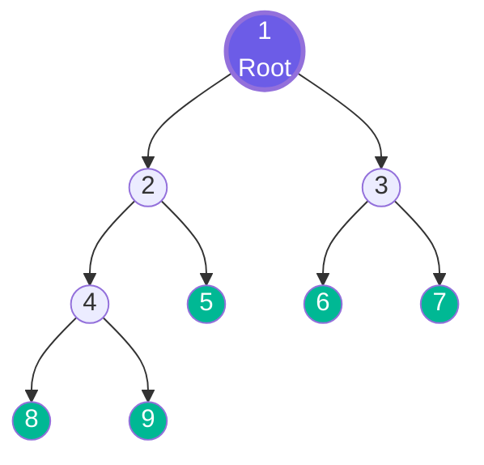
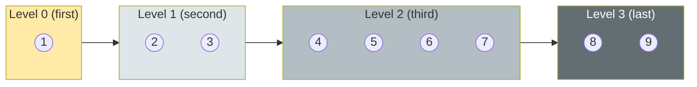
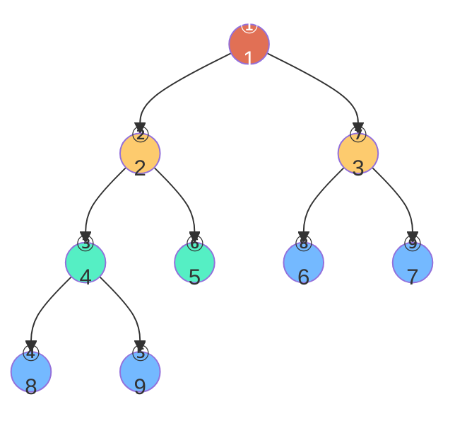
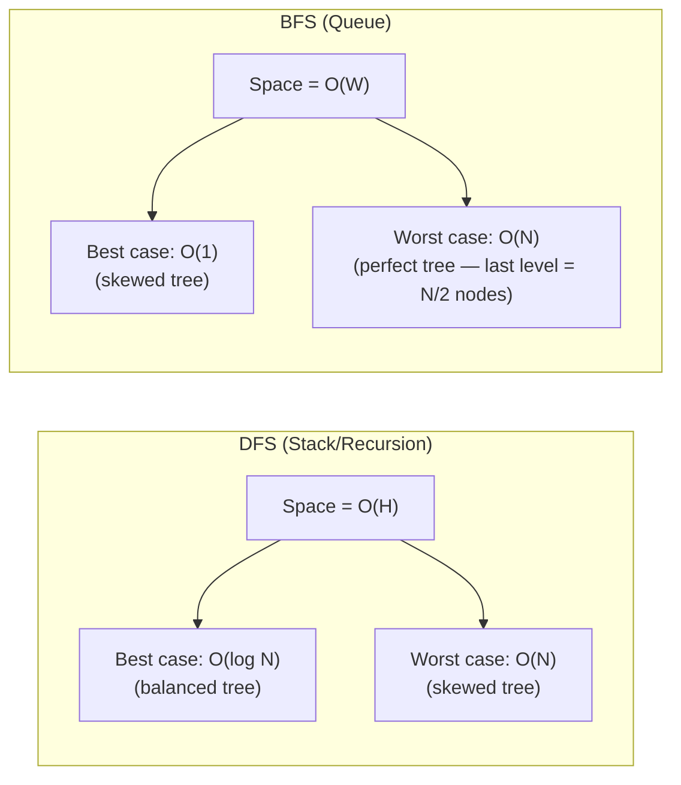

# Chapter 3: Tree Traversals 🗺️

---

## 👶 Explain Like I'm 5

Imagine you have a giant **treasure map** that looks like a tree. The treasure is hidden at one of the leaves, and you need to **visit every single room** in the mansion to find it.

The question is: **in what order do you visit the rooms?**

You can visit rooms in four completely different orders, and each order is useful for a different goal:

1. **Level-Order (BFS)**: Start at the front door, visit every room on **Floor 1** first, then every room on **Floor 2**, then **Floor 3**, etc. You see all rooms at the same depth before going deeper.

2. **Pre-Order**: Enter a room, **look around immediately**, then go left, then go right. You see the current room *before* its children.

3. **In-Order**: Go all the way **left** first, then look at the current room, then go **right**. In a BST, this visits everything in sorted order!

4. **Post-Order**: Go left, go right, then look at the current room **last**. You process children *before* their parent — like demolishing a building floor by floor from the top down.

---

## 🌳 The Tree We'll Use Throughout This Chapter



---

## Traversal 1: Level-Order (BFS) 🏊

**Order**: Visit every node level by level, left to right, top to bottom.

**Result for our tree**: `[1, 2, 3, 4, 5, 6, 7, 8, 9]`

**Mechanism**: Uses a **Queue (FIFO)**. Process a node, add its children to the back of the queue.

### Step-by-Step

```
Queue: [1]           → Process 1. Add children 2, 3.
Queue: [2, 3]        → Process 2. Add children 4, 5.
Queue: [3, 4, 5]     → Process 3. Add children 6, 7.
Queue: [4, 5, 6, 7]  → Process 4. Add children 8, 9.
Queue: [5, 6, 7, 8, 9] → Process 5. No children.
...and so on
```



### Python Implementation

```python
from collections import deque
from typing import Optional

def level_order(root: Optional[TreeNode]) -> list[list[int]]:
    """Returns nodes grouped by level. O(N) time, O(W) space (W = max width)."""
    if not root:
        return []
    result = []
    queue = deque([root])

    while queue:
        level_size = len(queue)     # ← KEY: snapshot of current level's size
        current_level = []

        for _ in range(level_size):
            node = queue.popleft()
            current_level.append(node.val)
            if node.left:  queue.append(node.left)
            if node.right: queue.append(node.right)

        result.append(current_level)

    return result
# → [[1], [2,3], [4,5,6,7], [8,9]]
```

**When to use**: Finding shortest paths in unweighted trees/graphs, level-by-level processing, minimum depth.

---

## Traversal 2: Pre-Order (Root → Left → Right) 🎯

**Mnemonic**: **N**ow, **L**eft, **R**ight — "I visit myself NOW, then go left, then right"

**Result for our tree**: `[1, 2, 4, 8, 9, 5, 3, 6, 7]`



*Numbers in circles show the visit order.*

### Recursive Implementation

```python
def pre_order_recursive(root: Optional[TreeNode]) -> list[int]:
    """Root → Left → Right. O(N) time, O(H) space."""
    result = []
    def dfs(node):
        if not node: return
        result.append(node.val)  # ① Process ROOT first
        dfs(node.left)           # ② Then LEFT subtree
        dfs(node.right)          # ③ Then RIGHT subtree
    dfs(root)
    return result
```

### Iterative Implementation (with Stack)

```python
def pre_order_iterative(root: Optional[TreeNode]) -> list[int]:
    if not root: return []
    result = []
    stack = [root]

    while stack:
        node = stack.pop()
        result.append(node.val)
        # Push RIGHT first so LEFT is processed first (LIFO)
        if node.right: stack.append(node.right)
        if node.left:  stack.append(node.left)

    return result
```

**When to use**: Serializing/copying a tree, creating a "prefix" representation, top-down computation where parent value is needed first.

---

## Traversal 3: In-Order (Left → Root → Right) 🔤

**Mnemonic**: **L**eft, **N**ow, **R**ight — "Visit everything to my left, THEN me, THEN everything to my right"

**Result for our tree**: `[8, 4, 9, 2, 5, 1, 6, 3, 7]`

**⭐ CRITICAL INSIGHT**: In-order traversal of a **BST** always yields elements in **sorted (ascending) order**. This is THE defining property — a BST guarantees that in-order traversal = sorted array.


### Recursive Implementation

```python
def in_order_recursive(root: Optional[TreeNode]) -> list[int]:
    """Left → Root → Right. Yields SORTED output for BST. O(N) time, O(H) space."""
    result = []
    def dfs(node):
        if not node: return
        dfs(node.left)           # ① Dive ALL the way LEFT first
        result.append(node.val)  # ② Process ROOT (when left is done)
        dfs(node.right)          # ③ Then RIGHT subtree
    dfs(root)
    return result
```

### Iterative Implementation (with Stack)

The iterative version reveals the true mechanics of DFS:

```python
def in_order_iterative(root: Optional[TreeNode]) -> list[int]:
    result = []
    stack  = []
    curr   = root

    while curr or stack:
        # Go as far LEFT as possible — push every node
        while curr:
            stack.append(curr)
            curr = curr.left

        # Backtrack: process the node
        curr = stack.pop()
        result.append(curr.val)

        # Now explore its RIGHT subtree
        curr = curr.right

    return result
```

**When to use**: BST sorted-order operations, BST validation (check if in-order output is strictly increasing), k-th smallest element in BST.

---

## Traversal 4: Post-Order (Left → Right → Root) 🏗️

**Mnemonic**: **L**eft, **R**ight, **N**ow — "Deal with both my children BEFORE I deal with myself"

**Result for our tree**: `[8, 9, 4, 5, 2, 6, 7, 3, 1]`

This is a **bottom-up** traversal — leaves are processed first, root is processed last.


### Recursive Implementation

```python
def post_order_recursive(root: Optional[TreeNode]) -> list[int]:
    """Left → Right → Root. Bottom-up computation. O(N) time, O(H) space."""
    result = []
    def dfs(node):
        if not node: return
        dfs(node.left)           # ① LEFT subtree first
        dfs(node.right)          # ② RIGHT subtree second
        result.append(node.val)  # ③ Process ROOT LAST
    dfs(root)
    return result
```

**When to use**: Deleting a tree (can't delete parent before children), computing subtree heights/sizes from leaves up, expression tree evaluation, Tree Diameter and Maximum Path Sum problems (Pattern 12).

---

## 🔑 The Big 4: Side-by-Side Comparison

| Property | Level-Order (BFS) | Pre-Order | In-Order | Post-Order |
|----------|-------------------|-----------|----------|------------|
| **Order** | Level by level | Root → L → R | L → Root → R | L → R → Root |
| **Structure used** | Queue | Stack / Recursion | Stack / Recursion | Stack / Recursion |
| **Space** | O(W) — max width | O(H) | O(H) | O(H) |
| **Time** | O(N) | O(N) | O(N) | O(N) |
| **Best for** | Shortest path, level-by-level | Serialization, copy, prefix | BST sorted order | Delete tree, height/size, expression eval |
| **BST sorted order** | ❌ | ❌ | ✅ | ❌ |
| **Root seen** | First | First | Middle | Last |
| **Leaves seen** | Last | Second-to-last ish | Intermixed | First |

> [!TIP]
> **Memory device for the 3 DFS traversals:**
> - **Pre** = parent **before** children (NLR)
> - **In** = parent **in-between** children (LNR)
> - **Post** = parent **after** children (LRN)
>
> The only thing that changes is **where you put the ROOT processing step** relative to the recursive calls.

---

## 🧠 The Call Stack Visualization

This is the hardest thing to internalize. Here's what Python's call stack actually looks like during an in-order traversal of a simple 3-node tree (`root=2, left=1, right=3`):

```
in_order(2)
  │
  ├─► in_order(1)              ← Dive LEFT
  │     ├─► in_order(None)     ← Hit bottom, return
  │     ├─► PROCESS: append 1  ← ✅ Visit 1
  │     └─► in_order(None)     ← No right child, return
  │
  ├─► PROCESS: append 2        ← ✅ Visit 2 (after left subtree done)
  │
  └─► in_order(3)              ← Dive RIGHT
        ├─► in_order(None)     ← Hit bottom, return
        ├─► PROCESS: append 3  ← ✅ Visit 3
        └─► in_order(None)     ← No right child, return

Final result: [1, 2, 3] ← SORTED! ✅
```

The call stack IS the "backtracking trail" — when `in_order(1)` returns, execution picks up right where it left off in `in_order(2)`, continuing to process node 2.

---

## 🐍 Python Generator Pattern

For large trees, Python generators are memory-efficient — they don't build the entire list upfront:

```python
from typing import Generator, Optional

def in_order_gen(node: Optional[TreeNode]) -> Generator[int, None, None]:
    """Lazy in-order traversal using generators. O(H) space at any moment."""
    if node:
        yield from in_order_gen(node.left)
        yield node.val
        yield from in_order_gen(node.right)

# Usage: only materializes one value at a time
for val in in_order_gen(root):
    if val == target:
        break  # Stop early — we don't need to traverse the rest!
```

---

## 🏁 DFS vs BFS Space Comparison



**Counterintuitive insight**: For a **perfect** tree, BFS uses **O(N/2) = O(N)** space because the last level alone has N/2 nodes in the queue simultaneously. DFS only uses O(log N) space. So for wide, balanced trees, **DFS is more memory-efficient than BFS**.

---

## ⚠️ Common Pitfalls

| Pitfall | Explanation |
|---------|------------|
| **Forgetting the base case** | `if not node: return` is mandatory in every recursive traversal. Without it, you'll hit a NullPointerException. |
| **Mutating the shared path list** | When collecting root-to-leaf paths, always `path.append(val)` before recursion and `path.pop()` after. Without the `pop()`, the path "bleeds" into other branches. |
| **Confusing in-order BST output** | In-order of a BST → sorted. But in-order of a **generic binary tree** is NOT sorted! |
| **BFS without a visited set** | For **trees**, BFS doesn't need a visited set (no cycles). For **graphs**, it's mandatory. |
| **Level-order vs simple BFS** | Level-order groups by level (using `len(queue)` snapshot). Simple BFS just processes in order without grouping. |

---

*← [Chapter 2: Binary Trees](02_binary_trees.md) | [Chapter 4: Binary Search Trees →](04_binary_search_trees.md)*
