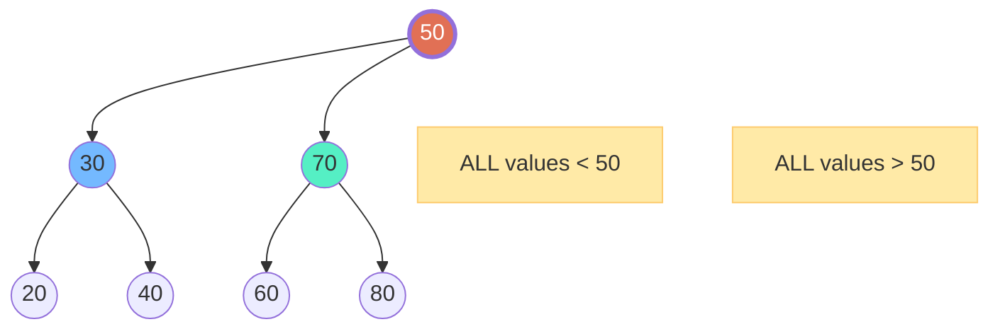
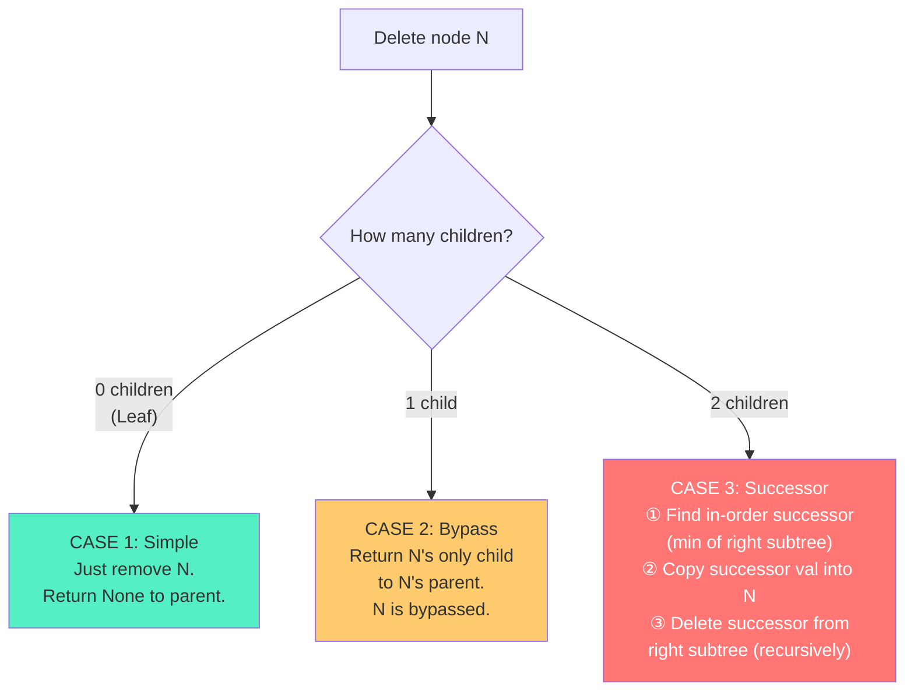
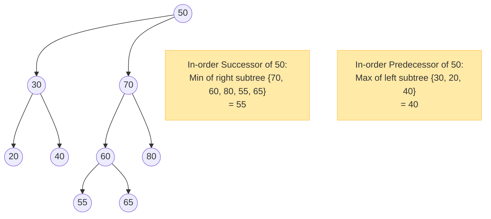
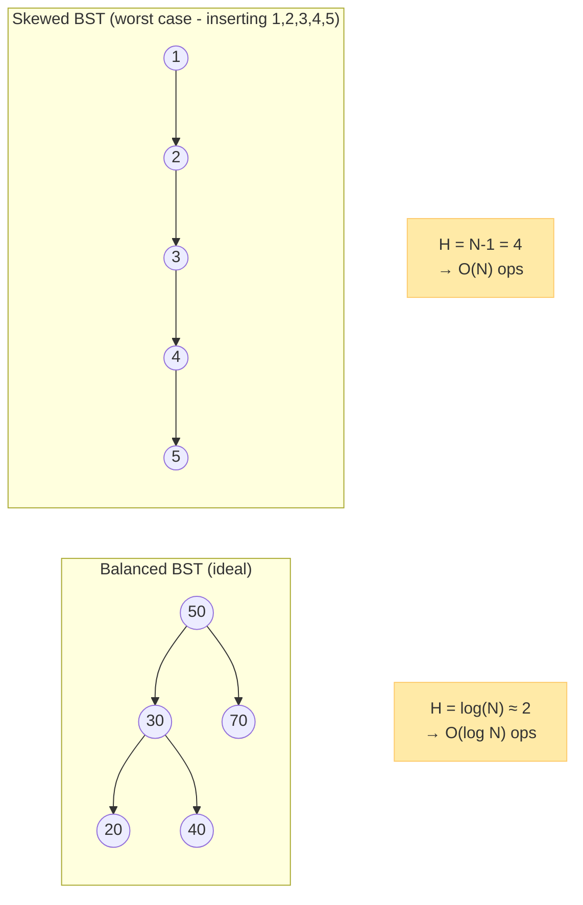

# Chapter 4: Binary Search Trees (BST) 🔍

---

## 👶 Explain Like I'm 5

Imagine a **dictionary** on your bookshelf. If you're looking for the word "Mango", you don't start from page 1 and read every single word! You open to the middle. If you're in the M's — great, search this half. If you're in the S's — search the first half.

A **Binary Search Tree (BST)** is a binary tree that works exactly like a dictionary. At **every single node**, a golden rule is strictly enforced:

> 🏆 **The BST Property**: Everything in the **left subtree** is **LESS THAN** the root. Everything in the **right subtree** is **GREATER THAN** the root. This rule applies at **every** node, not just the root.

This property lets you discard half the remaining tree at every step — just like a dictionary!

---

## 📜 The BST Property (Formally)

For **every** node `N` in a BST:
- `max(N.left subtree)  < N.val`
- `min(N.right subtree) > N.val`



> [!IMPORTANT]
> The BST property must hold for **ALL descendants**, not just direct children!
> A common trap: placing `35` as a right child of `30` — valid locally (`35 > 30`). But `35 < 50` means it should be in the LEFT subtree of `50`. So `35` placed as the right child of `30` is ✅ valid in a BST rooted at `50`.
> But placing `55` as the right child of `30` is ❌ INVALID — `55 > 50`, it belongs in the right subtree of `50`, not left.

---

## 🔧 Core Operations Deep-Dive

### Operation 1: Search — `O(H)`

Starting at root, at each node ask: "Is my target smaller, larger, or equal?"

```python
def search(root, target):
    curr = root
    while curr:
        if target == curr.val:   return True   # Found!
        elif target < curr.val:  curr = curr.left   # Go LEFT
        else:                    curr = curr.right  # Go RIGHT
    return False  # Fell off the tree — not found
```

**Trace**: Searching for `60` in the tree above:
```
At 50: 60 > 50 → go RIGHT
At 70: 60 < 70 → go LEFT
At 60: 60 == 60 → FOUND! ✅
(Only visited 3 nodes out of 7)
```

### Operation 2: Insert — `O(H)`

Search for where the value *would* be, then insert it there.

```python
def insert(root, val):
    if not root:
        return TreeNode(val)  # Base case: empty spot found
    if val < root.val:
        root.left  = insert(root.left, val)
    elif val > root.val:
        root.right = insert(root.right, val)
    # If val == root.val, ignore duplicates (or handle as needed)
    return root
```

**Trace**: Inserting `45` into the tree above:
```
At 50: 45 < 50 → go LEFT
At 30: 45 > 30 → go RIGHT
At 40: 45 > 40 → go RIGHT
At None: INSERT 45 here as right child of 40 ✅
```

### Operation 3: Delete — `O(H)` (The Tricky One)

Three distinct cases, and each requires different handling:



```python
def delete(root, val):
    if not root: return None

    if val < root.val:
        root.left  = delete(root.left, val)
    elif val > root.val:
        root.right = delete(root.right, val)
    else:
        # Found the node to delete!
        if not root.left:  return root.right  # Case 1 or 2 (no left child)
        if not root.right: return root.left   # Case 2 (no right child)

        # Case 3: Two children — find in-order successor
        successor = root.right
        while successor.left:
            successor = successor.left
        root.val   = successor.val             # Copy successor's value
        root.right = delete(root.right, successor.val)  # Delete successor

    return root
```

**Trace**: Deleting `50` (the root, which has 2 children):
```
1. Find in-order successor of 50: min of right subtree {70, 60, 80}
   → Go right to 70, then go left to 60. 60 has no left child.
   → In-order successor = 60

2. Copy 60 into root's val. Tree root now holds value 60.

3. Delete 60 from right subtree:
   → 60 is a leaf there. Remove it.

Result: Root = 60, left subtree unchanged, right = {70, 80}
```

---

## 🏆 The In-Order Successor & Predecessor

These concepts appear constantly in BST interview problems.

| Term | Definition | How to Find |
|------|-----------|------------|
| **In-Order Successor** | The **next larger** value after a given node in the BST. The node that would come *right after* this one in sorted order. | If node has a right subtree: `min(right subtree)`. If not: walk up ancestors until you find one where you came from the left. |
| **In-Order Predecessor** | The **next smaller** value before a given node. | If node has a left subtree: `max(left subtree)`. If not: walk up ancestors until you find one where you came from the right. |



---

## 📈 Complexity Analysis: The Full Picture

All BST operations are `O(H)` — the HEIGHT of the tree. The question is: what is H?



| Scenario | Height H | Search | Insert | Delete |
|----------|---------|--------|--------|--------|
| **Balanced BST** | `O(log N)` | O(log N) | O(log N) | O(log N) |
| **Skewed (worst case)** | `O(N)` | O(N) | O(N) | O(N) |
| **Random insertions** | `O(log N)` expected | O(log N) | O(log N) | O(log N) |

**Space**: O(H) for the recursive call stack (O(log N) balanced, O(N) worst case).

> [!WARNING]
> **A plain BST gives NO guarantees on balance.** If you insert `[1, 2, 3, 4, 5]` in sorted order, you get a linked list. This is why **AVL Trees** and **Red-Black Trees** were invented (Chapter 5). In Python, `sortedcontainers.SortedList` and in Java, `TreeMap` use Red-Black trees internally to guarantee O(log N).

---

## 💡 The BST ↔ Sorted Array Duality

This is THE fundamental insight about BSTs:

```
In-order traversal of BST  ↔  Sorted array
BST insertion              ↔  Inserting into sorted array at correct position
BST search                 ↔  Binary search on sorted array
BST height                 ↔  log(N) iterations of binary search
```

The BST is essentially a **dynamic sorted data structure** — unlike a sorted array, you can insert and delete without shifting elements.

---

## 🎯 Key BST Interview Patterns

### Validate a BST

```python
def is_valid_bst(root, min_val=float('-inf'), max_val=float('inf')):
    """Check if tree satisfies BST property at every node."""
    if not root: return True
    if not (min_val < root.val < max_val): return False
    return (is_valid_bst(root.left,  min_val, root.val) and
            is_valid_bst(root.right, root.val, max_val))
```

**The trap**: Don't just compare a node with its direct children. You must pass down the valid range (`min_val`, `max_val`) through the entire subtree.

### K-th Smallest Element in BST

```python
def kth_smallest(root, k):
    """In-order traversal stops at the k-th element. O(H + k) time."""
    count = [0]
    result = [None]

    def in_order(node):
        if not node or result[0] is not None: return
        in_order(node.left)
        count[0] += 1
        if count[0] == k:
            result[0] = node.val
            return
        in_order(node.right)

    in_order(root)
    return result[0]
```

### LCA (Lowest Common Ancestor) in BST

```python
def lca_bst(root, p, q):
    """The BST property makes LCA trivial. O(H) time."""
    while root:
        if p.val < root.val and q.val < root.val:
            root = root.left   # Both nodes are in left subtree
        elif p.val > root.val and q.val > root.val:
            root = root.right  # Both nodes are in right subtree
        else:
            return root  # We've diverged — this is the LCA!
```

---

## ⚠️ Common BST Pitfalls

| Pitfall | Correct Approach |
|---------|----------------|
| **Validating BST by only comparing parent-child** | Pass min/max bounds down the recursion |
| **Forgetting BST successor for deletion** | When deleting a 2-child node, find `min(right subtree)`, not just `right.val` |
| **Assuming BST is balanced** | Never assume! Height can be O(N). Always think about worst case. |
| **Duplicate handling** | Clarify with interviewer: ignore duplicates, allow left≤root, or allow root≤right? |

---

*← [Chapter 3: Tree Traversals](03_tree_traversals.md) | [Chapter 5: Balanced Trees →](05_balanced_trees.md)*
