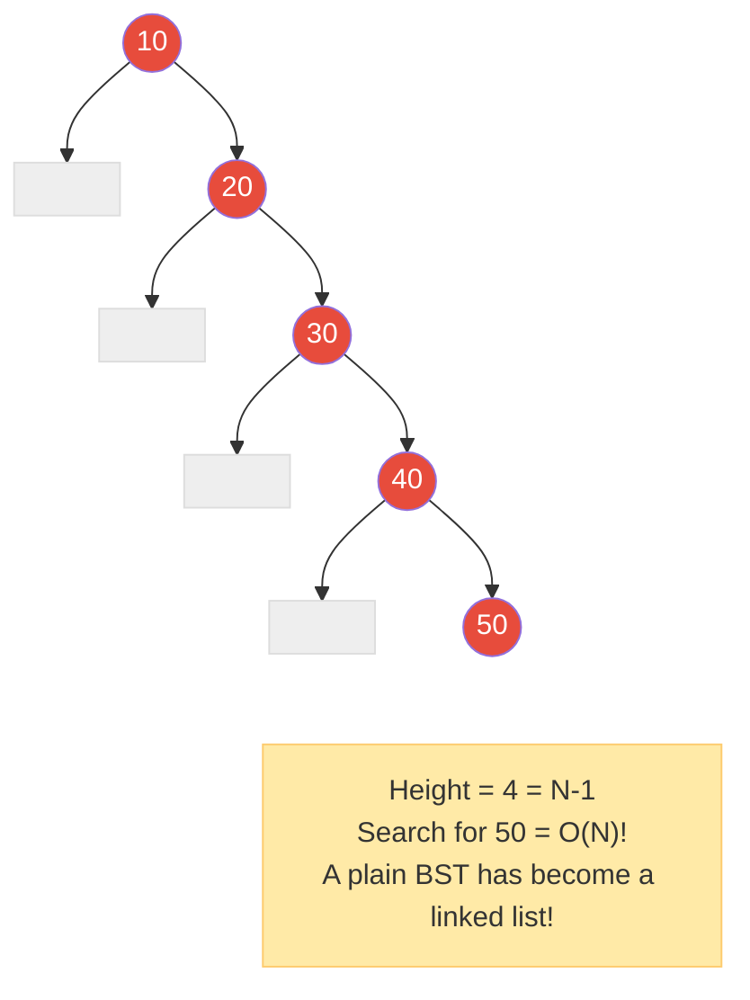
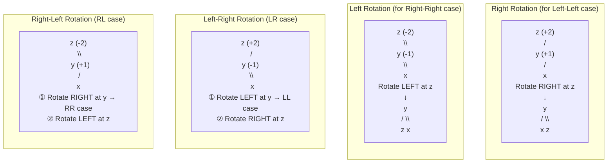
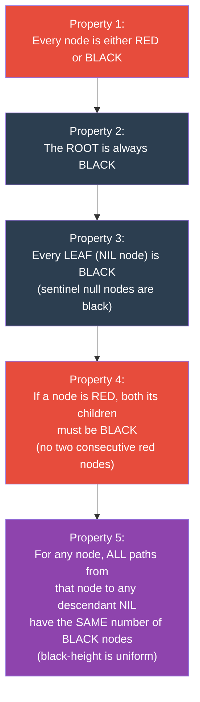
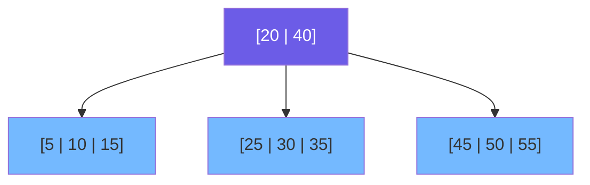
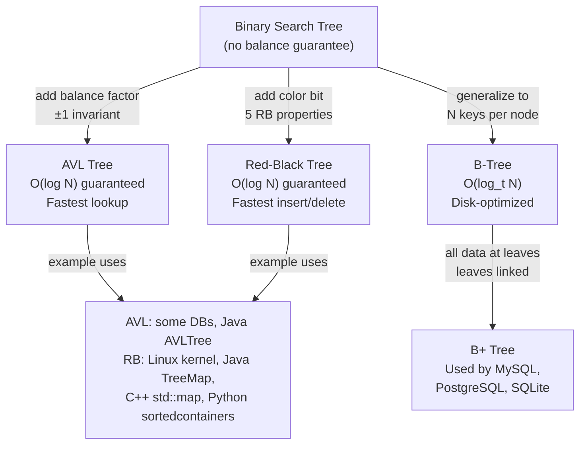

# Chapter 5: Balanced Trees ⚖️

---

## 👶 Explain Like I'm 5

Imagine you're building a **tower of blocks**. A BST is like stacking blocks however they come — if all your blocks arrive in order from smallest to biggest, your tower gets super tall and skinny and falls over!

A **Balanced Tree** is like a smart robot that takes each block you hand it, and if the tower starts leaning too much to one side, it **rearranges the blocks** to keep the tower squat, wide, and sturdy.

That rearranging is called a **rotation**, and the rules that trigger it are what separate AVL trees from Red-Black trees from B-Trees.

---

## 🔥 The Problem: Why Plain BSTs Fail

Insert these values into a BST in order: `[10, 20, 30, 40, 50]`



**Solution**: After every insertion or deletion, automatically *rebalance* the tree so the height stays `O(log N)`.

---

## 🌿 AVL Trees

Named after inventors **A**delson-**V**elsky and **L**andis (1962). The **first** self-balancing BST ever invented.

### The Balance Factor

Every node tracks its **balance factor**:
```
balance_factor(node) = height(left subtree) − height(right subtree)
```

**AVL invariant**: Every node's balance factor must be `−1`, `0`, or `+1`.
- `+1` → left-heavy (left subtree is 1 taller) ✅
- `0`  → perfectly balanced ✅
- `−1` → right-heavy (right subtree is 1 taller) ✅
- `±2` → **VIOLATION** → trigger a rotation to fix it!

### The 4 Rotation Cases

Rotations are local tree restructurings that preserve the BST property while fixing balance.



### AVL Complexity

| Operation | Time | Space |
|-----------|------|-------|
| Search | O(log N) | O(log N) |
| Insert | O(log N) — at most 1 rotation | O(log N) |
| Delete | O(log N) — may need O(log N) rotations | O(log N) |

**AVL trees are more strictly balanced than Red-Black trees** → faster lookups, but more rotations needed on insert/delete.

**Used in**: Python's `sortedcontainers` library (internally uses skip list actually), some database index implementations.

---

## 🔴⚫ Red-Black Trees

Invented by Rudolf Bayer (1972), popularized by Sedgewick. The most widely used self-balancing BST in practice.

### The 5 Red-Black Properties

Every Red-Black tree must satisfy ALL five properties simultaneously:



### Why These Properties Guarantee O(log N)

Properties 4 and 5 together enforce that **the longest path in the tree is at most 2× the shortest path**.
- Shortest path: all black nodes (black-height `bh`)
- Longest path: alternating red-black nodes (2 × black-height)
- Therefore: `height ≤ 2 × bh ≤ 2 × log₂(N+1)` → **O(log N)**

### Red-Black vs AVL

| Criterion | AVL Tree | Red-Black Tree |
|-----------|----------|---------------|
| **Balance** | More strictly balanced | Less strictly balanced |
| **Lookup speed** | ⚡ Slightly faster | Slightly slower |
| **Insert speed** | Slower (more rotations) | ⚡ Faster (at most 2 rotations) |
| **Delete speed** | Slower (O(log N) rotations) | ⚡ Faster (at most 3 rotations) |
| **Memory** | 1 extra int (balance factor) | 1 extra bit (color) |
| **Used in** | Databases needing fast reads | **Linux kernel, Java `TreeMap`, C++ `std::map`** |
| **Best for** | Read-heavy workloads | Mixed read-write workloads |

> [!TIP]
> In interviews, you will almost never be asked to implement an AVL or Red-Black tree from scratch. But you WILL be asked:
> - "Why does Python's `SortedList` / Java's `TreeMap` have O(log N) operations?"
> - "What data structure would you use for a dynamic sorted set?"
> - "Why is insertion into a sorted array O(N) but into a balanced BST O(log N)?"
>
> **The answer**: Balanced BST (Red-Black tree) → guarantees O(log N) for all operations.

---

## 🗄️ B-Trees: The Database Tree

B-Trees are the self-balancing tree used by **every major database and filesystem** (PostgreSQL, MySQL InnoDB, SQLite, Linux ext4, NTFS, macOS HFS+).

### Why Not Just Use Red-Black Trees?

Hard disks and SSDs read data in **pages** (typically 4KB or 16KB). A Red-Black tree node holds ONE key. To find a value in a million-node tree requires ~20 disk accesses (log₂ 1,000,000 ≈ 20) — and each disk access is painfully slow (milliseconds).

A B-Tree node holds **HUNDREDS of keys** and pointers. With branching factor ~1000, a million keys fit in a tree of height 2! Only 2-3 disk accesses instead of 20.

### B-Tree Properties

A **B-Tree of order `m`** (minimum degree `t`):
- Every node has at most `2t − 1` keys
- Every node (except root) has at least `t − 1` keys
- All leaves are at the **same level** (perfectly balanced!)
- Every internal node with `k` keys has `k + 1` children



*Above: A B-Tree of order 2. Root has 2 keys, 3 children. Each node holds multiple keys.*

**B+ Tree** (used by most databases): All data is stored at leaf level. Internal nodes only store routing keys. Leaves are linked together in a linked list for fast range scans.

---

## 🌲 The Balanced Tree Family Overview



---

## 📊 Complexity Comparison

| Data Structure | Search | Insert | Delete | Space |
|---------------|--------|--------|--------|-------|
| Unsorted Array | O(N) | O(1) amortized | O(N) | O(N) |
| Sorted Array | O(log N) | O(N) | O(N) | O(N) |
| Hash Table | O(1) avg | O(1) avg | O(1) avg | O(N) |
| Plain BST | O(N) worst | O(N) worst | O(N) worst | O(N) |
| AVL Tree | O(log N) | O(log N) | O(log N) | O(N) |
| Red-Black Tree | O(log N) | O(log N) | O(log N) | O(N) |
| B-Tree (order t) | O(log_t N) | O(log_t N) | O(log_t N) | O(N) |

> [!NOTE]
> Hash tables have better average-case complexity than balanced BSTs, BUT they don't support **ordered operations** (range queries, predecessor, successor, sorted iteration). Balanced BSTs do, in O(log N).

---

## 🐍 Using Balanced BSTs in Python

Python does NOT include a built-in balanced BST. Use these:

```python
# Option 1: sortedcontainers (pip install sortedcontainers)
from sortedcontainers import SortedList, SortedDict, SortedSet

sl = SortedList([5, 1, 3, 2, 4])
sl.add(0)           # O(log N)
sl.remove(3)        # O(log N)
sl[0]               # O(log N) — smallest element
sl.bisect_left(3)   # O(log N) — index of first element >= 3
# SortedList supports slicing: sl[2:5] is O(log N + k)

# Option 2: Use heapq for partial ordered access (only min/max)
import heapq
heap = [5, 1, 3, 2, 4]
heapq.heapify(heap)     # O(N)
heapq.heappush(heap, 0) # O(log N)
heapq.heappop(heap)     # O(log N) — always removes minimum

# Option 3: Use bisect for sorted list (no automatic rebalancing)
import bisect
arr = [1, 2, 4, 5]
bisect.insort(arr, 3)   # O(N) — but correct sorted insertion position is O(log N) to find
```

---

*← [Chapter 4: Binary Search Trees](04_binary_search_trees.md) | [Chapter 6: Special Trees →](06_special_trees.md)*
