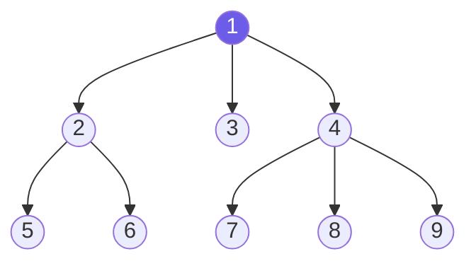
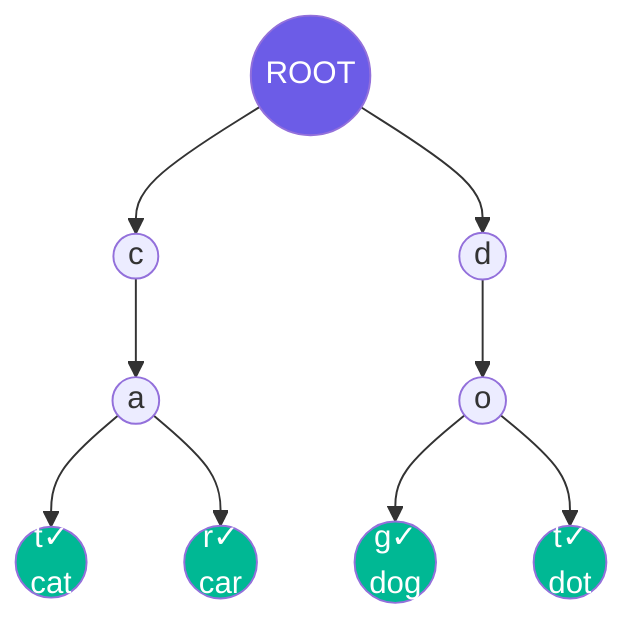
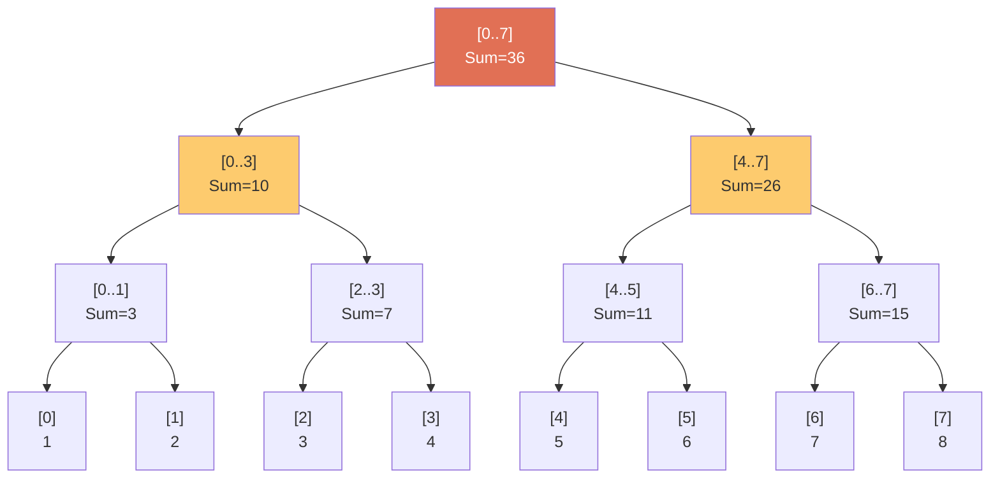
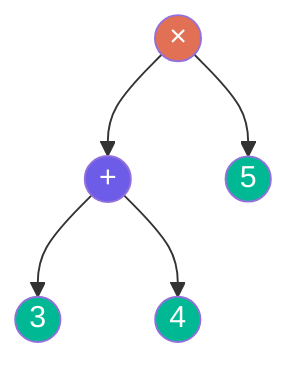
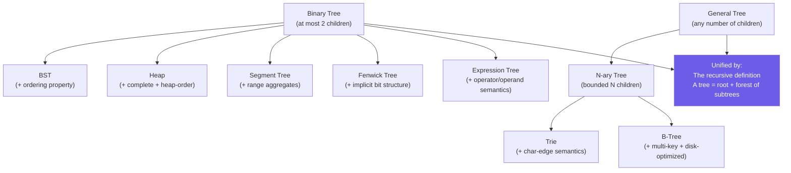

# Chapter 6: Special Trees 🌐

---

## Overview

So far we've covered binary trees (at most 2 children per node). The real world demands more:
- A file system folder can have hundreds of subfolders
- An autocomplete system needs to branch by every possible character
- A database needs to answer "sum of values from index 3 to 97" in milliseconds

Each of these needs a **specialized tree structure**. This chapter maps each one, shows how they relate to binary trees, and connects them to the coding patterns in this repo.

---

## 1. N-ary Trees (General Trees)

### What Is It?
An N-ary tree (also called a **multiway tree** or **rose tree**) allows each node to have **any number of children** — not just 2.



*Node 1 has 3 children. Node 4 has 3 children. This is perfectly valid in an N-ary tree.*

### Python Representation

```python
class NaryNode:
    def __init__(self, val: int, children: list['NaryNode'] = None):
        self.val      = val
        self.children = children or []
```

### Traversals on N-ary Trees

Same concepts as binary trees, just iterate over all children:

```python
def n_ary_level_order(root):
    """BFS — identical logic to binary tree BFS."""
    if not root: return []
    result, queue = [], deque([root])
    while queue:
        level = []
        for _ in range(len(queue)):
            node = queue.popleft()
            level.append(node.val)
            queue.extend(node.children)   # Add ALL children, not just left/right
        result.append(level)
    return result

def n_ary_pre_order(root):
    """DFS pre-order — process root, then each child."""
    if not root: return []
    result = [root.val]
    for child in root.children:
        result.extend(n_ary_pre_order(child))
    return result
```

### The Left-Child Right-Sibling Trick

**Any N-ary tree can be encoded as a binary tree** using this transformation:
- Left child pointer → first child
- Right child pointer → next sibling

```
N-ary tree:          Binary encoding:
    A                    A
  / | \                 /
 B  C  D               B
 |                      \
 E                       C
                          \
                           D
                          /
                         E
```

This is how Huffman coding trees and some recursive descent parsers work internally.

### Pattern Connection
- **Pattern 14**: N-ary Tree Level Order (`11 - Tree Breadth First Search/problem_14_nary_tree_level_order.py`)

---

## 2. Trie (Prefix Tree / Radix Tree)

### What Is It?
A Trie is an N-ary tree where **edges represent characters**. A path from root to any node spells out a prefix; a path to a marked node spells out a complete word.



*Green nodes are "end of word" markers. The trie above stores: cat, car, dog, dot.*

### Key Properties
- **Space**: Shared prefixes are stored ONCE. "cat" and "car" both share the `c → a` path.
- **Search time**: O(L) where L = length of search string. Completely independent of how many words are stored!
- **Alphabet size**: Branching factor = alphabet size (26 for lowercase English, 128 for ASCII, 65536 for Unicode)

### Operations
```python
class TrieNode:
    def __init__(self):
        self.children: dict[str, TrieNode] = {}
        self.is_end_of_word: bool = False

class Trie:
    def __init__(self):
        self.root = TrieNode()

    def insert(self, word: str) -> None:        # O(L)
        node = self.root
        for char in word:
            if char not in node.children:
                node.children[char] = TrieNode()
            node = node.children[char]
        node.is_end_of_word = True

    def search(self, word: str) -> bool:         # O(L)
        node = self.root
        for char in word:
            if char not in node.children: return False
            node = node.children[char]
        return node.is_end_of_word

    def starts_with(self, prefix: str) -> bool:  # O(L)
        node = self.root
        for char in prefix:
            if char not in node.children: return False
            node = node.children[char]
        return True  # prefix exists even if no complete word ends here
```

### Pattern Connection
- **Pattern 26**: Trie (full deep-dive with 5 problems → `26 - Trie/`)
- **Fundamentals 007**: Full implementation → [007 - Trie](../007%20-%20Trie/trie_walkthrough.md)

---

## 3. Segment Tree

### What Is It?
A Segment Tree is a **binary tree** where each node stores the result of an **aggregate function** (sum, min, max, GCD...) over a contiguous **range** of an input array.



*For input array `[1,2,3,4,5,6,7,8]`. Each node stores the sum of its range.*

### Why It's Powerful

| Operation | Naive Array | Segment Tree |
|-----------|------------|--------------|
| Point update | O(1) | O(log N) |
| Range query | O(N) | O(log N) |
| Range update | O(N) | O(log N) |

Without a segment tree: "sum of indices 2..6" requires 5 additions. With segment tree: 2-3 additions.

### Key Insight
A Segment Tree on N elements has:
- Height: `⌈log₂N⌉`
- Total nodes: at most `4N` (stored in an array of size `4N`)

### Pattern Connection
- **Pattern 41**: Segment Tree → `41 - Segment Tree/`

---

## 4. Fenwick Tree (Binary Indexed Tree / BIT)

### What Is It?
A Fenwick Tree is an **implicit** binary tree embedded in a flat array. It's a clever bit-manipulation trick that computes **prefix sums** in O(log N) time and supports **point updates** in O(log N).

```
Index:  1   2   3   4   5   6   7   8
Array: [1] [3] [2] [5] [2] [8] [3] [4]
BIT:   [1] [4] [2] [11] [2] [10] [3] [28]

BIT[i] stores the sum of elements from (i - lowbit(i) + 1) to i
where lowbit(i) = i & (-i)  (the lowest set bit of i)
```

### The Magic of `lowbit`

```python
def lowbit(i): return i & (-i)

# For i = 6 = 0b110:
# -i  = -6 = 0b...11111010 (two's complement)
# i & (-i) = 0b010 = 2
# So BIT[6] covers 2 elements: indices 5 and 6

# For i = 8 = 0b1000:
# lowbit(8) = 8
# BIT[8] covers 8 elements: indices 1 through 8
```

```python
class BIT:
    def __init__(self, n):
        self.n    = n
        self.tree = [0] * (n + 1)  # 1-indexed

    def update(self, i, delta):     # O(log N)
        while i <= self.n:
            self.tree[i] += delta
            i += i & (-i)           # Jump to next responsible node

    def prefix_sum(self, i):        # O(log N)
        total = 0
        while i > 0:
            total += self.tree[i]
            i -= i & (-i)           # Jump to parent
        return total

    def range_sum(self, l, r):      # O(log N)
        return self.prefix_sum(r) - self.prefix_sum(l - 1)
```

### Segment Tree vs Fenwick Tree

| Criterion | Segment Tree | Fenwick Tree (BIT) |
|-----------|-------------|-------------------|
| **Complexity** | O(log N) | O(log N) |
| **Constants** | Slower | ⚡ ~2-3x faster |
| **Code length** | Longer | ⚡ Very concise |
| **Memory** | 4N | N |
| **Range updates** | ✅ Yes | Needs modification |
| **Arbitrary ranges** | ✅ Yes | Prefix sums only (range = prefix diff) |
| **Functions supported** | Any (min, max, GCD, XOR...) | Only **invertible** functions (sum, XOR) — NOT min/max |

### Pattern Connection
- **Pattern 42**: Binary Indexed Tree → `42 - Binary Indexed Tree/`

---

## 5. Heap (Binary Heap)

### Relationship to Binary Trees
A **Heap** is a **Complete Binary Tree** with a **heap-order property**:
- **Min-Heap**: `parent.val ≤ child.val` for all nodes. Root = global minimum.
- **Max-Heap**: `parent.val ≥ child.val` for all nodes. Root = global maximum.

It's stored as an **array** using the complete binary tree index formulas from Chapter 2.

```
Min-Heap tree:        Array representation:
       1               [1, 2, 3, 5, 7, 6, 4]
      / \               0  1  2  3  4  5  6
     2   3
    / \ / \
   5  7 6  4
```

### Operations
| Operation | Time | Note |
|-----------|------|------|
| `heappush` | O(log N) | Sift up |
| `heappop` | O(log N) | Sift down |
| `heapify` | **O(N)** | Not O(N log N)! Build from bottom up |
| Peek min | O(1) | `heap[0]` |

### Pattern Connection
- **Fundamentals 006**: Full implementation → [006 - Min and Max Heap](../006%20-%20Min%20and%20Max%20Heap/heap_walkthrough.md)
- **Pattern 15**: Two Heaps
- **Pattern 19**: Top K Elements

---

## 6. Expression Trees

### What Is It?
An expression tree is a binary tree where:
- **Leaves** are **operands** (numbers, variables)
- **Internal nodes** are **operators** (`+`, `-`, `×`, `/`)



*This expression tree represents `(3 + 4) × 5 = 35`*

### Traversal → Notation Mapping

| Traversal | Output | Notation |
|-----------|--------|---------|
| **In-order** | `3 + 4 × 5` | Infix (human-readable, needs parentheses) |
| **Pre-order** | `× + 3 4 5` | **Prefix** / Polish Notation |
| **Post-order** | `3 4 + 5 ×` | **Postfix** / Reverse Polish Notation (RPN) — used by calculators, stack evaluation |

---

## 🗺️ Special Trees: The Complete Map



---

*← [Chapter 5: Balanced Trees](05_balanced_trees.md) | [Chapter 7: Trees Cheat Sheet →](07_trees_cheat_sheet.md)*
